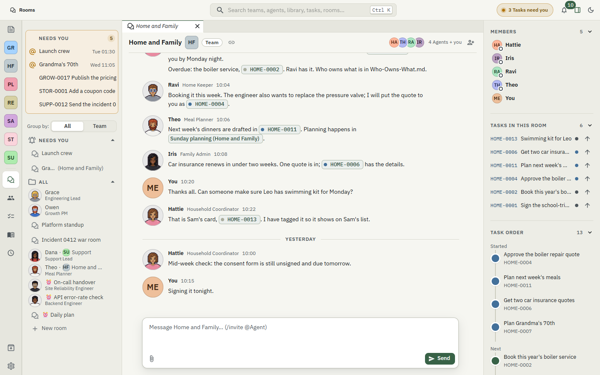
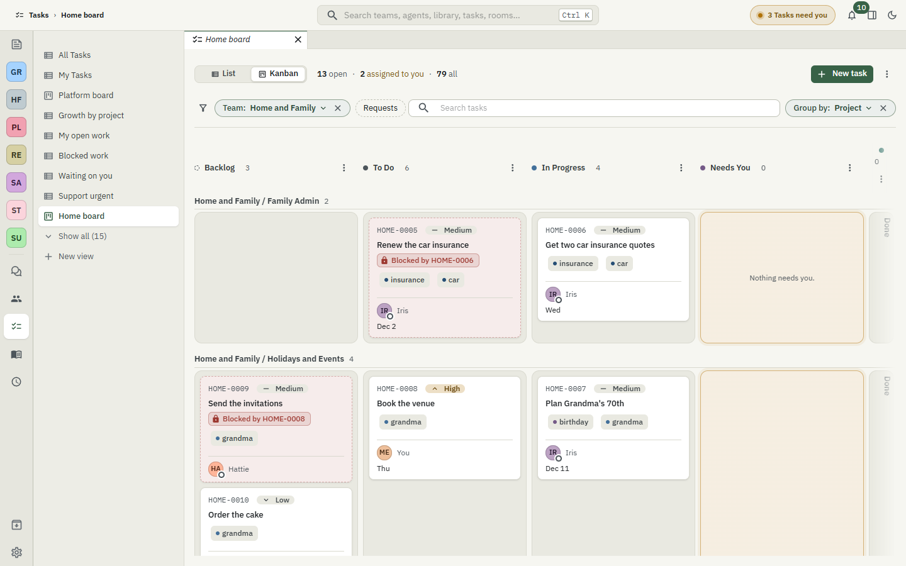
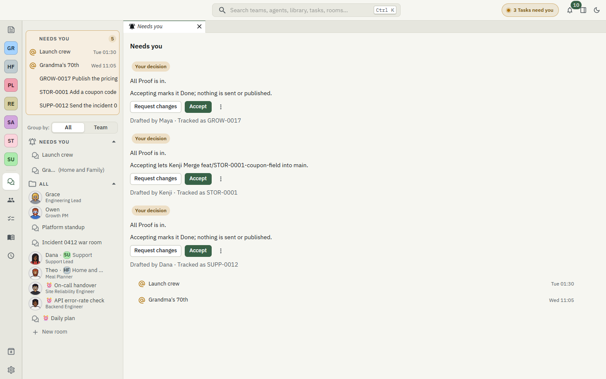
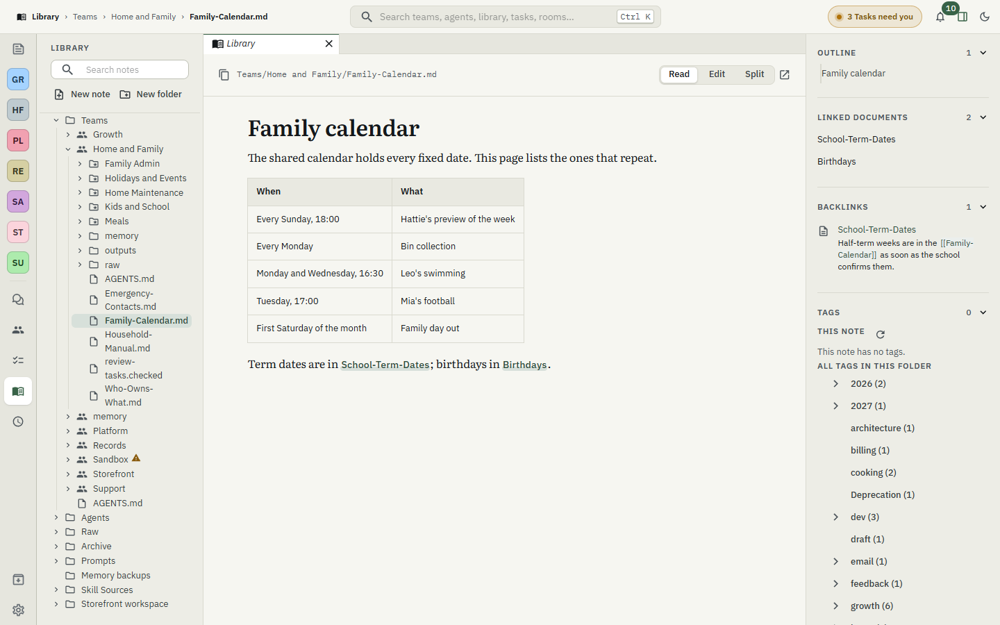
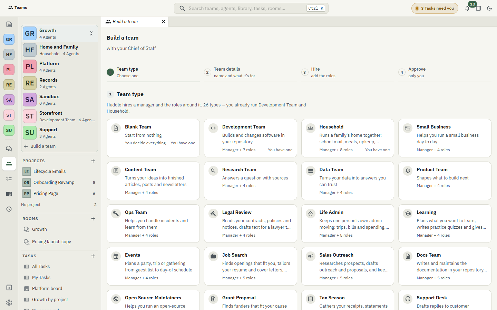
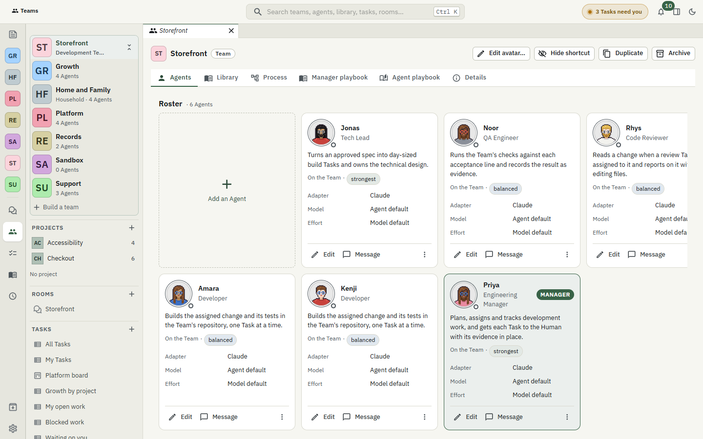
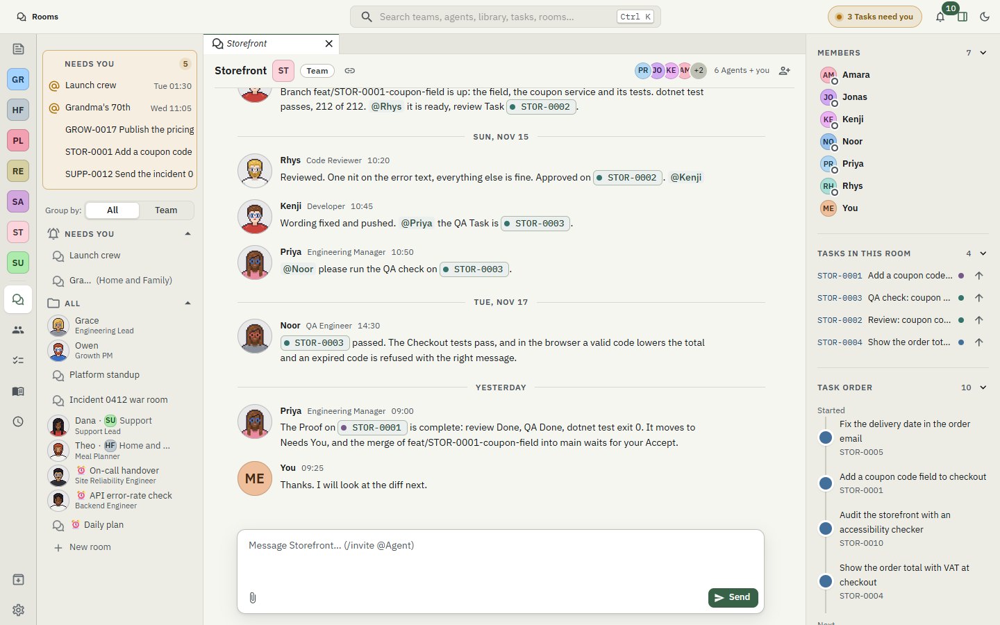
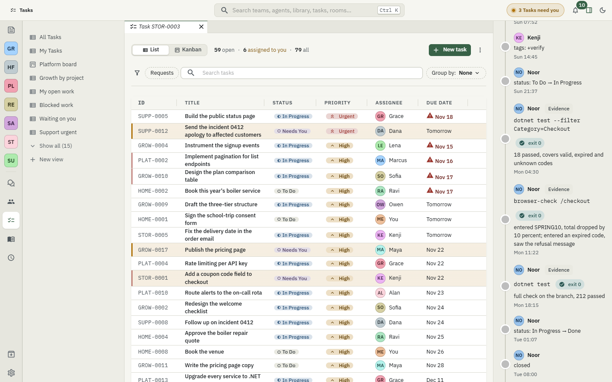
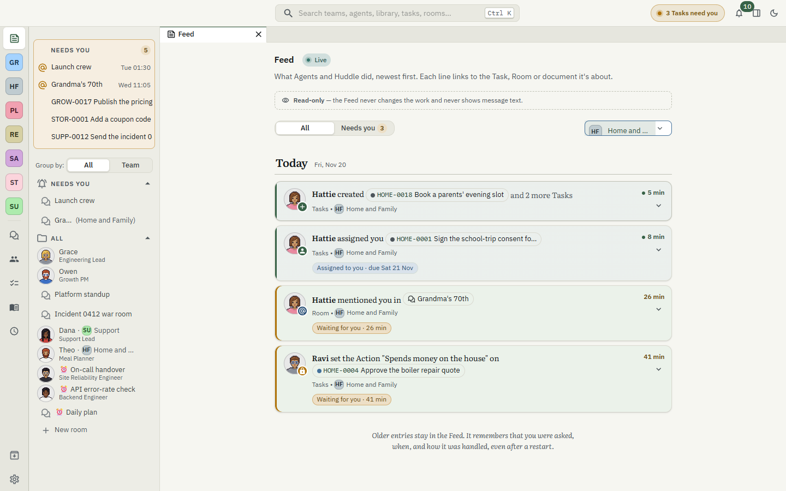
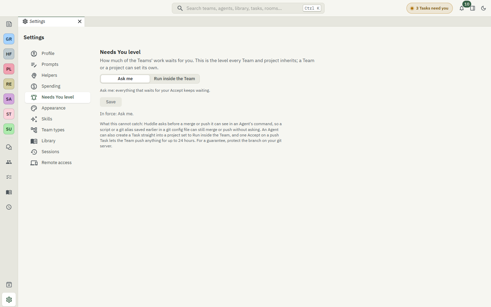

# Agency.Huddle

**A team of AI specialists that works for you, and a second brain that remembers
everything they learn, kept as plain files on your own machine.**

You talk to your Agents in chat, the way you would talk to colleagues. Each one has
one job and knows only its part of your life: school, meals, the house, your work.
What matters in a conversation does not stay in the scrollback. It is filed as a
Task, a remembered fact or a document, so the next Agent who needs it finds it
without you repeating yourself.

```text
#  home · kids-and-school                                   You, Hattie, Iris

   Hattie   Three school emails tonight. Filed: the museum trip is next
            Thursday, Ms Patel is Mia's new teacher. One needs you:
            HOME-0001 Sign the consent form, due tomorrow. It waits for you.
   Iris     The trip is the day you fly to the offsite. I've put the
            pick-up on Sam's list instead. Your call.
   You      Good. Sam does pick-up.
   Hattie   Noted. This week's school feed is in outputs/School-Feed.md.
```

Hattie read the emails. Iris knew about the trip only because Hattie filed it,
and spotted the clash only because your travel was already on record. Neither
was told.

## Two ideas that need each other

**Agent teams without a second brain have amnesia.** Every specialist starts from
zero, you brief them again each time, and what they produce disappears into chat.

**A second brain without agents is a filing cabinet you maintain yourself.**
Capturing, filing, linking and summarising is work, and it is the work that
usually stops happening.

In Huddle they are one design. A specialist is useful because its context is
small and relevant, and a second brain is useful because it is organised by
area. **The scope that keeps an Agent focused is the same scope that organises
what it remembers.** A Team's folder is both its workspace and its memory:

```text
Teams/Home and Family/
  AGENTS.md    how we work here, in your words
  raw/         what came in, kept exactly as it arrived (emails, letters, photos)
  memory/      what we know, one topic per file
  outputs/     what we made (the weekly feed, a plan, a comparison of quotes)
  _tasks/      what needs doing, who owns it, and the proof it was done
```

Tasks are where the two halves meet. A Task is remembered like any other fact,
and it is how Agents hand work to each other and to you. Everything is Markdown,
so you can open it, edit it or back it up with the tools you already use.

## See it

A short tour of the screens, all from Huddle's demo data.

### A Team talks in a Room

Each Agent has one job, and you talk to them like a group chat. Alone with you, an
Agent answers everything; in a bigger Room, it answers when you mention it, like
`@hattie`. You are in every Room, so you see all the work. What the Team agrees on
becomes Tasks, the blue chips.



### Work lives in Tasks

Chat is for talking; Tasks are where the work lives. Every Task has one owner, a
status and a due date, and assigning one to an Agent wakes it up to do it. One
Markdown file per Task, which you can edit by hand.



### Some things wait for you

Anything that leaves the house, like paying, sending, publishing or merging code,
waits in **Needs you** with its proof. Each decision says what **Accept** will do.



### Nothing gets lost in a chat

Every Team keeps the same folders: `raw/` for what came in, `memory/` for facts
worth keeping, `outputs/` for documents worth reading again, and `AGENTS.md` for
the rules. They are linked Markdown notes, so the Library reads like your own
wiki, and any editor can open them.



### A development team in your repository

Hire a whole team from the **Development Team** type: a manager, a tech lead,
developers, a reviewer, QA and more, each its own Agent, so the critic did not
write the work.





The manager splits your request into Tasks, the developer works on a branch named
after its Task, and the reviewer and QA report back in the Team's Room.



Huddle checks the process rather than trusting it: a Task cannot close until QA has
recorded a test run as Evidence, a merge waits for the check command to pass, and
merging into main waits for your Accept.



### Catch up, and stay in control

The Feed lists what your Agents did while you were away. The **Needs You level**
decides how much waits for you, and says plainly what it cannot catch.





### Take the tour in Claude

The screens above are a preview. The tour is a conversation: Claude shows you
around at your pace, and you can stop at any point to ask how something works,
what it costs or whether it fits what you have in mind. It answers from the user
guide, and it ends by sketching a first Team for whatever you tell it is on your
plate. Nothing is installed. Paste this into Claude Code or Claude Cowork:

```text
Give me a tour of Agency.Huddle. Fetch only the tour/ folder of
https://github.com/emreaydinceren/Agency.Huddle (a shallow, sparse git clone; if git isn't
available, download the repository ZIP) and follow tour/TOUR.md.
```

## What it will not do

- **It does not spend your money or sign for you.** An Agent can compare two
  quotes; a Human-gated Task waits in **Needs you** until you accept it.
- **It does not read your mail or calendar by default.** Account connectors are
  off for every Agent until you switch them on, one Agent at a time.
- **It does not run away.** Each Room has a budget of Agent replies that any
  message from you resets, and every Agent has a token budget. **Stop** cancels a
  turn in progress.
- **It does not keep your life in someone else's database.** Rooms, Tasks, memory
  and documents are files under your own folders.

## Why it is built this way

Every significant choice has a decision record that says what was chosen, what
was rejected and why. Four that shape the product:

| Choice | Over | Record |
| --- | --- | --- |
| The same `raw/`, `memory/`, `outputs/` layout in every Team | A free-form notes folder | [ADR-0075](docs/adr/0075-a-second-brain-layout-in-every-team.md) |
| A Human-gated Task waits for your acceptance | Agents that mark their own work done | [ADR-0061](docs/adr/0061-a-human-gated-task-waits-in-needs-you-for-the-humans-acceptance.md) |
| Connectors reach your account only when you switch them on | One login shared by every Agent | [ADR-0080](docs/adr/0080-an-agent-reaches-the-humans-account-connectors-only-when-the-human-switches-them-on.md) |
| A Room has a reply budget | Trusting Agents to stop on their own | [ADR-0006](docs/adr/0006-a-room-has-a-budget-for-agent-replies.md) |

Every record is listed in [docs/Index.md](docs/Index.md#4-decisions-adrs). The longer
argument for agents as colleagues rather than a pipeline, and what is still
unsolved, is in [docs/why-agency-huddle.md](docs/why-agency-huddle.md).

## Try it

One command installs it, with no admin rights and nothing installed first. On
Windows, in a normal PowerShell window:

```powershell
irm https://github.com/emreaydinceren/Agency.Huddle/releases/latest/download/install.ps1 | iex
```

On macOS, in Terminal:

```sh
curl -fsSL https://github.com/emreaydinceren/Agency.Huddle/releases/latest/download/install.sh | sh
```

It opens in your browser, and the **Chief of Staff** is the first Agent you meet:
tell it what you want help with and it proposes a Team. Start Huddle later with
`huddle` and stop it with `huddle stop`. If you are not signed in to Claude yet,
the installer prints `claude auth login` for you to run once.

> [!CAUTION]
> **Real Agents spend real money.** Each Agent is a live Claude session billed to
> your account. The budgets above limit a runaway, but a busy Team still costs
> more than a single chat.

Run it on your own machine. It has no sign-in of its own, and an Agent's work
directory is real disk, not a sandbox. Everything deliberately left out is listed
with its reasoning in [Known limits](docs/engineering/known-limits.md).

[The user guide](docs/Huddle.UserGuide.md) walks through Rooms, Teams, Tasks, the
Library and the Second Brain.

## Build it from source

You need the .NET 11 SDK. For a first run that spends nothing, turn the Agent
process off, because the development configuration starts one per Agent:

```powershell
$env:Team__Acp__Enabled = 'false'
dotnet run --project src/Huddle.App --urls http://localhost:5100
```

Build and test the whole solution. The trailing `--` is required; without it the
run reports "Zero tests ran", which reads as success:

```powershell
dotnet build Huddle.slnx
dotnet test  Huddle.slnx --
```

Warnings are errors, and the analyzers run inside the build, so a style or
correctness rule fails the build rather than waiting for review. The suite has
about 17,000 tests and never starts a real session. CI repeats restore, build and
test on every pull request, with a secret scan and a vulnerable-dependency check.

Start at [docs/Index.md](docs/Index.md), which routes you to the one page that
owns each answer. [docs/Huddle.EngineeringGuide.md](docs/Huddle.EngineeringGuide.md)
holds the design of the app.

## How Agents connect

The app drives each Agent as a Claude session over the
[Agent Client Protocol](https://agentclientprotocol.com), through the official
adapter, which reuses your existing `claude` login, so no API key is needed. Tool
bodies run inside the app, so an Agent can create a Room or a Task without ever
touching storage directly.

`src/Huddle.Console` is the terminal proof of concept the app grew from: one
Claude agent driven from C#, with streamed replies and human-in-the-loop
approvals. What it found about the protocol that its reference does not say is in
[docs/engineering/acp-agent-guide.md](docs/engineering/acp-agent-guide.md).

## Licence

[Apache License 2.0](LICENSE). Use it, fork it, ship it. The licence includes an
express patent grant, so adopting it leaves no patent question open.

`claude-agent-acp`, the adapter this project drives, is a separate work under its
own licence. Nothing here vendors or redistributes it.
