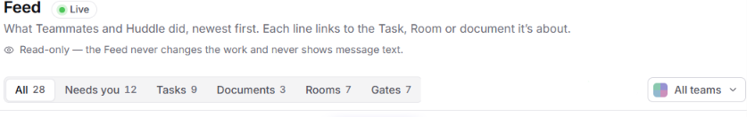
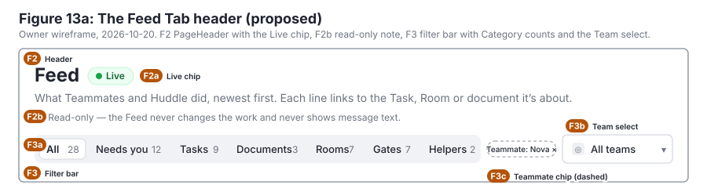
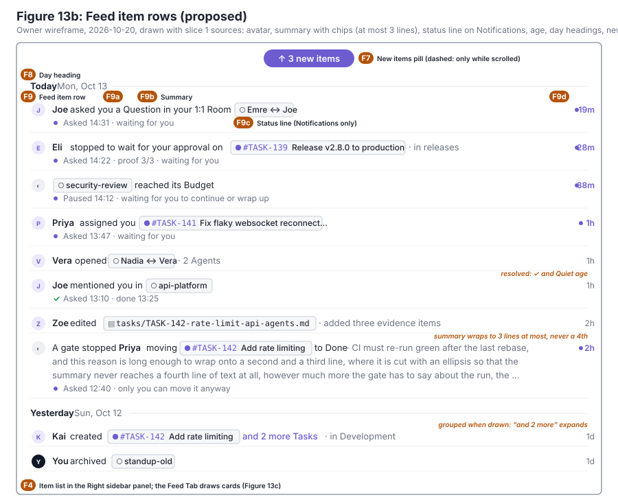

# Huddle.Feed — Design Specification (slice 1)

**Date:** 2026-10-20 · **Status:** Built 2026-10-20 (slice 1) · **Decision record:**
[ADR-0063](adr/0063-the-feed-is-a-stored-history-that-each-domain-component-posts-to.md); sits beside
[ADR-0050](adr/0050-needs-you-is-derived-from-room-events-and-held-in-memory.md) and
[ADR-0061](adr/0061-a-human-gated-task-waits-in-needs-you-for-the-humans-acceptance.md) without
changing them · **Vocabulary:** [language.md](engineering/language.md) (**Needs You**, **Room**,
**Task**, **Human gate**, **Request**, **History**, **Tab**, **Top Bar**, **Right sidebar**); the new
terms **Feed**, **Feed item**, **Notification**, **Activity** and **Feed publisher** are proposed in §9 D-17

This is the design for the first slice of the **Feed**: one stored history of what Agents and
Huddle did, shown two ways. The **Notifications** button in the Top Bar opens a panel in the Right
sidebar holding the items that ask for the Human. The **Feed** Tab is the full timeline of Team
activity. It builds on the [Needs You specification](Huddle.NeedsYou-Specifications.md), the
[Human gate specification](Huddle.HumanGate-Specifications.md), the
[Right sidebar specification](Huddle.RightSidebar-Specifications.md) and the
[Tabs specification](Huddle.Tabs-Specifications.md).

It is written for the engineers or agents building it, with no memory of the conversation that
produced it. Read §5 for the shape, §6 for the subsystems, and Appendix A for the ordered,
test-first task list. Every design decision is in §9 with the alternative it beat; the decisions
still open are in §10.

> [!IMPORTANT]
> Two pages are binding before any code in this spec is written:
> [rules.md](engineering/rules.md) before editing `src/Huddle.App`, and
> [agents/CSharpPrinciples.md](../agents/CSharpPrinciples.md) for every C# file. Nothing here
> overrides either.

---

## 1. Goal

**See what your Team did while you were away, and what is waiting for you.**

Needs You answers "who is blocked on me right now". It forgets everything once a Room clears, and
it has never said anything about work that needed nothing from the Human. The Human who comes back
after an hour cannot tell what happened: which Tasks Agents created, which Rooms started, which
documents changed, and which asks came and went.

The Feed answers that with one stored list of **Feed items**, written by the component that knows
each fact:

| Problem | Today | With the Feed |
| --- | --- | --- |
| Catching up | Open every Room, Task list and document | One timeline, newest first, each item opening its target |
| Asks that came and went | A Room that cleared leaves no trace | The item stays, dimmed as resolved |
| A Task handed to the Human | Visible only on My Tasks | A Notification with a count on the Top Bar |
| A gate stopped an Agent | Only the Agent sees the refusal | A Notification saying the Human's call is due |

### 1.1 Policies

1. **The Feed records; it does not decide.** Whether a Room waits, a Task needs the Human or a gate
   refused is decided where it is decided today. That component tells the Feed.
2. **No Message text.** A Feed item names a Room and what happened there, never what anyone wrote.
3. **One item per event.** Fifteen Tasks created by one Agent are fifteen stored items. The list
   may draw neighbouring items as one grouped line (§6.12), but storage, counts and filters see
   each item.
4. **The Feed can never hurt the work.** A Feed failure is logged. It never fails, delays or rolls
   back the Task write, the Message post or the History append that caused it.
5. **Read-only in v1.** The Feed Tab opens things. Deciding, replying and accepting stay where they
   are (§3).

---

## 2. Example use cases

| # | Situation | What must happen |
| --- | --- | --- |
| U-1 | Nova creates 15 Tasks in Growth while the Human is out | The Feed Tab shows 15 items, newest first, each "Nova created GRO-41 Draft the pricing page". No Notification |
| U-2 | Leo assigns WEB-12 to the Human | A Notification "Leo assigned WEB-12 Fix the footer to you"; the Notifications button shows 1 |
| U-3 | The Human opens the Notifications panel | Every Notification shown is marked seen; the count goes to 0; the items stay in the panel |
| U-4 | Miriam moves RSH-208 to Needs You with Proof 4/4 | A Notification "RSH-208 Pricing memo is waiting on you · Proof 4/4". When the Human accepts, the item stays, dimmed, and leaves the count |
| U-5 | Zoe Mentions the Human in Pricing; later the Human posts there | A Notification "Zoe mentioned you in Pricing"; the Human's post resolves it |
| U-6 | Ruth's move of QA-9 to Done is refused by `qa-evidence-before-done` | A Notification "A gate stopped Ruth moving QA-9 to Done: <refusal>"; resolved when QA-9's status next changes or it closes |
| U-7 | The Human dismisses a Notification | It leaves the panel and the count. It is still in the Feed Tab. 30 days later the row is deleted |
| U-8 | The Human clicks Nova's avatar on an item | The Feed Tab narrows to Nova's items; its address becomes `/feed?agent=Nova`, so the Tab remembers it |
| U-9 | A new item arrives while the Feed Tab is open | It is inserted at the top. Older pages already loaded do not shift or repeat |
| U-10 | The SQLite file is locked when the writer runs | A warning is logged and the batch is dropped. The Task update the Agent made succeeded and its tool result says so |
| U-11 | Huddle restarts while a Question card was waiting | The card is gone after the restart (Questions live in memory), so its Notification is resolved at startup |

---

## 3. Non-goals

| Not in v1 | Why |
| --- | --- |
| Reply into the Room from a Feed item | The Composer and its Reply Gate rules live in the Room. v2 |
| Accept from a Feed item | ADR-0061 binds Accept to a hash of what the Human saw. A Feed item would have to expand the whole decision card (`TaskDecisionCard`) with the Proof and the text to be honest. v2 |
| Request changes, Decline, dismissing or turning a gate off from a Feed item | Same reason: each belongs to a card that shows its context. v2 |
| Dismissing from the Feed Tab | Dismiss is a bell action. The Feed Tab is history |
| Merging items when they are written ("Nova created 15 Tasks" as one row) | Owner decision: one stored item per event; grouping happens only when drawn (§6.12) |
| The extra sources in the owner's row wireframe (§12) | Slice 1b |
| Helpers | A separate specification and ADR-0064 |
| Helpers posting to the Feed | Slice 3. The `IFeedPublisher` contract (§6.2) is what they will call |
| Message text, Question text or Form fields in an item | Policy 2 |
| "Agent left a Room" | Nothing in Huddle removes a Member from a Room today: `ITeamDirectory` has `AddMemberAsync` and no removal, and `DeleteRoomAsync` drops a whole Room. See §10 OD-1 |
| The Human's own Library saves | Every save appends a History entry and nothing is grouped, so one editing session would be dozens of items. §9 D-10 |
| Unarchive and rename of a Room | Not in the owner's list. Cheap to add later as two more source types |

---

## 4. Design principles

- **Push, never infer.** Each kind of item is posted by the one component that already knows the
  fact (`TaskService`, `NeedsYouTracker`, `ChatService`, `TeamRoomReconciler`, `DocHistoryStore`).
  The Feed subscribes to nothing and works nothing out.
- **The sender owns the lifecycle.** The sender decides `Notify`, and calls `Resolve` when its own
  condition clears. The Feed never decides that something stopped mattering.
- **Fire and forget.** `Post` and `Resolve` only enqueue. A background writer is the only code that
  writes `feed_events`, so producers never wait on SQLite and never see its errors.
- **One contract for every producer.** `IFeedPublisher` names no producer, so Helpers (slice 3)
  post through it unchanged.
- **Stable keys.** An item names its target by the key ADR-0055 fixed: a Task id, a Room id, a
  Library file's absolute path. A label beside it is what was true when the item was written.

---

## 5. Architecture overview

```text
TaskService ──────────┐  Post(FeedMessage) / Resolve(targetKey, type)
NeedsYouTracker ──────┤        (enqueue only; never throws)
ChatService ──────────┼──► IFeedPublisher = FeedQueue ──► Channel<FeedCommand>
TeamRoomReconciler ───┤                                        │ single reader
DocHistoryStore ──────┘                                        ▼
                                              FeedWriter (BackgroundService)
                                               │ batch in one transaction
                                               ▼
                                     FeedStore ── team.db: feed_events
                                               │ after commit
                                               ▼
                                     FeedEvents (ItemsAdded, ItemsChanged)
                                       │                         │
                                       ▼                         ▼
         NotificationsButton (S1c) + NotificationsPanel (S4)   FeedPage (/feed, a Tab)
```

New types live in `src/Huddle.App/Feed/` (namespace `Agency.Huddle.App.Feed`) and the components in
`src/Huddle.App/Components/Feed/`. Producers change only by gaining an optional `IFeedPublisher`
dependency and the calls in §6.5.

---

## 6. Subsystems

### 6.1 The table

One table in the existing `{DataDir}/team.db`, created by `FeedStore`'s constructor the way
`CadenceStateStore` creates `cadence_state` (plain `Microsoft.Data.Sqlite`, no EF):

```sql
CREATE TABLE IF NOT EXISTS feed_events (
    id            INTEGER PRIMARY KEY AUTOINCREMENT,
    created_at    TEXT    NOT NULL,          -- UTC, ISO 8601 round-trip ("O")
    source_type   TEXT    NOT NULL,          -- FeedSourceType wire name (§6.3)
    target_key    TEXT    NOT NULL,          -- Task id, Room id or Library absolute path (ADR-0055)
    actor         TEXT    NOT NULL,          -- the actor's Name at the time, or "Huddle"
    notify        INTEGER NOT NULL DEFAULT 0,
    seen_at       TEXT,
    dismissed_at  TEXT,
    resolved_at   TEXT,
    payload       TEXT    NOT NULL           -- JSON envelope (§6.4)
);
CREATE INDEX IF NOT EXISTS ix_feed_events_created_at ON feed_events(created_at);
CREATE INDEX IF NOT EXISTS ix_feed_events_target     ON feed_events(target_key, source_type);

CREATE TABLE IF NOT EXISTS feed_state (
    key    TEXT PRIMARY KEY,                 -- "tab_seen_up_to"
    value  TEXT NOT NULL                     -- the highest Feed item id the Feed Tab has shown
);
```

`feed_state` holds the Feed Tab's own "seen" mark (D-26): one id for every item, Notification or
Activity. It is separate from `seen_at`, which stays the bell's per-Notification state.

- `AUTOINCREMENT`, not a plain rowid: clean-up can delete the newest rows, and a reused id would
  break keyset paging and "seen up to id" (§6.7).
- `seen_at`, `dismissed_at` and `resolved_at` are only ever set on `notify = 1` rows. The writer
  enforces it in the `WHERE` clause of every update.
- Times are written with `ToString("O", CultureInfo.InvariantCulture)` on the UTC value and read
  back with `DateTimeStyles.AssumeUniversal | AdjustToUniversal`, as `CadenceStateStore` does.
- `team.db` is already in WAL mode (`SqliteTeamDirectory.InitializeAsync` sets
  `journal_mode=WAL`), so the writer does not block the directory's readers.

### 6.2 The publisher contract

```csharp
namespace Agency.Huddle.App.Feed;

/// <summary>What a producer calls to put an item in the Feed. Both members only enqueue, and never throw.</summary>
internal interface IFeedPublisher
{
    /// <summary>Queues one Feed item. The time is taken now, from the injected TimeProvider.</summary>
    void Post(FeedMessage message);

    /// <summary>Queues the resolution of every unresolved Notification of this type about this target.</summary>
    void Resolve(string targetKey, FeedSourceType type);
}

/// <summary>One Feed item as its sender describes it.</summary>
internal sealed record FeedMessage(
    FeedSourceType SourceType,
    string TargetKey,
    FeedActor Actor,
    bool Notify,
    FeedPayload Payload);

/// <summary>Who did it: an Agent by Name, Huddle itself, or an edit made outside Huddle.</summary>
internal sealed record FeedActor(FeedActorKind Kind, string Name)
{
    public static FeedActor Huddle { get; } = new(FeedActorKind.Huddle, "Huddle");
}

internal enum FeedActorKind { Human, Agent, Huddle, OutsideHuddle }
```

- `FeedQueue` implements it over a bounded `Channel<FeedCommand>` (capacity
  `Team:Feed:QueueCapacity`, `BoundedChannelFullMode.DropWrite`, single reader). `Post` and
  `Resolve` call `TryWrite`. A full queue or a payload whose type does not match its
  `SourceType` (§6.3) is logged as a warning and dropped; neither throws.
- `FeedCommand` is a closed record hierarchy: `PostCommand(FeedMessage, DateTimeOffset At)`,
  `ResolveCommand(string TargetKey, FeedSourceType Type, DateTimeOffset At)`,
  `MarkSeenCommand(long UpToId, DateTimeOffset At)`, `DismissCommand(long Id, DateTimeOffset At)`.
  The last two come from the UI (§6.7), not from producers, through an `internal` method on
  `FeedQueue` that `IFeedPublisher` does not expose.
- One FIFO queue for everything keeps a producer's `Post` and its later `Resolve` in order.
- With `Team:Feed:Enabled` false, `NullFeedPublisher` is registered instead: both members do
  nothing, and the UI in §6.8 and §6.9 is not drawn.
- Producers take `IFeedPublisher? feed = null` as an optional trailing constructor parameter, the
  way `TaskService` takes `ProcessGateService? gates` and `IProofSource? proof`, so every existing
  test that builds them compiles unchanged and posts nothing.

### 6.3 Source types

`FeedSourceType` is an enum. The column holds its wire name, never its number, so reordering the
enum cannot rewrite history. Each source type has exactly one payload record; `FeedPayloads.Matches`
pins the pairing and is unit-tested for every value.

| Source type | Wire name | Posted by | Notify | Target | Payload |
| --- | --- | --- | --- | --- | --- |
| `TaskCreated` | `task-created` | `TaskService` | No | Task id | `TaskCreatedPayload(Id, Title, Team, Assignee?)` |
| `TaskGateOn` | `task-gate-on` | `TaskService` | No; Yes when a Helper turned the gate on (slice 3) | Task id | `TaskGatePayload(Id, Title, Team, Action?, Reason?)` |
| `TaskNeedsYou` | `task-needs-you` | `TaskService` | Yes | Task id | `TaskNeedsYouPayload(Id, Title, Team, ProofMet, ProofTotal)` |
| `TaskAssignedToYou` | `task-assigned-to-you` | `TaskService` | Yes | Task id | `TaskAssignedPayload(Id, Title, Team, PreviousAssignee?)` |
| `RequestAwaitsYou` | `request-awaits-you` | `TaskService` | Yes | Task id | `RequestAwaitsPayload(Id, Title, Team, FromTeam, Kind)` |
| `GateDecisionDue` | `gate-decision-due` | `TaskService` | Yes | Task id | `GateDecisionPayload(Id, Title, Team, GateId, Message, FromStatus, ToStatus)` |
| `RoomMention` | `room-mention` | `NeedsYouTracker` | Yes | Room id | `RoomWaitPayload(RoomId, RoomName?, Team?)` |
| `RoomQuestion` | `room-question` | `NeedsYouTracker` | Yes | Room id | `RoomWaitPayload` |
| `RoomForm` | `room-form` | `NeedsYouTracker` | Yes | Room id | `RoomWaitPayload` |
| `RoomBudget` | `room-budget` | `NeedsYouTracker` | Yes | Room id | `RoomWaitPayload` |
| `RoomCreated` | `room-created` | `ChatService`, `TeamRoomReconciler` | No | Room id | `RoomCreatedPayload(RoomId, RoomName, Team?, Members)` |
| `RoomJoined` | `room-joined` | `ChatService` | No | Room id | `RoomJoinedPayload(RoomId, RoomName, Team?, Member)` |
| `RoomArchived` | `room-archived` | `ChatService` | No | Room id | `RoomArchivedPayload(RoomId, RoomName, Team?)` |
| `DocumentChanged` | `document-changed` | `DocHistoryStore` | No | Library absolute path | `DocumentChangedPayload(Path, RootName, RelativePath, Kind, Summary)` |
| `HelperPaused` | `helper-paused` | `HelperFeed` | Yes | `helper:<id>` | `HelperPausedPayload(HelperId, Name, DailyCap, Granted)` |
| `HelperFailing` | `helper-failing` | `HelperFeed` | Yes | `helper:<id>` | `HelperFailingPayload(HelperId, Name, Failures, LastError)` |

The last two rows and the `Reason` of `task-gate-on` are slice 3 ([Helpers in the Feed](Huddle.HelpersInFeed-Specifications.md)).
A Helper's `task-gate-on` carries the actor kind `helper` and is resolved when the Human turns the gate off or decides, the Task waits in Needs You, or it
closes; the two Helper items carry no Team, so with a Team chosen the Helpers count is 0, as for Documents.

`Team` in a payload is the Team the target belongs to: a Task's `TaskLocation.Team`, a Room's
Scope (`Room.Team`, null for the root). Documents carry no Team in v1 (§10 OD-4). Members and
Names in payloads are Names as they were when posted.

Every payload derives from `public abstract record FeedPayload` (the closed-hierarchy pattern
`PageSubject` uses, with the same `#pragma warning disable S1694` and its reason).

### 6.4 The payload envelope

The `payload` column holds one JSON object, written and read with one
`private static readonly JsonSerializerOptions` (camelCase, no indentation):

```json
{ "v": 1, "actorKind": "agent", "data": { "id": "GRO-41", "title": "Draft the pricing page", "team": "Growth" } }
```

- `actorKind` keeps the column list as fixed by the owner while telling an Agent named "Huddle"
  apart from Huddle itself.
- `data` is the payload record, serialised by its runtime type and read back by the type
  `FeedPayloads.TypeOf(sourceType)` names.
- A row whose `data` does not deserialise, or whose `source_type` is unknown (written by a newer
  build), reads as a `FeedItem` with a null `Payload`. The UI draws it as "Something happened"
  with the actor and time, and opens nothing. Reading never throws.
- The Team filter (§6.9) reads `json_extract(payload, '$.data.team')`. The bundled SQLite has the
  JSON functions built in.

### 6.5 Producers

Each producer posts **after** it has committed its own change and released its own lock, so a slow
or failing Feed never sits inside a domain lock. Where a producer decides, the rule is a pure
static function next to it, so the decision is unit-tested without SQLite or a queue.

**One rule for the Human's own actions.** A Notification is never posted for something the Human
did themselves (they assigned a Task to themselves, they moved a Task into Needs You). Activity is
posted whoever the actor is, Human included, so the Feed Tab is the whole record, with the one
exception of the Human's Library saves (§9 D-10).

#### 6.5.1 `TaskService`

`TaskService` gains `IFeedPublisher? feed = null` and `IRequestConfirmers? confirmers = null` as
trailing constructor parameters. After each public mutator (`Create`, `Update`, `Decide`, `Close`,
`Reopen`, `AddEvidence`) and the outside-edit path (`OnOutsideEdit`) raises `TaskChanged`, it calls
`this.PublishFeed(change)`, which hands the change to a pure rule:

```csharp
/// <summary>What one Task change means for the Feed (Feed spec §6.5.1). Pure.</summary>
internal static class TaskFeedRules
{
    public static FeedEffects For(TaskChange change, string humanName, Func<string, bool> teamHasConfirmer);
}

/// <summary>The items to post and the Notifications to resolve, in that order.</summary>
internal sealed record FeedEffects(IReadOnlyList<FeedMessage> Posts, IReadOnlyList<FeedResolution> Resolutions);

internal sealed record FeedResolution(string TargetKey, FeedSourceType Type);
```

`before` is `change.Before` (null for a creation), `after` is `change.After`, and "Human" means
`change.Actor.Kind == TaskActorKind.Human`.

| Source type | Posted when | Resolved when |
| --- | --- | --- |
| `TaskCreated` | `before` is null | Never (activity) |
| `TaskGateOn` | `after.IsGated` and not `before?.IsGated`, and the actor is not the Human. Covers `human_gate: true` and a new `action:`, which locks the gate on (ADR-0061) | Never (activity) |
| `TaskNeedsYou` | The Task starts to wait by the rule `NeedsYouTaskSource` lists by: gated, status Needs You, `Acceptance.Of(task).State` not `Valid`; true for `after` and false for `before`. This includes an acceptance going stale (Human gate spec §6.5). Not posted when the actor is the Human | That rule turns false for `after` (accepted, moved on, declined) or the Task closes |
| `TaskAssignedToYou` | `TaskQuery.NeedsYou(after, humanName)` and not for `before` (newly assigned, or created assigned), actor not the Human | `TaskQuery.NeedsYou(after, humanName)` turns false: reassigned, or a terminal status |
| `RequestAwaitsYou` | The Task is a Request (`RequestFields.TryRead` on its unknown fields), it entered Done, it is neither declined nor confirmed (`confirmed_by` empty), and `teamHasConfirmer(fromTeam)` is false, so no Agent can call `confirm_request` and only the Human can close it (ADR-0040) | The Task closes, or leaves Done |
| `GateDecisionDue` | Not from a change: see below | The Task's status changes, or it closes |

To make the rule's last column work, `PublishFeed` also asks the rule for resolutions on every
change, including changes that post nothing. `Resolve` on a target with nothing unresolved is a
no-op update.

**A refused move.** A refusal writes nothing and raises no `TaskChanged`, so `UpdateCore` returns
a third value, `RefusedMove? refused` (the current `TaskItem` and the requested `TaskState`), set
when `RefuseUpdate` returns a `TaskResult.GateRefused` with `CanOverride: true` for an actor whose
`Kind` is `Agent`. `CanOverride` is true exactly when a process gate (ADR-0039) refused and the
Task is not Human-gated, so this is "only the Human's Move anyway can pass it". `Update` posts
`GateDecisionDue` (notify) for it after releasing `mutateGate`, with the `GateRefused`'s `Gate` (as
`ProcessDocument.ToId`) and `Message`. Refusals by the Human gate (`CanOverride: false`) post
nothing: there is no override to make, only Proof to supply. A refused creation posts nothing: the
Agent can create the Task in an earlier status.

**Who can confirm a Request.** The check "is there a member of `fromTeam` whose role covers
`verify`" exists today as the private `ConfirmRequestTool.IsVerifierOf`. It moves into a new
`IRequestConfirmers` (`bool TeamHasConfirmer(string team)`, implemented by `RequestConfirmers` over
`ITeamCatalog`, `PersonaStore` and `ProcessGateService`), which both `ConfirmRequestTool` and
`TaskService` use. Check the DI graph when wiring it (FD-7): `TaskService` must not come to depend
on anything that depends on `TaskService`.

#### 6.5.2 `NeedsYouTracker`

`NeedsYouTracker` gains `IFeedPublisher? feed = null`. Its private `Apply` already compares the
Room's visible entry before and after each mutation under its lock. It also compares the set of
**reasons held** (not the visible entry, which hides dismissed Rooms), and after the lock is released:

- For each reason present after and absent before: `Post` the matching `Room*` type, notify, with
  the reason's own `By` as an Agent actor and `RoomWaitPayload(roomId, roomName, team)`. The Room's
  name and Scope are passed when the event carries the `Room` (`MessagePosted`), and left null
  otherwise; the writer fills them (§6.6).
- For each reason present before and absent after: `Resolve(roomId, type)`.

So a Human post resolves Mention and Budget, a Continue resolves Budget, an answered card resolves
Question, the last Form going resolves Form, and the Human's ✕ on the Needs You card resolves
Mention (the one reason `Dismiss` removes). `PruneAsync` resolves all four for each Room it drops.

`Seed` (the startup scan) posts nothing: the Mention it rebuilds was posted when it happened.
After the scan, `NeedsYouStartupScan` reconciles (§6.10).

#### 6.5.3 Room lifecycle: `ChatService` and `TeamRoomReconciler`

`ChatService` gains `IFeedPublisher? feed = null`. These methods post after their write and their
`PublishRoomsChanged()`:

| Method | Posts | Actor |
| --- | --- | --- |
| `EnsureRoomForAsync`, `CreateRoomForAsync` (both overloads), `EnsureTeamOneToOneAsync`, when they create a Room | `RoomCreated` | From a new `FeedActor actor` parameter (see below) |
| `InviteAsync`, when it adds a Member | `RoomJoined` (the new Member's Name) | Same |
| `SetRoomArchivedAsync(roomId, true)` | `RoomArchived` | Same |

`EnsureRoomForAsync` and `EnsureTeamOneToOneAsync` post only when they created the Room, not when
they found it. Unarchiving posts nothing.

These methods do not know who asked. Each gains a `FeedActor actor` parameter, placed before the
`CancellationToken`, which every caller supplies: the Human for the Razor callers and `RoomActions`,
the calling Agent for `CreateRoomTool` and `InviteAgentTool`, and `FeedActor.Huddle` for
`TeamRoomReconciler`. `CreateRoomTool` already holds `callerAgentId`; `InviteAgentTool` does not
today and gains it, from the same factory that builds `CreateRoomTool`. The Name comes from
`ITeamDirectory.GetUserAsync`.

`TeamRoomReconciler.TryCreateAsync` creates the Team Room through `ITeamDirectory.CreateRoomAsync`
directly, not `ChatService`, so it posts its own `RoomCreated` (actor Huddle) after
`PublishRoomsChanged()`. Its invites and archives already go through `ChatService`.

#### 6.5.4 `DocHistoryStore`

`DocHistoryStore` gains `IFeedPublisher? feed = null` (it is a primary-constructor class; the
parameter joins the list). After `Append` writes the line and raises `Changed`, it posts
`DocumentChanged` when `entry.ActorKind` is `DocActorKind.Agent`, with the entry's `Kind` and
`Summary`, the file's `FullPath` as the target key, and its `Root` name and `RelativePath`. Human
entries are not posted (§9 D-10). `Move` posts nothing.

### 6.6 The writer

`FeedWriter` is a `BackgroundService` that reads the channel, takes every command already queued
(up to `Team:Feed:BatchSize`), and applies them in **one transaction**, in order:

| Command | SQL |
| --- | --- |
| Post | `INSERT … RETURNING id`, so the hub can hand the new rows over |
| Resolve | `UPDATE feed_events SET resolved_at = $at WHERE target_key = $key AND source_type = $type AND notify = 1 AND resolved_at IS NULL` |
| Mark seen | `UPDATE … SET seen_at = $at WHERE id <= $upTo AND notify = 1 AND seen_at IS NULL` |
| Dismiss | `UPDATE … SET dismissed_at = $at WHERE id = $id AND notify = 1 AND dismissed_at IS NULL` |

- **Filling in a Room.** Before inserting a `RoomWaitPayload` with a null `RoomName` or `Team`,
  the writer reads the Room with `ITeamDirectory.GetRoomAsync` and fills them. It adds facts the
  sender did not have to hand; it never decides whether to post. A Room that is gone keeps the
  nulls, and the UI shows "a Room that was deleted".
- **After commit**, it raises `FeedEvents.ItemsAdded(IReadOnlyList<FeedItem>)` for the inserted
  rows and `FeedEvents.ItemsChanged()` once when any update touched a row.
- **Failure.** A `SqliteException` or `IOException` is logged as a warning and the batch is
  dropped; the loop goes on. The loop's outer `catch` is the one general catch, with a comment
  saying why swallowing is safe (CSharpPrinciples, Exceptions).
- **Clean-up.** On start and then every `Team:Feed:CleanupInterval` (a `PeriodicTimer` built on the
  injected `TimeProvider`), in its own transaction:

  ```sql
  DELETE FROM feed_events WHERE notify = 1 AND dismissed_at IS NOT NULL AND dismissed_at < $dismissedCutoff;
  DELETE FROM feed_events WHERE notify = 0 AND created_at < $activityCutoff;
  ```

  The cutoffs are now minus `DismissedRetentionDays` and `ActivityRetentionDays`. Undismissed
  Notifications, resolved or not, are kept (§10 OD-3). ISO 8601 UTC strings compare correctly as
  text.

`FeedEvents` follows `TaskEvents`: an `internal sealed` plain hub whose `Raise*` methods are
`internal`, so bUnit tests can drive the components without a writer.

### 6.7 Reading: `FeedStore`

`FeedStore` is a singleton, synchronous like `CadenceStateStore`. Its write methods are `internal`
and called only by `FeedWriter`. Its reads:

```csharp
/// <summary>One page of the Feed, newest first. Keyset by id, so live inserts never shift a page.</summary>
public IReadOnlyList<FeedItem> Page(FeedQuery query);

/// <summary>The Notifications for the panel: notify, not dismissed, newest first.</summary>
public IReadOnlyList<FeedItem> Notifications(int limit);

/// <summary>Notify, unseen, undismissed, unresolved: the number on the Notifications button.</summary>
public int UnseenCount();

/// <summary>Unresolved Notifications of one type, for the startup reconcilers (§6.10).</summary>
public IReadOnlyList<FeedItem> Unresolved(FeedSourceType type);

/// <summary>Up to <paramref name="limit"/> items about the item's target or the extra targets, newest first (§6.13).</summary>
public IReadOnlyList<FeedItem> Related(FeedItem item, IReadOnlyList<string> extraTargets, int limit);

/// <summary>The Feed Tab's seen mark (§6.1 <c>feed_state</c>), or 0 before the first view.</summary>
public long TabSeenUpTo();

/// <summary>The number on each Category segment (§6.9) under the Agent and Team filters, in one query.</summary>
public FeedCounts Counts(string? agent, string? team);

internal sealed record FeedQuery(long? BeforeId, int Limit, string? Agent, string? Team, FeedCategory Category = FeedCategory.All);

internal sealed record FeedCounts(int All, int NeedsYou, int Tasks, int Documents, int Rooms, int Gates);

internal sealed record FeedItem(
    long Id, DateTimeOffset At, FeedSourceType? SourceType, string TargetKey, FeedActor Actor, bool Notify,
    DateTimeOffset? SeenAt, DateTimeOffset? DismissedAt, DateTimeOffset? ResolvedAt, FeedPayload? Payload);
```

`Page` is `WHERE id < $before … ORDER BY id DESC LIMIT $limit`, with `actor = $agent COLLATE NOCASE`
and `json_extract(payload, '$.data.team') = $team COLLATE NOCASE` added when set, and the
Category's condition from §6.9 (a `source_type IN (…)`, or `notify = 1 AND resolved_at IS NULL`
for Needs you). `Counts` is one `SELECT` of six `SUM(CASE …)` columns over the same Agent and
Team conditions, so the six numbers always agree with what each segment shows. `SourceType` is
null for a wire name this build does not know; such an item counts only in All.

### 6.8 Notifications: the Top Bar button and the Right sidebar panel

**The button** (`NotificationsButton.razor`, in `S1c` before `RightSidebarToggle`): a 32px
`MudIconButton` with `Icons.Material.Outlined.Notifications` inside a `MudBadge` showing
`UnseenCount()` (hidden at 0, `Max="99"`). Its `aria-label` is "Notifications" or
"Notifications, N new". It re-reads the count on `FeedEvents.ItemsAdded` and `ItemsChanged`,
through `RendererDispatch`. Pressed (`aria-pressed`) while the panel shows.

**The panel host.** The Right sidebar draws panels for the focused Tab's Subject (Right sidebar
D-1), but Notifications belong to no page. `RightSidebarService` gains a mode:

```csharp
internal enum RightSidebarMode { Subject, Notifications }

public RightSidebarMode Mode { get; }        // Subject by default
public void ToggleNotifications();           // closed or Subject → open in Notifications; Notifications → closed
```

`RightSidebarToggle` keeps its meaning and always opens or closes in Subject mode. While the mode is
Notifications, `RightSidebar.razor` draws one `SidebarPanelFrame` (id `notifications`, title
"Notifications", the same icon) around `NotificationsPanel` instead of the catalog's panels. The
frame, its header, its collapse and its Edge line are reused unchanged. The panel is not registered
in `SidebarPanelCatalog`, because it applies to no Subject.

**The panel** (`NotificationsPanel.razor`):

- On first render it sends `MarkSeen(upToId)` with the highest id it shows, so opening the panel
  is what marks them seen (Right sidebar D-7: a panel lives only while it is seen).
- **It shows the Feed, not only Notifications** (D-21). At its top, a compact Category control
  with the six Categories of §6.9 and their counts, as a single-select `MudChipSet` that wraps (the
  panel is too narrow for the segmented control). It **opens on Needs you**, so the bell still
  shows what needs the Human first; All shows everything. The choice lives only while the panel
  does. The panel has no Team select and no Agent filter: those are the Feed Tab's.
- Rows are `FeedItemRow` (§6.12), the same component as the Feed Tab's, with day groups, grouping
  and the "↑ N new items" pill, loaded by `Page` with `PanelLimit` and "Show more".
- A ✕ revealed on hover or focus on a Notification row (`hover-reveal-row`, as `NeedsYouList`
  does) sends `Dismiss(id)` and removes the row from the panel's Needs you list at once; in All it
  stays, because dismissing hides a Notification from the bell, not from the Feed.
- The panel reports the unseen count through `SidebarPanelContext.SetCount`.
- Empty Needs you: `EmptyState` "Nothing needs you" with "Asks from your Agents appear here."
  Empty All: "Nothing yet" with "What your Agents do appears here."
- Its last row is a `NavTabLink` "See all activity" to `/feed?category=<the panel's Category>`.

### 6.9 The Feed Tab

**Route and Tab.** `FeedPage.razor` at `@page "/feed"`. `TabKeys.Describe` gains
`["feed"] => new("feed", "Feed", "feed")`. Filters are query parameters,
`/feed?category=<category>`, `/feed?agent=<Name>` and `/feed?team=<Team>`, combinable, so a Tab
remembers its filter (ADR-0045: a Tab is a remembered URL). An unknown `category` value reads as
All.

**Opening it.** A `NavTabLink` "Feed" (`Icons.Material.Outlined.DynamicFeed`, `aria-label` and
tooltip "Feed") first in the Activity bar's top toolbar (`S5a`), above the Sidebar view buttons (moved there by the owner, 2026-10-20): it opens a
Tab, like Settings, rather than switching the Sidebar view. Also the panel's "See all activity".

**The header** (owner wireframe, 2026-10-20; codes `F1`–`F3` in
[wireframes.md Figure 13](engineering/wireframes.md#figure-13-the-feed-page)). `MudContainer` with
`.page-reading`, then:



*Owner wireframe, 2026-10-20: the Feed Tab's header.*



- **`PageHeader`** with Title "Feed" and the Subtitle "What Agents and Huddle did, newest first.
  Each line links to the Task, Room or document it's about." In `TitleTrailing`, the **Live chip**:
  a small Success-tinted chip with a filled dot and "Live". It says that new items arrive on their
  own (live insertion, below); it is always drawn while the page is subscribed to `FeedEvents`,
  and Blazor's own reconnect UI covers a lost circuit, so it has no second state in v1.
- **The read-only note**, one caption line in Quiet ink under the header with a leading
  `Icons.Material.Outlined.Visibility`: "Read-only — the Feed never changes the work and never
  shows message text."
- **The filter bar**, one row: the **Category** control at the left and the **Team select** at the
  right; the Agent chip, when set, sits just left of the Team select.

**Category** is a `HuddleSegmentedControl<FeedCategory>` with nine segments (`ItemCount="9"`; the original seven plus Devices and Second Brain), each a
label and its count from `FeedStore.Counts`. Selecting one navigates the Tab to
`?category=<value>`, keeping `agent` and `team`. Every Feed item is in All, in exactly one of
Tasks, Gates, Rooms, Documents or Helpers, and in Needs you only while it is an unresolved Notification, so
Needs you overlaps the other five and the counts are not meant to add up:

| Segment | `FeedCategory` | `category=` | Source types |
| --- | --- | --- | --- |
| All | `All` | (absent) | Every item |
| Needs you | `NeedsYou` | `needs-you` | Any item with `notify = 1` and `resolved_at` null, whichever type; dismissing in the panel does not remove it here |
| Tasks | `Tasks` | `tasks` | `task-created`, `task-assigned-to-you`, `request-awaits-you` |
| Documents | `Documents` | `documents` | `document-changed` |
| Rooms | `Rooms` | `rooms` | `room-mention`, `room-question`, `room-form`, `room-budget`, `room-created`, `room-joined`, `room-archived` |
| Gates | `Gates` | `gates` | `task-gate-on`, `task-needs-you`, `gate-decision-due` |
| Helpers | `Helpers` | `helpers` | `helper-paused`, `helper-failing` |

A new source type must be added to exactly one of the five type segments in the same change
(a unit test walks `FeedSourceType` and fails on an unassigned value). The counts cover the
items the store still holds (the retention window, §6.11) under the current Agent and Team
filters, and are re-read on `FeedEvents.ItemsAdded` and on a resolve.

**Team select** is a `MudSelect<string?>` (Dense, Outlined, at its natural width, about 160px):
"All teams" first, then each Team Name in `TeamCatalog` order, each with the
`Icons.Material.Outlined.Groups` icon (Teams have no colour of their own, so the wireframe's colour
tile becomes the Teams icon). Choosing one navigates to `?team=<Team>`; "All teams" removes it.
Documents carry no Team (§10 OD-4), so with a Team chosen the Documents count is 0.

**Agent chip.** Clicking an avatar sets `?agent=<Name>`, shown as a `TaskFilterChip`
"Agent: Nova ×" in the filter bar; × removes only that parameter.

Then the items, newest first, as `FeedCard`s (§6.13) under the day headings of §6.12. The panel
keeps the compact `FeedItemRow`. In the Tab, clicking an avatar navigates to `?agent=<actor>` (not for the Huddle actor or the Human).
No Dismiss, no Accept, no Reply (§3).

**Paging and live insertion.** The page loads `Page(new(null, PageSize, …))`, and loads the next
page with `BeforeId` = the lowest id shown when its "Show more" button is pressed. On
`FeedEvents.ItemsAdded` the new items that match its filter are handled by the "↑ N new items"
pill of §6.12 (D-22). Because pages are keyed by id, adding items at the top never changes what
the next page returns, and nothing repeats or goes missing.

**Empty:** `EmptyState` "Nothing yet" with "What your Agents do appears here." Filtered and
empty: "Nothing from Nova yet." for an Agent, "Nothing here yet." with "Try All, or another
Team." for a Category or Team. Needs you empty: "Nothing needs you" with "Asks from your
Agents appear here." The header and filter bar stay drawn in every empty state, so the
counts show where the items are.

### 6.10 Startup reconciliation

Some conditions end while Huddle is stopped. Questions, Forms and Budgets live in memory and are
empty after a restart; a Task file can be edited while Huddle is down. Each producer reconciles its
own types once at startup:

- **Rooms.** At the end of `NeedsYouStartupScan`, for each of the four `Room*` types, every
  `FeedStore.Unresolved(type)` item whose Room does not hold that reason in the tracker is resolved.
- **Tasks.** A new hosted `TaskFeedStartup` waits for `TaskStore`'s first index, then, for each
  Task source type with a resolution rule, resolves every unresolved item whose condition
  `TaskFeedRules.Holds(type, task, humanName, teamHasConfirmer, item.Payload)` is false or whose
  Task is gone. `GateDecisionDue` holds while the Task is open and its status is still the
  payload's `FromStatus`.

Both only call `Resolve`. Nothing is posted at startup.

### 6.11 Options

`FeedOptions`, bound from `Team:Feed` as a property `Feed` on `TeamOptions` (as `DocHistory` is):

| Key | Default | Meaning |
| --- | --- | --- |
| `Enabled` | `true` | Off: `NullFeedPublisher`, no writer, no button, no Feed link |
| `DismissedRetentionDays` | `30` | A dismissed Notification is deleted this many days after its dismissal |
| `ActivityRetentionDays` | `30` | An activity item is deleted this many days after it was created |
| `CleanupInterval` | `01:00:00` | How often the clean-up runs |
| `QueueCapacity` | `10000` | Commands waiting for the writer; beyond it, new ones are dropped and logged |
| `BatchSize` | `200` | Most commands one transaction applies |
| `PageSize` | `50` | Items per Feed Tab page |
| `PanelLimit` | `50` | Most Notifications the panel shows |

Zero or less for a retention keeps those rows forever. Each key goes into the configuration table
of [Huddle.EngineeringGuide.md](Huddle.EngineeringGuide.md) with the build.

### 6.12 The Feed item row

`FeedItemRow.razor` draws one item, or one group of items, in the Right sidebar panel (§6.8). The
Feed Tab draws `FeedCard` instead (§6.13) and shares only the day headings, grouping and the pill. It follows the owner's row wireframe of 2026-10-20 (codes `F7`–`F10` in
[wireframes.md Figure 13](engineering/wireframes.md#figure-13-the-feed-page)).



*Figure 13b, drawn from the owner's row wireframe of 2026-10-20 with slice 1's sources: the Feed's rows in the Right sidebar panel, and under "In the Feed" in an expanded card.*

**Day groups.** Rows sit under a day heading with an Edge hairline to its right: the day word in
600, then the date in Quiet ink: "Today Mon, Oct 13", "Yesterday Sun, Oct 12", the weekday for the
rest of the last 7 days ("Friday Oct 10"), then the date alone ("Oct 3"). Days are the Human's local
days, from the injected `TimeProvider`.

**The row** is a three-column grid: avatar, body, time.

- **Avatar**, 20px, top-aligned with the first line: an Agent's `AgentAvatar` monogram; the
  Human's own avatar with the Name "You" for the Human's actions; Huddle's own icon (a toggle-like
  glyph in a circle) for the Huddle actor. A Team as actor (a 2-letter Team monogram) arrives with
  slice 1b.
- **Summary**, the first line, 13px: the actor's Name in 600, then the summary of §7 with its
  targets drawn as **reference chips**, then any trailing context in Quiet ink after " · ". It
  **wraps to at most 3 lines** and ends in "…" after that (`-webkit-line-clamp: 3`), never a 4th
  (D-24). The chips:
  - **Task chip:** the `TaskStateDot` icon, `#<id>` in the Accent ink and monospace, then the title,
    truncated with "…" inside the chip at about 32 characters. Opens the Task.
  - **Room chip:** a chat-bubble icon and the Room's Name; a Room of two Members reads
    "<Name> ↔ <Name>". Opens the Room.
  - **Document chip:** a document icon and the Library-relative path in monospace. Opens it.
  - A Team Name is plain 600 text, and a status change reads "<from> → <to>", each with its
    `TaskStateDot` icon.
- **Status line**, only on a Notification: one 12px line in Quiet ink under the summary, never
  wrapping. It starts with a 6px Accent dot while the Notification is unresolved, or a Success ✓
  once resolved, then the facts: "Asked 14:31 · waiting for you", "Asked 14:22 · proof 3/3 ·
  waiting for you", "Paused 14:12 · waiting for you to continue or wrap up", and once resolved
  "Asked 12:46 · you chose Continue 12:52". Copy per source type is in §7.
- **Time**, right-aligned on the first line: the compact age ("19m", "1h", "1d", "3d"), with
  `HumanDate.Full` in its tooltip. On an unresolved Notification it is Accent ink with a 6px Accent
  dot before it; otherwise Quiet ink.
- Clicking the row outside a chip opens the item's target in a Tab, as before; a chip opens its own
  target.

**Grouping when drawn** (D-23). Neighbouring items with the same actor, the same source type and
the same Team, at most 10 minutes apart, are drawn as one row: the first item's summary followed
by "and N more <noun>" ("Kai created #TASK-142 and 2 more Tasks"), or, for Room waits in one Team,
"In <Team>, N Rooms stopped to wait for you". Clicking "N more" expands the group into its rows.
Notifications are grouped only with Notifications, and a group shows the unresolved dot while any
member is unresolved. Storage, counts, filters and `Resolve` all see the single items.

**New items pill** (D-22). When `FeedEvents.ItemsAdded` brings items that match the list's filter,
a list scrolled to its top inserts them at once. Otherwise they wait, and a floating Accent pill
"↑ N new items" is drawn at the top centre of the list; clicking it inserts them and scrolls to the
top. The pill's count is the number of waiting items, not groups.

---

### 6.13 The Feed Tab card

The Feed Tab's body is a list of cards (owner wireframe, 2026-10-20; codes `F10`–`F12` in
[wireframes.md Figure 13](engineering/wireframes.md#figure-13-the-feed-page)). `FeedCard.razor`
draws one item, or one group drawn as one (§6.12), as an outlined card with an 8px radius and 8px
between cards.


*Figure 13c, drawn from the owner's body wireframe of 2026-10-20.*

**Collapsed card**, top to bottom, beside a 40px avatar:

- **Unseen bar.** A 3px Accent bar down the card's left edge while the item's id is above the Feed
  Tab's `tab_seen_up_to` (D-26). The age is then Accent too. When the Tab has been shown for
  2 seconds, `FeedQueue.MarkTabSeen(highestShownId)` moves the mark; bars already drawn stay for
  that view and are gone on the next one, so the Human sees what is new before it clears.
- **Avatar with a kind badge.** The actor's 40px `AgentAvatar` (Huddle's own mark for Huddle,
  the Human's for "You"), with a 16px round badge at its bottom right naming the kind: a check
  (stopped for you), a document (changed), a person (assigned to you), a gauge (Budget), a lock
  (gate), an @ (mention), a question mark (Question), a form (Form), a plus (created); a bolt
  (woke up) arrives with slice 1b. The badge colour follows the Category.
- **Summary**, 14px: the actor's Name in 600, the verb, the reference chip(s) of §6.12, and a
  trailing purpose in 600 when the item has one ("for you to publish", "and assigned it to you").
  It wraps to at most 3 lines (D-24).
- **Meta line**, 12px Quiet ink, items separated by " • ": the context word or relation ("assigned
  by you", "Library", "Tasks"), the Room chip when the target is in a Room, and the **Team chip**:
  a 14px square Team monogram (two letters, Accent tile) and the Team Name. Never Message text.
- **Status pill**, Notifications only, one line, with optional extra pills beside it:
  - "Waiting for you · 20 min" in the Warning outline while the Notification is unresolved; the
    minutes are its age, redrawn each minute. A Budget pause shows a pause glyph before it.
  - "Assigned to you · due Tue 13 Oct" in the Info outline for `task-assigned-to-you`.
  - A deadline pill with a clock, "Post by 11:30" (the verb is the Action's), when the Task is due
    today at a set time.
  - Once resolved: "Done · 13:25" with a ✓, in Quiet ink.
- **Age and chevron**, right-aligned: "16 min", "2 h", "1 d" (`HumanDate.Full` in the tooltip), and
  under it a chevron button with `aria-expanded` and the `aria-label` "Show details".

Clicking the card's empty space (not a chip, not a button) expands or collapses the card, as the chevron does, and Enter on the focused body does the same
(owner, 2026-10-20: "clicking empty space should expand the card"). The body is a `role="button"` tab stop with `aria-expanded` on every card. The target
opens from the expanded card's Open button and from each chip.

**Expanded card.** The chevron expands the card in place; one card is expanded at a time, and
`Escape` collapses it. Under the collapsed part, after an Edge line:

1. **The target's kind and Team**, a caption: "Task · Support Desk", "Room · Support Desk",
   "Document · Library".
2. **A read-only preview of the target**, in an inset outlined box (D-27):
   - **Task:** an icon tile, the id in Accent, the title in 18px/600, then a property grid:
     Status (`TaskStatusChip`), Assignee (avatar, Name, title), Assigned by (from the Change log),
     Due (`TaskCard`'s overdue treatment), Proof (a chip "Proof 2/3" with a three-segment bar),
     Room (the origin Room chip), File (the Task file's path in monospace). Then "Proof" and its
     items drawn as `TaskProofList` draws them, read-only: a ✓ or an empty circle, the label, and
     under it who, the evidence and the time, or "pending". A footer line with an eye icon gives
     the gate's sentence from `HumanGateCopy`, such as "Send unlocks at proof 3/3 · only you can
     send".
   - **Room:** its Scope (Team), its Members as avatars with Names, why it waits (the Needs You
     reason, when it does) and the time of its last Message. Never Message text.
   - **Document:** its Library root and path, and its last three History entries (who, kind,
     summary, time), as Document History shows them (ADR-0060).

   The preview is read when the card expands, from `TaskStore`, `ChatService` and
   `DocHistoryStore`. A target that is gone shows "This Task was deleted" (or Room, or document)
   and keeps only the Feed part below.
3. **"In the Feed"**, a caption, then up to 5 compact `FeedItemRow`s, newest first, from
   `FeedStore.Related`: items about the same target, and for a Task also items about its origin
   Room and the Library files it links (attachments, ADR-0053). The card's own item is tagged
   "This item".
4. **Buttons**, left-aligned, navigation only (v1 stays read-only, §3): **Open Task** (filled, the
   one primary), or **Open Room** or **Open document** for those targets; **Review in Needs you**
   (outlined, with a warning icon) when the item is an unresolved Notification about a gated Task
   in Needs You, opening `/needs-you#<id>`; **Open Room** (text, chat icon) for a Task's origin
   Room. None of them changes anything.

## 7. Interface copy

`<Room>` is the Room's Name; `<id> <title>` is a Task as the Tasks pages write it.

| Source type | Summary (chips in braces) | Status line (Notifications only) |
| --- | --- | --- |
| `task-created` | `created {Task}` · `in <Team>` | — |
| `task-gate-on` | `turned on Requires your acceptance for {Task}`; with an Action, `set the Action "<action>" on {Task}`; by a Helper, followed by `· <reason>` | by a Helper: `Asked <hh:mm> · you can turn it off on the Task`; otherwise — |
| `task-needs-you` | `stopped to wait for your approval on {Task}` · `in <Team>` | `Asked <hh:mm> · proof <m>/<n> · waiting for you` |
| `task-assigned-to-you` | `assigned you {Task}` | `Asked <hh:mm> · waiting for you` |
| `request-awaits-you` | `finished the Request {Task} from <FromTeam>` · `only you can confirm it` | `Asked <hh:mm> · waiting for you` |
| `gate-decision-due` | `was stopped by a gate moving {Task} to <status>` · `<message>` | `Asked <hh:mm> · only you can move it anyway` |
| `room-mention` | `mentioned you in {Room}` | `Asked <hh:mm> · waiting for you` |
| `room-question` | `asked you a Question in {Room}` | `Asked <hh:mm> · waiting for you` |
| `room-form` | `is waiting for you to fill in a Form in {Room}` | `Asked <hh:mm> · waiting for you` |
| `room-budget` | `{Room} reached its Budget` (actor: Huddle) | `Paused <hh:mm> · waiting for you to continue or wrap up` |
| `room-created` | `opened {Room}` · `<n> Agents` | — |
| `room-joined` | `<member> joined {Room}` | — |
| `room-archived` | `archived {Room}` | — |
| `document-changed` | `created`, `edited`, `reviewed` or `objected to` `{Document}` · `<summary>` when there is one | — |
| `helper-paused` | `paused {Helper}: its daily cap of <n> calls is reached` · `Agents' Tasks are not judged until you continue or the day ends` (actor: Huddle) | `Paused <hh:mm> · Continue is on the Helper's card` |
| `helper-failing` | `{Helper} failed <n> times in a row` · `<last error>` (actor: Huddle) | `Since <hh:mm> · Tasks are not being judged` |
| Unreadable item | `Something happened` | — |

A resolved Notification's status line keeps its first fact and ends `· done <hh:mm>` (from
`resolved_at`), after a Success ✓ instead of the dot. The wireframe's richer endings ("you chose
Continue 12:52", "you approved 17:30", token amounts, "Nadia and Vera paused") need data slice 1
does not store; slice 1b adds them (§12).

A summary starting in lower case follows the actor's Name. Other copy:

| Where | Text |
| --- | --- |
| Button | `Notifications` (tooltip and `aria-label`; `Notifications, <n> new` with a count) |
| Panel title | `Notifications` |
| Panel link | `See all activity` |
| Panel Categories | The nine Category labels (seven originally; Devices and Second Brain were added) with counts; opens on `Needs you` |
| Panel empty | Needs you: `Nothing needs you` · `Asks from your Agents appear here.`; All: `Nothing yet` · `What your Agents do appears here.` |
| Activity bar link | `Feed` |
| Page title | `Feed` |
| Page subtitle | `What Agents and Huddle did, newest first. Each line links to the Task, Room or document it's about.` |
| Live chip | `Live` |
| Read-only note | `Read-only — the Feed never changes the work and never shows message text.` |
| Category segments | `All`, `Needs you`, `Tasks`, `Documents`, `Rooms`, `Gates`, `Helpers`, each followed by its count |
| Team select | `All teams`, then each Team Name; `aria-label` `Team` |
| Filter chip | `Agent: <Name>` |
| Day heading | `Today <Ddd, Mmm d>`, `Yesterday <Ddd, Mmm d>`, `<Weekday> <Mmm d>`, `<Mmm d>` |
| Grouped row | `and <n> more Tasks` (or the source's noun); `In <Team>, <n> Rooms stopped to wait for you` |
| New items pill | `↑ <n> new items` (`↑ 1 new item`) |
| Age | `<n>m`, `<n>h`, `<n>d`; `now` under a minute |
| Feed empty | `Nothing yet` · `What your Agents do appears here.` |
| Paging | `Show more` |

Use **Feed item** in prose and code for one row. Never "post" as a noun (that word is avoided for
a Message), never "event" in interface copy, and never "unread": the count is **unseen**, and
Needs You keeps its own meaning.

---

## 8. Testing

Functional tests with the real `FeedStore` on a `TempDataDir` and a `ManualTimeProvider`, per
[agents/Testing.md](../agents/Testing.md); bUnit for components per
[agents/BlazorTesting.md](../agents/BlazorTesting.md). Store, writer, rules and producer tests go in
`tests/Huddle.Tests.Domain`; components in `tests/Huddle.Tests.Components`.

| Area | Must pin |
| --- | --- |
| `FeedStore` | Table created twice is harmless; a row round-trips every column; keyset paging returns no duplicates when rows are inserted between pages; Agent and Team filters; unknown wire name and bad JSON read as a null payload, never a throw |
| `FeedQueue` | `Post` and `Resolve` never throw: full queue, mismatched payload, disabled; the time is taken from the injected clock at the call |
| `FeedWriter` | Commands apply in order (a Post then a Resolve in one batch leaves the row resolved); Resolve, MarkSeen and Dismiss touch only `notify = 1` rows; a locked database drops the batch and the next batch succeeds; events raised after commit; Room name and Team filled in |
| Clean-up | Each retention boundary, one second each side; undismissed Notifications kept; zero keeps everything |
| `TaskFeedRules` | Every row of §6.5.1 posts and resolves; nothing notify for the Human's own action; a stale acceptance posts `TaskNeedsYou` again; a Request with a confirmer posts nothing |
| `TaskService` | A process-gate refusal of an Agent posts `GateDecisionDue`; a Human-gate refusal and a Human's refusal post nothing; a throwing publisher does not change the `TaskResult` |
| `NeedsYouTracker` | Each reason posts once on arrival and resolves on leaving; ✕ resolves Mention only; prune resolves all four; `Seed` posts nothing |
| Room lifecycle | Created once (not on a found Room), joined, archived (not unarchived), with the right actor; the reconciler's Team Room |
| `DocHistoryStore` | An Agent entry posts with its kind and summary; a Human entry does not |
| Startup | Room and Task reconcilers resolve exactly the items whose condition no longer holds |
| No Message text | A Mention whose Message holds a sentinel string leaves no row containing it |
| Components | Button count and its `aria-label`; opening the panel marks seen; ✕ dismisses; resolved rows dimmed; the panel opens on Needs you and its Categories switch; new items wait behind the pill unless the list is at its top; the Feed Tab filters by avatar and Team chip, "Show more" pages; links open the right address |

Manual tests go in a new page, `engineering/manual-tests/feed.md`, written with the build.

---

## 9. Decisions

Settled with the owner: D-1 to D-9. Made in this specification and open to review: D-10 to D-19.

| # | Decision | Alternative it beat |
| --- | --- | --- |
| D-1 | Two views (Notifications panel and Feed Tab) of one stored table | A second store per view |
| D-2 | Beside Needs You, not instead of it; Needs You stays in memory and unchanged except for posting | Moving Needs You onto the table (ADR-0050 rejected a table as a second copy) |
| D-3 | Push: the component that knows posts; the Feed infers nothing | The Feed subscribing to `RoomEvents` and `TaskEvents` and working out meaning |
| D-4 | The sender decides `Notify` and calls `Resolve` | The Feed deciding what still matters |
| D-5 | `Post` enqueues; a background writer inserts and raises a live hub | Writing inside the producer's call |
| D-6 | One SQLite table, plain `Microsoft.Data.Sqlite` | EF; a JSON Lines file |
| D-7 | No merging when written; grouping only when drawn (amended 2026-10-20, owner's row wireframe) | Merging in the writer ("Nova created 15 Tasks" as one row) |
| D-8 | Retention: dismissed Notifications 30 days after dismissal, activity 30 days after creation, both settings | Keep forever; one shared number |
| D-9 | Feed Tab v1 is read-only | Inline Reply and Accept now |
| D-10 | The Human's own Library saves are not posted; Agent History entries are | Post every History line (one editing session would be dozens of items, and nothing may be grouped) |
| D-11 | No Notification for the Human's own action; activity is posted for every actor | Post nothing the Human did (the Feed would miss the Rooms and Tasks the Human made) |
| D-12 | "Only the Human can confirm a Request" means: Done, unconfirmed, and no member of the requesting Team covers `verify`, so `confirm_request` has nobody to call it | Notify on every Request reaching Done (the requesting QA's job, not the Human's) |
| D-13 | `GateDecisionDue` only for a process-gate refusal of an Agent on an ordinary Task (`CanOverride: true`) | Also Human-gate refusals (nothing for the Human to override there) |
| D-14 | Notifications live in the Right sidebar through a second mode of `RightSidebarService`, reusing `SidebarPanelFrame` | A Subject that every page publishes; a separate drawer (a second right-hand surface) |
| D-15 | The Feed link sits at the top of the Activity bar's top toolbar (it began in the bottom toolbar) and opens a Tab | A sixth Sidebar view with nothing to list |
| D-16 | The table lives in `team.db`, as `cadence_state` does (ADR-0042) | A `feed.db` of its own |
| D-17 | New terms: **Feed**, **Feed item**, **Notification**, **Activity**, **Feed publisher** | "Post" as a noun (avoided for Message); "event" (the C# word) |
| D-18 | The actor's kind and a version ride in the payload envelope; the Team filter uses `json_extract` | Extra columns beyond the owner's list |
| D-19 | Each producer reconciles its own unresolved items at startup by calling `Resolve` | Leaving them unresolved forever after a restart; the Feed resolving them itself |
| D-20 | The Feed Tab's header is the owner's wireframe: Live chip, read-only note, six Categories with counts, Team select (owner, 2026-10-20) | Filters only as removable chips |
| D-21 | The Right sidebar panel shows the whole Feed with a Category control that opens on Needs you (owner, 2026-10-20; replaces "Notifications only") | Only Notifications in the panel |
| D-22 | New items wait behind a "↑ N new items" pill in the panel and the Feed Tab, and go straight in only when the list is at its top (owner, 2026-10-20; replaces "insert live") | Inserting live while the reader is scrolled |
| D-23 | Neighbouring items of one actor, kind and Team within 10 minutes are drawn as one grouped line that expands on click (owner, 2026-10-20) | Merging in the writer; no grouping |
| D-24 | A row's summary wraps to at most 3 lines; the status line is a 4th, single line of its own (owner, 2026-10-20) | The whole row capped at 3 lines |
| D-25 | The wireframe's extra sources come in slice 1b, after slice 1 (owner, 2026-10-20) | All of them in slice 1 |
| D-26 | The Feed Tab's unseen bar marks every item newer than one stored mark, Notifications and Activity alike, cleared by viewing the Tab (owner, 2026-10-20) | The bar for unresolved Notifications only; per-item seen for Activity |
| D-27 | The Feed Tab draws expandable cards (§6.13); Task, Room and document cards expand to a read-only preview, related items and navigation buttons (owner, 2026-10-20) | Compact rows in the Tab too; only Task cards expand |

---

## 10. Open decisions

| # | Question | Recommendation |
| --- | --- | --- |
| OD-1 | "An Agent leaves a Room" was asked for, but nothing in Huddle removes a Member today | Leave it out of slice 1. Add `RoomLeft` with the feature that removes a Member |
| OD-2 | An Agent that retries a refused move posts a `GateDecisionDue` each time. Is that noise? | Keep one item per refusal (D-7) and watch real use. If it is noise, the sender (not the Feed) can skip a post while an unresolved one exists |
| OD-3 | Undismissed Notifications, even resolved, are never deleted. The panel only shows the newest `PanelLimit`, but the table grows | Add `ResolvedRetentionDays` (say 30) for resolved, undismissed Notifications |
| OD-4 | Documents carry no Team, so a Team filter never shows them | Derive the Team when the file is under a Team's folder (ADR-0030), in a later slice |
| OD-5 | A rename leaves old items under the old Name, as Document History does (ADR-0060). The avatar of a renamed Agent stops matching | Keep in v1. If it matters, `PersonaRenameCascade` can rewrite the `actor` column in one statement |
| OD-6 | Should Unarchive and Room rename be activity too? | Not in slice 1 (not asked for); two source types later |
| OD-7 | The bell's panel now shows the whole Feed, opening on Needs you (D-21), but keeps the title "Notifications" | Keep "Notifications": the bell and its count are about the Human. Rename to "Feed" if the All view turns out to be what people use |

### Deviations from this design

Slice 1 was built as designed, except for these facts.

1. `ChatService`'s Room-lifecycle methods take the `FeedActor` through new `internal` overloads; the existing signatures post as the Human. A required parameter would have changed about 227 test call sites.
2. `TaskFeedRules.For` takes a `proofOf` function, so it can count Proof for `TaskNeedsYou`.
3. A resolution is emitted when a condition turns false for a change that had it true, not on every change.
4. The `RoomCreated` member list carries the Human's Name first.
5. `FeedItem`, `FeedActor`, `FeedActorKind`, `FeedSourceType` and `FeedGroup` are `public`, because Razor `[Parameter]` types cannot be `internal` (precedent: `PageSubject`).
6. The card has no "Post by" deadline pill (a Task's due date has no time) and no Assignee job title.
7. The Needs you chip count still includes dismissed Notifications.
8. The disabled page text "The Feed is turned off." and "Set Team:Feed:Enabled to turn it on." is not in §7.
9. The filter query values (`category`, `agent`, `team`) are plain `[Parameter]`s filled by `TabPageRoutes`.

---

## 11. Files touched

| File | Change |
| --- | --- |
| `Feed/` (new) | `IFeedPublisher`, `FeedMessage`, `FeedActor`, `FeedActorKind`, `FeedSourceType`, `FeedPayload` and the payload records, `FeedPayloads`, `FeedCommand` records, `FeedQueue`, `NullFeedPublisher`, `FeedWriter`, `FeedStore`, `FeedItem`, `FeedQuery`, `FeedEvents`, `FeedOptions`, `FeedEffects`, `FeedResolution` |
| `TeamOptions.cs` | `Feed` property |
| `ServiceCollectionExtensions.cs` | Register the Feed singletons, the writer and `TaskFeedStartup` |
| `Tasks/TaskService.cs`, `Tasks/TaskFeedRules.cs` (new), `Tasks/TaskFeedStartup.cs` (new) | §6.5.1, §6.10 |
| `Tasks/IRequestConfirmers.cs`, `Tasks/RequestConfirmers.cs` (new), `Acp/Tools/ConfirmRequestTool.cs` | The confirmer check moved and shared |
| `NeedsYou/NeedsYouTracker.cs`, `NeedsYou/NeedsYouStartupScan.cs` | §6.5.2, §6.10 |
| `Services/ChatService.cs`, `Services/RoomActions.cs`, `Acp/Tools/CreateRoomTool.cs`, `Acp/Tools/InviteAgentTool.cs`, `Teams/TeamRoomReconciler.cs`, Razor callers of the changed methods | §6.5.3 |
| `DocHistory/DocHistoryStore.cs` | §6.5.4 |
| `Tabs/RightSidebarService.cs`, `Components/Layout/RightSidebar.razor` | Notifications mode |
| `Components/Layout/MainLayout.razor`, `Components/Layout/TopBar.razor` callers | Button in `S1c`, link in `S5b` |
| `Components/Feed/NotificationsButton.razor`, `NotificationsPanel.razor`, `FeedPage.razor`, `FeedItemRow.razor`, `FeedSummary.cs` (new) | §6.8, §6.9, §7 |
| `Tabs/TabKeys.cs` | The `feed` key |
| `docs/Huddle.UserGuide.md`, `docs/engineering/wireframes.md` (`S1c`, `S4`, `S5b`, a new `F` family), `docs/engineering/code-map.md`, `docs/Huddle.EngineeringGuide.md` (`Team:Feed:*`) | With the build |

---

## 12. Slice 1b: the wireframe's other sources

The owner's row wireframe (2026-10-20) shows events slice 1 has no producer or data for. They come in
slice 1b, after slice 1 (D-25), each posted by the component that owns it, through the same
`IFeedPublisher`. Slice 1b gets its own short spec section and source types; each new type joins
exactly one Category.

| Wireframe line | Likely producer | Category |
| --- | --- | --- |
| "Priya woke up · reading #TASK-151 · assigned by Kai" | The Task wake (`TaskTriggerService`) or the Reply Gate | Tasks |
| "Wren filed 2 Retro proposals", "asked you to accept a Retro proposal" | The retro flow (ADR-0041) | Gates |
| "Priya recorded proof on #TASK-142 · ✓ test failed before the change · run #2284" | `TaskService.AddEvidence` | Gates |
| "Kai changed due on #TASK-142 Oct 13 → Oct 14 · and marked it blocked by #TASK-143" | `TaskService` field changes | Tasks |
| "Priya moved #TASK-142 In progress → Review" (any status change) | `TaskService` | Tasks |
| "Zoe drafted a Request to the Data Team", "Docs Team filed a Request for the Development Team" | Request tools (ADR-0040); a Team as actor | Tasks |
| "Gate turned on · Needs you → Done now needs CI … · in Team process" | `ProcessGateService` / `Process.md` changes | Gates |
| "Data Team hired an Agent · Mira", "Margot hired Wren" | The hiring flow | None of the five fits: All only, or a new Category, decided in 1b |
| "You installed the Skill Dependency upgrade audit" | Skills | All only, or a new Category, decided in 1b |
| "Zoe changed tasks/…md +9 −0 · 3 evidence items", "Eli froze the v2.8.0 changelog" | `DocHistoryStore` with diff counts | Documents |
| Budget lines with "80k / 80k tokens · Nadia and Vera paused", "you chose Continue 12:52" | `NeedsYouTracker` and the Budget code, with richer payloads and resolve reasons | Rooms |
| "Vera opened a 1:1 Room with Nadia · you can observe" | `ChatService`: slice 1's `room-created` already posts it; 1b adds the 1:1 wording and "you can observe" | Rooms |

---

## Appendix A. Tasks, in order, test first

Each task is one commit: a failing test, the code, a green `dotnet build Huddle.slnx` and
`dotnet test Huddle.slnx --`.

| # | Task | Tests |
| --- | --- | --- |
| FD-1 | `FeedSourceType` with wire names, `FeedPayload` records, `FeedPayloads.Matches` and `TypeOf`, the envelope serialiser | Every enum value has one wire name and one payload type; round-trip each payload; unknown wire name and bad JSON give a null payload |
| FD-2 | `FeedOptions` on `TeamOptions`, bound from `Team:Feed` | Defaults; binding from configuration |
| FD-3 | `FeedStore`: DDL, insert, the reads of §6.7, `FeedCategory` and `Counts` | §8 `FeedStore` row; every `FeedSourceType` is in exactly one of Tasks, Gates, Rooms or Documents; each count equals the length of that Category's unpaged list |
| FD-4 | `FeedCommand`, `FeedQueue`, `NullFeedPublisher`, `FeedEvents` | §8 `FeedQueue` row |
| FD-5 | `FeedWriter`: batches, the four commands, events after commit, failure handling, Room fill-in | §8 `FeedWriter` row |
| FD-6 | Clean-up on the writer's timer | §8 Clean-up row, with `ManualTimeProvider` |
| FD-7 | `IRequestConfirmers` extracted from `ConfirmRequestTool` | Existing `ConfirmRequestTool` tests stay green; a Team with and without a `verify` member |
| FD-8 | `TaskFeedRules.For` and `Holds` | Every row of §6.5.1 for Human and Agent actors |
| FD-9 | `TaskService` wiring: `PublishFeed` after every change; `RefusedMove` and `GateDecisionDue` | §8 `TaskService` row |
| FD-10 | `NeedsYouTracker` posting and resolving | §8 `NeedsYouTracker` row |
| FD-11 | `ChatService` and `TeamRoomReconciler` room lifecycle, with the `FeedActor` parameter and every caller updated | §8 Room lifecycle row |
| FD-12 | `DocHistoryStore` posting | §8 `DocHistoryStore` row |
| FD-13 | Startup reconciliation in `NeedsYouStartupScan` and `TaskFeedStartup` | §8 Startup row |
| FD-14 | No Message text, end to end | The sentinel test of §8 |
| FD-15 | `RightSidebarService` Notifications mode and `RightSidebar.razor` | Toggle table of §6.8; the Subject toggle unchanged |
| FD-16 | `NotificationsButton` and `NotificationsPanel` | §8 Components row: count, seen, dismiss, resolved, See all activity |
| FD-17 | `FeedSummary` copy and `FeedItemRow` (§6.12): day groups, reference chips, 3-line clamp, status line, age, grouping when drawn, the new items pill | One summary and status line per row of §7; the unreadable item; grouping joins only same actor, type and Team within 10 minutes and never mixes Notifications with Activity; the pill appears only when scrolled |
| FD-17b | `FeedCard` (§6.13): unseen bar and `feed_state`, kind badge, meta line with Room and Team chips, status pills, expand with the Task, Room and document previews, "In the Feed" from `Related`, the navigation buttons | The bar follows `tab_seen_up_to` and clears on the next view; one card expanded at a time; a deleted target; Review in Needs you only for an unresolved gated Task; no button writes anything |
| FD-18 | `FeedPage` at `/feed`, `TabKeys`, the `S5b` link; the header of §6.9 (Live chip, read-only note, Category control with counts, Team select, Agent chip) | Paging, new items through the pill, `category`/`agent`/`team` combine in the address and survive a Tab restore, counts re-read on a new item and on a resolve, target links |
| FD-19 | User Guide, wireframes, code-map, Engineering Guide keys, manual tests page `feed.md` | `Check-All.ps1` |
