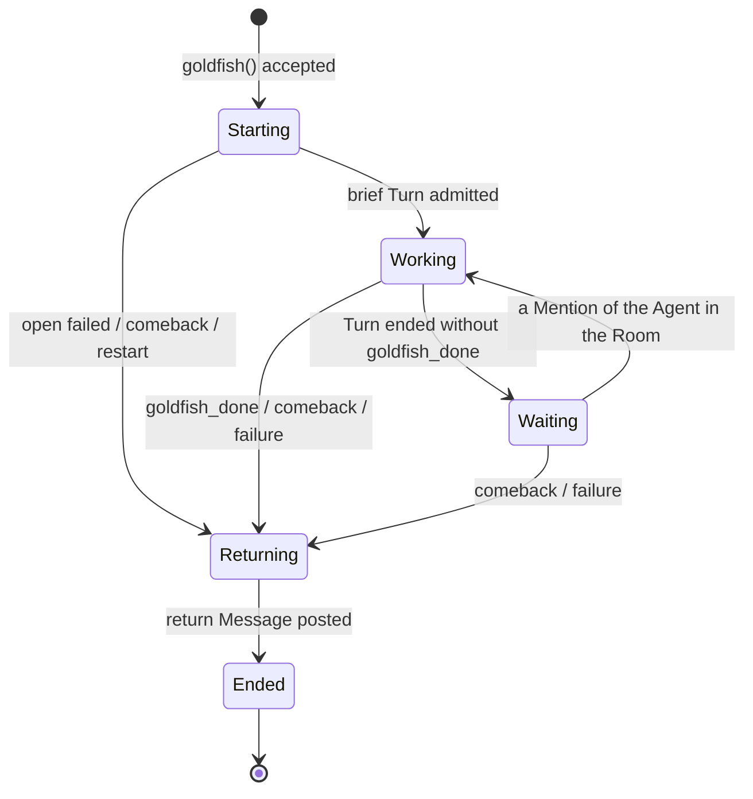

# Huddle.Goldfish — Design Specification

**Date:** 2026-11-17 · **Status:** Built 2026-11-17 (slices 0 to 4); slice 5 waits for #669 · **Issue:** #627 (V1). #629, a full process built on the idea, is
V2 and out of scope · **Depends on:** #669 (a review becomes a Task and the Review state goes; a goldfish review is
a review Task done in goldfish mode; a Team asks for it in its process text, §9.1) · **Decision record:** [ADR-0096](adr/0096-goldfish-mode-a-possession-of-one-agent-in-one-room.md) ·
**Builds on:** [ADR-0024](adr/0024-an-agent-holds-one-session-per-room.md) (one session per Room),
[ADR-0065](adr/0065-huddle-posts-as-itself.md) (Huddle posts as itself),
[ADR-0060](adr/0060-a-documents-history-is-what-its-editors-report.md) (document history),
[ADR-0091](adr/0091-a-rooms-waiting-turns-are-kept-in-team-db.md) (the Turn Queue) ·
**Vocabulary:** [language.md](engineering/language.md) (**Agent**, **Turn**, **Room Session**, **Catch-up**, **App Tool**,
**Huddle** as a sender)

**Goldfish mode** lets an Agent hand its body to a clean copy of itself until a piece of work is done. The copy has the
Agent's name, Persona text, Adapter, Model, budget and permission guards, and nothing the Agent knows: no Room history, no
Catch-up, no Memory, no `AGENTS.md`, no earlier session. The note the Agent writes before it hands over, its **brief**, is
the only thing that crosses. Some work is best done by someone who was not in the conversation: reading a spec to see
whether it can be built, reproducing a bug from its report, checking a claim against its sources. A review done this way
is one use of the mode, not a separate feature.

The idea is based on Google's Elephant-Goldfish Model. Huddle takes its goldfish and generalises it from a reviewer to a
mode any Agent can enter for any work. The product carries no EGM branding.

This page is written for the engineers or agents building it, with no memory of the conversation that produced it. §1
checks the issue against the code; §5 to §7 are the behaviour and the screens; §8 is the architecture; §11 holds every
decision with the alternative it beat; §12 holds what the owner has not yet decided, each with a recommendation; §14 is the
test plan.

> [!IMPORTANT]
> Three pages are binding before any code in this spec is written:
> [rules.md](engineering/rules.md) before editing `src/Huddle.App`,
> [traps.md](engineering/traps.md) before touching `Huddle.Contracts` or the wire, and
> [agents/CSharpPrinciples.md](../agents/CSharpPrinciples.md) for every C# file. For the UI, read
> [UXDesignGuidelines.md](engineering/UXDesignGuidelines.md) first.

> [!NOTE]
> **No change in the ACP effort's subtree.** Everything here lands in `src/Huddle.App`, `src/Huddle.Contracts` and the
> chat-surface tests. `AppToolServer` (`src/Huddle.Acp/Tools/AppToolServer.cs:24`) already takes any tool list, and
> `AgentSessionOptions` already carries a tool endpoint, a system prompt, a permission handler and `_meta` per session
> (`src/Huddle.App/Acp/DotAcpPersonaHost.cs:233-241`), so a second, differently built session in the same Adapter
> process needs nothing new from `Huddle.Acp`.

---

## 1. Today, checked against the code

The issue's *Where Huddle is now* was checked line by line before the build. What it says, what the code said, and where they differed. The rows describe the code as it was then; the build is described in §5 to §8.

| # | Claim | What the code does | Agrees? |
| --- | --- | --- | --- |
| T-1 | A session is kept per (Agent, Room) in a per-Persona pool and saved by Room | `RoomSessionPool` holds `sessionsByRoom` keyed by Room id (`src/Huddle.App/Acp/Sessions/RoomSessionPool.cs:45`), created lazily (`:449-461`); in shared mode (`SessionPerRoom: false`) one session serves every Room (`:132-137`). `RoomSessionStore` keeps one entry per (Persona, Room) (`src/Huddle.App/Acp/Sessions/RoomSessionStore.cs:26`, `:42`) | Yes |
| T-2 | The first Turn carries the Room's last 20 Messages | `TranscriptCatchUpMessages` is 20 (`src/Huddle.App/Acp/AcpOptions.cs:186`); `TranscriptCatchUpStep.AddAsync` adds it to the first non-Command Turn with a trigger Message (`src/Huddle.App/Acp/Sessions/TranscriptCatchUpStep.cs:119-134`). Every `RoomSession` builds the step unconditionally (`RoomSession.cs:252`) | Yes |
| T-3 | The system prompt carries Instructions, Agent Memory and Team Memory | **Instructions are gone.** `Instructions.md` was retired by the Second Brain (ADR-0075); the prompt carries the Human's `AGENTS.md` files instead (`src/Huddle.App/Acp/SystemPromptComposer.cs:336`, `:610-630`), plus Agent Memory, Huddle-wide Memory, Team Memory, the outputs index and the Needs You levels (`:351-353`), all read by `SessionPromptInputs.Build` (`src/Huddle.App/Acp/SessionPromptInputs.cs:26`) in `DotAcpPersonaHost.ComposeSystemPrompt` (`DotAcpPersonaHost.cs:270-311`). This spec reads "no Instructions" as "no `AGENTS.md`" | Outdated word |
| T-4 | `SystemPromptComposer` leaves out any block whose input is empty | True of the optional blocks: `AGENTS.md` (`:612`), Memory (`:527`), Huddle-wide Memory (`:554`), outputs (`:576`), Needs You (`:472`), role (`:344`), Skills (`:707`). **Not true of the rest:** orientation, Persona text, identity, chat rules, promised work, silent replies, tools (`:327-335`, `:373-399`), the Second Brain summary (`:341`, `:447`) and the closing part (`:355`, `systemPrompt.roomSessions` or `.sharedSession`) are always there. The closing part describes Room Sessions, which is false for a goldfish (§8.2) | Partly |
| T-5 | Turn hooks add more on every Turn (`AgentsMd`, `HuddleMemory`) | Four hooks, in this order: Team rename, `AGENTS.md`, Huddle-wide Memory, File Changes (`src/Huddle.App/Acp/Sessions/TurnHooks/TurnHookPipeline.cs:21-27`). Each decides by `AppliesTo(TurnHookScope)` (`:11`), and `TurnHookScope` has `PersonaName`, `ReadsFiles`, `FileChangesOn`, `DeclaredWatches`: nothing says a session is clean (`TurnHookScope.cs:8`) | Yes, wider |
| T-6 | Every wake is a Message; Task wake rules at `TaskTriggerService.cs:235-241` | Yes: four rules, assignee, manager, challenger, requesting manager (`src/Huddle.App/Tasks/TaskTriggerService.cs:235-241`). The Review line is a `const` in code, `ReviewSentence` (`:94`), appended to the assignee's and challenger's wake (`:1519-1522`); it is not a Prompt | Yes |
| T-7 | Helpers start clean in a fresh Adapter process with `SystemPromptMode.Replace` and no tools (`ThrowawayAdapterSession.cs`) | `ThrowawayAdapterSession` only launches one process and one session from options it is given (`src/Huddle.App/Acp/ThrowawayAdapterSession.cs`); `Replace` is set by `AdapterProcessHelperRunner` (`src/Huddle.App/Acp/AdapterProcessHelperRunner.cs:32`) | Yes, other file |
| T-8 | Every Turn starts from a `WorkItem` (Message, Greeting, Command) | `WorkItemKind` has exactly those three (`src/Huddle.App/Acp/Sessions/WorkItemKind.cs`) | Yes |
| T-9 | DocHistory has an app-written actor kind, `Helper` | `DocActorKind` is `Agent`, `Human`, `Helper` (`src/Huddle.App/DocHistory/DocActorKind.cs`); an entry is `(At, Actor, ActorKind, Kind, Summary)` (`DocHistoryEntry.cs`), written as a versioned JSON line (`DocHistoryStore.cs:250`, `:384`) | Yes |
| T-10 | The spend table has a `task_id` column nobody fills | The column exists (`src/Huddle.App/Data/PersonaSpendStore.cs:22`) and `PersonaSpend.Add` takes a `taskId` (`src/Huddle.App/Acp/PersonaSpend.cs:58`), but the only caller passes none (`src/Huddle.App/Acp/PersonaRunner.cs:233-234`) | Yes |
| T-11 | A Task can carry a `goldfish-review` *label* | Tasks have **tags**, not labels (`src/Huddle.App/Tasks/TaskItem.cs:37`); ADR-0062's `task tagged <tag>` rule reads the same field. **Superseded by #669:** there is no `goldfish-review` tag. A review is a Task tagged `review` (or `verify` for QA), and a Team that wants goldfish reviews says so in its process text (§9.1) | Replaced |
| T-12 | Anyone may answer a goldfish's question **by replying to it** | **Huddle has no reply.** `ChatMessage` is `(Id, Timestamp, SenderId, SenderName, Text)` plus `References` (`src/Huddle.Contracts/ChatMessage.cs`); no Message names another, and the Composer has no reply action. An `ask_human` answer is a new Human Message that Mentions the asker (ADR-0022). V1 adds none: a goldfish's question is an ordinary Message and its answer an ordinary Mention (§6.4, D-7) | No, and V1 adds none |
| T-13 | An App Tool knows which session called it | **It does not.** `IAppTool.InvokeAsync` gets only the arguments (`src/Huddle.Acp/Abstractions/IAppTool.cs:16`). Each Persona has one `AppToolServer` and one tool list, built once at start and handed to every session (`src/Huddle.App/Acp/DotAcpAgentHostFactory.cs:139-144`, `:173`); a tool is bound to an Agent id, not to a session (`:557-614`). A tool infers the Room from `TurnActivity` (`src/Huddle.App/Services/TurnActivity.cs:145`, `:237`). V1 uses that: while an Agent is possessed, a tool call it makes in the possession's Room is the goldfish's (§8.3) | No; V1 decides by (Agent, Room) |
| T-14 | Read-deny rules go through the session's `permissions.deny` (`DenyRules`) | `DenyRules()` names one tool, the browser's `browser_run_code_unsafe` (`DotAcpAgentHostFactory.cs:808`), and `permissions.deny` is sent **only when the browser is passed** (`:721-728`). A goldfish deny list is a new list in the same `permissions` key (§8.4) | Partly |
| T-15 | The Agent's Memory is outside its Work Dir | It is **inside**: `{WorkDir}/memory` (`DotAcpAgentHostFactory.cs:444`), and the Work Dir is every session's `cwd` (`DotAcpPersonaHost.cs:234`). A goldfish working in the Work Dir can read its own Memory with the Adapter's file tools unless something denies it (§8.4, O-2) | New finding |
| T-16 | The avatar can take a dashed ring | design-system.md reserves the dashed `ProfileCard` ring for a proposed Agent, "Nowhere else" ([design-system.md](engineering/design-system.md), *Avatars and status*, Profile ring). **Resolved with a ring of its own look:** a 2px solid Info ring, where the `ProfileCard` ring is 1px `TextSecondary` dashed or solid, and the design-system row is amended to name it (§7.4) | Resolved |
| T-17 | A Task waits for review in the Review state | Today, yes: `TaskState.Review` (`src/Huddle.App/Tasks/TaskState.cs`) drives `ChallengerWakeRule`, `ReviewSentence` and `ProofInputWatcher`. **#669 removes it** (decided 2026-11-17): a review is its own Task, owned by the reviewer, and the work Task waits `blocked_by` it. This spec assumes #669 and never relies on the Review state | Changing first |

---

## 2. Goal

1. **An Agent can do a piece of work with a clean mind, as itself,** from a chat request or a Task, without a new kind of
   Task and without a new Persona.
2. **What crosses is on the record.** The brief is posted word for word where the work started and heads the result, so
   anyone can judge whether the goldfish was led.
3. **What the goldfish learns is on the record too.** Every question it asks is posted, answered in the open, and counted
   as a finding.
4. **A goldfish leaves on its own, by calling `goldfish_done`,** and anyone can call it back. Whichever way it ends, the
   Agent always gets its body back with a result that says how it ended. Goldfish mode adds no limit or budget of its
   own; the Agent's and the Room's existing budgets apply to its Turns as to any Turn.
5. **The Human can see, while it lasts, that an Agent is in goldfish mode,** and can call it back with one click.
6. **The Agent's other Rooms keep working.** Only the Room where the work started waits.

### 2.1 Use cases

| # | Situation | What must happen |
| --- | --- | --- |
| U1 | The Human writes "@Ruth, goldfish this spec: can it be built as written?" in a group Room | Ruth calls `goldfish` with a brief naming the spec. Her Turn ends with a short reply. The Room shows "Ruth went into goldfish mode" with the brief; the clean Ruth reads the spec and posts its findings stamped "Ruth · goldfish"; the warm Ruth then gets a Turn with the result |
| U2 | Ruth is assigned a review Task (tagged `review`, #669) whose parent holds a spec, in a Team whose process text asks for goldfish mode for spec reviews (§9.1) | Ruth calls `goldfish` with a brief naming the spec; the brief is posted in the Room and as a comment on the review Task; the goldfish's `log_change` on the spec reads "Goldfish review by Ruth" in its history |
| U3 | The goldfish needs to know whether "lockout" means per account or per device | It posts the question as an ordinary Message, stamped "Ruth · goldfish", and ends its Turn without `goldfish_done`, so it waits. Quinn (an Agent) or the Human answers with a Message that Mentions Ruth; that Message, and nothing else of the Room, starts the goldfish's next Turn |
| U4 | The goldfish has what it needs | It calls `goldfish_done`; Ruth gets the result |
| U5 | The Human wants Ruth back now | The Human presses **Call Ruth back** (or anyone posts exactly "@Ruth comeback"). The goldfish stops; the warm Ruth gets "Called back by {Name} after 4 minutes" and the partial result |
| U6 | While Ruth is a goldfish in Room A, the Human Mentions Ruth in Room B | The warm Ruth answers in Room B as usual |
| U7 | While Ruth is a goldfish in Room A, the Human Mentions Ruth in Room A about something else | The goldfish gets it, as it gets every Mention of Ruth there: the body is the goldfish in that Room. A Message that does not Mention Ruth is owed to nobody, as today |
| U8 | Huddle is closed or crashes during a possession | On the next start the possession ends as **Restarted**, never resumed; Ruth gets "Interrupted by a restart" with whatever was posted |
| U9 | The goldfish ends a Turn without `goldfish_done` and nobody Mentions Ruth | It stays in goldfish mode, waiting. The chip reads "Ruth (goldfish) is waiting · 12 min" with **Call Ruth back**; nothing ends it on a clock |
| U10 | A sentence such as "Ruth, don't come back yet, @Ruth comeback later" is posted | An ordinary Message. Nothing ends |

---

## 3. Non-goals

| Not in scope | Why |
| --- | --- |
| **Enforcement**: a Definition of Done rule, a gate, a change to Proof or `spec-approved-before-build` | Decided: V1 makes what happened visible, it does not require it |
| **A new kind of Task** | Decided: a goldfish review is ordinary work on an ordinary Task, or a chat request |
| **A new `WorkItemKind` for Tasks**, or any change to `TaskService`'s rules | The stamp rides on existing writes (§6.8) |
| **Several goldfish at once**, for one Agent or one piece of work | Later (§13) |
| **A goldfish that remembers**: Memory writes, Follow-ups, Watched Folders | It ends when the work ends (O-5) |
| **Replies, a question tool, a question counter, or Huddle detecting questions** | A goldfish asks with an ordinary Message and is answered with an ordinary Mention (D-7, D-18) |
| **Limits of its own**: a time limit, a Turn cap, a spend cap, a daily cap, a cap on calls per Turn, a question cap or a question timeout | Owner decision 2026-11-17 (D-17): a goldfish leaves by `goldfish_done`; the guardrail is the comeback. The Agent's and the Room's existing budgets still apply |
| **EGM branding** | Decided |
| **Making the Work Dir a jail** | It is not one ([rules.md](engineering/rules.md), "The Work Dir is not a jail"); §8.4 narrows what a Claude goldfish can read and §10 states what it cannot stop |

---

## 4. Principles

1. **Build the session up, never strip it down.** A goldfish session is composed from an explicit list of parts that
   names what it gets. It never starts from a Room Session and removes things, so a part added to Room Sessions later
   cannot leak in.
2. **The brief is the only thing that crosses in.** Whatever is not in it, or in the files it names, the goldfish does not
   know. Huddle adds nothing about the Room, the Agent's Memory or the request.
3. **Everything that crosses is on the record.** The brief, every question and every answer are Messages in the Room.
4. **One owner per possession.** One supervisor starts it, follows its Turns and always runs the return step, whatever
   ends it.
5. **Huddle stamps; the goldfish does not.** The stamp comes from the session's own tools and the server's knowledge of the
   possession, never from text the goldfish writes.
6. **The runner stays a pipe client.** `PersonaRunner` keeps no database access (Turn Queue principle 2); possession state
   lives on the server and reaches the runner as additive envelopes (§8.6).
7. **Absent means unchanged.** An Agent that never calls `goldfish` prompts, posts and stores byte-for-byte as today.

---

## 5. The App Tools

Two tools, each a model-facing name built from the Adapter Profile's prefix (`mcp__team__` for `claude-agent-acp`), never
typed into a Prompt ([rules.md](engineering/rules.md), the prefix rows). Every description and result text is a Prompt in
`PromptCatalog` ([ADR-0007](adr/0007-model-facing-text-is-configuration.md)).

| Tool | Offered to | Purpose |
| --- | --- | --- |
| `goldfish` | Every session of an Agent on a Claude Adapter with isolation, while `Team:Goldfish:Enabled` is `true` (O-3). Offered to no other Agent, so there is no refusal for an unsupported Adapter | Start a possession |
| `goldfish_done` | The same Agents, in the same list (both tools are offered together or not at all); refuses unless the caller's (Agent, Room) is possessed | End the possession with a result |

### 5.1 `goldfish(instructions)`

```json
{
  "type": "object",
  "properties": {
    "instructions": { "type": "string", "maxLength": 1000 }
  },
  "required": ["instructions"]
}
```

- **The Room** is the one the calling Turn runs in, read from `TurnActivity.SoleRoom` for the caller (`TurnActivity.cs:41`, `:145`).
  The tool takes no `roomId`: a goldfish starts where the work is.
- **The Task**, when there is one, is the Task in hand: the Task whose wake started the calling Turn
  (`TurnActivity.TaskInHand`, `TurnActivity.cs:237`; ADR-0089).
- **The tool returns at once.** Goldfish work can be long, so the calling Turn ends with a short reply and the result comes
  back later as a new Turn.

Success result (`tool.goldfish.started`, rendered):

```text
Goldfish started in {Room}. Your brief is posted there. End this Turn now with one short line, or {{silentToken}}.
You will get the result as a new Turn when the goldfish is done. Until then you cannot post in {Room}.
```

Refusals, each a plain sentence that says it is final, so the model does not retry (the Budget refusal's reasoning,
[rules.md](engineering/rules.md)). They are checked in the order of the table, except that the concurrency check comes before the Turn check:

| Case | Text (gist) |
| --- | --- |
| Empty or whitespace `instructions` | "Write the brief: what to do and what to read." |
| Over `Team:Goldfish:MaxBriefChars` (1,000) | "The brief is {n} characters; the limit is 1000. Say less: what to do and which files to read." |
| No running Turn found for the caller | "Call goldfish from the Turn where the work is." |
| The Agent is already in goldfish mode in any Room (this also covers a second call in the same Turn) | "You are already in goldfish mode in {Room}. One at a time." |
| The caller's (Agent, Room) is possessed, that is, a goldfish calls it | "You are in goldfish mode. Finish with goldfish_done first." (no nesting) |
| `Team:Acp:MaxConcurrentTurns` is above 1, so the Agent may run Turns in two Rooms at once (D-20) | "Goldfish mode needs one Turn at a time, and this Huddle runs up to {n} at once." |
| `Team:Goldfish:Enabled` is `false`, or the Adapter is not a Claude Adapter with isolation | Neither tool is offered at all (`DotAcpAgentHostFactory.OfferGoldfishTools`); a shared-mode profile is not refused here, the pool's throw becomes a `Failed` report (§6.9) |

The description (`tool.goldfish.description`) says, in this order: what the mode is; that the brief is the only thing the
goldfish will know and is posted word for word; **say what to do and what to read; do not say what you think the answer
is, what the author meant or what was agreed in chat**; that the goldfish leaves by `goldfish_done` and can be called
back; that the call ends the Turn.

### 5.2 Asking: no tool of its own

A goldfish asks the way anyone in a Room asks: it posts an ordinary Message, its reply or `post_message` into the brief's
Room, stamped "· goldfish" (§6.8), and ends its Turn without `goldfish_done`, which means it is waiting (§6.3). An `@` in
it Mentions whoever it names, as for any Agent. A question only the Human can answer may use `ask_human` or
`AskUserQuestion` (§6.4.1). There is no question tool, header or counter, and Huddle does not detect questions (D-7, D-18).

### 5.3 `goldfish_done(result, findings?, outcome?)`

```json
{
  "type": "object",
  "properties": {
    "result": { "type": "string", "maxLength": 4000 },
    "findings": { "type": "array", "items": { "type": "string", "maxLength": 500 }, "maxItems": 30 },
    "outcome": { "type": "string", "enum": ["finished", "stuck"] }
  },
  "required": ["result"]
}
```

- `outcome` defaults to `finished`. `stuck` is the goldfish saying it cannot go on, even with assumptions (§6.5).
- Huddle posts the result Message (§6.6) and starts the return step. The tool returns "Done. Your body goes back to
  {Agent}." and the goldfish's Turn is stopped after the call returns.
- `result` lists the questions the goldfish asked and the answers it got; the findings stay in `findings`. Huddle counts
  nothing itself.
- A file the goldfish wrote (a report) is named in `result` by its path; Huddle does not write a file of its own.

### 5.4 What works inside a possession

The goldfish uses the Agent's own `AppToolServer` and tool list, unchanged (D-14). Its calls are told apart by where they
come from: a call the Agent makes in the possession's Room while it is possessed is the goldfish's (§8.3). Everything works
as today, except:

| Tool | Inside a possession | Why |
| --- | --- | --- |
| `memory`, `propose_team_memory` | Refuses | Reads and writes Memory (O-5) |
| `search` | Refuses | Reads Transcripts across Rooms (ADR-0066) |
| `read_records` | Refuses | Reads Room Transcripts and Change logs |
| `goldfish` | Refuses | No nesting |
| `goldfish_done` | Works; refuses everywhere else | The way out |
| `ask_human` | Works; its card is stamped (§6.4.1) | Questions for the Human |
| `log_change`, the Task tools | Work; their writes are stamped (§6.8) | Writing stays |
| `post_message` | Works from a Turn running in the possession's Room, and is stamped there. Called from a Turn in another Room into the possessed Room, it refuses with `tool.goldfish.warmBlocked`: "{Agent} is in goldfish mode in {Room}; post there after she is back." | The warm Agent may not speak in that Room (A-5). The goldfish's own `post_message` into another Room works, unstamped (a known limit) |

The refusing tools are `memory`, `propose_team_memory`, `search`, `read_records` and `goldfish`, each by a guard (`GoldfishGuard.Refusal`) on its first line. A refusal is one Prompt, `tool.goldfish.refused`: "Not in goldfish mode: this tool reads what you must not know. Work from
your brief and the files it names." Catch-up is not a tool; it is off in the clean session (§8.2). O-4 asks the owner to
confirm the refused set; tools that reach other Rooms (`create_room`, `invite_agent`, `follow_room`, `post_message` with
another Room) and `jobs` work as today under this rule.

---

## 6. Behaviour

### 6.1 The possession, as a state machine



| State | Meaning | Stored |
| --- | --- | --- |
| `Starting` | The row exists, the brief is posted, the warm Agent finishes its Turn, the clean session opens | Yes |
| `Working` | A goldfish Turn is running or queued | Yes |
| `Waiting` | A goldfish Turn ended without `goldfish_done`; the goldfish holds the body until a Mention of the Agent in that Room starts its next Turn, or it is called back | Yes |
| `Returning` | An exit is chosen; the result and the return Message are being posted | Yes |
| `Ended` | Done, with its exit (§6.5) | Yes, kept for diagnosis |

Every transition is written to `team.db` before its effect (§8.7). Only the supervisor writes the state.

### 6.2 Starting

When `goldfish` is accepted, in order:

1. `GoldfishSupervisor.BeginAsync` writes a `Starting` row: possession id, Agent id, Room id, Task id or none, the brief,
   the start time. A unique-index conflict (the Agent already has an open possession) returns null and the tool refuses.
2. Huddle posts the start row in the Room with `PostAsHuddleQuietAsync`, so the brief, quoted word for word, parses no
   Mention: "Ruth went into goldfish mode. They don't remember this Room." followed by the brief, drawn as a system row (§7.2).
   With a Task in hand, Huddle also adds the brief as a comment on the Task, written as Huddle, "Goldfish brief for Ruth: …"
   (a failure is logged, not fatal).
3. The server sends the runner `GoldfishBegin` (§8.6) at once, with the Task id. A failed post or send ends the possession
   `Failed` and rethrows.
4. The tool returns. The warm Turn finishes as usual and its reply is posted.
5. The runner opens the clean session (§8.2), queues its first Turn, the brief framed by `turn.goldfishBrief` (§9), and then
   reports `Opened`. The goldfish's Turns go through the Persona's own Turn gate, in ticket order with its other Rooms
   ([rules.md](engineering/rules.md), "Turns across Rooms are admitted in ticket order"), so the brief Turn runs after the
   warm Turn that called the tool. From then on the runner delivers that Room's Turns for the Agent to the goldfish
   session instead of the warm one (§6.9).
6. When that Turn starts, the runner reports `TurnStarted` and the row becomes `Working`.

The goldfish's first prompt holds the brief and nothing else: no Catch-up, no own-post lines, no hook blocks, no Room
Messages.

### 6.3 Turns

A goldfish Turn is one of:

| Turn | Prompt |
| --- | --- |
| The brief | `turn.goldfishBrief` with `{{brief}}` and `{{roomLabel}}` |
| A Message for the Agent in that Room | `turn.goldfishMessage` with `{{sender}}` and the Message's text, and nothing else: no Catch-up, no Room history (§6.4) |

**The goldfish's own rule** (D-18), stated in `systemPrompt.goldfish`: if it asked a question, it ends its Turn and waits
until it is satisfied with the answer; if it did not need to ask, or has what it needs, it leaves with `goldfish_done`.
Huddle does not detect questions. When a goldfish Turn ends:

- **With `goldfish_done` called:** the possession ends (§6.5).
- **Without it:** the goldfish is `Waiting`. The possession stays, Huddle sends nothing, and the chip `C2c` reads "Ruth
  (goldfish) is waiting" with its **Call Ruth back** button (§7.1). The next Mention of the Agent in that Room, an `ask_human` answer
  included (it is a Mention), starts its next Turn. A comeback, or a failure, ends it.

### 6.4 Questions and answers

- **Asking:** an ordinary Message in the brief's Room, stamped "· goldfish" (§5.2). When the possession started from a
  Task, the question is still asked in the Room (A-3).
- **Answering:** anyone answers with an ordinary Message that Mentions the Agent ("@Ruth, per account").
- **The Mention rule.** While an Agent is possessed, every Message in the possession's Room that is owed to that Agent (a
  Mention, or, in a one-to-one Room, any Message, ADR-0004) is delivered to the goldfish session. A
  Message that does not Mention the Agent is owed to nobody, as today; one the Agent hears only because it follows the Room
  goes to the warm Catch-up and starts no Turn, so the warm Agent never answers there. The Agent's other Rooms are unchanged.
- **Only that Message.** The goldfish receives the Mentioning Message itself, framed by `turn.goldfishMessage`, never the
  Room around it: no Catch-up, no own-post lines, no hook blocks.
- **The trade-off.** Every Mention of Ruth in that Room reaches the goldfish while she is possessed, whatever it is about.
  That is on the record and visible: the chip (`C2c`) says who is answering.
- **No Needs You item** for an ordinary question Message; an `ask_human` card raises its Question reason as any card does
  (§6.4.1, A-4).
- **The record.** The goldfish's result lists the questions it asked and the answers it got (§5.3). Huddle counts nothing.

#### 6.4.1 Questions for the Human

A question only the Human can answer uses what any Agent uses (D-19), and both stay available in a goldfish session:

| Way | Card | Answer reaches the goldfish |
| --- | --- | --- |
| `ask_human` (`src/Huddle.App/Acp/Tools/AskHumanTool.cs`) | The Question card `C8a`, its title "Ruth · goldfish is asking" with the fish | As a Message Turn, by the Mention rule (§6.4): the call returned at once, and the answer is posted as a Human Message that Mentions the asker (ADR-0022; `QuestionService.AnswerAsync`, `src/Huddle.App/Questions/QuestionService.cs:43`) |
| Claude's `AskUserQuestion`, through the elicitation bridge | The `ElicitationCard` (`C8`), stamped "Ruth · goldfish" in its title | On the goldfish's own open request: the call is held inside the goldfish's Turn and the answer is its result, as for any session |

- **No routing of its own.** The card is stamped because it is raised from a possessed (Agent, Room) (§8.3); the answer
  travels as any `ask_human` answer does.
- **Needs You.** Either card raises Needs You's Question reason, as any card does (ADR-0050), and clears as any card does.
- **A call back with a card open** dismisses the card (`QuestionService.Dismiss`, `QuestionService.cs:71`) or ends the
  held request.

### 6.5 Exits

Every possession ends with exactly one exit, and every exit runs the same return step (§6.6).

| Exit | Trigger | Return line (the warm Agent's Turn and the Room's system row) |
| --- | --- | --- |
| **Finished** | `goldfish_done` with `finished` | "Ruth is back. Goldfish finished: 3 findings, result above." |
| **Stuck** | `goldfish_done` with `stuck` | "Ruth is back. Gave up: {first line of the result}." |
| **Called back** | An exact comeback (§6.7), the **Call Ruth back** button, or the Human's Stop on the goldfish's Draft (`TurnControl.StopAsync` ends it CalledBack by the Human and sends no `StopTurn`); from any state, `Waiting` included | "Ruth is back. Called back by Quinn after 4 minutes. Partial result above." |
| **Failed** | The clean session failed to open, the Adapter stopped, the Turn failed or timed out, the Agent was restarted, renamed away or removed | "Ruth is back. Didn't finish: the Adapter stopped." |
| **Restarted** | Huddle stopped or crashed mid-possession; found at the next start (§10) | "Ruth is back. Interrupted by a restart. Partial result above." |

**Partial work is kept.** Whatever the goldfish posted stays, stamped. A partial result says how far it got: the Turns it
ran and its last reply.

**A possession never resumes.** Its session is never stored (§8.2), so nothing can bring it back. Failed and Restarted are
not limits: they are what happens when the goldfish can no longer run.

**Existing budgets, not goldfish ones.** A goldfish post refused because the Room's Budget is spent, or a Turn refused
because the Agent's per-Persona token budget is spent, is refused exactly as for any Turn of that Agent. Neither ends the
possession: the goldfish waits, the chip keeps **Call Ruth back**, and a Continue or a Human Message resumes it as it would
any Agent (E-7).

### 6.6 The return step

Run once per possession by the supervisor, whichever exit was chosen, and idempotent by possession id:

1. **Stop the goldfish.** Send `GoldfishEnd` to the runner: it cancels any goldfish Turn, disposes the clean session, and delivers that Room's Turns to the warm session again.
2. **Post the result Message** in the Room, always by Huddle (`PostAsHuddleQuietAsync`, so a Mention inside the quoted
   brief owes nobody), stamped with the possession id, and skipped when `result_message_id` is already set. Its text, in
   order: "Brief:" and the brief quoted word for word; the result ("Partial result:" and the text for a Stuck exit, "No result
   was posted." when there is none); the findings. `goldfish_done` hands its result to `EndAsync` as a `GoldfishResult`;
   every other exit has none. Huddle's post spends no Budget.
3. **Post the return row** as Huddle, stamped with the possession id: the line from §6.5, Mentioning the Agent. This is the warm Agent's new Turn. Huddle's
   post with a Mention owes a Turn and spends no Budget ([ADR-0065](adr/0065-huddle-posts-as-itself.md)); the Turn Queue
   keeps it across a crash.
4. **Write `Ended`.** The spend was added per Turn as the runner reported it (§8.8). Steps 2 and 3 catch and log any
   non-cancellation failure (a deleted Room, a Transcript write that fails), and step 4 runs in a `finally`, so a row is never
   stranded in `Returning`; on cancellation (Huddle stopping) it stays `Returning` and the start-up pass ends it Restarted.

There is no `turn.goldfishReturn` Prompt: the return row's Mention owes the warm Agent an ordinary Turn, and the result
Message sits just above it in the Room, so what the goldfish learned flows back through the Catch-up. Nothing flows the
other way.

### 6.7 "@Ruth comeback"

- **Exact match only.** After trimming, a Message whose whole text is a Mention of an Agent Member of the Room (not the sender) followed by the word
  `comeback`, case ignored, any run of white space between them treated as one space. The Mention is resolved against the
  Room's Members, Name or Alias, longest first, as every Mention is ([rules.md](engineering/rules.md), "a Mention is
  resolved against the Members"). "@Ruth comeback." with a full stop, or a sentence containing the words, is an ordinary
  Message.
- **Anyone in the Room** may send it: the Human, the manager, the Chief of Staff, any other Agent.
- **Huddle decides it inside the post**, in `ChatService`'s post lock (`DecideGoldfish`): the Message is appended to the
  record and owes no Turn (its Mentions are cleared). The lock only decides; the supervisor is called after the lock is
  released, because the post lock is not reentrant and `EndAsync` posts into the same Room. Neither the goldfish nor the
  warm queue ever sees the Message. The possession may be in another Room than the one the comeback is posted in.
- **The goldfish's own comeback is ignored**: a Message from the goldfish session is checked first and never matches. It
  ends with `goldfish_done`.
- **An Agent not in goldfish mode:** Huddle replies "Ruth isn't in goldfish mode." (a quiet post) and does nothing else; the
  Message owes no Turn. A lookup that fails is logged and nothing is posted, so Huddle never claims an Agent isn't in goldfish mode when it cannot tell.
- **The result always says who called it back and when** ("Called back by Quinn after 4 minutes"). The **Call Ruth back**
  button posts the same text as the Human.

### 6.8 The stamp

Huddle stamps a write when it comes from a possessed (Agent, Room) (§8.3): a post by the Agent into the possession's Room,
or a tool call the Agent makes there. The warm Agent cannot act in that Room (A-5), and a possession still `Starting` is not possessed, so the calling Turn's own writes are never stamped. The stamp
is never parsed from text the goldfish writes; Huddle's own start and return rows are recognised by the stamp and then parsed (§7.2).

| What the goldfish writes | Stamp | Where it is stored |
| --- | --- | --- |
| A Message (its reply, a question, `post_message`, the result) | `ChatMessage.Goldfish`: the possession id. Huddle's start row, result Message and return row carry it too; the meta line draws "Ruth · goldfish" for an Agent sender only, never "Huddle · goldfish" | The Transcript line; the meta line shows "Ruth · goldfish" (§7.3) |
| A Task change (comment, Evidence, update, close, reopen, create) | The Timeline author written `Ruth · goldfish`, like a Helper's `Name (Helper)` (`src/Huddle.App/Tasks/TaskActors.cs:47`). A Task a goldfish creates keeps its `Creator` plain, "Ruth": it is an identity that wake rules and the rename sweep look up; only the `created` Timeline row carries the stamp | The Task file's `## Timeline` row (`TaskFileFormat.Timeline.cs:99`) |
| A document history entry (`log_change`) | `DocHistoryEntry.Goldfish = true`; the entry's actor stays "Ruth" | The JSON line, a new optional field (`"goldfish":true`, omitted when false); the byline reads "Goldfish review by Ruth" for `Reviewed` and "Goldfish edit by Ruth" for `Edited`. `Objected` and `Created` entries keep the flag but are worded as before |

Any reader that compares a Timeline author with an Agent's Name (Proof's `evidence from <step>`, the wake rules' actor
checks) strips the stamp through one helper, `GoldfishStamp.AgentName(author)`, so a goldfish's Evidence still counts as
Ruth's. The readers are Proof's context builder and evaluator, `TaskService`, `ProcessGateService`, the manager, requesting-manager and challenger wake rules, and the Feed's Agent filter and avatar lookup; display keeps the stamp. A test pins them (§14).

### 6.9 The warm Agent, set aside in one Room

- **No queue, no hold.** While the possession is open, the runner delivers the possession Room's Turns for the Agent (the
  Mention rule, §6.4) to the goldfish session, not to the warm Room Session. The warm session keeps its stored session id
  and is untouched. A Turn already running when `GoldfishBegin` arrives (the calling Turn) finishes first.
- **The Turn Queue still holds.** A Message owed to the Agent there keeps its Turn Queue row (ADR-0091) and is answered by
  the goldfish's reply, which names it like any reply. After a crash the possession ends Restarted (E-1) and the Turn Queue
  re-sends what is still owed to the warm Agent.
- **The warm Agent reads them later as context.** A Message delivered to the goldfish is also added to the warm Agent's
  Catch-up for that Room, so after the return it sees what was asked and answered, as for any Message it did not answer.
- **The warm Agent cannot post in that Room** during the possession: `post_message` into the brief's Room from a Turn that is not running in it is refused, "Ruth is in goldfish mode in {Room}; post there after she is back." (A-5). Two voices of one
  Agent in one Room would make the record unreadable.
- **A Message the Agent only follows** in the possession's Room goes to the warm Catch-up and starts no Turn (§6.4). A redelivered Message the goldfish already holds adds no second Turn and no second Catch-up line.
- **Its other Rooms keep working**, through the same Turn gate.
- **Shared mode** (`SessionPerRoom: false`) routes by Room inside the one shared session: deliveries for the brief's Room go
  to the goldfish, others to the shared session. No built-in profile uses shared mode
  (`src/Huddle.App/Acp/AdapterProfile.cs:74`, `AdapterCatalog.cs:107`), so V1 does not offer `goldfish` there; if a shared-mode pool is asked to open one anyway it throws, the runner reports `Failed`, and the possession ends Failed (O-3).

### 6.10 No limits of its own

Decided 2026-11-17 (D-17): goldfish mode has no time limit, no Turn cap, no spend cap, no daily cap, no cap on calls per
Turn, and nothing about questions. A goldfish leaves voluntarily through `goldfish_done`; the one guardrail is
that anyone can call it back (§6.7). What stays:

| Rule | Why |
| --- | --- |
| No nesting: a goldfish cannot call `goldfish` | It refuses inside a possession (§5.4) |
| One possession per Agent at a time | One clean session, one Room routed to it, one chip; several at once is later (§13) |
| The brief's length (`Team:Goldfish:MaxBriefChars`) | A brief is a note, not a transcript (D-4) |
| The Room's Budget and the Agent's per-Persona token budget | They apply to a goldfish's Turns as to any Turn (§6.5) |

The header chip still shows the elapsed minutes (§7.1), as information. The return row states the spend (§7.2).

---

## 7. What the Human sees

Two kinds of signal. **Live state** exists only while a possession is open and is read from the store's rows through `GoldfishLive`, a read model that refreshes when the store changes, so
nothing stale survives a crash. `Starting` and `Working` read "in goldfish mode", `Waiting` reads "is waiting", and `Returning` and `Ended` show nothing. **The permanent record** is Messages, Task rows and history entries, and stays.

### 7.1 Live state

| Code | Where | Container | Copy |
| --- | --- | --- | --- |
| `C2c` (new) | Room header (`C2`), right after the Room's name | `Chip` `Look=Status`, the fish icon, Info tone, with a text button | "Ruth in goldfish mode · 12 min" while a goldfish Turn runs, "Ruth (goldfish) is waiting · 12 min" between Turns (§6.3), and the text button **Call Ruth back** on the chip. The minutes tick once a minute and are information only: nothing ends at any number. **The Room's name and the tab title do not change** (Decided) |
| Avatar (every `PresenceAnchor`) | Room members (`C3`), the sidebar, a Task's assignee, the profile popover (`O9`), the Agents page | `PresenceAnchor` with a goldfish cue | A 2px solid Info ring 2px clear of the avatar, and the fish badge on the rim replacing the usual presence glyph. On a `ProfileCard`, the badge only (§7.4). `aria-label` "Ruth, in goldfish mode". Drawn by the four `PresenceAnchor` users (the Agents page, `AgentLabel`, `ProfileCard`, `MembersPanel`) through `AgentName` and `BadgeOnly` |

**Call Ruth back** posts "@Ruth comeback" as the Human (§6.7), then disables itself until the chip is gone. It does not
confirm: the action ends the work but loses nothing.

### 7.2 The permanent record

| Code | What | Copy |
| --- | --- | --- |
| `C4d` (new) | Start row: a Huddle Message drawn as a system row, like `C4c` | Summary: "Ruth went into goldfish mode. They don't remember this Room." Detail: "Their brief:" and the brief, word for word, as plain text (never Markdown or Mention pills) |
| `C4e` (new) | Return row: a Huddle Message drawn as a system row | Summary: the line from §6.5, for example "Ruth is back. Goldfish finished: 3 findings, result above." Detail: "Started 14:02, ended 14:09, 3 Turns", plus ", spent 0.120 USD" when the spend is known; a pruned row shows the summary only |
| `C5d` (new) | The stamp on the meta line (`C5b`) of every Message the goldfish wrote | "Ruth · goldfish" with a 14px fish after the Name; its tooltip is the subtitle "Fresh-eyes mode: no memory of this Room, sees only their brief and the files it names." |
| Document history | A `log_change` entry with the stamp | "Goldfish review by Ruth" (`Reviewed`), "Goldfish edit by Ruth" (`Edited`), "Goldfish objection by Ruth" (`Objected`), "Created by Ruth (goldfish)" (`Created`) |
| Task Timeline | A Task row from the goldfish | The author "Ruth · goldfish" |

The start and return rows are identified by the stamp plus a parse, not by a prefix alone. `MessageList` takes a Message
as a goldfish row when its sender is Huddle and `Goldfish` is set, then `GoldfishLine.TryParseStartRow` (the first line ends
with the start marker, the brief follows a blank line) draws `C4d` and `TryParseReturnRow` (one line, " is back. " and a known
ending) draws `C4e`; the result Message, stamped too, parses as neither and stays an ordinary Huddle row. The markers are
constants beside the builders in `GoldfishLine`, so poster and renderer cannot drift.

### 7.3 Interface copy, in one place

| Key | Text |
| --- | --- |
| Name on screen | goldfish mode |
| Subtitle and tooltip | Fresh-eyes mode: no memory of this Room, sees only their brief and the files it names. (`GoldfishStamp.Tooltip`) |
| Stamp | {Name} · goldfish |
| Header chip | {Name} in goldfish mode · {n} min |
| Header chip, between Turns | {Name} (goldfish) is waiting · {n} min |
| Chip action | Call {Name} back |
| Start row | {Name} went into goldfish mode. They don't remember this Room. |
| Brief label | Their brief: |
| Not in goldfish mode | {Name} isn't in goldfish mode. |
| Avatar label | {Name}, in goldfish mode |
| Card title, a question for the Human | {Name} · goldfish is asking |

The copy says "they" and "their" for every Agent (A-6, D-28); the Persona's pronoun is not read. The issue's copy used Ruth's "she".

### 7.4 Icon and avatar

- **The fish.** Material ships no plain fish ("phishing" reads as security, "set_meal" is a fish on a plate). Add a simple
  fish outline to `MaterialSymbols.cs` (`src/Huddle.App/Tabs/MaterialSymbols.cs`, four symbols today), drawn on the 24dp
  grid, used for this concept only. design-system.md's *Icons* table gets a row for it first ("A new concept gets a new row
  here before it gets an icon in the code").
- **The cue.** `PresenceCue` gains a goldfish cue and `PresenceGlyph` a `Fish` glyph (`src/Huddle.App/Presence/PresenceCue.cs:18-39`,
  `PresenceGlyph.cs`). The badge is drawn by `PresenceBadge` as today, a 10px (12px beside 40px and up) circle at the rim with
  a 2px Surface ring, the fish white on Info mixed 20% toward black. The glyph carries the state, so it reads in greyscale.
- **The ring.** `PresenceAnchor` takes `AgentName` and `BadgeOnly`, reads `GoldfishLive` and re-renders when it changes, and adds `.presence-anchor.goldfish`, a **2px solid Info ring, 2px clear
  of the avatar**, drawn outside it so the avatar never shrinks. `AgentAvatar` is untouched, and keeps its single
  `MudAvatar` root.
- **Why it can't be mistaken for the Profile ring (T-16).** design-system.md's Profile ring is 1px `TextSecondary`, dashed
  for a proposed Agent and solid for an existing one, on a `ProfileCard` only. The goldfish ring differs in width, colour
  and place: 2px, Info, on live avatars (Room members, the sidebar, a Task's assignee, the profile popover, the Agents
  page). The Profile ring row's "Nowhere else" is amended in the same change to "Nowhere else, except the goldfish ring
  (Huddle.Goldfish §7.4)".
- **Never two rings.** On a `ProfileCard` of a possessed Agent the card keeps its own ring and shows only the fish badge.
- **Never colour alone**: the ring comes with the badge's glyph, and the label says it.

### 7.5 Wireframe codes to add

[wireframes.md](engineering/wireframes.md), Figure 3, gains `C2c` (goldfish chip), `C4d` (goldfish start row), `C4e`
(goldfish return row), and `C5d` (goldfish stamp). The avatar cue is a variant of an
existing container, not a new code.

---

## 8. Architecture

### 8.1 The shape

```text
 goldfish tool (warm session)        ChatService (post lock)
        |                                   |  comeback?
        v                                   v
 GoldfishSupervisor  <---- reports ---- PersonaRunner -- RoomSessionPool
 (hosted, StopSignal,                    |                 |  Room A's Turns: to the goldfish
  team.db rows)           -- envelopes -->|                 |  GoldfishSession: clean RoomSession
        |                                                   |    (the Agent's own tools)
        v                                                   v
 return step: result, return row, release            IPersonaHost.OpenCleanAsync(spec)
```

| New type | Where | Does |
| --- | --- | --- |
| `GoldfishTool`, `GoldfishDoneTool` | `src/Huddle.App/Acp/Tools/` | The two App Tools, offered together by `OfferGoldfishTools` (§5). `GoldfishDoneTool` refuses outside a possession |
| `GoldfishSupervisor` | `src/Huddle.App/Goldfish/` | The one owner of every possession (§8.9). An `IHostedService, IDisposable` holding its lifetime in a `StopSignal` (`src/Huddle.App/Services/StopSignal.cs:10`; HUD0002); it runs no loop and no timer |
| `GoldfishStore` | `src/Huddle.App/Goldfish/` | The `goldfish_possessions` table in `team.db` (§8.7), the single source of truth; it raises `Changed` after each write |
| `Possession`, `PossessionState`, `GoldfishOptions`, `GoldfishResult` | `src/Huddle.App/Goldfish/` | Records, enum and options; `GoldfishResult` is the text and findings `goldfish_done` hands to `EndAsync` |
| `GoldfishExit`, `GoldfishReportKind`, `GoldfishBegin`, `GoldfishEnd`, `GoldfishReport` | `src/Huddle.Contracts/` | The wire (§8.6) |
| `GoldfishComeback` | `src/Huddle.App/Goldfish/` | The pure exact-match rule of §6.7, over the text and the Members, and `Text(name)`, the string the button posts |
| `GoldfishStamp` | `src/Huddle.App/Goldfish/` | Formats, tests and strips the Timeline author stamp; the one place the `" · goldfish"` text and the tooltip live |
| `GoldfishLine` | `src/Huddle.App/Goldfish/` | The start, result and return texts and their parsers, shared by poster and renderer |
| `GoldfishReadDeny` | `src/Huddle.App/Goldfish/` | The read-deny rules of §8.4 |
| `IGoldfishRunnerLink`, `AgentGatewayGoldfishLink` | `src/Huddle.App/Goldfish/` | How the supervisor sends `GoldfishBegin` and `GoldfishEnd`; a silent no-op when the Agent is offline |
| `CleanSessionSpec` | `src/Huddle.App/Acp/` | `(PossessionId, RoomId, TaskId)`: what `OpenCleanAsync` builds from. The deny list is built at each open, not carried in it |
| `IPossessionLookup`, `GoldfishGuard` | `src/Huddle.App/Goldfish/` | `PossessionOf(agentId, roomId)` reads the store; the guard adds the caller's sole Room (`TurnActivity.SoleRoom`) and the refusal text. Read by the reader tools, the stamp writers and `goldfish_done` |
| `GoldfishLive`, `LivePossession` | `src/Huddle.App/Goldfish/` | The UI read model (§8.9): the live possessions with their Agents' names, refreshed when the store changes. Decisions never read it |
| `GoldfishChip` | `src/Huddle.App/Components/Chat/` | `C2c`, with Call back |

The `Goldfish/` folder needs a row in `agents/scripts/test-split-map.psd1` (to `Rooms`) before its first test, or the test
lands nowhere.

### 8.2 The clean session: built up, part by part

The runner asks the host for a clean session instead of reaching into a Room Session. `IPersonaHost` today has `OpenAsync`
and `ResumeAsync` only (`src/Huddle.App/Acp/IPersonaHost.cs:24`); it gains one method:

```csharp
Task<IAgentSession> OpenCleanAsync(CleanSessionSpec spec, CancellationToken cancellationToken);
```

`DotAcpPersonaHost.OpenCleanAsync` builds an `AgentSessionOptions` of its own, in the same Adapter process
(`DotAcpAgentHost.StartSessionAsync`, as `OpenAsync` does at `DotAcpPersonaHost.cs:185-188`). It returns the same `IAgentSession` as `OpenAsync`: there is no `IGoldfishSession`. It throws `InvalidOperationException` unless the profile is a Claude Adapter with isolation (defence in depth; the tool is not offered first). What each seam must accept:

| Seam | Room Session today | Goldfish session |
| --- | --- | --- |
| `cwd` | The Work Dir (`DotAcpPersonaHost.cs:234`) | The same Work Dir: the goldfish edits real files as the Agent. Reads of `memory/` and Room data denied on Claude (§8.4) |
| Permission handler | `WorkDirPermissionHandler` over the guard list (`:254-262`; guards `DotAcpAgentHostFactory.cs:270-284`) | The same handler and **the same guards**, in the same order. Identity includes the guards |
| System prompt | `ComposeSystemPrompt` over `SessionPromptInputs.Build` (`:270-311`), `SystemPromptMode.Append` (`:236`) | `SystemPromptComposer.ComposeClean(persona, prompts, helpToolName, toolNames, skills, readSkillToolName, askHumanToolName)` (no brief: it arrives as the first Turn), `Append` as well, so the Adapter's own preset stays. **`SessionPromptInputs.Build` is not called**: no Memory, Huddle-wide Memory, Team Memory, outputs, `AGENTS.md`, workspaces or Needs You levels are read at all |
| Tool endpoint | The Persona's one `AppToolServer` (`DotAcpAgentHostFactory.cs:141`, `:173`) | **The same server and list** (D-14). Calls from the possession's Room are told apart by (Agent, Room) (§8.3) |
| Model, Effort, Work Mode | The Persona's (`:231`, `:238-241`) | The same: same Adapter, same Model, same Effort, same Work Mode |
| `_meta` | `BuildIsolationMeta(profile, connectors, askRules, browser)` (`DotAcpAgentHostFactory.cs:699-758`) | `BuildIsolationMeta` with connectors **off**, ask rules **on**, browser **off**, plus the goldfish deny list through its trailing `readDeny` parameter, in the same `permissions` key as the ask rules (§8.4); with `readDeny` null the output is byte-identical to today |
| Resume | `RoomSessionStore` entry by (Persona, Room) (`RoomSession.cs:1029-1053`) | **None.** The `RoomSession` is built with `roomSessions: null`, so nothing is stored or resumed (`RoomSession.cs:214`, `:1029`) |
| Catch-up | `TranscriptCatchUpStep`, built in every `RoomSession` (`:252`), added at `:1514` | **Off.** `RoomSession` takes a `clean` flag that skips the step (today it cannot be switched off) |
| Turn hooks | `TurnHookPipeline` with `TurnHookScope` (`TurnHookScope.cs:8`) | `TurnHookScope` gains `Clean` and `TurnHookPipeline.ForClean()` returns the pipeline with it set; each hook's `AppliesTo` returns `false` for a clean scope. The four hooks today all read what a goldfish must not know (a Team rename notice, `AGENTS.md`, Huddle-wide Memory, File Changes). A hook added later must say whether it applies to a clean scope; a test fails a hook that does not decide |
| Enrichers | Library documents, then Referenced items (`TurnEnricherPipeline.cs:14-18`) | Library documents **on** (it attaches files the Message names, which is how the brief's files arrive); Referenced items **on for Tasks only**: Rooms, Teams and Library files are dropped. The pipeline and `TurnEnriching` take the same clean flag |
| Own posts, Follows, context meter, last catch-up file | Passed to every Room Session (`RoomSessionPool.cs:424-447`) | All `null`, with the memory paths: the goldfish's own posts are not the warm Agent's, and its context fill must not overwrite the warm meter in that Room. The Turn activity and the Agent id stay, because §8.3 needs them |
| Elicitation | `RoomSession.ElicitAsync` through the bridge | **Through the bridge, as for any session**: the card is stamped, because it is raised in a possessed (Agent, Room) (§8.3), "Ruth · goldfish", posted in the brief's Room, and its answer returns on the goldfish's own request (§6.4.1). `AskUserQuestion` and a form from a Work Dir MCP server are questions for the Human and count as one. A connector or browser approval cannot arise, because the goldfish's `_meta` passes neither (§8.5); if one did, `WorkDirPermissionHandler` refuses it as today, since an approval is not a question and would hand the goldfish a tool its session was built without |
| Turn gate, eviction | The pool's `TurnGate`; `PickVictim` may evict an idle session (`RoomSessionPool.cs:274-298`, `:483`) | The same gate (the Agent's concurrency holds). **Never a victim**; it may take the pool one above `MaxLiveSessions` (A-7) |

`ComposeClean` holds, in order: orientation (`systemPrompt.orientation`), the Persona text, identity and chat rules (without
the Promised work part), the tool paragraphs for the tools actually offered (no browser), the Persona's Skills with
`read_skill` (O-8: method, not context), and **one new closing part, `systemPrompt.goldfish`**, in place of
`systemPrompt.roomSessions`: what goldfish mode is, that the brief is the only context, how to ask (an ordinary Message, then
end the Turn and wait: a Mention starts the next Turn), that ending a Turn without `{{goldfishDoneTool}}` means waiting, that
`{{goldfishDoneTool}}` leaves the mode once it has what it needs or never needed to ask, that anyone may call it back, and that
every write is stamped. The placeholder is filled from the live roster (`FindGoldfishDoneTool`) and falls back to the bare
`goldfish_done`. It leaves out promised work (a goldfish promises nothing past its end), the Second Brain summary (it teaches
where Memory lives), the role block (O-8), Memory, `AGENTS.md`, outputs, workspaces and Needs You. `SessionPromptInputs.Build`
is static and `ComposeClean` takes none of those inputs, so the signature plus a golden file pin it (§14).

The `RoomSession` that runs the goldfish's Turns is created by the pool, not looked up by Room: `RoomSessionPool` has one
`goldfish` slot beside `sessionsByRoom`, because the brief's Room id is already a key there for the warm session. The slot is
never in `sessionsByRoom`, so the live count, eviction and the idle sweep never see it (A-7). It is driven through four
members: `OpenGoldfish(roomId, spec)` (throws when the slot is taken, the pool is disposed or the host is not per-Room),
`EnqueueGoldfish(item)`, `GoldfishRoomId` and `CloseGoldfishAsync()` (idempotent; a second caller awaits the first close).
`StopAsync(roomId)` routes to both sessions, so the Human's Stop on the goldfish's Draft reaches it; at the server,
`TurnControl.StopAsync` turns that Stop into a comeback by the Human (§6.5, A-9).

### 8.3 Telling the goldfish's calls apart: (Agent, Room)

An App Tool cannot tell which session called it (T-13); it can tell which Room, from `TurnActivity`, as tools already do
(`TurnActivity.cs:145`, `:237`). So the goldfish is told apart the same way, with nothing added to the tool server:

- **The rule.** `IPossessionLookup.PossessionOf(agentId, roomId)` returns the id of the Agent's open possession when it is
  in that Room and `Working`, `Waiting` or `Returning`, and null for `Starting` or `Ended`. The calling Turn's own writes
  therefore are never stamped: the row is `Starting` until the runner's `TurnStarted`. The warm Agent cannot act in that Room
  meanwhile (A-5), and Mentions there go to the goldfish (§6.4), so every call from that (Agent, Room) is the goldfish's.
- **One lookup, no cache.** The store is the single source of truth (D-22): `PossessionOf` and `FindOpen` read it, so there is
  no cache to drift. `GoldfishGuard.PossessionOf(agentId)` adds the caller's sole Room. The reader tools of §5.4 refuse when it
  is set; `goldfish_done` refuses when it is not; `goldfish` refuses when the Agent has any open possession.
- **The stamp** (§6.8) is decided the same way: `ChatService` stamps an Agent's post into a possessed Room; the Task tools,
  `log_change` and `ask_human` stamp when their caller's (Agent, Room) is possessed. A tool call from another Room is not
  stamped, so a goldfish's `post_message` into another Room is unstamped (known-limits).
- **The system prompt and `get_help`** list the Agent's whole tool list, as for any session; the refused tools say why
  when called.
- **The read-deny list** (§8.4) is separate from the tools: it is part of the clean session's `_meta`, sent at its `session/new`.

### 8.4 Clean on disk (Claude Adapters)

The prompt and tool list are clean on every Adapter. On disk, a goldfish could still read its own Memory, the Teams'
`memory/` folders and the Room Transcripts with the Adapter's file tools. O-2's recommendation: on a Claude Adapter, add a
goldfish deny list to the session's `permissions` key, beside the ask rules (`DotAcpAgentHostFactory.cs:713-731`).
Settled by spike S-1 (2026-11-17, Claude Code 2.1.326): an absolute path is written with a leading `//` and forward
slashes (`Read(//e/huddle/data/rooms/**)`; a single leading `/` is project-relative and matches nothing), and `Grep` and
`Glob` honour a `Read` deny, so one `Read` rule per folder is enough:

| Rule | Denies |
| --- | --- |
| `Read(//{WorkDir}/memory/**)` | The Agent's own Memory (T-15) |
| `Read(//{memory folder}/**)`, one per existing Team, Project and Huddle-wide `memory/` folder | Team, Project and Huddle-wide Memory. Listed folder by folder: a `**` in the middle of a path was not measured |
| `Read(//{DataDir}/rooms/**)` | Room Transcripts (ADR-0002) |

`{…}` is the real path with forward slashes and no colon (`E:\Huddle\Data` becomes `e/Huddle/Data`). `GoldfishReadDeny.Rule(fullPath)` builds one rule and literal tests pin its output; `Rules` is built at each open from the folders that exist then (a folder created later is not denied, and an empty list logs a warning). Paths with spaces were not measured. A `permissions` key replaces any other, so the deny list is added to
the same dictionary the ask rules are in, never beside it (the rule in [rules.md](engineering/rules.md), connectors row).
A `Read` deny also stops a plain `cat`, but not a script that opens the file (`python -c`); this is an accepted limit
(§10, E-9), as EGM's own reviewers can read any file on disk.

### 8.5 What stays off and why

File Changes, the `AGENTS.md` notice, the Huddle-wide Memory notice and the Team rename notice are hooks (§8.2) and stay
off. The browser and the account connectors stay off: they are not passed in the goldfish's `_meta`, so none of their approvals
can be asked.
The per-Persona token budget stays on: the goldfish spends the Agent's tokens.

### 8.6 The wire: additive, version unchanged

Every change is additive ([traps.md](engineering/traps.md), "Adding to the wire is not the same as changing it"):
`ProtocolVersion.Current` stays 3 and a nullable property is omitted when null. A new `type` is **not** ignored by a peer that does not know it: `ProtocolJson.Deserialize` throws on an unknown one and `AgentConnection` answers `ProtocolError(BadMessage)`. Server and runner ship together, so V1 accepts that (D-21).

| Change | Direction | Carries |
| --- | --- | --- |
| `GoldfishBegin(PossessionId, RoomId, Brief, TaskId?)` | Server to client | Route the Room's Turns to the goldfish, open the clean session, queue the brief Turn. `TaskId` is the Task the possession works on, which its spend is charged to (§8.8) |
| `GoldfishEnd(PossessionId, Exit)` | Server to client | Cancel, dispose the clean session, route the Room's Turns to the warm session again |
| `GoldfishReport(PossessionId, Kind, RunningSpend?, Currency?, Detail?, Done?)` | Client to server | `Opened`, `TurnStarted`, `TurnEnded`, `Failed`. `RunningSpend` is the session's running total, recorded and never checked. `Done` rides only on `TurnEnded` and the runner always sends `false`: a real finish goes through the `goldfish_done` tool and `EndAsync`, which a Turn's end cannot see |
| `ChatMessage.Goldfish` | Both, and the Transcript | The stamp (§6.8), an `init` property like `References` (`src/Huddle.Contracts/ChatMessage.cs`) |

A `GoldfishReport` is applied only to the sending Agent's own open possession; a report naming any other id is ignored. `GoldfishExit` and `GoldfishReportKind` are enums in `Huddle.Contracts`. The stamp needs no wire field from the runner: the server decides it (§8.3). `ProtocolJsonTests` pins the literal JSON of each, with and without the new fields
([traps.md](engineering/traps.md), "The wire contract has no explicit declaration"). `FileChatStore` writes `ChatMessage`
with `ProtocolJson.Options` (`src/Huddle.App/Data/FileChatStore.cs:39`), so the new property reaches the Transcript the
same way `References` does.

### 8.7 Storage

One sibling table in `team.db`, created with `CREATE TABLE IF NOT EXISTS` in the store's own initialiser
([rules.md](engineering/rules.md), "Persisted Room state goes in a sibling table").

| Table | Columns |
| --- | --- |
| `goldfish_possessions` | `id` (PK), `agent_id`, `room_id`, `task_id` (nullable), `brief`, `state`, `exit` (nullable), `exit_by` (nullable: who called back), `started_at`, `ended_at` (nullable), `turns`, `spend`, `currency`, `result_message_id` (nullable) |

States and exits are stored as lower-case text, and a CHECK ties `exit` to `Returning` and `Ended`: a `Returning` row already holds its exit, so a state move that races the return fails the conditional update instead of writing an impossible row. At most one row per `agent_id` is not `Ended` (a partial unique index), which is the "one at a time" rule stated where it
cannot be broken. Ended rows are kept `Team:Goldfish:KeepDays` (30) for diagnosis, then pruned at start-up. A Room delete removes its
rows in the delete's transaction ([rules.md](engineering/rules.md), "Deleting a Room must delete both halves of it"); an
Agent rename keeps the id and needs nothing.

### 8.8 Spend

The clean session reports its running total per session id through `IRoomSessionOwner.AddSpend` as every session does
(`RoomSession.cs:2492-2495`), with one change: the goldfish's call passes the possession's Task id, so
`PersonaSpend.Add(..., taskId)` (`PersonaSpend.cs:58`) fills `persona_spend.task_id` for the first time. The runner also
sends the running total in `GoldfishReport` on each `TurnEnded`, and the supervisor adds the difference to the row (`AddTurn`), which is how the return row states the possession's spend. `IRoomSessionOwner.AddSpend` gained an optional trailing `taskId`; warm sessions pass none. It is recorded, never checked:
goldfish mode has no spend cap (D-17), and the Agent's own budgets apply as for any Turn.

### 8.9 The supervisor

`GoldfishSupervisor` is the one owner of every possession.

- **Lifetime** in a `StopSignal`, never a `CancellationTokenSource` field (HUD0002); the elapsed time it shows is read
  from the injected `TimeProvider`. It runs no timer that ends anything.
- **No cache** (D-22). Every method reads `GoldfishStore`. `GoldfishLive` is a separate read model for the UI: it filters the
  store's open rows to the live states, resolves the Agents' names and raises `Changed` when the store does. No decision reads it.
- **Starts** possessions for `GoldfishTool` in `BeginAsync`: the unique index is the one-at-a-time check, then it writes
  `Starting`, quiet-posts the start row and sends `GoldfishBegin` (§6.2).
- **Follows** each Turn through `OnReportAsync` (§6.3): `TurnStarted` moves `Starting` or `Waiting` to `Working`; `TurnEnded`
  adds the Turn and its spend and moves to `Waiting`; `Failed` ends it. Moves are conditional updates in the store, so a
  move that races the return changes nothing. A Mention delivered while `Waiting` moves it back to `Working`
  (`OnMentionAsync`, called by `ChatService` after its post lock).
- **Routes**: `ChatService` decides inside the post lock whether a Message is a comeback (`GoldfishComeback`), reading the
  store for the open possession, and calls the supervisor after the lock is released (§6.7).
- **Ends** every possession through one method, `EndAsync(possessionId, exit, by, ct, result?) → Task<bool>`, under a
  per-possession `SemaphoreSlim`. `BeginReturn` writes `Returning` with the exit and is the claim: a second call finds it
  taken and returns false. It then runs §6.6. Every caller goes through it: the tools, the comeback, a runner report, a lost
  connection, the start-up pass.
- **Lost runner**: `AgentGateway` tells the supervisor when an Agent's pipe connection ends or is replaced (a Restart, an
  Adapter death) during a possession, and it ends **Failed**, "Ruth was restarted" or "the Adapter stopped". The return Message
  is owed through the Turn Queue, so the restarted runner gets it.
- **At start-up**, in `StartAsync` before the pipe accepts (the Turn Queue's D-11 order): every row not `Ended`, `Returning`
  included, ends **Restarted** (§10), and ended rows older than `KeepDays` are pruned. It runs even when `Team:Goldfish:Enabled`
  is `false`.

---

## 9. Configuration and Prompts

Under the `Team:` root, listed in [Huddle.EngineeringGuide.md](Huddle.EngineeringGuide.md) (Configuration) when built.

| Key | Default | Meaning |
| --- | --- | --- |
| `Team:Goldfish:Enabled` | `true` | `false`: neither tool is offered; open possessions still end at the next start as Restarted. ACP itself is off by default (`Team:Acp:Enabled`) |
| `Team:Goldfish:MaxBriefChars` | `1000` | The longest brief `goldfish` accepts |
| `Team:Goldfish:KeepDays` | `30` | How long an ended row is kept |

There are deliberately no keys for time, Turns, spend, a daily count or questions (D-17).

New Prompts, all in `PromptCatalog` with defaults in code, none holding a tool prefix ([rules.md](engineering/rules.md),
"A Prompt's text never contains `mcp__team__`"): `tool.goldfish.description`, `.started` (`{{room}}`, `{{silentToken}}`),
`.briefEmpty`, `.briefTooLong` (`{{count}}`, `{{limit}}`), `.noTurn`, `.already` (`{{room}}`), `.nested`, `.concurrent`
(`{{count}}`), `.refused` and `.warmBlocked` (`{{agent}}`, `{{room}}`); `tool.goldfishDone.description`, `.done` (`{{agent}}`) and
`.notPossessed`; `systemPrompt.goldfish` (`{{goldfishDoneTool}}`); `turn.goldfishBrief` (`{{brief}}`, `{{roomLabel}}`) and
`turn.goldfishMessage` (`{{sender}}`, `{{text}}`). There is no `turn.goldfishReturn` (§6.6). Tool names inside them are
`{{toolName}}`-style placeholders filled from the live roster. The UI strings of §7.3 are interface copy, not Prompts.

### 9.1 Asking a Team's reviewers for goldfish mode

There is no setting. A Team asks for goldfish reviews in its process text, the existing feature: the built-in
`development` type's `spec-driven` template gains one sentence in its prose, "Spec reviews are done in goldfish mode: the
reviewer calls goldfish with a brief naming the spec." A Team created before that change adopts it by editing its own
`AGENTS.md`; Huddle never writes that file (Second Brain D-10).

---

## 10. Failure modes and restart

| # | Case | Behaviour |
| --- | --- | --- |
| E-1 | Huddle stops normally or crashes mid-possession | At the next start, before the pipe accepts, the supervisor ends every open row as **Restarted**: posts the result Message as Huddle (the brief, the goldfish's posts so far by id, "Interrupted by a restart"), posts the return row Mentioning the Agent, and writes `Ended`. The brief is always posted as Huddle, and the rows are stamped. The return row's Turn Queue row brings the warm Agent's Turn once its runner is up; waiting Messages are re-sent by the Turn Queue as after any restart. The clean session was never stored, so nothing resumes (D-6) |
| E-2 | The clean session fails to open | **Failed** before any goldfish Turn; the return step runs at once |
| E-3 | The Agent is restarted (Persona edit, Model, Restart button) mid-possession | The runner's connection ends; **Failed**, "Ruth was restarted". The restarted runner gets the return Turn through the Turn Queue |
| E-4 | The Agent is removed mid-possession | **Failed**; the result Message and return row are posted as Huddle, the return row Mentions nobody (the Agent is resolved among the Room's Members; the stored id stands in for the name). A Feed Activity item for it is not built |
| E-5 | The Room is deleted mid-possession | **Failed**; nothing can be posted; posting into the deleted Room throws, which is caught and logged, and `Ended` is still written; the rows go with the Room. A Feed Activity item for it is not built |
| E-6 | The goldfish ends a Turn without `goldfish_done` and nobody Mentions Ruth | It waits, holding the body in that Room, indefinitely; the chip says so. Accepted by D-17 and D-18: the comeback is the guardrail. A restart ends it as Restarted (E-1) |
| E-7 | The Room's Budget, or the Agent's per-Persona token budget, is spent and a goldfish post or Turn is refused | Refused as for any Agent; the possession stays open. A Continue or a Human Message lets it go on; a comeback ends it, and the result is then posted as Huddle, which spends no Budget |
| E-8 | Two comebacks in a row | The first ends it; the second finds the Agent not in goldfish mode and gets "Ruth isn't in goldfish mode." |
| E-9 | The goldfish reads Memory through `Bash`, or the Work Dir's own `CLAUDE.md` loads | Not stopped: the Work Dir is not a jail, and `settingSources` includes `project` (`DotAcpAgentHostFactory.cs:708`). Accepted limit, in known-limits when built |
| E-10 | The goldfish uses `post_message` to say "@Ruth comeback" | Ignored (§6.7) |
| E-11 | An answer Mentioning Ruth arrives after the goldfish was called back | It goes to the warm Agent, by the ordinary Reply Gate |
| E-12 | The warm Agent's Turn that called `goldfish` fails after the call | The possession goes on: the brief is already posted. The warm failure is reported as today |
| E-13 | The Human presses Stop on the warm Agent's Draft before the calling Turn ends | The warm Turn stops; the possession is already `Starting` and goes on. A Stop on the goldfish's Draft is a comeback |
| E-14 | A comeback and a Mention of the Agent arrive together | Decided under the supervisor's per-possession lock: the first written wins |
| E-15 | The goldfish and the author share a vendor | Not warned in V1 (§13) |
| E-16 | The Agent could have Turns running in two Rooms at once (`Team:Acp:MaxConcurrentTurns` above its default 1) | A tool call's Room comes from `TurnActivity`, which then cannot always name one Room (`TurnActivity.SoleRoom`, `TurnActivity.cs:145`), so a warm call could be refused or stamped as the goldfish's. **Avoided, not handled:** `goldfish` refuses to start while the setting is above 1 (D-20). If the setting is raised while a possession is open, the possession goes on; the next `goldfish` call refuses |

---

## 11. Decisions

Every row marked **Decided** in issue #627, with what it beat. D-21 onward were settled while building, on 2026-11-17.

| # | Decision | Rejected | Why |
| --- | --- | --- | --- |
| D-1 | **Name: goldfish mode**; stamp "Ruth · goldfish"; a review reads "Goldfish review by Ruth"; subtitle "Fresh-eyes mode: no memory of this Room, sees only their brief and the files it names." (wording settled in D-28) | EGM terms (Elephant, Goldfish model); "fresh eyes" as the name | Decided. No EGM branding; docs may credit the idea |
| D-2 | **One generic App Tool, `goldfish(instructions)`**, `mcp__team__` prefix | A review tool; a review Task kind | Decided: the brief says what the work is |
| D-3 | **Called from anywhere an Agent works**, chat or Task; the Agent decides when, from its instructions: the Persona, the process text (§9.1), or the request | Huddle deciding; only from a Task; a `goldfish-review` tag; a Team setting in `_team.md`; a wake line on review Tasks | Decided: the process text is the existing feature for a Team's way of working |
| D-4 | **The brief is the only thing that crosses, posted word for word where the work started and at the top of the result**, with a length limit and guidance against leading | Pass the request Message too (O-1 keeps that question open); keep the brief private | Decided: anyone can judge whether the goldfish was led |
| D-5 | **The tool returns at once**; the result is a new Turn | Block the calling Turn until done | Decided: goldfish work can be long |
| D-6 | **Possession**: the Agent's own identity, an empty mind, its tools minus the readers, the warm Agent paused in that Room only, no nesting; **never resumed after a restart** | A new Persona; a Helper; resuming the clean session | Decided |
| D-7 | **Questions are ordinary Messages and answers ordinary Mentions.** A goldfish asks by posting, stamped; while possessed, a Mention of the Agent in the possession's Room reaches the goldfish, and only that Message; no question tool, no counter; the result lists what it asked and was told (owner decision 2026-11-17: reuse existing features as they are) | A dedicated question tool; a reply feature routing only replies; question limits and timeouts; ask only the Human | Decided: what it learns stays on the record, through the features the Room already has |
| D-8 | **Every exit returns the body with a result, run by one supervisor** (finished, stuck, called back, failed, restarted) | Per-exit handlers; a "hit a limit" exit (removed with the limits, D-17) | Decided. Implemented as one `EndAsync` (§8.9) |
| D-9 | **"@Ruth comeback": anyone, exact match only, handled by Huddle before delivery; the goldfish cannot call itself back; "isn't in goldfish mode" otherwise; the result says who and when** | A button only; any Message containing the words | Decided |
| D-10 | **UI: a 2px solid Info ring and the fish badge through `PresenceAnchor`, `AgentAvatar` untouched; one chip beside the Room name carrying the live state and the Call back button, the name and tab title unchanged; the stamp; system rows at start and end, the return row stating the spend; a new fish symbol** | Renaming the Room or tab; a banner; colour alone; a dashed avatar ring (it means a proposed Agent on the `ProfileCard`, T-16); fading the avatar (reads as offline); a separate notice in the notices zone and a composer hint; spend in the live UI | Decided: chip only, so nothing stale survives a crash |
| D-11 | **Removed 2026-11-17.** The narrow reply for goldfish questions was dropped with the question tool (D-7) | — | — |
| D-12 | **No enforcement and no new kinds of Task**; the process text and the tag only prompt | A Definition of Done rule; a gate | Decided |
| D-13 | **Removed 2026-11-17.** Nothing waits for the warm Agent in the possession's Room, so there is no order of release (§6.9) | — | — |
| D-14 | **The goldfish uses the Agent's own tool server and list; its calls are told apart by (Agent, Room) possession** (§8.3) | A separate tool server per goldfish, with its own list and a mark on each tool | Owner decision 2026-11-17: reuse what exists. `TurnActivity` already tells a tool its Room |
| D-15 | **A clean session in the Agent's own Adapter process, through `IPersonaHost.OpenCleanAsync`**, with the same tool endpoint | A throwaway process (Helper style) | Same Adapter, Model and process limits as the Agent; no second sign-in or cold start |
| D-16 | **Possession state on the server, reaching the runner as additive envelopes** | The runner owns it | The runner has no database (Turn Queue principle 2); a restart must find every open possession |
| D-17 | **No goldfish limits: a goldfish leaves voluntarily by `goldfish_done`; the only guardrail is the comeback.** Huddle's existing Room and Agent budgets apply as to any Turn; goldfish mode adds no budget of its own. Kept: no nesting, one possession per Agent, `Enabled`, `MaxBriefChars`, `KeepDays` | The issue's first proposal: 30 minutes, 5 Turns, a 2 USD cap, a daily cap, one call per Turn, 3 questions of 10 minutes each, and a "hit a limit" exit | Owner decision 2026-11-17 |
| D-18 | **The goldfish decides when it is done.** If it asked a question it ends its Turn and waits until it is satisfied with the answer; otherwise, or once satisfied, it calls `goldfish_done`. A Turn that ends without `goldfish_done` means `Waiting`: the possession stays and the next Mention of the Agent in that Room starts the next Turn. Huddle detects nothing | Auto-finish on a Turn's end, with its reply as the result; a reminder Turn followed by an Idle state; Huddle detecting questions | Owner decision 2026-11-17. A detected question is a guess; the goldfish knows whether it is waiting, and the comeback keeps the Human in charge |
| D-19 | **A question only the Human can answer uses `ask_human` (the Question card `C8a`) or Claude's `AskUserQuestion` (the `ElicitationCard`), both kept in a goldfish session and stamped "Ruth · goldfish"; its answer reaches the goldfish by the ordinary Mention rule; either card raises Needs You's Question reason; an ordinary question Message raises none** | A new option for addressing a question to the Human; Human-only answers for every goldfish question | Owner decision 2026-11-17. Reuses the cards the Human already knows and the Needs You they already raise; leaves ordinary questions open to anyone, as D-7 decided |
| D-20 | **Goldfish mode needs one Turn at a time: `goldfish` refuses while `Team:Acp:MaxConcurrentTurns` is above 1** | Allow it and note the misattribution as a known limit; solve it with session identity (a second tool server, rejected in D-14) | Owner decision 2026-11-17. The (Agent, Room) rule is exact only at one Turn at a time, the default; refusing keeps it always right |
| D-21 | **An unknown wire `type` is rejected, not ignored; `ProtocolVersion.Current` stays 3** | Bump the version; keep the "ignored by an older client" claim | Owner decision 2026-11-17. `ProtocolJson.Deserialize` throws on an unknown type and `AgentConnection` answers `BadMessage`; server and runner ship together, so no mixed pair exists to protect |
| D-22 | **No possession cache: `GoldfishStore` is the source of truth; `GoldfishLive` is a UI read model that no decision reads** | A cache of open rows in the supervisor, read by the post lock and the lookup | Owner decision 2026-11-17. One place to be right; a crash or a missed update cannot leave a cache wrong. A measured need would reopen it |
| D-23 | **`goldfish` and `goldfish_done` are offered together, only when `Enabled`, the Adapter is Claude and isolates**; there is no "Adapter does not support it" refusal and a shared-mode pool's throw becomes a `Failed` report | A refusal naming the Adapter; the tools offered everywhere | Owner decision 2026-11-17. A tool that cannot work is not offered, so the model never tries it and no Prompt needs to explain it |
| D-24 | **A possession still `Starting` is not possessed** (`PossessionOf` is null); `Working`, `Waiting` and `Returning` are | Possessed from the row's insert | Owner decision 2026-11-17. The calling Turn's own writes stay unstamped and unrefused until the goldfish's first Turn starts |
| D-25 | **A comeback matches against every Agent Member of the Room, is decided in the post lock and acted on after the lock is released**; no match for an open possession is a quiet "isn't in goldfish mode" | Match only the Agent the Message is addressed to; end it inside the lock | Owner decision 2026-11-17. The post lock is not reentrant and `EndAsync` posts into the same Room |
| D-26 | **Huddle's start, result and return rows are stamped with the possession id and recognised by stamp plus parse**; the start and result post quietly (no Mentions from a quoted brief), the return row keeps its Mention and so owes the warm Agent its Turn; no `turn.goldfishReturn` Prompt | A text prefix alone; a Prompt for the return Turn | Owner decision 2026-11-17. A human sentence cannot pass for a row, and the ordinary Mention is the one way a Turn is owed |
| D-27 | **A Task a goldfish creates keeps `Creator` plain ("Ruth"); the `created` Timeline row and the Feed carry the stamp, and Feed filters and avatar lookups strip it** | Store the stamped name as `Creator` | Owner decision 2026-11-17. `Creator` is an identity that wake rules and the rename sweep look up |
| D-28 | **Copy says "they" and "their" for every Agent**, including the tooltip ("sees only their brief") and "Their brief:" | The Persona's pronoun where it declares one | Owner decision 2026-11-17. One string everywhere; no Persona field to read and no wrong guess |
| D-29 | **A Stop on the goldfish's Draft ends the possession CalledBack by the Human, in `TurnControl.StopAsync`, and sends no `StopTurn`** | Stop only the Turn and leave it `Waiting` | Owner decision 2026-11-17. `GoldfishEnd` cancels the Turn; the one Stop path covers the Draft's button |
| D-30 | **A Message the Agent only follows, in the possessed Room, goes to the warm Catch-up and starts no Turn**; a redelivery the goldfish holds adds nothing | Let the warm Agent answer it | Owner decision 2026-11-17. A warm answer would break A-5 and be stamped as the goldfish's |
| D-31 | **A failure while posting the result or return row is logged and never strands the row**: step 4 writes `Ended` in a `finally`; cancellation leaves `Returning` for the start-up pass | Let any exception leave the row `Returning` | Owner decision 2026-11-17. The unique index would otherwise block the Agent until a restart |
| D-32 | **A goldfish's `post_message` into another Room is not stamped**, and a warm Agent's into the possessed Room is refused | Stamp by the caller's Agent rather than its Room | Owner decision 2026-11-17. The stamp keys on the possession's Room (§6.8); written in known-limits |

---

## 12. Open decisions

Carried from issue #627; O-8 was found while writing this spec. **All are settled (2026-11-17)** and kept for the record:
O-6 and O-7 by the product owner, the others by the delivery owner, each on its recommendation. A later question about
Human-only answers was settled the same day as D-19.

| # | Question | Options | Recommendation |
| --- | --- | --- | --- |
| O-1 | What crosses over? | The instructions only; or the instructions plus the original request Message, word for word | **Settled 2026-11-17: the instructions only.** This spec is written for it; the other option adds the request to the brief Turn and to the start row |
| O-2 | How strict is "clean" on disk? | Clean prompt and tools, plus a read-deny list on Claude Adapters through the session's `permissions.deny` (`DotAcpAgentHostFactory`, `DenyRules`), a convention elsewhere, as in EGM; or a convention everywhere | **Settled 2026-11-17: clean prompt and tools; on Claude also deny reads of `memory/` and Room data (§8.4); elsewhere a convention.** Needs spike S-1 for the rule syntax. Note T-14: today's `DenyRules` is the browser's one rule |
| O-3 | Which Adapters in V1? | Claude Adapters first; others refuse with a plain message, or get a no-tools fallback | **Settled 2026-11-17: Claude Adapters with isolation first** (`AdapterCatalog.RunsClaude` and `IsolateUserSettings`), where tool lists and deny rules are known to work; others are not offered the tools (D-23). A shared-mode profile is not offered them either (§6.9) |
| O-4 | Which tools are removed? | Memory, transcript, catch-up and other-Room readers; list per tool when building | **Settled 2026-11-17: Memory, transcript, catch-up and other-Room readers.** §5.4 is that list, per tool, for the owner to confirm: they refuse inside a possession, and every other tool works as today |
| O-5 | Can a goldfish write Memory? | No in V1; yes | **Settled 2026-11-17: no in V1**: a goldfish deciding what the Team should remember is out of scope |
| O-6 | The limits | The first proposal; other values | **Settled 2026-11-17: none** (D-17, §6.10) |
| O-7 | Cue in the wake Message | A fixed line on a review Task's wake; or the process text only | **Settled 2026-11-17: the process text only** (§9.1, D-3); no wake line and no Team setting |
| O-8 | Does the goldfish keep its Skills and role block? (found while writing) | The issue's "the persona, the orientation and tool paragraphs, the brief and nothing else"; or keep Skills, which are know-how, and leave out the role block, which names colleagues and Team duties | **Settled 2026-11-17: keep Skills and `read_skill`, leave out the role block.** A Skill such as "how to review a spec" is method, not context; the role block's consult lines are colleagues the goldfish has not met. |

---

## 13. Out of scope and later

### 13.1 Found while scoping, outside V1

Real, but V1 does not depend on them. Each may deserve its own issue. Line numbers re-checked 2026-11-17.

1. **No screen approves a spec.** Only `Tasks/TaskService.cs` and `Tasks/TaskPatch.cs` touch `approved_by`; no component sets
   it, so `spec-approved-before-build` waits for something the Human cannot do from the UI.
2. **Possibly an Agent can approve a spec (unconfirmed).** `IsApproved` (`src/Huddle.App/Tasks/TaskService.cs:1507-1509`)
   also accepts `approved: true` as an unknown front-matter key, while only `approved_by` is guarded as Human-only
   (`TaskService.cs:1215`).
3. **An Accept does not cover the attached document.** `ContentFingerprint` (`Tasks/HumanGate/ContentFingerprint.cs`) hashes
   title, Action and description only, so editing an attached spec after an Accept does not void it.
4. **A document rule on a Task with no document is never met** (`Tasks/HumanGate/ProofEvaluator.cs:128-131`). The Definition
   of Done is one list per Team, so `Spec reviewed: document reviewed by verify` also applies to Human-gated build Tasks.
5. **The Definition of Done parser matches by prefix** (`Teams/ProcessDocument.cs:108-139`). A future goldfish rule must not
   start with `document reviewed by `.

### 13.2 Later (V2 and beyond)

- Enforcement: a Definition of Done rule met only by goldfish work, and approval through Accept.
- A finding lifecycle (open, fixed, contested) with contested findings in Needs You.
- Several goldfish at once on one piece of work, each in its own clean session.
- Other Adapters fully supported.
- A stronger warning when the goldfish and the author share a vendor.
- #629: the full EGM-style process.

---

## 14. Testing

Every automated test below is free and needs no Agent: `FakeAgentHostFactory`, a real `ChatService` over a temp `team.db`
and `TempDataDir`, a `ManualTimeProvider`, per [agents/Testing.md](../agents/Testing.md) (*Where a test goes*). Before
pushing, read its *Passing on Linux CI* section. Each test has a `///` summary (`Check-TestDocs.ps1`).

| Area | Project and classes | Pins |
| --- | --- | --- |
| The tools | `Huddle.Tests.Rooms` (`Acp/Tools`): `GoldfishToolTests`, `GoldfishDoneToolTests`, `GoldfishToolRulesTests`, with `GoldfishToolRig`; `Huddle.Tests.Agents`: `GoldfishToolOfferTests` | Every refusal of §5.1 with its text; a second call refused while a possession is open and allowed after it ended; the start row's brief byte for byte; the Task comment; done posts the result with the brief on top, findings, `stuck`; no question tool; the reader tools, `goldfish` and `post_message` refuse or work as §5.4 says; both tools offered for a Claude isolating profile only |
| Comeback and chat | `Huddle.Tests.Rooms`: `GoldfishComebackTests` (`Goldfish/`), `ChatServiceGoldfishTests` (`Services/`) | Exact match by Name and Alias, case and spacing; no match for a full stop, a sentence, another Member or the goldfish's own post; a comeback owes no Turn; the not-in-mode reply; the stamp on an Agent's post into a possessed Room and not into a `Starting` one; a Mention moves `Waiting` to `Working`; a supervisor failure does not fail the post; `Goldfish` survives the Transcript (`FileChatStoreGoldfishTests`, `Data/`) |
| The supervisor | `Huddle.Tests.Rooms` (`Goldfish/`): `GoldfishSupervisorTests`, `GoldfishSupervisorSlice3Tests`, `AgentGatewayGoldfishLinkTests`; `Huddle.Tests.Hosted`: `GoldfishSupervisorRegistrationTests` | Each exit runs §6.6 once, in order; `EndAsync` twice is a no-op; nothing ends on the clock; a Turn's end without `goldfish_done` waits and sends nothing; a lost connection ends Failed; start-up ends open rows Restarted, with `Enabled` off too; a post that throws still ends the row; the supervisor is registered with a `StopSignal` |
| The store | `Huddle.Tests.Rooms` (`Goldfish/`): `GoldfishStoreTests` | Round trip of every state and exit; the unique index and the CHECK; conditional state moves; prune; a pre-feature `team.db` gains the table; Room delete in its transaction |
| The wire | `Huddle.Tests.Personas`: `ProtocolJsonTests` | Literal JSON of the three envelopes with and without optional fields; an unknown type throws; `Current` still 3 |
| Clean prompt | `Huddle.Tests.Hosted`: `PromptGoldenTests`; `Huddle.Tests.Personas`: `PromptCatalogTests` | Golden `systemPrompt.goldfish.txt` and its unprefixed form; no Memory, `AGENTS.md`, outputs, Needs You, Second Brain or Room Sessions text; new Prompts hold no `mcp__team__` |
| Clean session | `Huddle.Tests.Personas` (`Acp/Sessions`): `CleanRoomSessionTests`, `CleanTurnHookTests`, `GoldfishSlotTests`, `GoldfishSlotLifetimeTests`; `Huddle.Tests.Library`: the Referenced items rows | The first prompt is the brief only; no Catch-up, own posts or hook blocks; every hook decides for a clean scope; the slot is never evicted, closes once and survives a racing enqueue |
| Routing | `Huddle.Tests.Personas` (`Acp/Sessions`): `GoldfishRoutingTests`, `GoldfishRoutingFixTests`; `Huddle.Tests.Agents`: `GoldfishEndToEndTests` | A Mention in the possessed Room reaches the goldfish without Catch-up and the warm Catch-up gains it; a followed Room's Message starts no Turn; redelivery adds nothing; a refused second Begin leaves the first; over the mock Adapter, begin to return, and a killed pipe ends Failed |
| Isolation meta | `Huddle.Tests.Personas`: `AgentIsolationMetaTests`; `Huddle.Tests.Rooms` (`Goldfish/`): `GoldfishReadDenyTests` | Connectors off, browser off, ask rules present, the deny list in the same `permissions` key; `readDeny` null leaves the output unchanged; the literal rule strings |
| Spend | `Huddle.Tests.Personas`: `GoldfishSpendTests` | The goldfish's spend carries the Task id into `persona_spend.task_id`; warm sessions pass none |
| Stamp readers | `Huddle.Tests.Tasks`: `TaskGoldfishStampTests`, `TaskGoldfishCreatorTests`; `Huddle.Tests.Library`: `DocHistoryGoldfishTests`; `Huddle.Tests.Rooms`: `GoldfishFeedFilterTests`, `GoldfishFeedAvatarTests` | Evidence from a goldfish counts as the Agent's; wake rules strip the stamp; `Creator` stays plain; the History byline; an old history line reads as before; the Feed filter and avatar |
| The UI | `Huddle.Tests.Rooms` (`Ui/`, `Goldfish/`, `Services/`): `GoldfishChipTests`, `GoldfishRowsTests`, `GoldfishLiveTests`, `GoldfishLineTests`, `TurnControlGoldfishTests`; `Huddle.Tests.Shell`: `PresenceAnchorGoldfishTests` | `C2c` present only while a possession is live, with both texts, the minutes and Call back; `C4d`, `C4e` and `C5d` and the card titles; rows still draw after the end; the stamp parse accepts every return line and rejects a human sentence; the ring and badge, and the badge only on a `ProfileCard`; a Stop on the Draft is a comeback |

### 14.1 Spikes before building

| # | Question | Settles |
| --- | --- | --- |
| S-1 | The `permissions.deny` syntax for an absolute path on `claude-agent-acp`, and whether `Grep` and `Glob` honour a `Read` deny | §8.4, O-2 |

### 14.2 Manual verification

Paid, on **Sonnet at least** for every Agent, in an isolated lane per
[manual-tests/common.md](engineering/manual-tests/common.md). A new page, `engineering/manual-tests/goldfish.md`, holds them
when built.

| # | Steps | Expect |
| --- | --- | --- |
| GF-M1 | In a group Room, "@Ruth, goldfish docs/spec.md: can it be built as written?" | The calling Turn ends at once; `C4d` with the brief; the chip with Call back and the avatar's ring and fish badge appear; the goldfish's posts read "Ruth · goldfish"; `C4e`; Ruth answers with the result; every live cue is gone, the stamp and rows stay |
| GF-M2 | Open the possession's prompt (`TraceWire`) | No Room Messages, no Memory, no `AGENTS.md`; the tool list has no `memory`, `search` or `read_records` |
| GF-M3 | Let the goldfish ask; another Agent answers with a Message that Mentions Ruth; post a Message beside it that does not | The question is a stamped Message and the goldfish waits; the Mentioning answer starts its next Turn, the other does not reach it |
| GF-M4 | Brief the goldfish to ask five questions, one after another | All five are ordinary Messages; the result lists them with their answers |
| GF-M5 | While possessed, Mention Ruth in that Room about something unrelated | The goldfish gets it (the trade-off, §6.4); the chip showed who would answer |
| GF-M6 | Press **Call Ruth back** on the chip | "Called back by {you} after n minutes", partial result |
| GF-M7 | Post "Ruth, @Ruth comeback later" | Nothing ends |
| GF-M8 | Mention Ruth in another Room while possessed | The warm Ruth answers there |
| GF-M9 | Send two Messages in the possessed Room, one Mentioning Ruth | The goldfish answers the Mentioning one; after the return, the warm Ruth sees both as context |
| GF-M10 | Kill Huddle mid-possession; start | "Interrupted by a restart"; never resumed; a Mention still owed is answered once, by the warm Ruth |
| GF-M11 | Let the goldfish ask and do not answer | It ends its Turn and waits; the chip reads "Ruth (goldfish) is waiting · n min"; nothing more until a Mention of Ruth or **Call Ruth back** |
| GF-M12 | A goldfish `log_change` with `reviewed` on a spec | The document's History reads "Goldfish review by Ruth" |
| GF-M13 | In a Team created from the `spec-driven` template, assign Ruth a review Task whose parent holds a spec | Ruth, following the process text, calls `goldfish`; the brief is a comment on the review Task too |
| GF-M14 | As the goldfish, try `cat` and `Read` of `memory/` (Claude, after S-1) | `Read` refused; `cat` succeeds (E-9, accepted) |
| GF-M15 | Brief the goldfish so it must ask the Human (for example, "ask the Human which environment to test"); it calls `ask_human` | The Question card reads "Ruth · goldfish is asking" and Needs You lists the Room; answer it: the goldfish continues with the answer, the warm Ruth gets no Turn for it; the result lists the question and answer |
| GF-M16 | Set `Team:Acp:MaxConcurrentTurns` to 2 and ask Ruth to goldfish a spec | `goldfish` refuses with the one-Turn-at-a-time sentence; nothing is posted and Ruth is not possessed |

---

## 15. Documents that change when this is built

| Doc | Change |
| --- | --- |
| New ADR (0096 or next free) | Goldfish mode: the possession, the brief on the record, Mentions routed to the goldfish, (Agent, Room) possession for tools and the stamp, never resumed |
| `docs/Huddle.EngineeringGuide.md` | The `Team:Goldfish:*` keys |
| `docs/engineering/language.md` | **Goldfish mode**, **brief**, **possession** (avoid: clone, sub-agent, reviewer mode) |
| `docs/engineering/wireframes.md` | §7.5's codes |
| `docs/engineering/design-system.md` | The fish in *Icons*; the goldfish ring and badge in *Avatars and status*; the Profile ring row's "Nowhere else" amended to except the goldfish ring |
| `docs/engineering/known-limits.md` | E-9; a waiting goldfish holds its Room until a Mention or a call back (E-6) |
| `docs/engineering/traps.md` | The new envelopes, under "Adding to the wire" |
| `docs/engineering/code-map.md` | `Goldfish/` and the two tools |
| `docs/Huddle.UserGuide.md` | Goldfish mode from the Human's side: what the cues mean, Mentioning a goldfish, calling back |
| `docs/engineering/manual-tests/goldfish.md`, `docs/Index.md` | GF-M1 to GF-M16 |
| `agents/scripts/test-split-map.psd1` | `Goldfish` to `Rooms` |

---

## Appendix A. Slices, in build order

Each slice ships alone, with its docs in the same commit series ([CLAUDE.md](../CLAUDE.md): a page added under `docs/`
changes `docs/Index.md` in the same commit).

| Slice | Contents | After | State |
| --- | --- | --- | --- |
| 0 | Spike S-1 (paid, small) | — | Built 2026-11-17 |
| 1 | `GoldfishStore`, `Possession` types, `GoldfishSupervisor` with `EndAsync` and the start-up pass; `GoldfishComeback`; the wire envelopes; `ChatMessage.Goldfish` | — | Built 2026-11-17 |
| 2 | The clean session: `OpenCleanAsync`, `ComposeClean` and its golden, the clean flag on `RoomSession`, hooks and enrichers; the deny list | 1, S-1 | Built 2026-11-17 |
| 3 | The two tools, `IPossessionLookup`, the reader refusals and the stamped `ask_human`; routing the Room's Turns in the runner; the comeback in `ChatService`; the stamp writers and `GoldfishStamp` readers; spend with the Task id | 2 | Built 2026-11-17 |
| 4 | UI: `C2c` with Call back, `C4d`, `C4e`, `C5d`, the avatar cue, the fish symbol | 3 | Built 2026-11-17 |
| 5 | The `spec-driven` template's sentence (§9.1); the manual page; the UserGuide | 4, #669 | Waits for #669 |

## Appendix B. Assumptions made while writing

Each is this spec's reading where the issue was silent. The owner may overturn any.

| # | Assumption |
| --- | --- |
| A-1 | "No Instructions" means no `AGENTS.md` block (T-3) |
| A-2 | Superseded: the cue is the Team's process text (§9.1, #669), not a tag, a setting or a wake line |
| A-3 | Questions are asked in the Room even when the possession started from a Task; the brief is also a Task comment |
| A-4 | Settled: an ordinary question Message raises no Needs You item; a goldfish's `ask_human` or `AskUserQuestion` card raises the Question reason as any card does (§6.4, §6.4.1, D-19) |
| A-5 | The warm Agent may not post into the brief's Room during a possession; (Agent, Room) possession, and so the stamp and the tool refusals, rests on this |
| A-6 | Settled: UI copy says "they" and "their" for every Agent (D-28) |
| A-7 | Settled: the goldfish slot is outside `sessionsByRoom`, so it may take the pool one above `MaxLiveSessions` and is never evicted (§8.2) |
| A-8 | Superseded: nothing waits for the warm Agent in the possession's Room (§6.9) |
| A-9 | Settled: a Stop on the goldfish's Draft is a comeback by the Human, done in `TurnControl.StopAsync` (D-29) |
| A-10 | The result is capped at 4,000 characters, a tool input size, not a goldfish limit |
| A-11 | Superseded: a goldfish post refused by a spent Room Budget leaves the possession open (§6.5, E-7) |
