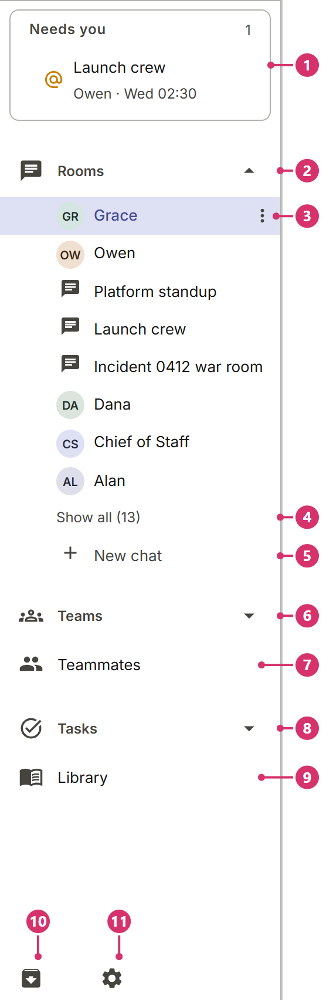
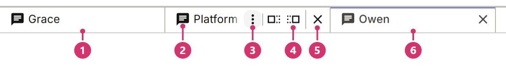
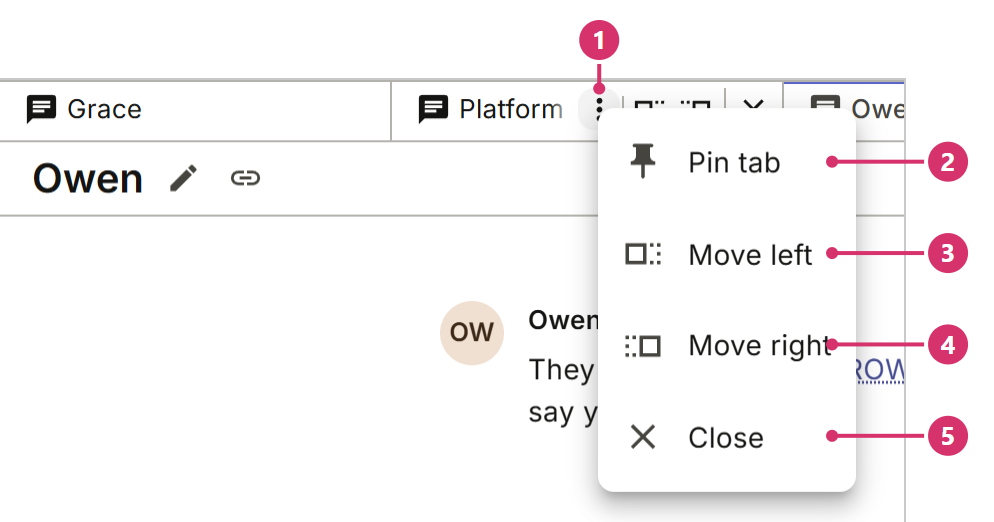
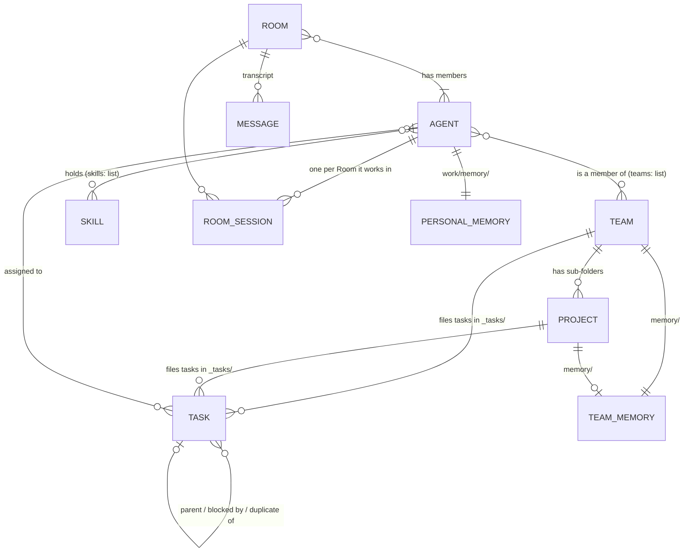
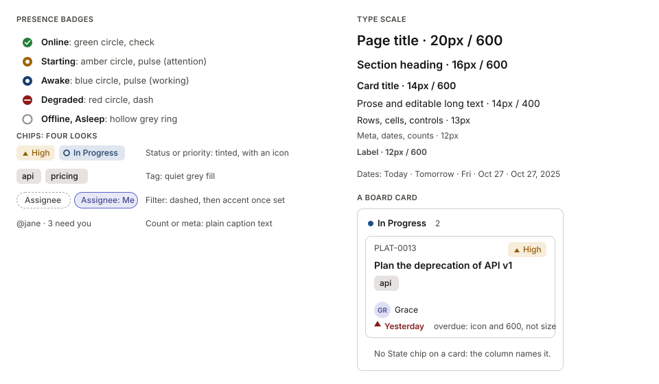
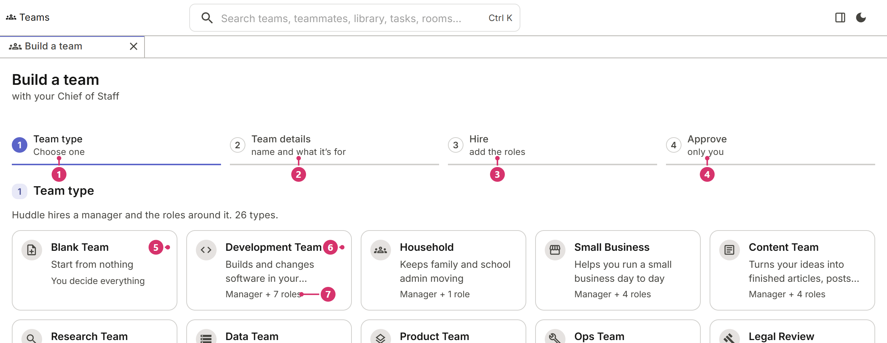
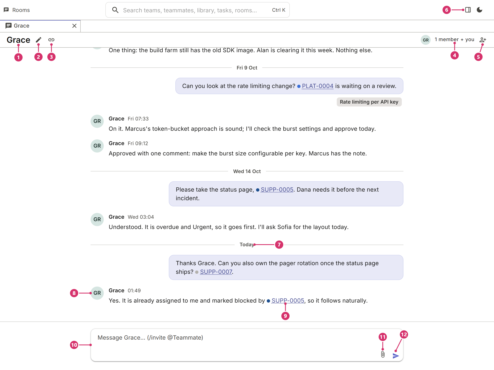
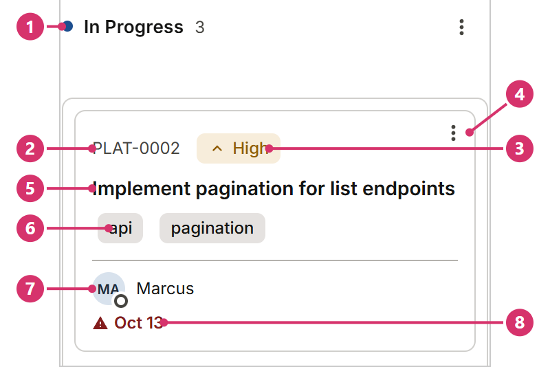

# Huddle user guide

Huddle gives you a team of AI **Agents** that do work for you and remember what
they learn. Each Agent has one job and knows only its part of your work or your
life, such as school, meals, the house or a codebase. You talk to them in Rooms.
What is worth keeping does not stay in the chat: it is filed as a Task, a note in
Memory or a document, in the same folders in every Team. That is your
[Second Brain](#your-second-brain), and it is plain files on your own machine.

**Tasks** are where the two meet. A Task is remembered like everything else, and
it is how Agents hand work to each other and to you: who owns it, what happened
on it, and the proof that it was done.

This guide is for the person running Huddle on their own machine. It explains what
each part of the app does, how the parts relate, and **what Huddle writes to
disk** every time you change something. It does not cover installing adapters or
configuring models; see [the chat-surface hub](Huddle.EngineeringGuide.md) for that.

## Contents at a glance

| If you want to… | Read |
| --- | --- |
| Get started with your own copy | [Install](#install) |
| Find your way around the screen | [A quick tour of the screen](#a-quick-tour-of-the-screen), [Tabs](#tabs) and [Global search](#global-search) |
| See which Rooms and Tasks are waiting on you | [Needs you](#needs-you) |
| See what your Agents did while you were away | [Feed](#feed) |
| Decide whether a Task is done, or what leaves the Team | [The Human gate](#the-human-gate) |
| Read an Agent's status badge or a chip | [Status at a glance](#status-at-a-glance) and [Chips](#chips) |
| Understand how Agents, Teams, Tasks and memory relate | [The data model](#the-data-model) |
| Free a long-running Agent's memory without restarting it | [Freeing an Agent's memory with `/compact`](#freeing-an-agents-memory-with-compact) |
| Know which file a change lands in | [Where your data lives](#where-your-data-lives) and [What happens when…](#what-happens-when-reference) |
| Add or change an Agent | [Working with Agents](#working-with-agents) |
| Set up Teams and Projects | [Organising Teams and Projects](#organising-teams-and-projects) |
| Hire a Team from a type | [Hiring a Team from a type](#hiring-a-team-from-a-type) |
| Set a Team's process and gates, schedules and Household | [Running a Team](#running-a-team) |
| Handle asks between Teams, or Team retrospectives | [Requests between Teams](#requests-between-teams) and [Retrospectives](#retrospectives) |
| Chat with one or several Agents | [Chatting in Rooms](#chatting-in-rooms) |
| Open a Room inside a Team, or find its Team Room | [Team rooms](#team-rooms) |
| Track work | [Tracking work with Tasks](#tracking-work-with-tasks) |
| Have an Agent, or yourself, reminded of something on a timetable | [Scheduling jobs](#scheduling-jobs) |
| Share notes and documents | [Keeping notes in the Library](#keeping-notes-in-the-library) |
| See a Room's members, Tasks and files, or a note's outline and links | [The Right sidebar](#the-right-sidebar) |
| Teach Agents a procedure | [Giving Agents Skills](#giving-agents-skills) |
| Understand where files go, and use the Second Brain pattern | [Your Second Brain](#your-second-brain) |
| Give every Agent, or one Team, standing rules | [Writing rules in `AGENTS.md`](#writing-rules-in-agentsmd) |
| See what Agents remember and which files they changed | [Memory and file changes](#memory-and-file-changes) |
| Use Huddle from a phone, a tablet or another computer | [Using Huddle from another device](#using-huddle-from-another-device) |
| Change prompts, Themes, Personas, Skills or Library roots | [Settings](#settings) |
| Turn a Helper on or off, or change what it may spend | [Helpers](#helpers) |
| Fix something that went wrong | [Troubleshooting](#troubleshooting) |

## Install

Get Huddle running on your machine with one command. No admin rights are needed, and
nothing has to be installed first.

**Windows:** open PowerShell (a normal window) and run:

```powershell
irm https://github.com/emreaydinceren/Agency.Huddle/releases/latest/download/install.ps1 | iex
```

**macOS (Apple Silicon or Intel):** open Terminal and run:

```sh
curl -fsSL https://github.com/emreaydinceren/Agency.Huddle/releases/latest/download/install.sh | sh
```

The installer checks your machine first and tells you plainly if something is missing. It then
downloads the app, sets it up in your own folders and starts it in your browser. Running the
same command again is safe: it only changes what is out of date.

**Signing in to Claude.** If you are not signed in yet, the installer prints a command to run
once. It opens your browser:

```sh
claude auth login
```

**Starting it later.** On Windows use the Start menu entry `Agency Huddle`, or type `huddle`
in a new PowerShell window. On macOS open `Agency Huddle` from your Applications folder in your
home folder, or type `huddle` in Terminal.

**Stopping it.** Run `huddle stop`. (Closing the browser tab does not stop the app; on Windows you can
also close the console window it opened.)

**Upgrading.** Run the install command again. Your rooms and settings are kept.

**Uninstalling.** Your data is kept unless you ask for it to be removed.

```powershell
$env:HUDDLE_UNINSTALL='1'; irm https://github.com/emreaydinceren/Agency.Huddle/releases/latest/download/install.ps1 | iex
```

```sh
curl -fsSL https://github.com/emreaydinceren/Agency.Huddle/releases/latest/download/install.sh | sh -s -- --uninstall
```

Add `$env:HUDDLE_PURGE_DATA='1'` (Windows) or `--purge-data` (macOS) as well to delete your data
too.

For the options, troubleshooting and how releases are made, see
[Installer](engineering/installer.md).


## A quick tour of the screen

You get around the app from the left edge of the window, which works like Visual Studio Code. The narrow
**Activity bar** at the far left has two rows of buttons. The buttons at the top choose
what the **sidebar** beside it shows. The highlighted button is the one showing now.
Select another to switch; select the highlighted one again to fold the sidebar away and
give the page more room. The sidebar opens on **Rooms**.

The **Feed** icon is always the first button in the Activity bar. Below it is one avatar tile
per Team, its shortcut. To hide or bring back a Team's tile, open the Team's page and select
**Hide shortcut** or **Show shortcut** beside **Edit avatar…**, or right-click the tile.

| Activity bar button | What the sidebar shows |
| --- | --- |
| **Rooms** | **Needs you**, a card drawn only while a Room is waiting on you (see [Needs you](#needs-you)), then **Group by: All | Team**. **All** lists your root Rooms in two folders: **Needs you** on top, holding the Rooms waiting on you, and **All** with the rest, plus **New room**. It never folds the list behind "Show all". A Team's Rooms are not listed under **All**; see [Team rooms](#team-rooms). Pick **Team** to list every Room in a folder per Team ("No team" first); click a folder to close or open it. The choice and the closed folders are remembered. A Room that is waiting on you also wears a **Needs you** pill in the list. |
| **Teams** | One row per Team. Expand it to see its Team Room, its other Rooms and its Projects. **Build a team** sits at the bottom. The More (⋮) menu on a Team row has **New room**, **New project** and **Archive team**. A Project row has its own More (⋮) menu with **Archive project**. |
| **Agents** | A link to the page listing every Agent, grouped by Team. |
| **Tasks** | Your saved Views of Tasks: **All Tasks**, **My Tasks**, any you saved, and **New view**. Not shown when Tasks are turned off. |
| **Library** | One **Library** link. The Library's roots (see [Library roots](#library-roots)) and **Add folder** are on the Library page. Not shown when the Library is turned off. |
| **Scheduled** | Every Job, for you and for each Agent, and **New job**. See [Scheduling jobs](#scheduling-jobs). |
| **Remote access** | Who may reach Huddle from other devices. **Strict local** (on by default) means only this computer, no sign-in; turn it off to use the rest: Bind, Auth and Tailscale, the gateway token, pairing, the Devices list and the Security check. Admin only; a change to Bind or Tailscale applies after a restart. See [Using Huddle from another device](#using-huddle-from-another-device). | `team.db` |

The two buttons at the bottom of the Activity bar are **Archived** and **Settings**. **Archived**
opens the [Archived page](#the-archived-page).



1. **Rooms**, highlighted because the sidebar is showing it.
2. **Teams**.
3. **Agents**.
4. **Tasks**.
5. **Library**.
6. **Archived**.
7. **Settings**.
8. **Rooms**. The arrow folds the group away.
9. A Room. Its More (⋮) menu sits at the end of the row.
10. **Show all**, with how many Rooms there are, to list the rest.
11. **New room**.

When a Room is waiting on you, the **Needs you** card sits above **Rooms**.

Every page has its own address, so you can bookmark it:

| Address | Page |
| --- | --- |
| `/rooms/{roomId}` | A Room |
| `/agents` | Agents |
| `/teams/{Team}`, `/teams/{Team}/files`, `/teams/{Team}/tasks` | A Team page and its tabs |
| `/teams/{Team}/projects/{Project}` | A Project page |
| `/tasks/{viewId}` | A saved Task View |
| `/tasks/item/{TaskId}` | One Task, opened over your last View, for example `/tasks/item/BUSI-0001` |
| `/tasks/item/{TaskId}/edit` | One Task in edit mode, in a Tab of its own, for example `/tasks/item/BUSI-0001/edit` |
| `/library?scopeRoot=teams&scopePath=` | The Library, scoped to a root |
| `/settings/{tab}` | Settings: Profile, Prompts, Helpers, Spending, Appearance, Personas, Skills, Team types, Library, Sessions, Remote access. A blank system opens on `/settings/profile` until you save a profile |

### Needs you

When several Rooms are running, **Needs you** at the top of the sidebar's **Rooms** view lists the ones waiting on you, longest wait first. A Room is listed when:

- an Agent **mentions you** in a Message you have not answered (the row shows who and when);
- an Agent has asked you a **Question** or opened a **Form** that is still waiting;
- the Room has used up its **Budget** and is paused until you speak.

Each row shows an icon for every reason, the Room's name, and who asked and when. Select it to open the Room.

A Room leaves the list when you **post in it**, or when you press the check (✓) on its row. Opening a Room does not clear it, so you can read a Room and come back to it later. The check hides the Room until something new makes it wait again; it does not answer the Question or Form behind it. Pressing **Continue** on a paused Room clears only the paused reason. When nothing is waiting, the card is not drawn.

The list lives in memory. After a restart, Rooms with an unanswered mention (within the last 50 Messages) are listed again; a Question that was waiting is listed again, with its card still in the Room; a Form that was waiting is gone, and so is any dismissal.

**Tasks waiting for your decision** are listed too, after the Rooms and under the same count. A Task row shows its id and title with "Waiting on you · Proof 4/4", and opens the **Needs you** page at that Task. A Task is listed while it is under the [Human gate](#the-human-gate), in the Needs you status, and not yet accepted. It has no check (✓): it leaves the list only when you decide, or when its status changes. These rows are read from the Task files, so a restart loses none of them.

The **Needs you** page lists the Tasks first, each as a decision card where you can Accept, Request changes or Decline, then the Rooms. When nothing waits, it says "Nothing needs you".

### Feed

The **Feed** is one list of what your Agents and Huddle did, and what is waiting for you. It is the way to catch up after an hour away: the Tasks Agents created, the Rooms that started, the documents that changed, and the asks that came and went. It is read-only. It never changes the work, and it never shows the text of a Message.

**The Notifications bell.** The **Notifications** button at the right of the Top Bar shows how many new items ask for you: a Task assigned to you, a gated Task waiting for your approval, a Mention, a Question or a Form, a Room that reached its Budget, a Request only you can confirm, and a Task move that a gate stopped. Opening it shows the **Notifications** panel in the Right sidebar and marks what it shows as seen, so the number goes away; the items stay. The panel opens on **Needs you**, with the number of items waiting for you. Choose **All** to see the rest of the Feed. Hover a row and press its ✕ to hide that Notification from the bell. It stays in the Feed. **See all activity** at the bottom opens the Feed Tab on the same Category.

An item you caused yourself never rings the bell. A Notification fades and leaves **Needs you** once the reason is gone: you posted in the Room, you accepted the Task, the Task was reassigned.

**The Feed Tab.** The **Feed** icon at the top of the Activity bar opens the Feed in a Tab. The header shows a **Live** chip, because new items arrive on their own, and the note "Read-only — the Feed never changes the work and never shows message text." Below it, **All** shows everything and **Needs you** (with its count) only what waits for you, and the **All teams** select narrows the list to one Team. Click an Agent's avatar to open their profile, as you would in a Room. Hover the small badge on an avatar to see what kind of item it is.

Items are cards, newest first, under day headings. A card shows who did what, a chip for the Task, Room or document it is about, the Team, and for a Notification a pill such as "Waiting for you". Press the chevron, or the empty space on the card, to expand a card into a preview of the Task, Room or document, with the other items about it under "In the Feed", and **Open Task**, **Open Room** or **Open document**. **Review in Needs you** appears for a gated Task that is waiting. Those buttons only open things; deciding, replying and accepting stay in the Needs you page and the Room. A thin bar at a card's left edge marks items you have not seen in the Feed Tab yet; it clears the next time you open the Tab. If new items arrive while you are scrolled down, a "↑ n new items" pill appears at the top. Press it to add them.

**Helpers in the Feed.** When the Needs Human Helper turns **Requires your acceptance** on for a Task, the Feed shows it as a Notification, with the Helper's reason and a Helper mark where an Agent's avatar would be, until you turn the gate off, decide the Task, it waits in Needs You, or it closes. If a Helper pauses at its daily cap, or fails three times in a row, **Huddle** says so in the **Helpers** Category and links to the Helper's card on **Settings › Helpers**, where **Continue** is; the item is done when you continue, the day ends or the Helper works again. The Helper's wake-up Message to the Task's assignee is written by **Huddle**, not by you, so it no longer answers a Mention of you or clears a Room from Needs you.

Feed items are kept for 30 days (a Notification you dismissed, 30 days after you dismissed it). To turn the Feed off, set `Team:Feed:Enabled` to `false`; the bell and the **Feed** icon then disappear. See the [Engineering Guide](Huddle.EngineeringGuide.md) for the keys.

### Tabs

Everything you open from the sidebar opens in a tab, in a strip above the page.
The Library is one tab like any other.

- **One click** on a sidebar item opens a preview tab. Its title is grey until you keep
  it, and the next sidebar item you select replaces it, so browsing does not pile up
  tabs.
- **Keep a tab** by double-clicking its sidebar item or the tab itself, or by typing in
  a message box on that tab. The title turns the same colour as the other tabs, and the
  next item you select opens beside it.
- **Close a tab** with its **×**, by middle-clicking it, or with **Alt+W**. If you
  close the last tab, the page shows "No pages are open". **Alt+Page Down** and
  **Alt+Page Up** move to the next and previous tab. (Ctrl+W and Ctrl+Tab belong to
  the browser, which does not let a page take them.)
- **Rooms, Teams and Projects:** a Room's tab takes the Room's name when you rename
  the Room, and closes when the Room is archived or deleted. A Team's or Project's
  tab closes when that Team or Project is removed.
- **Half-written messages:** the text you have typed but not sent is kept for each
  Room while you switch between tabs, and it is still there after you reload the page.



1. A kept tab.
2. A kept tab under the pointer: its buttons take the place of the end of its name.
3. **More (⋮)**, for the tab's menu.
4. The quick **Move left** and **Move right** buttons.
5. **Close (×)**.
6. A preview tab, the one open now. The next sidebar item you select replaces it.

**Right-click a tab**, or hover it and press **More (⋮)** beside its **Close (×)**, for its menu (hovering also shows quick **Move left** and **Move right** buttons when those apply):

- **Pin tab** keeps the tab at the start of the strip as just its icon, with no ×
  (hover for its name). **Unpin tab** puts it back.
- **Move right** and **Move left** move the tab to the other side of a split. The first
  time, they open a second pane beside the first, so you can see two pages at once. The
  item is shown in grey when there is nowhere to move the tab, for example when it is the
  only tab or the window already holds two panes. A moved tab is kept.
- **Close** closes the tab.



1. **More (⋮)** on the hovered tab.
2. **Pin tab**.
3. **Move left**.
4. **Move right**.
5. **Close**.

With two panes, the one you last clicked or tabbed into is the one the address bar shows,
and what you open from the menu opens there. The other pane keeps its page exactly as you
left it. A page that is already open in one pane is never opened a second time in the
other: opening it takes you to it. Closing the last tab in a pane closes the pane.

Your open tabs and panes come back after you reload the page or restart the app, in the
same order, with the tab for the page you are on active. They are remembered by the
browser, so another browser starts with its own. Each tab is at least a fixed width, so with many open the strip scrolls sideways.

### Global search

The search box sits in the top bar, above the sidebar and every page.

- **Open the box** with `Ctrl+K` from anywhere, with `/` when no text field has focus, or by
  clicking it. `Esc` closes it and returns you to where you were.
- **Narrow the search** with the chips under the box: **All**, **Teams**, **Agents**,
  **Library**, **Tasks** and **Rooms**. Picking a chip is the same as typing its prefix at the
  start of the box: `team:`, `agent:`, `lib:`, `task:` or `room:`. `Alt+1` to `Alt+6` pick
  them from the keyboard, and `Ctrl+Left` and `Ctrl+Right` move between them.
- **A search starts at 3 characters**, after any prefix. `task:fi` waits; `task:fix` searches.
  Matching ignores case and looks for the exact phrase you typed.
- **Results come in groups:** Teams, Agents, Library, Tasks and Rooms. With All, each group
  shows up to five results. With one chip picked, that group shows up to 50. Library matches
  its contents as well as its names, for entries up to 1 MB. Closed Tasks and archived Rooms come
  last, shown in grey.
- **Open a result** with `Enter` in the current Tab, or `Ctrl+Enter` to open it in a new Tab that
  stays. An Agent opens its card. A Room opens at the matching Message, which is highlighted for
  a moment.
- **Every search reads again.** Global Search keeps no index of its own, so a new Message or file
  shows up on your next search, and nothing is kept after it. `Results may be incomplete.` means a
  limit was reached: narrow the search or pick one chip.

### The Right sidebar

The button at the right end of the top bar opens and closes the **Right sidebar**, a panel on
the window's right edge that shows things about the page you are looking at. It is open the
first time, and after that stays as you left it. With two panes open, it follows the pane you last clicked.

It holds one or more panels, depending on the page:

| On | Panels |
| --- | --- |
| A Room | **Members**, **Tasks in this Room**, **Documents in this Room** |
| A Markdown note in the Library | **Outline**, **Linked documents** |
| A Task you opened on the Tasks page | **Task**: its details, read-only, with **Edit** (the sidebar opens by itself when you open a Task) |
| A Task in its edit page | **Activity**, **Blocked by**, **Blocks**, **Linked documents** (the last three only when they have something to show) |
| Any other page | None. The sidebar says `Nothing to show here`, with a line on where panels appear. |

| Panel | What it shows | What selecting it does |
| --- | --- | --- |
| **Members** | Everyone in the Room, Agents first, each with their avatar and, for an Agent, the [presence badge](#status-at-a-glance) on it. | The avatar opens the member's profile. |
| **Tasks in this Room** | Each Task the Room's Messages mention, most recent first, with its current title and state. A deleted Task shows `(unavailable)`. A code such as an invoice number (`INV-2043`) is listed only if its letters are the Task prefix of a Team that exists or once existed; otherwise it stays plain text. | The row opens the Task. The arrow beside it scrolls the Room to the Message that last mentioned it. |
| **Documents in this Room** | Each Library file the Room's Messages mention, most recent first. A file that is no longer in the Library is shown in grey. | The row opens the file in the Library. The arrow scrolls the Room to the Message. |
| **Outline** | The note's headings, indented by level. In **Split** mode it follows your typing; in **Read** and **Edit** it shows the note as last loaded or saved. | Scrolls the note to that heading. In **Edit** mode it moves the cursor to the heading's line. |
| **Linked documents** | The notes this note links to with `[[...]]`, in the order they appear. A link to a note that does not exist shows `(not found)`. | Opens the linked note. |

Each panel's header shows its name and a count. Press the header to fold the panel away; your
browser remembers which panels you folded. A panel with nothing in it stays, with one line
saying so, such as `No Tasks mentioned in this Room yet.` The Tasks panel appears only while
Tasks are switched on, and the two Library panels only while the Library is.

**In the background:** the sidebar reads the same files and records as the page beside it and
changes nothing. The Room panels update when a Message is posted in that Room, and Members
also when someone joins or leaves; the Library
panels update when a note is saved, renamed, moved or deleted.

## The data model

Huddle has a small number of things, and almost all of them are plain files you
can open in any editor. This section names each one and explains how they
connect. Later sections explain how to work with them.

### The things in Huddle

| Entity | What it is | Stored as |
| --- | --- | --- |
| **You (the Human)** | The person using the app. You set your Name, Alias, Title and avatar on **Settings > Profile**; `Team:HumanName` (default `You`) is only the Name a blank system starts with. Your Alias @mentions you like your Name. You are in every Room. | `profile.json`, `avatars.json` and a row in `team.db` |
| **Agent** (also called a **Persona**) | One AI Agent: its name, job title, @alias, Teams, Skills, and its instructions. | `Agents/<Name>/<Name>.md` |
| **Agent** | An Agent that is running and online in chat. There is one Agent per Agent file. | A row in `team.db`, plus a running adapter process |
| **Team** | A named group of Agents. Its membership is a label in each member's `teams:` list; a Team set up from a type also has a manager, a workspace and a process. | A label in each member's `teams:` list, plus a folder `Teams/<Team>/` holding `_team.md` (settings) and `AGENTS.md` (rules) |
| **Project** | A piece of work inside one Team. | A sub-folder `Teams/<Team>/<Project>/` |
| **Room** | A shared space where you and one or more Agents chat: its members, Messages, Budget and files. You chat *in* a Room; the app never calls the Room itself a chat. | Rows in `team.db` |
| **Message** | One chat message, in one Room. | One line in `rooms/<roomId>.jsonl` |
| **Room Session** | An Agent's private working conversation for one Room. | Only a resume pointer, in `room-sessions/<Name>.json` |
| **Task** | A unit of work filed under a Team or Project, optionally assigned to someone. | `Teams/<Team>/[<Project>/]_tasks/<ID>.md` |
| **View** | A saved list or board of Tasks with filters. | `views.json` |
| **Library item** | Any note, folder or file you browse in the Library. | The file itself, wherever it lives |
| **Personal memory** | What one Agent remembers across Rooms. | `Agents/<Name>/work/memory/*.md` |
| **Team Memory** | Facts shared by every member of a Team, or by a Project. | `Teams/<Team>/memory/*.md` and `Teams/<Team>/<Project>/memory/*.md` |
| **Skill** | A named, reusable set of instructions an Agent can read on demand. | `Skills/<skill-name>/SKILL.md` plus extra `.md` files |

### How they relate



The relationships that matter most:

- **An Agent can belong to many Teams.** Membership is written on the
  Agent, not on the Team. An Agent file with
  `teams: ['Business', 'Household']` is a member of both, and appears under both
  on the Agents page. An Agent with no `teams:` line appears under **No
  team**.
- **A Team is a label plus a folder.** The list of Teams is every label used by
  any Agent, plus every folder directly under `Teams/`. A folder with no
  members still shows, as **No members**. A label with no folder gets one
  created automatically. A Team's folder may also hold `_team.md`, which names its
  team type, manager and workspace and holds its process settings, and `AGENTS.md`,
  which says how it works.
- **A Project belongs to exactly one Team** and has no members of its own. The
  Team's members work on it. Any ordinary sub-folder of a Team folder is a
  Project, except `memory` and names starting with `_` or `.`.
- **A Task belongs to one Team, and optionally one Project.** Which one is
  decided by the folder the file sits in, not by a field. A Task has at most
  **one assignee**: an Agent or you. A Task can have one parent Task
  (sub-tasks), a list of Tasks that block it, and can be marked a duplicate of
  another.
- **A Room always includes you**, plus one or more Agents. A Message belongs to
  exactly one Room.
- **An Agent keeps a separate conversation per Room**: a Room Session. What it
  said in one Room is not visible in another. Only memory, Team Memory, Tasks and
  file changes cross between Rooms.
- **A Skill is attached to Agents only**, by name, through the Agent's
  `skills:` list. One Skill can be held by any number of Agents. Skills are
  not attached to Teams, Projects or Rooms.

### Example: one Agent file

An Agent is a Markdown file with frontmatter. Everything below the frontmatter
is the Agent's private instructions.

```markdown
---
name: 'Nova'
title: 'Coordinator'
alias: 'nova'
teams: ['Business', 'Household']
skills: ['team-building']
---
You are Nova. You keep the team's Tasks moving and summarise progress.
```

| Field | Required | Meaning |
| --- | --- | --- |
| `name` | Yes | The Agent's identity. Must match the folder and file name. |
| `title` | Yes | Job title, shown on cards and to other Agents. |
| `alias` | Yes | Short handle for mentions, as in `@nova`. |
| `teams` | No | The Teams this Agent belongs to. |
| `skills` | No | Skills this Agent may read. |
| `adapter` | No | Which AI adapter runs it. |
| `watches` | No | Extra folders it is told about when files change. |

**Model**, **Effort** and **Work mode** are not in the file. They are stored in
`team.db`, so you can change them without touching the Markdown. The **avatar**
is stored in `avatars.json`.

## Where your data lives

Everything Huddle keeps is under one **data root**, set by the configuration key
`Team:DataDir`. The default is `App_Data`, relative to where Huddle runs. In a
development checkout that is `src/Huddle.App/App_Data`.

```text
App_Data/
├── Agents/                     Team:Acp:AgentsDir
│   └── Nova/
│       ├── Nova.md                the Agent definition
│       └── work/                  Nova's working folder (Team:Acp:WorkDir)
│           └── memory/            Nova's personal memory
├── Teams/                         Team:Teams:Dir
│   └── Business/                  a Team
│       ├── memory/                Team Memory
│       ├── _tasks/                open Tasks for the Team
│       │   ├── BUSI-0001.md
│       │   └── _closed/           closed Tasks
│       └── Website/               a Project
│           ├── memory/            Project memory
│           └── _tasks/
├── Skills/                        Team:Acp:SkillsDir; your own and overridden Skills
├── rooms/<roomId>.jsonl           one transcript per Room
├── room-sessions/<Name>.json      where each Agent can resume each Room
├── file-state/<Name>.json         what each Agent last saw of its folders
├── team.db                        SQLite: users, agents, rooms, members, models, task ID counters
├── views.json                     saved Task Views
├── library-roots.json             pinned Library folders (created on first change)
├── custom-roles.json              your own roles from Build a team (created on first change)
├── Prompts/<key>.md               one file per prompt you changed in Settings
├── appearance.json                theme and accent colour
├── avatars.json, avatars/         avatars
└── logs/                          log files, when file logging is on
```

> [!WARNING]
> Some folders under the data root are managed by the app. Do not rename or move
> `rooms/`, `room-sessions/`, `file-state/`, `avatars/`, `logs/` or `team.db`.
> The Library refuses to open them, and hand edits can lose chat history.

## Working with Agents

Select **Agents** in the Activity bar, then the **Agents** link in the sidebar. The page lists every Agent, grouped by
Team, with a **Team** filter at the top. An Agent in two Teams is listed under
both. Each card shows the Agent's status as a badge on its avatar.

### Status at a glance

The same badge sits on an Agent's avatar everywhere: the Agents page, a Room, the
Board and the Right sidebar. Hover it to see the reason.

| Badge | Means |
| --- | --- |
| Green circle with a check | Online: ready to work |
| Amber circle that pulses | Starting up |
| Blue circle that pulses | Working on something now, such as a Turn in a Room or a Task |
| Red circle with a dash | Something is wrong; open the Agent to see why |
| Hollow grey ring | Offline, or asleep with nothing to do |

Amber always means something wants your attention: an Agent starting, a **High**
priority, an overdue date or a Room that needs you. Working is blue.



Each Agent has its own card with **Message**, **Edit**, **Open**,
**Restart** and **Remove**. With no Agents the page says "No Agents yet.
Choose New agent."

### Adding an Agent

1. Select **New agent**.
2. **Name** starts with a random first name that no Agent has yet. Keep it,
   edit it, or select the reset button (the circular arrow at the right of the
   box) for another one. Then fill in **Title** and **Alias**. Optionally add
   **Teams** as a comma-separated list, select **Skills**, **Model**,
   **Effort**, **Work mode** and an avatar.
3. Write the Agent's instructions in the text area.
4. Select **Add agent**.

**In the background:**

- Huddle composes the frontmatter and writes
  `Agents/<Name>/<Name>.md`.
- Model, Effort and Work mode are written to `team.db`.
- The Agent starts as an Agent and appears in chat. Its `work/` and
  `work/memory/` folders are created.
- Each Team label you entered that has no folder yet gets
  `Teams/<Team>/` created.

Names and aliases are at most 64 characters, start with a letter or digit, and
may contain letters, digits, `_`, `-` and single spaces. No dots. Names and
aliases must be unique across all Agents. How many Agents a Team may hold,
and how many run at once, is limited; see [Hire limits](#hire-limits).

The built-in **Chief of Staff** is the first Agent you meet. It helps you put
a team together: it proposes Agents, and nothing is created until you select
**Approve**. It has **Reset to default** instead of **Remove**; the card asks
**Reset to default?** in place, and **Reset** confirms it.

### Editing an Agent

Select **Edit** on the card, change the fields or the instructions, and select
**Save**.

**In the background:** Huddle rewrites `<Name>.md` in place. **Saving restarts
the Agent and clears what it remembers of every conversation.** Its Rooms and
their transcripts stay. On its next turn in each Room it catches up by reading
up to the last 20 messages of that Room. Its personal memory files in
`work/memory/` are kept.

A restart also happens when you change Model, Effort, Work mode, Adapter, Skills
or Teams. Changing the avatar does not restart anything.

> [!NOTE]
> The Edit card has no **Teams** field. To take an Agent off a Team, use
> **Remove from Team** on the Team page's **Members** tab; to add it to a Team,
> edit the `teams:` line in the text.

### Changing an avatar

Select the avatar at the top of an Agent's card. It does this in every mode:
viewing, editing and creating. An **Edit** (✎) mark appears on it when you point at it
or tab to it. A window titled **Avatar** opens with three choices, and **An image**
is selected when the avatar has no label or image yet:

- **Initials of the name** shows the letters Huddle makes from the Name.
- **A short label** shows up to six characters you type instead (the small avatar in rows and the sidebar shows the first three).
- **An image** shows a picture. **Choose an image** uploads a PNG, JPEG or WebP
  file of up to 512 KB, and **Choose from library** (see the next section) picks
  one of the ready-made pictures.

The round picture at the top of the window previews your choice as you make it.
Initials and a label sit on a **Background** colour. Set it by pressing a swatch
in the palette in the window; the swatch for the current colour is highlighted. A
colour can be changed to another swatch but not cleared, so once an Agent has a
colour it keeps one. An image covers the background, so the palette is hidden while
**An image** is selected. A colour you chose earlier is kept, and is there again if
you go back to initials or a label.

A new Agent starts with a colour of its own: when you open **New agent**,
Huddle picks a random swatch from the same palette, so a new card is not a row of
identical circles. It is written with the Agent when you select **Add
agent**, and you can change it in the window like any other. Agents that
already exist, and any created some other way, keep the theme's colour until you
press a swatch.

What the window's last button does depends on where you opened it:

- **Creating or editing an Agent:** it reads **Apply**. The new avatar shows on
  the card at once, but nothing is written until you select **Add agent** or
  **Save** on the card. **Cancel** on the card throws it away.
- **Viewing an Agent:** the card has no Save of its own, so the button reads
  **Save** and the avatar is written as soon as you select it.

**Cancel**, the close button and the **Esc** key leave the avatar as it was.

### Choosing an avatar from the library

Choosing **An image** in the **Avatar** window shows a second button,
**Choose from library**, beside the upload button. Press it to open a window of
pictures to pick from.

- **Narrow the pictures.** Press a skin tone (**All**, **Light**, **Tan** or
  **Dark**). Type a word in the search box, such as `beard` or `glasses`: each
  word must match the start of a word of any tag, so `red hair` also finds red
  tops and red glasses. To get exactly one tag, press it instead. Press a tag to
  select it; the cloud shows the 12 most used, and **Show all** shows the rest.
  Selections combine: two tags show only pictures with both.
- **Selected chips move to the left.** Each one has an **X**. Press the X to
  turn it off, and it returns to its place. **Clear all** turns everything off.
- **Pick a picture.** Select it, and the library window closes. The **Avatar**
  window shows the picture and says **New image selected (not yet saved)**.
  Select **Apply** (or **Save**, when you opened it from a viewed Agent) to
  keep it, or **Cancel** to keep your old avatar. On your own avatar in
  **Settings › Appearance** the picture is saved at once.

The library comes with Huddle: 126 pixel-art people, in the repository in
`src/Huddle.App/AvatarLibrary`, used as they are with nothing to set up.
To use a library of your own instead, set `Team:AvatarLibrary:Dir` to its folder
(it needs a `master.json` and the pictures, like the bundled one). If you set it
to a folder that does not exist there is no library at all and no button, which
is how to switch the library off; uploading an image works either way. A
picked picture is copied, so the Agent keeps it even if the library is later
moved or deleted.

### Choosing a Work mode

A **Work mode** is how much the Agent's agent may do before it must ask first.
Select **Edit** on the card and pick one in **Work mode**, directly under
**Effort**. The choices come from the Agent's Adapter, so they are the
Adapter's own names and the text under the select describes the one you picked.

For the Claude adapter the choices are:

| Choice | What it does |
| --- | --- |
| **Agent default** | Huddle sends nothing and the agent starts in its own mode, which is Manual. |
| **Manual** | The agent asks before it makes changes. |
| **Accept edits** | The agent edits files without asking. |

**Plan**, **Auto** and **Bypass permissions** are not offered. **Plan** is hidden
because an Agent in it ends its turn without posting a reply. **Auto** hands
permission decisions to the model and changes with the Model. **Bypass
permissions** removes every prompt. An operator who wants them back changes
`Team:Acp:HiddenModes`. A mode on the hidden list is never sent, even if one is
already stored for an Agent.

**In the background:**

- The mode is stored in `team.db`, not in `<Name>.md`.
- It is applied every time the Agent starts or resumes, after its Model and
  Effort.
- **Saving a different Work mode restarts the Agent and clears what it
  remembers**, as a Model change does.
- Changing the **Adapter** resets Work mode to the agent's default and the card
  says so. Each Adapter advertises its own modes, so pick one again if you want
  one.
- An Adapter that advertises no modes shows no Work mode select.

> [!NOTE]
> Work mode changes what the agent asks, not who answers. Huddle still approves
> the agent's permission requests on its own; nothing here asks you before a tool
> runs. One thing is refused whatever the mode: a tool call that writes a file
> inside the agent's own `~/.claude` folder. A shell command that redirects into
> it is not caught.

### Account connectors

An Agent cannot use your claude.ai account connectors (mail, calendar, files) unless you turn them on for that Agent. Every Agent starts with them off, including the Chief of Staff, and an Agent cannot switch them on for itself.

1. Open the Agent and find **Account connectors** under Work mode.
2. Turn the switch on. Huddle asks first: "Give {Name} access to all your connected accounts?" Choose **Give access**, or **Cancel** to leave it off.
3. Huddle restarts the Agent to apply the change; it takes effect on the Agent's next Turn. The line under the switch then says "On since" and the date. Each use of a connector asks you first: a card in the Room names the Agent and the tool, shows what the Agent asked for as plain text (the Agent's words, which Huddle has not checked, and which may come from an email it read), and offers **Allow once** or **Refuse**. There is no "always allow". If you do not answer within ten minutes, or press Dismiss, or the Turn stops, the call is refused, and so is every further connector call in that Turn. A Work Mode that never asks before a tool runs (Bypass permissions, Auto) cannot be combined with connectors: the switch stays off and says why.

Turning the switch off applies at once, with no question. Renaming an Agent turns it off again, so switch it back on after a rename. Resetting the Chief of Staff to its default also turns it off. The switch appears only for the Claude Adapter with isolation on. For any other Adapter the card says what Huddle cannot control instead.

If you upgraded with Agents already in place, the Agents page shows a one-time notice that connectors are now off. Dismiss it and it does not come back. The Feed records each time you turn the switch on or off.

### Your Agents' browser

Every Agent has its own browser, so it can read pages that need JavaScript and work inside a site you signed in to for it. It is on for every Agent, including a new one, with nothing for you to do. An Agent opens no window until it first browses.

- **Turning it off.** Open the Agent and find **Browser** under Account connectors. The switch acts at once, with no question and no Save. The line under it says "Off. {Name} has no browser." Turn it on again the same way.
- **The window.** The first time the Agent browses, a browser window opens on this computer. It is the Agent's own, with its own sign-ins, and never your everyday browser's profile. You can watch it work.
- **Signing in.** When a site needs a login, the Agent stops and says which site. Type the password or code yourself, in that window, then tell the Agent it is done. Never give an Agent a password or a code: it is told not to type one. The sign-in stays for that Agent only and is not seen by your other Agents.
- **What asks.** Reading a page runs at once. Every click, typing, key press, form step, upload, dialog answer or script asks you first, on a card in the Room that names the Agent and shows what it will do, such as the exact text to type. Choose **Allow once** or **Refuse**. There is no "always allow". If you refuse, the Agent says what it wanted to do and does not retry. If you do not answer within ten minutes, the call is refused.
- **Deleting an Agent** deletes its browser profile too, with every site it was signed in to. Renaming an Agent keeps them.
- **Work Modes.** A Work Mode that never asks before a tool runs (Bypass permissions, Auto) cannot be combined with the browser. The switch shows off and says why. Choose another Work Mode first.
- **Where it does not work.** The switch is text instead of a switch for an Adapter that is not Claude, and where no Edge or Chrome is installed. On Linux with no display the browser runs without a window, so you cannot sign in to sites for it.
- **One Room at a time.** An Agent that browses in two Rooms at once can use the browser in only one: the second gets "Browser is already in use" until the first finishes.

The Feed records each time you turn the switch on or off. Duplicating a Team keeps a member's browser off in the copy, and resetting the Chief of Staff to its default turns it on.

### Renaming an Agent

Change **Name** on the Edit card and save. Huddle warns you first:
messages already posted keep the old name, because the transcript records what
was said at the time.

**In the background:**

- The folder `Agents/<Old>/` moves to `Agents/<New>/` and the definition
  file is renamed with it.
- The avatar, `file-state/`, `room-sessions/` entries and the `team.db` row are
  renamed.
- Every Task whose `creator:` or `assignee:` was the old name is rewritten, open
  and closed, and saved Task Views that filtered on it are updated. No Change
  log line is added to those Tasks.
- Rooms that were auto-named after the Agent are renamed. Rooms you named
  yourself are left alone.

### Removing an Agent

Select **Remove**. The card asks **Remove {name}?** in place; select **Remove**
again to confirm, or **Cancel** to keep the Agent.

**In the background:** only `<Name>.md` is deleted, along with its Model, Effort,
Work mode, avatar and resume entries. The Agent goes offline. Its Rooms, their
transcripts and its `work/` folder stay on disk. Tasks still assigned to it keep
the name and no longer wake anyone.

### Restarting an Agent

**Restart** deletes `room-sessions/<Name>.json` and restarts the Agent. Every
Room then starts a fresh conversation, with catch-up from the transcript. Use it
when an Agent seems confused. A Turn the Agent was in the middle of stops; the
Messages waiting behind it are answered by the restarted Agent.

### After Huddle restarts

A Message you sent that an Agent had not answered yet is not lost when Huddle
closes, crashes or the computer restarts. On the next start the Agent answers it
once it is online, and the Room shows a line, "Picked up after a restart.", that
says what is waiting and for whom. A Turn that was cut off half way runs once
more, and the Agent is told to check what it had already done. A reply is never
posted twice.

A Message older than a day (`Team:TurnQueue:ResumeWithin`) is not picked up,
and the line says so ("Not picked up after a restart: …"). A Turn you stopped
stays stopped.

While Messages wait for an Agent that is offline, or for a Room that has used its
Budget, the Room shows "Waiting for Nova: 2 Messages". Press **Don't answer** on
that row to call them off before they spend anything. Where the Agent is already
answering, its **Stop** button does the same for what waits behind it. A Room
whose Budget is spent answers its waiting Messages once you press **Continue** or
type in the Room.

A Question an Agent asked with option buttons is still waiting after a restart.

### Editing the file by hand

You can open an Agent's file with **Open** or through the Library and edit it
in any editor. Huddle watches the `Agents/` folder and picks up a saved change
within half a second. It behaves exactly like an in-app edit, including the
restart. A file that fails validation is listed under **Files that didn't load**
on the Agents page, with the reason.

### Packs, setup warnings and the Process step

An Agent who was hired from a team type's role has a **Complete setup** panel on
its card. It shows:

- **Role:** the role and version the Agent was hired as.
- **Total spent:** the lasting cost of the Agent, one line per currency, kept
  across restarts. It shows on every Agent card once anything is stored, not
  only on an Agent with this panel. This is different from **Spent since start**,
  which counts only the current run.
- **Packs:** named groups of Skills, such as **MSBuild Authoring**. Select a
  pack's chip to add its Skills to that Agent, or select it again to take
  them off. A Skill the role itself carries stays when you remove a pack. Adding
  a pack also adds a short phrase to the Agent's `consult_when` line, so the
  manager knows to route that kind of work to it.
- Each Skill's provenance line (see [Adding Skills with your AI tool](#adding-skills-with-your-ai-tool)).

The panel shows a warning, as a full sentence, in two places:

- beside the **Model** choice, when the Agent runs on the same vendor as a
  member whose role it must differ from (the Reviewer and QA, for example, against
  the Developer), such as "Reviewer Jane runs on the same vendor as Developer
  Joe.";
- beneath the packs, when the Agent has more Skills than is advised, or when
  two or more of its Skills come from the same catalog sub-category, such as
  "msbuild-a and msbuild-b are both in Build tooling.".

A warning does not stop anything. It tells you where the Team's setup may be
weaker than you meant. An Agent you added by hand, with no role, shows none of
this.

A manager's card also has a **Process** step, with **Use this process** for the
process its team type offers, or **Start blank**. Either one writes the Team's
`AGENTS.md` once and says "AGENTS.md created."; the process's settings go into
`_team.md`. An existing `AGENTS.md` is never overwritten: the step says
"This Team already has a process. Edit it on the Process tab." See
[Process and gates](#process-and-gates).

> **Example (Scenario 2).** Emre hires a second Developer, Jane, and selects the
> MSBuild Authoring chip on her card. Her card now lists the pack's Skills, and
> if two of them share a sub-category, the card says so.

## Organising Teams and Projects

### Creating a Team

Select **Teams** in the Activity bar, then **Build a team** at the bottom of the Teams group, and follow its four steps;
see [Building a team with the Chief of Staff](#building-a-team-with-the-chief-of-staff).
Approving the last step creates the Team folder and hires the Agents you drafted.

**In the background:** Huddle creates the folder `Teams/<Team>/`, with `raw/`,
`memory/` and `outputs/`, and writes the Team's `_team.md`. A Team of a type also
gets the type's process as `AGENTS.md`, and its gates and schedules in `_team.md`.
No other Agent restarts.

Team names cannot contain `,` `;` `[` `]`, cannot start with `_` or `.`, and
must follow the Library file-name rules (no `/ \ : < > " | ? *`, no trailing dot
or space, no Windows device names like `CON`). Names are unique regardless of
case.

### Adding and removing members

Open the Team, then the **Members** tab. It is the **Hire** step of **Build a team** for
this Team: the role cards, then the **Roster** with the members first (each with the
presence badge on its avatar and the word **Member**) and any new drafts after them.

- **Add** on a role card puts a new draft Agent on the roster, as in Build a team.
- **Edit** on a member opens their Agent card, which saves at once.
- **Message** opens this Team's own one-to-one Room with that member. It shows once the
  member has connected at least once.
- **Remove** opens a menu: **Remove from team** takes the member off this Team and keeps
  the Agent; **Delete agent** deletes them. Either marks the card until you save,
  and **Undo** clears the mark.
- **Manager** picks who manages the Team, from the members and drafts in a manager role.

Nothing changes until **Save changes**, which is off until something did and while the
manager is marked to go with nobody chosen instead. It asks first when anyone will be
deleted, then hires the new drafts, makes the chosen member the manager, takes the
leaving members off the Team, deletes the marked Agents, and redraws the tab. To put
an Agent who already exists into a Team, add the Team to the `teams:` line in the text
of their Agent card.

**In the background:** removing from a Team rewrites only the `teams:` line in that
Agent's `<Name>.md`, then saves. The Agent restarts and loses its
conversation memory. Removing the last member does **not** delete the Team folder. The
Team stays, marked **No members**.

> [!CAUTION]
> Close any open Agent Edit card before adding or removing members. A card
> saves its whole text, so saving a card that was open during the membership
> change puts the old `teams:` line back.

### Creating a Project

On a Team row in the sidebar's **Teams** view, open More (⋮) and select **New project**. Or, in the
Team's **Files** tab, open a Team folder's menu and select **New project**.

**In the background:** Huddle creates `Teams/<Team>/<Project>/`. `memory` is
reserved, and so are names starting with `_` or `.`.

Any folder you create directly inside a Team folder, from the Library or your
file manager, becomes a Project too. There is no separate Project record.

### Renaming or deleting Teams and Projects

Huddle does not offer this, and the Library refuses to rename, move or delete
Team and Project folders. To retire a Team, remove it from every member. The
folder and its Tasks remain on disk.

### The Team and Project pages

Select **Teams** in the Activity bar, then a Team or Project in the sidebar.

| Tab | On a Team page | On a Project page |
| --- | --- | --- |
| **Members** | The role cards and the roster of members, with status, Edit, Message and Remove, and **Save changes**. See [Adding and removing members](#adding-and-removing-members). | Not shown. Projects are worked by the Team. |
| **Files** | The Library, scoped to `Teams/<Team>/`, with **New note** and a file-name search. | Scoped to `Teams/<Team>/<Project>/`. |
| **Tasks** | The Team's Tasks as a List or a Board (one swimlane per Project), with the same toolbar as the Tasks page. **New task** fills in the Team. | The same, for the Project. **New task** fills in the Team and Project. |
| **Details** | Last. The Team's type, name, **What it's for** and **Library folder**, and **Save changes**. See [Editing a team](#editing-a-team). | Not shown. |

Changes you make with the Tasks tab toolbar (filter, group, sort, search) last for
the current visit only, and always stay inside the Team or Project.

The Files tab is hidden when the Library is turned off (`Team:Library:Enabled`).
The Tasks tab is hidden when Tasks are turned off (`Team:Tasks:Enabled`).

A Team with a `_team.md` also has a **Process** tab, which shows its
`AGENTS.md` with an **Edit** button and a switch for each gate. See
[Process and gates](#process-and-gates).

Under a Team's title (not a Project's), the header has two more things:

- **Duplicate** copies the Team's roster into a new Team. A small dialog asks for
  the **New team name** and a **Workspace folder** (left blank, it means none,
  which is refused when the type requires one). The new Team has
  the same team type, and each member is hired afresh under a new name, on the
  same Model, Effort, Work Mode and Adapter as the member it copies (a member left on the
  default stays on the default); no memory, Library file or Task is copied, and
  account connectors start off. A member whose role no longer exists
  in the type, or who was added without a role, is listed as skipped before you
  select **Open Team**. A title that is taken, or a workspace folder that does
  not exist, is refused in the dialog.
- **Spent** shows what the Team's members have cost in total, one amount per
  currency. It stays blank until something was spent, and it survives restarts.

Under a Project's title, **Spent** shows what the Project's own work has cost, one
amount per currency, with the note "Counts Turns run in this Project's Rooms." It adds
up the Turns that ran in the Project's Rooms (a Task of the Project wakes its Agent in
one of them), whoever ran them, and it updates as Turns finish. A Turn in a Room outside
the Project, or in an Agent's shared session (an Adapter that keeps one session for
every Room), counts toward no Project. Deleting one of the Project's Rooms keeps what
it spent in the total. It stays blank until something was spent there; spend from before this
was recorded is not shown.

#### Editing a team

A Team page's last tab, **Details**, holds the first two steps of Build a team for that
Team: **Team type** and **Team details**, then **Save changes**. The type and name can't be
changed; **What it's for** and the **Library folder** can. **Save changes** is off until a
detail changed; it writes them to the Team file and the tab stays open. The Team's members
are edited on its **Members** tab (see
[Adding and removing members](#adding-and-removing-members)).

### Building a team with the Chief of Staff

**Build a team** (`/teams/build`) walks you through making a Team in four steps:
**Team type**, **Team details**, **Hire** and **Approve**. Step 1 shows a card for each team type: its name, what it does in a line, how many
roles it has besides the manager, and **You have one** when you already run a Team of
that type. The cards wrap into a grid.



1. Step 1, **Team type**.
2. Step 2, **Team details**.
3. Step 3, **Hire**.
4. Step 4, **Approve**.
5. **Blank Team**, the first card.
6. A team type's card: its name, and what it does in a line.
7. How many roles it has besides the manager.

To set up the Team:

1. **Select a type's card.** Step 1 shows a check and the type's name, and **Team
   details** opens under it.
2. **Set the Team name.** It starts as the type's name; a name an existing Team has is
   refused.
3. **Set What it's for.** It starts as the type's description.
4. **Set the Library folder**, if the Team works in a folder or repository outside Huddle. It
   starts empty, and whatever you put here becomes the Team's
   [workspace](#teams-with-a-workspace). Leave it empty for a Team that has none, such as a
   Household. A type that needs one, such as **Development Team**, asks for it before you can go
   on, and a folder you type must exist. The folder button at the end of the field opens a folder
   picker: walk the folders, or type a path and press Enter, then press **Select**.
5. **Choose the Process**, if the type offers more than one. It starts on the type's default, and
   becomes the Team's `AGENTS.md`.

Nothing is created yet; the later steps do that.

**Blank Team**, the first card, is for when you want to decide everything: it has no
roles and no process, and its name and purpose start empty.
Select it again to clear the choice. The choice stays in the address (`?type=`), so
it is still there when you come back to the tab. Open the page with **Build a team**,
the last link of the Teams group in the sidebar's **Teams** view.

**Hire**, step 3, opens once **Team details** is complete. Under **Roles** ("Available
roles") it shows a grid of cards in this order: a blank card with an **Add** (+) button,
the roles the chosen team type already defines (each with a **Suggested** chip), your own
roles, then the rest of the hiring pool. To fill the roster:

1. **Press Add on a role card.** A new Agent for that role joins the **Draft roster**
   below, with a name and an avatar drawn for it (a picture from the avatar library, one
   of those the role suggests when it has any). The role card shows a check to say the
   role is covered. Press **Add** again for a second Agent in the same role.
2. **Adjust each draft card.** **Re-roll** draws another name and avatar. **Edit** opens
   the Agent card, saved with **Save draft**; it changes only the draft. **Remove**
   takes the draft off the roster.
3. **Check the manager.** The team type's manager role carries a **Manager** badge.

A dashed ring around a draft's avatar means the Agent is not hired yet; nothing is
hired until you approve. An Agent who already exists has a solid ring.

The **Add** (+) card opens a form (title, what it does, instructions, model strength); the
role is saved in `custom-roles.json` in your data folder and stays on the page for next
time. A role you wrote has **Edit** and **Delete** buttons; Delete asks first. An Agent in a role
with no instructions works from what the role does, or else from its title, so write instructions
for anything more than a sketch.

**Approve & hire**, the last step, is off until the team details are complete and the
roster has at least one Agent; a hint beside it says which is missing. Pressing it
creates the Team (its type, Library folder and purpose), gives it the chosen process, hires every
draft Agent into it with the avatar drawn for it, makes the draft in the type's manager role the
Team's manager, and opens the Team. If a draft's name is already taken, you are told before
anything is created. The manager also carries the `ingest`, `wrap-up` and `brain-check` Skills.

**Hiring starts work, and that costs money.** Once the manager is running, Huddle posts the
process's onboarding steps to it, once, in your one-to-one Room with it for that Team (the Room
**Message** opens from the manager on the Team page), and the manager takes a Turn. So set each
draft's **Model** before you approve. With Adapters off the manager never starts,
so a Team hired then is not onboarded; ask the manager to work through the steps yourself.

Each draft card shows how many **Skills** the role brings (hover for the names) and, when
something is missing, **Needs setup** with the reason, such as "no logged-in adapter for
tier Balanced". A role that reads a connector you have not set up shows a grey line instead,
such as "Not connected yet: email:read". That line is information only and never stops the
approval. When an Adapter reports that nobody is signed in, a new draft's card also warns
"<Adapter> does not seem to be signed in. The hire will work, but this Agent's first Turn will
fail until you sign in." It is a warning only: **Approve & hire** stays on. Huddle checks when you
press **Add**, and **Check again** on the warning asks once more after you sign in. When Huddle
cannot tell, the card says nothing. Before anything is created, **Approve &
hire** copies the Skills the roster needs into `Skills/`. A Skill that cannot be copied (not downloaded,
broken, or withdrawn by its Source) stops the approval with "Skills not ready: …" and nothing is created.
A card that names such a Skill already shows **Needs setup** with a **Copy prompt**; paste it into your AI
tool, and the card turns ready by itself when the tool finishes. A hired Agent runs on the adapter and
model its role's strength resolved to and carries the role's Skills and packs. **Edit** on a draft can
change them: its **Skills** list shows the Skills Huddle has or can copy, and Skills that are not on this
computer yet are listed below it, each with **Copy prompt**. A Skill the draft brought that is not on this
computer is in the list too, so you can untick it and hire without downloading it. The role form for your own
roles has the same **Skills** field.

### Hiring a Team from a type

A team type is a template for a kind of Team: its roles, the Agents that fill
them, its process and its workspace. Huddle ships 26 built-in types, with
**Development Team** and **Household** first. **Household** runs a family's shared
home with a Household Manager; **Life Admin** runs one person's own admin with a
Chief of Household. Your own types live in the `TeamTypes` folder under your data
folder, and a folder there with the same id replaces the built-in one.

The **Settings** page's **Team Types** tab lists every type Huddle can serve: its
name, id, version, whether it is **Built-in** or **Yours**, and how many roles it
has. **Reload** rereads the built-in types and your `TeamTypes` folder. Under
**Problems**, each type Huddle rejected is listed with its file and the reason,
so you can see why a folder you wrote never reached the Team type list.

To make a Team from a type, use **Build a team**: select the type in step 1, name the Team
and give it a Library folder in step 2, add the roles in step 3 and select **Approve &
hire** in step 4. See
[Building a team with the Chief of Staff](#building-a-team-with-the-chief-of-staff).

### Hire limits

Two limits apply whenever Agents are hired, whether from **Build a team** or by
approving a Chief of Staff proposal:

| Setting | Default | What it limits |
| --- | --- | --- |
| `Team:Acp:MaxAgentsPerTeam` | `8` | Agents in one Team. |
| `Team:Acp:MaxLiveProcesses` | `16` | Agent processes running at once, across every Team. |

A hire that would pass either is refused with a plain sentence, such as "Team
'Web Team' is full: 8 of 8 Agents." or "16 of 16 agent processes are running, so
no more Agents can be hired." A value of zero turns a limit off. The old
`Team:Acp:MaxAgents` is retired: it is still read, so an old configuration
loads, but nothing enforces it.

### Models for a role

A role names a **tier** (strongest, balanced or fast), never a model. Huddle picks
an adapter that is available, preferring one that keeps a role on a different
vendor from the role it must differ from, and then looks for the model with
`Team:Teams:Tiers:<adapter>:<tier>` in your configuration. With no entry for that adapter and tier, the adapter's default model is used, and Build a team and an approved Proposal store that default model on the hire. A
mapped model the adapter does not list is ignored in the same way.

The Chief of Staff is not hired for a role. A new install creates it on **Opus** at
**medium** effort, so its first Greeting is billed on Opus: about 0.33 USD when last measured, against under
0.01 USD on Haiku. An
install whose Chief of Staff was still on the earlier default, Haiku with no effort, moves
to Opus at medium once, at the next start. A model or effort you chose stays, and you can
change it on the Chief of Staff's card at any time.

### Running an Agent on Haiku

Haiku is the cheapest model, and every Second Brain flow works on it. These were checked by hand on 2026-11-03: filing a
fact, proposing a rule, a changed `AGENTS.md` and the `raw/` guard. It behaves differently from the larger models in a
few ways worth knowing before you pick it for a role:

| What you see | Why, and what to do |
| --- | --- |
| A **Notice** row, **Auto mode unavailable: … using Accept edits instead.**, appears under the Agent's reply while it works | Your own `~/.claude/settings.json` sets `permissions.defaultMode` to `auto`, and the Agent is pinned to an older Haiku (Haiku 4.5) that has no auto mode. The Adapter switches to Accept edits and tells you so in the Turn's activity; it is not part of the reply. Choose **Haiku** (the current one has auto mode), remove the setting, or set the Agent's **Work mode** on its card. |
| A Huddle tool call is refused, then retried and works | Haiku loads a tool's description only when it first needs it, so its first call can guess the arguments. Huddle's refusal says what to pass, for example *"Name the Team in team and the fact in fact; nothing was proposed."*, and the next call succeeds. Each retry is one more call on your bill. |
| A fact you told it went nowhere, although it said **Done** | Rare since the refusals above were made explicit, but a small model can still report a refused call as done. Check the Feed for the **Team Memory (Helper)** record, or open the Team's `memory/` folder. |
| It does not offer an `AGENTS.md` change for a standing rule | Only an Agent with the `retrospective` Skill is offered the tool that proposes one. Without it, the Agent tells you the rule belongs in `AGENTS.md` and you add the line yourself. |
| **Effort** offers only **Agent default** | Only an Agent on the older Haiku (Haiku 4.5) has no effort levels. Haiku 5.5, the current Haiku that **Haiku** picks, offers low, medium, high, extra high and max, as the Agent's card lists them. |

Choose a larger model for an Agent that manages a Team or runs long, many-step Tasks. Haiku suits Agents that answer
questions, file what you tell them and do short jobs.

> **Example (Scenario 1).** Emre picks **Development Team** in **Build a team**,
> names it **Web Team** and points its Library folder at his repository. He adds the
> Development Manager, a Developer, a Reviewer and QA to the roster, and selects
> **Approve & hire**.

## Running a Team

Once a Team is hired, these decide how it works day to day: its process and gates,
the schedules that wake its manager, Requests between Teams, retrospectives, and the
Household team.

### Process and gates

A Team's **process** says how its work is done, in two files in the Team folder:

- **`AGENTS.md`** holds the prose every member reads at the start of each session: the
  steps, the `## Onboarding` section and the Definition of Done. See
  [Writing rules in `AGENTS.md`](#writing-rules-in-agentsmd).
- **`_team.md`** holds the settings Huddle enforces, as lines in its frontmatter:
  - `gates:` lists the gates the Team enforces, from [the six gates](#the-six-gates).
  - `checkCommand:` names the command whose passing Evidence the merge gate looks for.
  - `wip:` sets a limit on work in progress.
  - `retro:` and `digest:` set when a retrospective and a digest run, such as
    `retro: { every: 10, unit: 'done-tasks' }`. See
    [Digests and retrospectives on a schedule](#digests-and-retrospectives-on-a-schedule).

A Team of a type gets its process when you hire it in **Build a team**. A Team that has
none, such as a Blank Team or one that began as a label, gets it from the **Process** step on
the manager's card, or by writing the files yourself. **Start blank** writes an `AGENTS.md` with a heading
outline and no settings; **Use this process** writes the type's prose to `AGENTS.md`
and its settings to `_team.md`. Neither overwrites an existing `AGENTS.md`, and a
setting `_team.md` already holds is kept. The team types ship several templates,
such as a lightweight flow, spec-driven, sprints and maintenance for a Development
Team, and household basics for a Household.

> **Note.** A `Process.md` from before the Second Brain is no longer read. Huddle logs a
> warning naming it at start-up; move its prose into `AGENTS.md` and its settings into
> `_team.md`.

### The Process tab

A Team with a `_team.md` has a **Process** tab on its page. It shows the Team's
`AGENTS.md` as a document, with an **Edit** button that opens it in the Library.
Above the document sits the Team's [Needs You level](#the-needs-you-level) with the caption "A merge into main and every push that Huddle sees in an Agent's command wait for your Accept. The level above decides which merges wait.", and below it one switch for each gate `_team.md` turns on (except `accept-before-merge`, which the level replaces). Turning a
switch off asks first, naming the gate and its risk (for example, "A Task can then
be marked Done with no verified Evidence."). Only **Turn off** rewrites the `gates:`
line of `_team.md`; **Cancel** leaves the file alone and the switch on. The tab only
lists gates that are on; to turn one on, edit `_team.md`. A Team with neither an
`AGENTS.md` nor a gate says "This Team has no process yet."

### The Needs You level

The **Needs You level** says how much of a Team's work waits for you. There are two levels.

| Level | What waits for you |
| --- | --- |
| **Ask me** (the default) | Everything that waits today: every merge into main, every push Huddle sees in an Agent's command, every Task with an Action, every connector call. |
| **Run inside the Team** | The same, except three steps go ahead without you: a **local merge** into main of a Task's own branch (named after the Task's id) once its Proof is complete, a **Sprint** proposal (approved at once when every Task it names runs inside the Team) and new Backlog Tasks. |

Under both levels, in every Team, these still wait for your **Accept**: every `git push` Huddle sees in an Agent's command, whatever its form (a named branch, a URL, a path, `--all`; it passes
only when you accept a Task whose Action names the push, and an Agent in no Team is refused every push it is seen making), every Task with an Action (send, pay, publish,
sign, delete) or marked **Requires your acceptance**, and every connector call.

**What this cannot catch.** Huddle asks before a merge or push by reading the command an Agent runs, so it is an early warning and not enforcement. The caption under the level control says the same. These get past it:

- a script, or a command built with `$(…)`, that merges or pushes (`./deploy.sh`);
- a git alias saved earlier in a git config file. A push alias set on the same command line (`-c alias.x=push`, `git config alias.x push`) is caught; a merge alias is not;
- a Task an Agent creates straight into a project (or a Team) set to **Run inside the Team**;
- the push window: one Accept on a Task whose Action names a push lets the Team push anything for up to 24 hours (one hour after the Accept took the Task to **Done**);
- the Needs Human Helper, which is a model and may still send a merge to you that it should not have;
- an Agent on the Codex Adapter, which has no hook;
- a Task with an Action: it waits in **Needs you** for your Accept, but Huddle cannot stop an Agent doing that step another way.

For a guarantee, protect the branch on your git server (branch protection). A connector call asks you first (see the known limits for its soft edges).

You set the level in three places, and the most specific one wins: **Settings › Needs You level** for everything, the **Process** tab of a Team page
for that Team, and **Needs You level…** on a project for that project. A scope you leave unset inherits from the one above, and the line under the
control says which level is in force and where it comes from. The level is kept in Huddle's own database (`team.db`), not in `_team.md` or `_project.md`,
so only you can set it: an Agent, a Helper or a retro proposal has nothing to write, and editing those files or moving a Task file changes
nothing. A Task's level is fixed where Huddle put it (or where you last moved it) and can only get stricter: an Agent that moves a Task into a
**Run inside the Team** project does not lax it, and a Task Huddle did not place is on **Ask me**.

Beside **Run inside the Team** you can enter a **Spend cap (USD)**. When the Team (or project) has spent that much running inside the Team it
falls back to **Ask me** and asks you, in Needs you and in the Feed: **Let it spend another** that amount, or **No, ask me for each step**. Yes lets
it spend exactly one more cap, then it asks again. No keeps it on Ask me until you change the level or the cap. The cap counts the USD spend of
the Team's Agents as it happens (all Agents for the Settings level), so an Agent leaving the Team or a rename moves no count. A project's
cap counts only the project's own spend: the Turns run in its Rooms, as its page shows. Saving the same level and
cap again restarts nothing. The cap does not stop a Turn in progress. A step that went ahead shows as a Change log entry
on the Task, "proceeded under Team level Run inside the Team", and as an item in the Feed.

### The six gates

| Gate | Refuses |
| --- | --- |
| `accept-before-merge` | A `git merge` into main by any Agent in the Team waits for your **Accept** in every Team, whatever its `gates:` line says. In a Team whose process lists `accept-before-merge` (every development process) the process tells the Agent to put the merge in a Task's Action; Huddle moves the Task to **Needs you** and the merge follows your Accept. If no Agent names the merge, Huddle does so when the Task's Proof is complete, as `Merge this Task's work into main`. In any other Team Huddle never names the merge: the Agent must put it in a Task's Action. If a Task has nothing to merge, clear its Action, then move it to **Done**. Your Accept carries a merge for 24 hours (one hour when it took the Task straight to **Done**); after that the merge needs a fresh Accept. As with the other gates, a refused Agent sees only that the request was denied, and the reason goes to the log. Within that time another merge by the Team is allowed too, because a command names no Task. The gate has no switch: set the Team's or project's [Needs You level](#the-needs-you-level) instead. Under **Run inside the Team**, in a Team whose process lists this gate, a local merge of a branch named after the Task's id needs no Accept, so Huddle does not move the Task to **Needs you** for it; a push Huddle sees in the command still waits, at every level: put the push in a Task's Action. |
| `qa-evidence-before-done` | A Task moving to **Done** until a member whose role verifies (for example QA) has added an Evidence line with a command. When the Team's Definition of Done names no command, a note from that member is enough. |
| `checks-before-merge` | A `git merge` or `git push` by an Agent in the Team until an Evidence line shows the Team's `checkCommand` ending with exit code 0. |
| `spec-approved-before-build` | A Task moving to **In Progress** until its parent spec Task is approved. |
| `failing-test-before-fix` | A bug Task moving to **Review** until its Evidence shows a failing run followed by a passing one. A Task is a bug when it has the `bug` label or is a bug Request. |
| `blockers-done-before-start` | A Task moving to **In Progress**, **Review**, **Needs you** or **Done** while any Task it is blocked by is still open. A blocker is finished when it is Done, Cancelled, Duplicate or Rejected; one in **Needs you** still blocks, and one that no longer exists blocks nothing. The refusal names the blocker. Only the Team's manager or you can take a blocker off, and the gate judges the blockers as saved, so clearing them and starting in one call is refused too. You can override it with **Move anyway**. The development processes have it, and development Teams you already had get it once, when you first start the new version; switch it off in the **Process** tab if you do not want it. It stops the move, not early work: the process text is what asks an Agent not to start. |

A Task in a Team with gates shows a line such as `Gates: qa-evidence-before-done`
in its panel.

**What you see when a move is refused.**

- In the **Task panel**, saving a status change that a gate refuses shows a
  warning that names the gate, with a **Move anyway** button. It asks you to
  confirm, saying the move skips that gate and is logged. Only you can override
  a gate, and the override shows in the Task's **Timeline** as the event `gate
  overridden by Human: <gate>`.
- On the **board**, a card you drag into a refused column snaps back and a message
  says "Could not move <Task>: " and the gate's reason. The card does not move,
  and there is no override on the board; open the Task panel instead.
- **Creating** a Task directly in **In Progress**, **Review** or **Done** is
  refused in the same way when a gate would refuse it. In the Task panel you get the
  same warning with a **Move anyway** button, and confirming it creates the Task and
  logs the override. An Agent's `file_request` or create call cannot override.
- When a **Agent** is refused, the refusal comes back to it as the result of its
  `update_task` or `close_task` call, and it cannot override.
- When an Agent or you **edit a Task file by hand** to jump to a gated status,
  Huddle puts the status back, keeps the rest of your edit, and adds `outside edit
  refused by gate: <reason>` to the Change log. Evidence-only edits are kept.

**Evidence.** Evidence is a comment tagged `evidence` on the Task's
[Timeline](#the-timeline-and-comments): the time, the author, the command, and optionally the
exit code and a pointer to the tool-call log; an entry with no command is a note. Agents add
it with the `add_evidence` tool, and entries are only ever appended. The gates and the Proof
read only these entries, so editing the description cannot change them. The Task view shows
each one on the Timeline with an Evidence chip, its exit code and the log path in full. Older
Task files with an `## Evidence` section still count: Huddle reads those lines the same way.

**Checking a web page.** When a Task's acceptance names a web page or a UI, a Development Team's QA Engineer verifies it in a headless browser with the built-in `browser-check` Skill. It installs Playwright in a temporary folder outside the repository, so the tree it checks stays clean, and drives the page with the Edge installed on Windows or Chrome elsewhere. The Evidence line names the command, its exit code and the browser, and lists the steps it drove. When no QA Engineer is hired, the manager does the same. Opening `localhost` only is a rule the Skill states, not a guard Huddle enforces; a governed browser is planned (#548). Agents hired before this change keep their copied role text and Skills list: to give an existing QA Engineer the Skill, add `browser-check` on its card and paste this sentence into its role text: "When the acceptance names a web page or a UI, drive it in a browser and record what you did as Evidence: read your browser-check Skill and follow it. If you cannot, say in the Evidence line that the verify is partial."

**Tool-call log.** Huddle keeps a lasting record of every tool call an Agent
makes, one JSON line each, in `logs/tool-calls/<Agent>/<date>.jsonl` in your data
folder. An Evidence line can point to a line of it, such as
`logs/tool-calls/Joe/2026-10-08.jsonl#L12`, so you can check that the command was run.
Each line records the call's arguments, its status and, for Huddle's own tools, what
the tool answered, so a refused call shows its refusal. Arguments are not redacted
(the 200-character cap is the only limit), so treat the folder like your Transcripts.

**How the merge gate works, and its limits.** When an Agent asks to run a shell
command, Huddle reads it. If it is a `git merge` or `git push` and the Team has
`checks-before-merge` and a `checkCommand`, Huddle refuses it until Evidence on one
of the Team's open Tasks shows the latest run of that exact command passing. The
Agent is told only that the request was denied; the reason is written to the log,
not shown to it. This is a guard against honest mistakes, not a sandbox. With the
Claude Code Adapter it also works when the Adapter would otherwise run commands
without asking (its `auto` mode), because Huddle installs a small hook that makes it
ask before a `git merge` or `git push`. A Codex Adapter has no such hook, so the gate
only works there in modes where Codex asks. It reads through a `FOO=1` prefix, `sudo`,
`env`, a command wrapped in `bash -c` or `pwsh -Command`, and redirections. It does not
catch a git alias saved earlier in a git config file, `$(…)`, a script that pushes, a rebase onto main, `gh pr merge`, a
direct commit on main, or a push from an IDE or another tool. The gate is an early warning, not enforcement: the
[Needs You level](#the-needs-you-level) section lists the rest of what it cannot catch (the 24-hour push window and a
Task created straight into a **Run inside the Team** project among them), and for a guarantee you protect the branch on
your git server. Your own approval of a prompt is never intercepted.

> **Example (Scenario 4).** The Team's process lists `failing-test-before-fix`, so a
> bug Task cannot move to Review until its Evidence shows the test failing and then
> passing. The retrospective in a later section is where a rule like this is
> proposed.

### Digests and retrospectives on a schedule

If a Team's `_team.md` has a `digest:` or `retro:` line, Huddle checks each Team once a
minute. A **digest** is time-based (`digest: { every: 1, unit: 'days' }`): when the
time is up, the Team's manager gets a message in its Room asking it to post the
digest. A **retro** runs after so many Done Tasks (`unit: 'done-tasks'`) or so many
days (`unit: 'days'`) and goes to the Team's Retro agent, or to the manager with a
note that no Retro agent is hired. The first time Huddle sees a Team it only starts
the count, so nothing fires at once. The last run is remembered across restarts.

### Wake-ups for managers

Besides the assignee, Huddle wakes the Team's **manager** about a Task change, unless
the manager made the change, is the assignee, or is you. When the last Task that was
blocking another is finished (Done, Cancelled, Duplicate or Rejected), Huddle wakes the blocked Task's assignee (or the
manager when it has none) once, however many blockers finished together. These wake-ups
use the same per-Task wake budget as any other.

### Sprint proposals

A manager who holds the `team-management` Skill can propose a Sprint with `propose_sprint`: a name and the
Team's Tasks that are not yet Done. A card appears in the manager's Room with the name and each
Task's id, title and assignee. **Approve** creates the Sprint and adds the Tasks;
**Decline** sends your typed reason back to the manager. Nothing is created until you
approve. Tasks that cannot be added are listed as skipped in the reply the manager
sees.

### The Chief of Staff roll-up

The Chief of Staff holds the `team-rollup` Skill. When a manager posts a digest or
a Team declines a Request, it is woken, summarises the Teams for you as decisions and
risks with links, and uses `list_teams` to include each Team's open Requests.

### Requests between Teams

One Team can ask another for a **bug**, a **feature**, **feedback** or a
**question**. Such an ask is a **Request**: a Task in the receiving Team's own
Tasks, which names the Team that filed it. The receiving Team's Tasks have a
**Requests** filter, and a Request's Task shows a chip such as
**Request · bug · from Web Team**.

- In the **Task panel**, a Request shows a chip such as **Request · bug · from Web
  Team**, a second chip with its triage state (**Needs triage**, **Needs info**,
  **Accepted** or **Declined**), and, once they exist, **Requested by**, **Decline
  reason** and **Confirmed by**.
- In the Task toolbar, the **Requests** chip filters the view to Requests only.
- A new Request lands in the receiving Team's **Backlog** as **Needs triage**.
  Its manager **accepts** it (it moves to **To Do**, optionally assigned),
  **declines** it with a reason (it moves to **Rejected**), or asks the requester
  for more information (**Needs info**, still in Backlog). A Request cannot leave
  Backlog any other way: an agent that tries is refused, and only you can move it
  from the Task panel with the usual override.
- Work then follows the Task statuses: To Do, In Progress, Review. The
  receiving Team finishes the work and moves the Request to **Done**.
- **Done is not closed.** The Request closes only when the requesting Team's verifier
  confirms it was delivered as asked. An agent that tries to close a Request nobody
  confirmed, with `close_task` or `update_task`, is refused. You can still close one
  yourself.
- Four tools do this, each granted by a Skill the Agent holds. The built-in
  `team-management` Skill grants `file_request`, `triage_request` and `list_teams`,
  and the manager of a Development Team or a Household carries it. `confirm_request`
  comes from the built-in `request-confirmation` Skill, which every role whose
  coverage includes verify carries when hired: the Development QA Engineer, a
  Content fact-checker, a manager whose role covers verify, and so on. The
  requesting Team's verifier can confirm without any setup. Holding a Skill does
  not make an Agent a manager: `file_request`, `triage_request` and `list_teams`
  still refuse a caller who is not the right manager, and so does `propose_sprint`.
  The tools are `file_request` (a manager files a bug, feature, feedback or
  question into another Team; the body needs the sections the kind asks for, such
  as **Steps to reproduce** and **Expected and actual** for a bug),
  `triage_request` (the receiving manager), `confirm_request` (the requesting
  Team's verifier) and `list_teams` (every Team with its type, manager, what it
  owns and its open Requests). An Agent hired before `request-confirmation`
  shipped keeps the Skills it was hired with. A Development QA Engineer still lists
  `team-management`: its manager tools refuse her, so it is harmless, and you can
  untick it on her Edit card by hand. Such an Agent, and a Household manager hired
  then, can no longer confirm until you tick `request-confirmation` on its Edit card.
- **Who is woken.** Filing a Request wakes the receiving manager. A needs-info,
  accept or decline wakes the requesting manager; a decline also wakes the Chief of
  Staff. Work and the QA's evidence wake the requesting manager; the
  confirmation wakes the receiving manager. One event wakes each person once, not
  once as the Request's assignee and again as a manager.

> **Example (Scenario 3).** The Web Developer hits a 500 from the API. Joe files a
> bug Request into the API Team's backlog with the steps and logs. The API Team's
> manager accepts it. The Request closes only after the Web Team's QA confirms the
> fix.

### Retrospectives

A retrospective runs on the cadence in `_team.md`: after every so many Done Tasks,
or every so many days (see
[Digests and retrospectives on a schedule](#digests-and-retrospectives-on-a-schedule)).
The Team's retro role, the Development Team's **Retro agent**, reads the Team's
records and proposes up to three changes. The Retro agent is in the hiring pool but
is not hired for you, so add it with its **+**. It needs the
built-in `retrospective` Skill, which the role carries.

**What it may read.** With `read_records` the Retro agent (or the Team's manager)
reads only its own Team: a compact bundle of the Team's records, one Task's Change
log and Evidence, or the last 200 messages of a Room. A Room is readable only if
the Team's members posted in it and everyone who posted there is a member of that
Team or you. A Room with an outsider in it is refused. An Agent who is not a
member of the Team, or who lacks the Skill, is refused.

**What it proposes.** The proposals arrive as a card in the Team's Team Room, and in no other Room. If the Team Room is archived, the card shows in a Room that holds the Retro agent instead.
Each change shows its title, the file it targets and a diff Huddle computes from the
file as it is now. A change is an exact-text replacement in one file: the Team's
`AGENTS.md`, `_team.md`, or one member's file. An accepted change is the only way
Huddle ever writes `AGENTS.md`. Select **Accept** to apply a change, or **Decline**
(type the reason in **Reason if you decline** first). Huddle refuses an Accept, and
changes nothing, when:

- the text to replace is not in the file exactly once;
- the edit would leave `_team.md` unreadable (it is checked before it is written);
- the edit would change a member's name (a retro change cannot rename an Agent).

A refusal appears as a notice and the change stays on the card. An applied or
rejected change shows as a message in the Room, which also wakes the proposer.

**The register.** Each Team keeps a `Retro register.md` in its folder, and its
retrospective reports in `_retros/`. Every accepted change adds a row to the
register with the status **Done** and a note to verify it at the next retro. A row's
status is one of **Open** (found, nothing changed), **Done** (changed, not yet
checked), **Partial** (only partly worked), **Verified** (later evidence shows it
worked) or **Changed** (replaced by another change). At the next retro the Retro
agent checks Done and Partial rows with `mark_retro_row`; **Verified** needs
evidence from after the change, linking a Task, a `logs/...#L12` line or a
`_retros/` file.

> **Example (Scenario 4).** After a sprint, the Retro agent finds three Tasks sent
> back from Review for missing tests. It proposes one change to `AGENTS.md`: write
> the failing test before the fix. You accept it.

### Household teams

Household runs a family's home: school mail, meals, upkeep, appointments, bills and
renewals. Only the Household Manager is required; it gives every job one owner,
checks each draft and leads the weekly check-in. Add the roles your family needs:

| Role | Owns |
| --- | --- |
| School Liaison | School emails: parent to-dos, events, the weekly digest and draft replies. Needs `email:read`. |
| Meal Planner | The week's menu around the family's allergies, the pantry list and the grocery list. |
| Home Keeper | The upkeep calendar (boiler service, filters, bin day), contractors and warranties. |
| Health Admin | Appointments, vaccinations, prescriptions and health forms. Needs `email:read`. |
| Schedule Keeper | The family calendar and the renewals list: passports, insurance, car, memberships. |
| Finance Tracker | Bills, subscriptions and spending against the household budget. |
| Comparison Shopper | Quotes and prices for a big purchase or a renewal. |
| Retro Agent | The monthly retro, on a different vendor from the manager. Without one, the manager runs it. |

The default process, household basics, keeps a few family rules:

- **One owner per job.** Whoever owns a job notices when it is needed and sees it
  through. The "who owns what" note in Team Memory lists each area and its owner.
- **A recurring chore is one Task each time.** Huddle has no repeating Tasks, so the
  owner opens the next one a week before it is due.
- **Every spend and signature waits for you.** Such a Task carries an `action:` line,
  so it waits in Review until its Proof is complete, then in **Needs You** however small
  the amount.
- **Notes say where a document is kept, never its number.** "Passports in the blue
  folder", never a passport, policy or account number.
- **A weekly check-in.** Huddle wakes the Household Manager every 7 days, counted from
  the day you adopt the process, for what is done, due and slipped, and who owns each
  item. Adopt it on the day your family meets, such as a Sunday. A retro runs every 28
  days.

At onboarding the manager writes notes on allergies, emergency contacts, bin day, the
check-in day and the school's usual senders.

A card whose connector is not yet connected shows "Not connected yet: <connector>".
It is information, not **Needs setup**: the Agent is hired either way. A connector
counts as connected when it is listed in `connectors.json` in your data folder, such
as `{"connected": ["email:read"]}`. Huddle rereads the file each time it makes a
card; a missing or malformed file means nothing is connected. Huddle does not
connect anything itself. A Household has no workspace requirement.

> **Example (Scenario 5).** Emre picks **Household** and hires a School Liaison. The
> card shows "Not connected yet: email:read" and he hires it anyway. Once email is
> listed in `connectors.json`, the line is gone from the next card.

## Chatting in Rooms

### Starting a Room

Select **New room**, pick one or more Agents and select **Open room**. Choosing a single Agent
reopens your existing one-to-one Room with it, if there is one. In the Rooms
group this makes a root Room. From a Team's menu it makes a Room inside that
Team; see [Team rooms](#team-rooms).

**In the background:** Huddle adds the Room and its members to `team.db`. The
Room gets a name derived from its members. Its transcript file is created in
`rooms/<roomId>.jsonl` when the first message is posted.

### Who answers

| Room | Behaviour |
| --- | --- |
| You and one Agent | The Agent answers every message. |
| You and two or more Agents | An Agent answers only when you mention it, as in `@nova`. Write `@all` to have every Agent in the Room answer. |

Type `/invite @alias` in the message box, or use the **Invite agent** button in the Room's header, to add an
Agent to the current Room.

Agents can reply to each other. To stop runaway conversations, a Room has a
**Budget**: after a number of Agent replies without you speaking, Agents pause
and Huddle asks whether to **Continue** or **Leave paused**. Your next message
resets it.

### What happens when you send a message

1. Huddle appends one line of JSON to `rooms/<roomId>.jsonl`. Transcripts are
   append-only and are never rewritten.
2. The Agents who should answer each take a turn in **their own Room Session
   for this Room**. An Agent runs one turn at a time across all its Rooms.
3. At the start of the turn, the Agent is told about any files that changed
   in its folders since its last turn in this Room (see
   [Memory and file changes](#memory-and-file-changes)).
4. When the turn ends, Huddle saves the session's resume pointer to
   `room-sessions/<Name>.json`.

Room Sessions are opened on demand and closed after 30 minutes idle. At most 3
are open per Agent at once. A closed session resumes where it left off if the
adapter supports it. Otherwise it starts fresh and catches up from the last 20
messages of the transcript.

### Referencing things in a Message

Type `@` in the message box to find an Agent, a Room, a Team or a Library file. The
list opens at the start of a line, after a space or after an opening bracket, so an
email address such as `me@example.com` does not open it. Type `@room:` or `@lib:` to
narrow the list to Rooms or Library files. A bare `@` lists the Room's Members first.

Type `#` to find a Task. Picking a Task writes its plain id, such as `GROW-0002`, and
the id becomes a link in the sent Message.

What a pick writes:

| You pick | The Message gets |
| --- | --- |
| An Agent | `@` and the Agent's name. It is addressed exactly as if you had typed `@Name`. |
| A Task | The Task's id, shown as a link. |
| A Room | A link to the Room. A Room in a Team says which Team in its label. |
| A Team | A link to the Team's page. |
| A Library file | The file's path in a code span, the same text an attached file produces. |

The keys work the same for every kind of pick. While the list is open:

| Key | What it does |
| --- | --- |
| Up and Down | Move the highlight. It wraps from the last row to the first, and back. |
| Enter or Tab | Pick the highlighted row. |
| Enter | Never sends while the list is open, even when no row matches. |
| Esc | Closes the list and keeps the text you typed. It does not reopen for the same word. |

Typing keeps narrowing the list. Ctrl+Z after a pick undoes it in one step and brings back
the text you typed. The **Send** button always sends the text exactly as you typed it, even
while the list is open.

An Agent who is not a Member of the Room is shown in grey and marked **Not in this Room**.
Type **/invite @** in the message box, or pick the Agent after inviting it, to add
it to the Room first.

When a referenced item changes, the link shows the change. A **changed** chip means
the item was renamed or retitled since the Message was sent; the Message keeps the name
it had. An **(unavailable)** chip means the item no longer exists, for example a deleted
Room or a Library file that was renamed or moved. An archived Room still exists, so its
references show no chip at all. A Task id or a Library path that names nothing when you
send is not a reference: it stays plain text, with no chip.

Agents are told what a reference is when you send one, so they can read the item. To
stop that, set `Team:References:ExpandInPrompt` to `false`.

### Copying a Room's link

Use **Copy link** to put a Room's reference on the clipboard. It is the link button in
the Room's header, and **Copy link** in the More (⋮) or right-click menu of a Room in the
sidebar, both under the **Rooms** view and under a Team (the **Teams** view). Paste it into any message box to make the same
reference the picker writes. The Room opens when a reader selects it.

A plain address from the address bar opens the Room, but it is not a reference: it
shows as a link and nothing more.

### Watching an Agent work

While an Agent is answering, its reply shows its last six tool calls as rows.
Each row has a status (**Waiting**, **Running**, **Failed** or done), and shows
the file name and line when the call touches a file. When the call is an edit,
select the arrow on its row to see an **Edit preview** of the change in place.

An Agent's card also shows **Spent since start**, one line per currency, when
its adapter reports a cost. It is a figure for this run, not a ledger.

> [!NOTE]
> Tool-call rows are not saved. They disappear when the reply is finished or
> the app restarts, and are never written to the transcript.

### How the conversation reads

- Your messages sit on the right in a bubble tinted with the accent colour. An Agent's message is plain text beside its avatar, with no card.
- Files and notes a message refers to sit under it: under your bubble on the right, under an Agent's text on the left.
- A notice, such as "Grace is Offline", sits between the conversation and the message box, in the same column.
- A separator marks each day ("Today", "Yesterday", "Fri 2 Oct"), and consecutive messages from one Agent share a single name and avatar.
- When a Task changes and wakes its assignee, the Room shows one slim line (such as "PLAT-0004 changed by You") instead of a message from you. Select the line to see the changes.
- A Task link carries a status dot in its status colour, the same colour as the status on the List and Board.



1. The Room's name.
2. **Rename** (pencil icon).
3. **Copy link**.
4. The Room's members.
5. **Invite agent**.
6. The button that opens the **Right sidebar**.
7. A day separator.
8. An Agent's message: plain text beside its avatar.
9. A Task link, with its status dot.
10. The message box.
11. The paperclip, for attaching files.
12. **Send**.

### Attaching files

Press the paperclip beside Send, paste a screenshot, or drop files on the
composer. Each file is saved at once, and its chip shows above the text box. Remove a chip with its close button before you send if you change
your mind; the saved file is then deleted and nothing is posted. When you send,
each file's path is added to your Message, so the Agents who answer can open
it with their own tools.

- The limits are 25 MiB per file and 10 files per Message. A file over the size
  limit, or one more than the Message can carry, is refused: an error notice above
  the message box gives the reason, and no chip is added.
- SVG files and programs (executables) are refused: the chip stays, outlined in the
  error colour with a warning icon, and shows the reason. Remove it with its close button. Huddle identifies a file by its contents, not its name.
- Send waits while a file is still uploading, and the text you typed stays in the
  box.
- The paperclip, paste and drop appear only when the Library is on.
- In a Team's Room, files land in that Team's **`raw/`** folder, kept exactly as
  they arrived. Other Rooms put their files in the **Raw** root of the Library, one
  folder per Room.
- Deleting a Room sends its files in **Raw** to the Recycle Bin. Archiving
  keeps them.
- The Message that carries a file's path is the only notice of it. File Changes
  does not report uploads, so an Agent is not told of one by a file change.
- Pending chips do not survive a page reload. Files already saved stay in the
  Room's folder; remove them from the Library if you do not want them.

### Linking to Tasks and files

- Type `#` at the start of a word to pick a Task. A Task ID such as `BUSI-0001`
  in a message becomes a link to the Task.
- An absolute path to a Library file becomes a link that opens the file in the
  Library, in its own tab. The Agents who answer are also given the list of those files,
  or, for adapters that cannot read files, the text of small ones.
- A PDF named in a Message goes as the document itself only to an Adapter that cannot
  read files and accepts embedded documents, up to two per Message; any further PDF is
  named by its path only. Claude, as set up here, can read files, so for it a PDF stays
  a path and Claude opens the file itself.

### Freeing an Agent's memory with `/compact`

An Agent that has worked in a Room for a long time carries a long conversation.
**Compacting** summarises it, which frees space and usually speeds and cheapens
later turns, without the **Restart** that forgets the conversation entirely. To
compact one Agent, **mention it and then write the command**:

```text
@nova /compact
```

You can add guidance after the name, which is passed to the Agent as written:
`@nova /compact keep the decisions and the open questions`.

When it finishes, the Agent posts one line in the Room, for example
`Compacted my conversation: 50,624 → 2,964 tokens in 9 s.` It still knows the
conversation, but as a summary: a detail you care about may not survive, so put
lasting facts in memory files.

- **The mention comes first, and is required.** This works in a Room of two as
  well. A bare `/compact` is refused with *Unknown command*, because a message
  that starts with a slash is one of Huddle's own commands (such as `/invite`).
- **Only you can run one.** The same text from another Agent is an ordinary
  message.
- **Only listed commands work.** `/compact` is the one offered to Agents on the
  standard Claude adapter. Anything else you write after a mention, such as
  `@nova /config`, is sent as ordinary text and runs nothing. An Agent's
  card lists what it offers: open **Agents**, select the Agent, and look for
  lines like `/compact — Free up context by summarizing the conversation so far`.
  The line is absent while the Agent is offline.
- **It costs a little.** A compaction is a model call, and Huddle does not show it
  in the **Spent since start** line. The Agent's token budget may also count
  slightly fewer tokens afterwards than were really used.
- **Stop works.** Use **Stop** to cancel one in progress; a stopped command posts
  nothing.

If an Agent has just started and you write the command straight away, it may be
treated as an ordinary message, because it has not yet told Huddle what it
offers. Try again a moment later.

**In the background:** your message is stored like any other, in
`rooms/<roomId>.jsonl`. Huddle sends only the command to the Agent's adapter for
that turn, without the Room context, and keeps any messages the Agent missed
for its next ordinary turn. The Agent's own summary lives in its adapter
session; nothing new is written to disk for the compaction itself.

### Renaming, archiving and deleting Rooms

| Action | In the background |
| --- | --- |
| **Rename** (pencil icon beside the Room name) | Updates `team.db`. A name you type is kept even when members change. Not offered for a Team Room, whose name is its Team's. |
| **Archive** | Adds the Room to the archived list in `team.db`. It only hides the Room; it still works and can still be woken. Find it on the **Rooms** tab of the [Archived page](#the-archived-page). |
| **Delete** | Removes the Room from `team.db` and **permanently deletes** `rooms/<roomId>.jsonl`. Asks for confirmation. |

> [!WARNING]
> Deleting a Room cannot be undone. The transcript file is deleted, not moved to
> the Recycle Bin. Archive the Room instead if you might want it later.

### Team rooms

A Room is either a root Room or belongs to one Team. The two look the same
inside; they differ in where they are listed.

- **Rooms** lists the root Rooms: the ones you start from the **Rooms** view, and
  your one-to-one Rooms with Agents.
- **A Team's Rooms** are listed under the Team in the sidebar's **Teams** view, below its Team
  Room and above its Projects. Open the Team's More (⋮) menu and select **New room**.
  The panel is headed *New room in Marketing* and lists that Team's members
  first, but you can still select an Agent from another Team.
- **The Team Room** is a Room named after the Team, holding you and every member
  of the Team. Every Team has one. It is created when the Team first has a
  member, and an Agent who joins the Team later is invited into it; the
  Transcript records the join like any invitation. Leaving a Team does not take
  the Agent out of the Team Room. The Team Room cannot be renamed, so it has
  no pencil icon.
- **Message** on a member's roster card in the Team's **Members** tab opens that
  Team's own one-to-one with the Agent, created if it does not exist. It is
  separate from the one-to-one under Rooms, so the two conversations do not mix.
- **Digests and retrospectives** for a Team post in its Team Room, with a
  mention of the Agent they are for, so it replies. If the Team Room is
  archived, they post in that Agent's one-to-one under Rooms instead. A Task
  whose original Room is gone wakes its assignee in a Room of that Team.
- **A Team that goes away** (no folder and no Agent's label names it any more,
  which is what renaming its folder in Explorer does while no Agent still
  carries the old name) has its Rooms archived, with their history kept. Find them on the **Rooms** tab of the [Archived page](#the-archived-page). If you restore one of them
  while its Team is still gone, it is listed under Rooms with "(Marketing)" after
  its name.

**In the background:** when a Room is created inside a Team, Huddle writes a
row to the `room_teams` table in `team.db`, saying which Team the Room belongs
to. A Team Room has its flag set there too. Huddle creates and fills Team Rooms
when the list of Teams changes, so a Team made by hand, or from an Agent's
`teams:` line, gets one as well. A Team Room that you archive stays archived;
Huddle does not recreate it.

## Your Second Brain

This section explains how Huddle organises what you and your Agents know: where files go, why,
and how to use the pattern day to day. Read it before you set up Teams for areas of your life or
work, or when you wonder where something should be saved.

> [!NOTE]
> **One limit.** Huddle does not restrict what an Agent writes in a Team's workspace.

### The principle

A **Second Brain** is a place outside your head where knowledge is kept so it can be found and
used again. People who keep one with an AI usually sort everything by what state it is in:

- **What came in:** originals you brought, kept exactly as they arrived.
- **What lasts:** the facts, decisions and agreements worth remembering, distilled from the
  originals.
- **What was made:** the documents produced from them: briefs, plans, reports.

Huddle follows the same idea, and adds one thing: a plain file of **rules** at each level that
says how Agents should behave there. Your Agents read and write this structure for you, so you
spend your time on decisions rather than filing.

### The pattern

Every Team, and every Project inside it, has the same folders. The top of the Teams root has
the same pattern for things that apply to everyone.

```text
Teams/
  AGENTS.md     rules for every Agent
  memory/       facts every Agent keeps
  Home/                         a Team
    AGENTS.md   how this Team works
    raw/        what came in
    memory/     what lasts
    outputs/    what was made
    _tasks/     the work: who owns it, its timeline and proof (Huddle keeps these)
    Repairs/                    a Project in the Team
      AGENTS.md
      raw/  memory/  outputs/  _tasks/
```

| Folder | What goes in it | Who writes it | Can it change? | Agents read it |
| --- | --- | --- | --- | --- |
| `raw/` | Files you attach in chat or to a Task: PDFs, emails, screenshots, statements | You, by attaching | **No.** Kept exactly as it arrived. An Agent may add a derived file beside an original, such as a scan or a transcript | When a Message names a file, or when asked |
| `memory/` | One topic per file, its `description` line saying what it holds: decisions and their reasons, who owns what, agreed ways of working | Agents, and you | Yes. A topic is corrected in place when it changes | **Every session**, as a short index of each file's `description` |
| `outputs/` | Documents worth reading again: briefs, plans, comparisons, reports, prep notes | Agents, and you | Yes | **Every session**, as an index of each document's "Read when…" line |
| `_tasks/` | One file per Task: the work, who owns it, its timeline of comments, Evidence and changes, and its Proof. Tasks are how Agents hand work to each other and to you | Huddle, when you use the Tasks screens or an Agent uses the Task tools | Through Tasks. The description can be edited; the timeline is only added to | Through the Task tools |
| `AGENTS.md` | Rules: how to behave here | **You only** | When you edit it | **Every session**, in full |

Two more things complete the picture:

- **What recurs is a Job.** "Every weekday at 09:00, summarise yesterday" lives in the owner's
  `schedule.md`, not in a Team folder. See [Scheduling jobs](#scheduling-jobs).
- **An Agent's own rules live in its Agent file** (`Agents/<Name>/<Name>.md`). Use that only for
  rules about that one Agent; editing it restarts the Agent.

### How it helps

- **Agents know where things go.** Every Agent is taught the same pattern, so a fact one Agent
  learns is where every other Agent looks for it.
- **Context stays small.** Agents carry short indexes of Memory and outputs, not every file. They
  open a file only when its index line says it's relevant.
- **Originals stay trustworthy.** Nothing in `raw/` is changed after it arrives, and a document
  built from originals ends with a **Based on** list linking each one, so you can always check a
  summary against its source.
- **Rules are in one visible place.** What Agents are told to do is in `AGENTS.md` files you can
  open, read and edit, in the Library or in any editor such as Obsidian.
- **Nothing is lost when an area goes quiet.** You can archive a whole Team or Project, and bring
  it back whole later.

### Writing rules in `AGENTS.md`

`AGENTS.md` is plain Markdown you write. There are three levels, and an Agent reads every level
that applies to it:

| Level | File | Who reads it |
| --- | --- | --- |
| **Huddle-wide** | `Teams/AGENTS.md` | Every Agent |
| **Team** | `Teams/<Team>/AGENTS.md` | Every member of the Team |
| **Project** | `Teams/<Team>/<Project>/AGENTS.md` | Every member of the Team |

- **Every level adds.** A Project's rules are read together with its Team's rules, never instead
  of them. **When two rules conflict, the more specific one wins:** a Project's over its Team's, a
  Team's over the Huddle-wide rules. Use that to make a deliberate exception, such as one Project
  that writes in another language.
- **Put a rule at the broadest level it applies to.** A rule about how a Team works belongs in the
  Team's file. Editing an `AGENTS.md` restarts nobody.
- **A running Agent hears of an edit at its next Turn in each Room.** Huddle adds a short note
  to that Turn. It says what changed (rules added, changed or removed, each quoted from the
  file) and that it applies from now on. The file's text wins over the summary. You see nothing
  in the Room; the Agent just follows the new rule. If you save and ask an Agent something in
  the same minute, its reply may start up to 30 seconds late while Huddle prepares the note.
  The **AGENTS.md Changes** Helper writes the summary once per edit, not once per Agent, and
  saving in a loop does not spend a call for every save. If the Helper is off, paused or
  too slow, the Agent gets the changed lines instead. A small edit, such as a typo, is skipped
  and listed in the Feed (see [Helpers](#helpers)).
- **Agents can't edit `AGENTS.md`.** An Agent that thinks a rule should change proposes it in a
  retrospective, and you accept or decline.
- A Team's settings (its type, manager, gates and schedules) are kept by Huddle in the hidden
  `_team.md` and changed on the Team page, so your `AGENTS.md` holds only your words.
- A new Team made from a Team type starts with an `AGENTS.md` written from that type: who the
  Team is and what routes to it, how work moves through it, onboarding and its Definition of Done.
  Edit it freely.

### Using it day to day

| You want to… | Do this | Where it ends up |
| --- | --- | --- |
| **Bring in a document** | Attach it in the Team's Room, or to a Task | `raw/`, unchanged |
| **Capture something quickly** | Tell the Chief of Staff in a few words, without sorting it | The Chief of Staff routes it to the right Team, as a Task, a fact or a document, and asks you about anything it can't place |
| **Have something remembered** | Say "remember this" to an Agent | Its own Memory, or its Team's Memory if the whole Team should know |
| **Keep a document** | Ask the Agent to save it as an output | `outputs/`, with a "Read when…" line and a **Based on** list |
| **Set a rule** | Edit the right `AGENTS.md` | Read by every Agent at that level |
| **Track something with a date** | Ask for a Task, or create one | `_tasks/`, on the Board |
| **Make something happen regularly** | Ask for a Job | The owner's `schedule.md` |
| **Find something** | Ask. Agents look in their indexes, then Memory, outputs, Tasks and finally the originals, and say which file they used | — |

Agents sort what they learn with two questions:

1. **Does it say how to behave** ("always", "never", "before X, do Y")? Then it's a rule, and
   belongs in an `AGENTS.md`. Agents propose rules; they don't write them.
2. **Is it a fact that could change?** Then it's Memory.

When neither question settles it, the Agent asks you.

### Keeping it tidy

A Second Brain drifts if nobody looks after it. Huddle can do most of the looking after:

- **Daily reviews.** The Chief of Staff can run a review at times you choose: what's due and
  overdue, what's waiting on you, and what was filed since the last review, with three things to
  do today.
- **A weekly check** per Team, run by the `brain-check` Skill, finds Memory over its limit,
  outputs with no "Read when…" line, broken links and originals that changed after filing. It
  changes nothing: it files what it finds as Tasks, and rule changes as proposals for you.
- **A monthly check** lists Teams and Projects that have gone quiet and suggests keeping or
  archiving each one. It runs from the weekly Job and acts only on the first Monday of the month.
- **Wrapping up a session.** Ask an Agent to wrap up. The `wrap-up` Skill proposes the rules,
  facts, documents and Tasks the session produced, grouped by where each goes, and waits for your OK.
- **Ingesting new originals.** Ask an Agent to go through new files in `raw/`. The `ingest` Skill
  proposes facts, Tasks and documents from them, each linked back to its source.

The reviews and checks are Jobs. The Chief of Staff offers the upkeep Jobs when you start, and
creates each one only if you say yes. The three Skills come with the Second Brain; see
[Giving Agents Skills](#giving-agents-skills).

When a Memory folder grows past its limit, you get a notification, and the Team's manager moves
old facts into `memory/archive/`. They're kept, but no longer carried in every session.

### Archiving a Team or a Project

When an area of your life or work goes quiet, archive it. For a Team, choose **Archive team** from
the More (⋮) menu on its row in the sidebar, or **Archive** on the Team's **Details** tab. For a
Project, choose **Archive project** from the More (⋮) menu on its row, or **Archive** at the top of
the Project's page. Archiving moves the whole folder, unchanged, into the **Archive** root, which is
laid out just like Teams.

- It leaves every Agent's prompt and is no longer offered for new work. Its Rooms are archived,
  and its Tasks leave the Boards. Before archiving a Team, Huddle tells you how many open Tasks it
  would hide and which Agents would be left with no Team. A Project is archived at once, since
  nothing is lost.
- Nothing is deleted. You can open its files in the Archive root, and links written before the
  move still open them in Huddle.
- **Restore** on the [Archived page](#the-archived-page) puts everything back where it was,
  members and Rooms included.

### The Archived page

The **Archived** button at the bottom of the Activity bar opens one page with three tabs:
**Teams**, **Projects** and **Rooms**. Each tab lists what you archived. Select a row and choose
**Restore**, or double-click it. On the **Rooms** tab you can also **Delete** a Room for good;
Huddle asks first.

- A Room shows where it belongs after its name: its Team, and its Project when it has one
  ("Kickoff · Marketing / Q3 launch").
- **Projects** lists the archived Projects of the Teams you still have. An archived Team's
  Projects come back with it when you restore the Team.
- If something now has the same name (a Team or Project you created since), Huddle refuses and
  says so. Rename one of them first.
- The page updates by itself when you archive something from the sidebar.

### Teams with a workspace

Some Teams work in a folder or repository outside Huddle, their **workspace**: a development
Team's code repository, for example. For those Teams the real work lives in the workspace and
follows its own conventions: specs and decisions in the repository, its own `AGENTS.md` or
`CLAUDE.md` for rules about the code. The Team's `outputs/` then holds only what isn't part of
that work, such as status reports and meeting prep. Agents are told which applies to each Team.
Huddle does not restrict what Agents write in the workspace.

### Seeing what an Agent reads

An Agent's page shows, under **What this Agent reads**, everything its next session will be told, part by part: Huddle's own
prompts, each `AGENTS.md` level, its Agent file, its Memory and output indexes, and its tools.
Each part says where it comes from and links to where you change it. Huddle's own prompts can be
changed on **Settings › Prompts**. A changed prompt is saved as a file in the **Prompts** root,
and deleting that file returns it to Huddle's default.

### If you use Jeff Su's system or BrainOS

The pattern maps directly onto it:

| In your vault | In Huddle |
| --- | --- |
| Workstation | Team |
| Root and workstation `CLAUDE.md` | `Teams/AGENTS.md` and the Team's `AGENTS.md` |
| Root and workstation `MEMORY.md` | `Teams/memory/` and the Team's `memory/` |
| `raw/` | `raw/` |
| Knowledge pages and the Resources table | `outputs/` and its "Read when…" index |
| Inbox | A Message to the Chief of Staff |
| Kanban board | Tasks |
| `Archive/` | The Archive root |
| Weekly and monthly checks | Jobs that run the checks for you |

The full mapping is in [Huddle.SecondBrain.md](Huddle.SecondBrain.md), §2.4.

## Instructions

Standing rules for your Agents are plain Markdown in `AGENTS.md` files, one for each
level. See [Writing rules in `AGENTS.md`](#writing-rules-in-agentsmd).

## Memory and file changes

Agents do not keep conversations between restarts, so anything worth
remembering goes into files. Memory is kept in plain Markdown folders.

| Memory | Folder | Who sees it |
| --- | --- | --- |
| **Huddle-wide memory** | `Teams/memory/` | Every Agent. Only the Chief of Staff writes it. |
| **Personal memory** | `Agents/<Name>/work/memory/` | That Agent only. Created when the Agent starts. |
| **Team Memory** | `Teams/<Team>/memory/` | Every member of the Team. |
| **Project memory** | `Teams/<Team>/<Project>/memory/` | Every member of the Team. |

The convention is **one topic per file, with a description**. A memory file starts
with a one-line `description` that says when to read it. For example,
`Teams/Business/memory/invoicing.md`:

```markdown
---
description: When invoices go out and which template to use. Read before sending or chasing an invoice.
---

Invoices go out on the last working day of each month.

Use the template in Business/templates/invoice.md.
```

An older file with no `description` still works: its first line is used instead.

There is no `MEMORY.md` to keep: Huddle builds the index from the descriptions. The name is
reserved in every memory folder. An Agent cannot create a file called `MEMORY.md`, and one you
leave there is kept on disk but never listed in the index.

Agents write memory with the `memory` tool. It lists, reads, writes, appends to,
replaces text in and deletes memory files, and it enforces what a prompt can only
ask: a file must have a description, an Agent must read a file before it writes over
it, and a file may not be larger than 16 KB (`Team:Memory:MaxFileBytes`). If you edit
a file in the Library while an Agent holds an older copy, the Agent's next write is
refused and it is shown your version to merge into. An Agent deletes a memory file
only when you ask it to, and the file goes to the Recycle Bin.

**Members propose; a Helper files.** Every member reads its Team's Memory. A member who
learns something the whole Team should keep, such as a decision and its reason, proposes
it with `propose_team_memory`. The **Team Memory Helper** (one short call on your Adapter,
counted on its card in **Settings › Helpers**, 30 a day by default) decides whether it is
worth keeping and whether it belongs in an existing topic file, and Huddle writes the
file. The file's **History** shows each such write as **Team Memory (Helper)**, with who
proposed it and why. A proposal it does not file appears in the Feed's **Helpers** filter
with the reason. It reads only what a member chose to propose, never your Rooms or Tasks.

The Team's manager and the Chief of Staff can also write Team Memory directly, to fix or
tidy it. You can write it too: open the Team's **Files** tab, select the `memory` folder,
and select **New note**. Huddle creates the `memory/` folder the first time something is
written there. To stop proposals, turn the Team Memory card off; members are then told to
keep the fact in their own Memory or tell the manager.

### What an Agent already told you

An Agent that reports to you keeps a file called `reported.md` in its own Memory: one line for
each thing it told you, with the date, the Room's name and a few words of what it said.

```markdown
- 2026-11-16 · Nova and Sam · launch budget is 12% over plan
```

Before it reports, the Agent reads the file. If it already told you and nothing has changed, it
says so in one line ("no change since 2026-11-16") instead of repeating the whole item, and when
something has changed it says what. A direct answer to a question you just asked is not a report
and gets no line.

- **Huddle writes the date and drops old lines.** The Agent only says what it told you. Lines
  older than 14 days are dropped (`Team:Memory:Reported:KeepDays`; zero or less keeps every line),
  counted in your own calendar days. If the file reaches the size cap, the oldest dated lines go
  first.
- **You can read and edit it.** Open it in the Library like any memory file. A line Huddle cannot
  read as a date and text is kept, so you can add your own notes.
- **The Chief of Staff reads a manager's file** before it summarises a digest, so it leaves out
  what the manager already told you directly. It reads no other file of that manager.
- **An Agent that never reports to you has no file.** One that only does Task work for a manager
  gets none.

The Agent keeps the file itself, so a report it forgot to note can come again. See
[known limits](engineering/known-limits.md).

**How Agents learn about it:**

- **When a session opens**, each Agent's system prompt includes an index of
  its personal memory and of the Team Memory of every Team it belongs to. Each
  entry is the file's name and its description (or, for an older file, its first
  line), cut at 200 characters. The personal index lists at most 100 entries
  (`Team:FileChanges:MaxMemoryEntries`) and the Team index at most 50 in total
  (`Team:Teams:MaxMemoryEntries`); the `memory` tool's `list` shows every file.
- **At the start of each turn**, an Agent is told which files were added,
  changed or deleted in its **watched folders** since its last turn in that
  Room. Watched folders are its own `work/` folder, the folder of each of its
  Teams (excluding `_tasks`), and any folders it chose to watch. Huddle keeps
  what it last saw in `file-state/<Name>.json`.

The memory index and the `memory` tool do not depend on file changes: every Agent gets
them, including one whose adapter cannot read files. Telling an Agent which files changed
at the start of a turn requires `Team:FileChanges:Enabled` (on by default) and an adapter
that can read files.

> [!NOTE]
> The `memory/` folder is not protected in the Library the way Team and Project
> folders are. You can rename or delete it, and Agents will lose the index.

## Tracking work with Tasks

A **Task** is a Markdown file under a Team or Project. You and your Agents
see the same Tasks, and a change to an assigned Task wakes the assignee.

### Opening and editing a Task

Click a Task in the List or on the Board and it opens in a panel on the right. The panel is for reading: it shows
the Task's status, priority, assignee, Team and Project, Sprint, parent, blockers, tags, dates, origin and its
description, then the Human gate, Proof and your decision if the Task has them, and the **Timeline**. Nothing in it
changes the Task, so a stray key cannot leave an unsaved edit behind, except the comment box under the Timeline. You can still **Accept**, **Request changes**
or **Decline** a gated Task there, **Ask** for Proof, copy the id or link, make a copy, and close or reopen the Task.

Choose **Edit** to change the Task. The Task opens in a Tab of its own, "Edit BUSI-0001", next to the Tab you were in.
Choosing Edit again on the same Task goes back to that Tab. The Tab keeps its place until you close it, and closing it with unsaved edits asks "Discard changes?". **Cancel** and
**Save** are at the top right of the page and stay in view as you scroll, and the Tab shows a dot (●) while you have
edits that are not saved. **View task** goes back to the read-only panel. The page is two columns when it is wide
enough (about 1024 pixels), and one column when the sidebars take its room.

The description has the same formatting buttons as a note in the Library (bold, italic, heading, code, bulleted list
and task list), with the same shortcuts (Ctrl+B, Ctrl+I, Ctrl+E). **New task** and **Make a copy** open the same editor in their own Tab, so there is one place to edit a Task.

While an edit Tab is open, the [Right sidebar](#the-right-sidebar) shows what Huddle works out about the Task:
**Activity** (the Room it last woke an Agent in, how many of its wakes are used, and who is working on it now),
**Blocked by**, **Blocks** (the open Tasks waiting on it) and **Linked documents** (the Library files its description
links to). They show the Task as saved, not your unsaved edits.

### The Timeline and comments

A Task is its description plus a **Timeline**, like an issue in a tracker. The description is the only text anyone
edits. The Timeline lists, oldest first:

- **Comments**, from you or an Agent, in Markdown.
- **Evidence**, marked with an Evidence chip: the command an Agent ran, its exit code (green for 0, red otherwise),
  the full path of its tool-call log line, and any note. A remark with no command shows just the note.
- **Events**, the Task's history: `created`, `status: To Do → In Progress`, `description edited` and the rest.

Type in **Add a comment** under the Timeline and choose **Comment** to add yours. It is saved at once, on its own: it
does not save or discard edits you have pending on the edit page. A comment wakes the Task's assignee like any other
change. Agents comment with the `add_comment` tool and add Evidence with `add_evidence`.

Nothing on the Timeline can be edited or deleted, by an Agent or by you. Editing the description, by the form or by an
Agent's `update_task`, never touches it, so the Evidence the Proof reads cannot be lost that way. Only an edit to the
Task file in another program can change a Timeline line; Huddle reads the file as written.

### What a Task file looks like

`Teams/Business/_tasks/BUSI-0002.md`:

```markdown
---
id: BUSI-0002
title: Second task for the Board
status: To Do
priority: Medium
creator: You
assignee: Nova
tags:
  - billing
due_date: 2026-10-15
---
Draft the October invoice run and check it against last month.

## Timeline
- 2026-09-25T08:30:00Z | You | event | created
- 2026-09-25T09:12:41Z | You | event | assignee: — → Nova
- 2026-09-25T10:02:17Z | Nova | comment | Last month's run is in the Library.\nStarting on the draft now.
```

| Field | Meaning |
| --- | --- |
| `id` | `<PREFIX>-<number>`. The prefix is the first four letters of the Team name, upper-cased, chosen once and stored in `team.db`. Numbers are never reused. |
| `title` | One line, 1–200 characters. |
| `status` | One of the eight statuses below. |
| `priority` | Low, Medium, High or Urgent. |
| `creator`, `assignee` | An Agent's name, or your name. One assignee at most. |
| `origin` | The Room the Task was created from, if any. |
| `parent`, `blocked_by`, `duplicate_of` | Links to other Tasks. |
| `tags`, `start_date`, `due_date` | Dates are `yyyy-MM-dd`. |
| `request`, `from_team`, `requester`, `triage`, `decline_reason`, `confirmed_by` | Present on a Request from another Team; see [Requests between Teams](#requests-between-teams). |
| Body | The description, in Markdown. |
| `## Timeline` | One line per entry: time, author, kind (`comment`, `evidence` or `event`) and text. Huddle adds lines and never edits old ones. A comment's line breaks are written as `\n`. See [The Timeline and comments](#the-timeline-and-comments). |

A Task file written before the Timeline has an `## Evidence` section and a `## Change log` instead. Huddle reads it as
it is, with the same Proof, and rewrites it in the form above the first time it changes the Task. Its Change log lines
are copied over unchanged.

The Team and Project are not fields. They come from the folder the file is in.

### Statuses

| Status | Group |
| --- | --- |
| Backlog, To Do, In Progress, Review, Needs you | Open |
| Done | Finished |
| Cancelled, Duplicate, Rejected | Won't do |

**Needs you** is the ninth status: a Task whose Proof is in and whose decision is
yours. See [The Human gate](#the-human-gate).

You can move a Task from any status to any other, except that a Task under the
Human gate reaches Done only through your **Accept**. **Duplicate** requires naming
the original Task. **Cancelled** and **Rejected** accept an optional reason.

**Closed is separate from status.** Closing a Task hides it from active Views and
boards; it does not change its status. Huddle never closes Tasks automatically.
There is no delete.

### Creating and editing Tasks

Select **New task** on the Tasks page or a Team page's Tasks tab. A new Tab,
"New task", opens with the same editor you get from **Edit**: Title, Status,
Priority, Assignee, Team / Project, Parent, blockers, Tags, Start and Due date,
and a description with **Edit** and **Preview**. Select **Save** at the top
right. If the Task is assigned to an Agent, the button reads **Save & notify
{Name}**. After the first save the same Tab becomes that Task's edit page.

| Action | In the background |
| --- | --- |
| **Create** | Writes a new `<ID>.md` in the Team's or Project's `_tasks/` folder, with a `created` Change log line. Defaults are Backlog and Medium. |
| **Edit any field** | Rewrites the frontmatter and appends one Change log line summarising what changed, such as `status: To Do → In Progress`. |
| **Drag a card on the Board** | Saves immediately, same as an edit. |
| **Change Team or Project** | Moves the file to the other folder's `_tasks/`, and logs `moved: A → B`. A new Project name typed here creates the Project folder. |
| **Close task** / **Reopen** | In the **⋮** menu of the read-only panel or the edit page. Moves the file into or out of `_tasks/_closed/` and logs `closed` or `reopened`. |
| **Make a copy** | In the **⋮** menu of the read-only panel or the edit page. Opens a "New task" Tab holding an unsaved copy titled `Copy of …`. Nothing is written until you save. The copy is of the Task as saved, not of edits still pending. |

Every write goes to a temporary file first and is then moved into place, so a
Task file is never half-written. If someone else (an Agent, or you in another
window) changed the same Task while you were editing, Huddle merges changes to
different fields silently and asks **Keep mine** or **Take theirs** for a field
you both changed.

### How Task changes reach Agents

When a Task assigned to an Agent changes, Huddle **wakes** the assignee by
posting a message in a Room, as the person who made the change:

```text
@nova Task BUSI-0002 "Second task for the Board" (In Progress, Business) was changed by You:
status: To Do → In Progress
Call get_task with taskId BUSI-0002 for the full task.
```

- The Room is, in order of preference: the Task's origin Room; a Room with
  exactly you, the creator and the assignee; otherwise a new Room.
- Changes by the same person within 5 seconds are combined into one message.
- No one is woken for their own changes, for Tasks assigned to you, or for
  assignees that are not known Agents.
- Agents changing each other's Tasks could loop, so each Task allows 10
  Agent-made wake-ups. After that, changes are still saved but nobody is
  woken until you select **Allow 10 more** in the Task panel. Any change you make
  resets the count. The count also resets when Huddle restarts. A hand-off that was
  waiting on a spent budget stays in the Feed as a Notification on the Task, with
  **Wake {Agent}** on its card. Nobody wakes at startup; **Wake** starts the Agent once.

When an Agent asks another Agent for something in a Room that has reached its Budget, the request
is held, not sent. The Feed shows a "held a request" Notification for each Agent asked. Before a
restart, **Continue** on the Room sends it. After a restart the Room starts fresh and the
Notification stays; expand its row and select **Wake {Agent}** to send one Message that starts that
Agent once. Nothing is sent at startup. The Notification goes if the Agent, or the Room, is gone, or
the Agent has already written in the Room.

The panel tells you what will happen before you save, for example "Nova is
offline, so this change won't reach them."

Agents use the tools `create_task`, `get_task`, `list_tasks`, `update_task`,
`close_task`, `reopen_task`, `add_evidence` and `add_comment`. Their changes follow the same rules
and write the same files, and they are also subject to a Team's
[gates](#the-six-gates) and to the [Request](#requests-between-teams) rules, which
you can override from the Task panel and they cannot.

### Chips

Huddle draws a small label in one of four looks, and each look has one job:

| Look | Means | Example |
| --- | --- | --- |
| Status or priority: a tinted label with an icon | A state or a priority; its colour follows [Status at a glance](#status-at-a-glance) (amber needs attention) | **High**, **In Progress** |
| Tag: a plain grey label | A word you or an Agent attached | `api`, `pricing` |
| Filter: dashed until set, outlined in the accent once set | A filter on a View; press it to change it, **Close (×)** to clear it | **Assignee: Me** |
| Meta: plain small text, no label at all | A count or a detail | "@jane", "3 need you" |

### Views: lists and boards

A **View** is a saved way of looking at Tasks. **All Tasks** and **My Tasks**
are built in. Select **New view** to make your own: it is created at once under
the name **New view** (or **New view 2** and so on), and you rename it from its More (⋮) menu.

| Setting | Options |
| --- | --- |
| Kind | **List** or **Board** |
| Filters | Team, Project, Assignee, Sprint, Status, Priority, and Blocked / Unblocked / All |
| Grouping | The **Group by** chip: None, Team, Project, Assignee, Sprint, or Status in a List |
| Fields shown | **Fields…** in the View's More (⋮) menu: drag to reorder, switch a field off, remove it or add it back |
| Column widths | Drag the right edge of a List column header |

In a List, Tags show as tag chips and the Assignee as their avatar and name.

Dates read the way you would say them: "Today", "Tomorrow", "Fri", "Oct 27", and
"Oct 27, 2025" for another year. Hover a date for the full one. An overdue date has a
warning icon and is shown in bold.



1. The status column, with how many Tasks are in it.
2. The Task's id.
3. Its priority chip, amber because **High** needs attention.
4. **More (⋮)**, the Task's **Actions for {id}** menu.
5. The Task's title.
6. Its Tags.
7. The assignee's avatar, with the [presence badge](#status-at-a-glance) on it (here a hollow grey ring: offline).
8. The due date, overdue: a warning icon, in bold.

The toolbar above a View has a **Filter** menu, a filter chip for each filter that is set
(press its **Close (×)** to clear it) and a search box. There is no Save button:
**every change is saved to the View as you make it**, apart from the search text.
**Reset filters** clears the filter and the search; it is the button on an empty result.

A View's More (⋮) menu has **Rename**, **Fields…** and **Delete view**. **Rename** opens a
small dialog (1 to 60 characters, not the name of another View). **Delete view** asks
`Delete 'name'?` and says that Tasks are not affected.

A Task's More (⋮) menu is titled **Actions for {id}**. It has **Copy id** and **Copy link**
(the message at the bottom of the window reads "Copied link to {id}"). A Task's panel shows **Created**, **Updated**
and **Closed** dates. A Task an Agent is working on shows a **Agent working**
chip, and a Task that woke an Agent links to **Woken in Room {name}**.

**In the background:** Views are saved to `views.json` in the data root. If that
file has a syntax error, Huddle shows the line and column and makes Views
read-only until you fix it.

### The Human gate

**Your Agents do the work. You make the calls.** The **Human gate** keeps a Task
from becoming Done without you. Anything that leaves the Team or cannot easily be
undone, such as sending, paying, signing, publishing or merging, stops and waits for
you. Agents draft as much as they like; the Task shows you the work and the Proof,
and you judge the evidence rather than the tone.

A Task goes through five steps: **Draft, Check, Track, Gate, Decide.** The assignee
drafts. Other Agents supply the Proof the Team asks for. The Task's Change log
records who did what. When the Proof is complete Huddle moves the Task from Review to
**Needs you**, and you **Accept**, **Request changes** or **Decline**. Two rules hold
however the Team's process is set up: only you can mark a gated Task Done, and a
Team's process can add Proof but never remove your decision.

What needs no gate: internal notes, drafts, research and ordinary Task updates.
What is always gated: customer messages, money, contracts, public posts, merges to
main and deleting data. An Agent about to do one of these names it in the Task's
**Action** first.

#### Turning it on, and the Action

Open a Task. Its panel has a **Human gate** section ("You decide whether this is
done") under the fields.

- **Requires your acceptance** switches the gate on for this Task. The switch is
  locked on, with a lock icon, once the Task has an Action: "This Task names an Action
  that leaves the team."
- **What will happen** is the Action, one line, such as `Send reply to Acme`. Leave
  it empty ("Nothing leaves the team") for work that only needs your decision.
- **Can move to Done** shows "<you> only": that is the rule in one chip.

The section explains what Accept will do. With no Action, Accepting marks the Task
Done and nothing is sent or published. With an Action, Accepting lets the assignee
carry it out, and the assignee then moves the Task to Done.

#### Proof and the Definition of Done

**Proof** is the checklist a gated Task must complete before it reaches you. Each line
is one item of **Evidence**, such as a test run or a reviewer's check. The checklist
comes from the Team's **Definition of Done**, a `## Definition of Done` section in its
`AGENTS.md`. Every built-in process template ships one. A line is a label, a colon
and a rule:

```markdown
## Definition of Done

- QA evidence: evidence from verify
- Citation check: task tagged citation-check
- Tests pass: command `dotnet test Huddle.slnx --` exits 0
- Skeptic review: document reviewed by verify
```

| Rule | It is met when |
| --- | --- |
| `evidence from <step>` | an Agent whose role covers that step added an Evidence line with a command to the Task; when the Definition of Done names no command, a note from that Agent is enough |
| ``command `<cmd>` exits 0`` | the latest Evidence line for that command passed |
| `task tagged <tag>` | a sub-Task with that tag is Done |
| `document reviewed by <step>` | a document attached to the Task was reviewed by that step after its last edit, and nobody has objected since |

The development templates start their Definition of Done with `- Review: evidence from challenge`, so a Task does not reach you until a reviewer (or a tech lead or security engineer) has run the check command and posted an Evidence line. Because those templates also name a command (`Tests pass`), a note-only line does not count there. In the other built-in templates nothing runs a command, so the manager's note after checking the draft meets `evidence from verify`. Their `document reviewed by verify` item needs the draft as a file: the owner saves it in the Team's `outputs/` folder and attaches it to the Task, and the manager logs the review on it before posting the note. A draft written only in the Task's description leaves that item open with "no document attached". The order, review first and verify after, is written in the process and in the Reviewer and QA Engineer personas; Huddle does not check it.

The **Proof** list on the Task panel shows a tick or an open circle per line, with
who owns the open ones and what is missing, such as "19 of 23 in #RSH-209". On an
open line, **Ask <name>** posts a Message from you in the Task's Room: "@Ruth,
RSH-208 needs Citation check before it can come to me." On an ordinary Task the list
reads "Definition of Done (for information)": it guides, and locks nothing. A line
Huddle can't read says "Huddle can't read this rule" and never counts as met.

#### Needs you, the ninth status

**Needs you** sits between **Review** and **Done**. It means "the Proof is in, the
decision is yours". Huddle moves a gated Task from Review to Needs you once the
Proof is complete, and wakes no one. It does so after a change to the Task, after a
new review of an attached document, and after a tagged child Task reaches Done. Some
Proof items, such as role coverage or an edit to the Team's process, can complete with
no such change; Huddle does not move the Task then, and the assignee may move it. Agents do not ask you for approval
in chat: you accept in Needs you, and the Action happens after that.

Gated Tasks waiting for you appear in the sidebar's **Needs you** card (see
[Needs you](#needs-you)) and on the **Needs you** page, oldest wait first. The page
shows each Task as a **decision card**:

- the chip **Your decision**, and "All Proof is in." (or "3 of 4 Proof items are in.");
- what Accept will do, and the trail: "Drafted by Miriam · Checked by Ruth · Tracked
  as RSH-208";
- **Request changes** and **Accept**, and a **More decisions** menu holding **Decline**.

If the Proof is incomplete, Accept is locked: "Proof 3/4 — citation check still
open (Ruth, 19 of 23 in #RSH-209). Accept unlocks when it's in." You can still
**Request changes**, and use **Ask <name>**. While the Task is still in Review,
the card says Accept unlocks when the Task moves to Needs you, which it does by
itself once the Proof is in. Save any edits
to the Task before deciding.

#### Accept, Request changes, Decline

| You choose | What happens |
| --- | --- |
| **Accept** | Your name and the time are recorded against the exact text you accepted. With no Action the Task becomes Done. With an Action the assignee is woken to carry it out and then moves the Task to Done. |
| **Request changes** | You write a reason (required). The assignee is woken with your reason. |
| **Decline** | You write a reason (required). The Task becomes Rejected and closed, the assignee is woken with the reason, and the Change log reads `declined: <reason>`. |

Your reason also reaches the next retrospective, so over time the Team learns what
you accept quickly and what needs a closer look. If anyone changes the Task after you
accepted it, the card says "Changed since you accepted it." and the Task returns to
the Needs you list for a new decision. Every decision is a line in the Task's Change log.

#### Dragging a card into Done

On the board, a gated card shows a lock chip: "Needs you", or "Accepted" once you
have accepted it. Dropping it on **Done** is a shortcut to the decision, never the
decision itself:

- **From Review or earlier:** refused ("RSH-208 goes to Needs you first (Proof 3/4)"),
  and the card stays.
- **From Needs you with the Proof incomplete:** refused, with the locked notice and
  an **Ask <name>** button.
- **From Needs you with the Proof complete:** the decision card opens in a dialog,
  "Your decision on RSH-208". **Accept** completes the move; **Cancel** or Escape
  leaves the card where it was.

There is no **Move anyway** for a gated Task.

#### Known limits

- **A document edited outside Huddle keeps its review.** A review goes stale when
  the document is edited in Huddle afterwards. An edit made in another editor leaves
  no history entry, so the review stays valid. Check the document yourself before
  you accept.
- **The gate guards the Task's status, not the outward action itself.** An Agent
  that can send email can still send it. The gate makes sure the Task is not Done
  without you, and that the Action was named; it does not block the tool. Give
  Agents only the tools you are happy for them to use.

### Editing Task files by hand

You can edit a Task file in any editor. Huddle watches the `Teams/` folder:

- **While Huddle runs**, it notices the save within half a second, appends
  `edited outside Huddle: <what changed>` to the Change log, and wakes the
  assignee.
- **While Huddle is stopped**, it notices at the next start, logs the same line,
  and wakes no one.
- **Deleting a Task file** makes the Task disappear without a log entry.

A file that fails to load is shown under **Tasks that didn't load**, with the
reason.

### Sprints

A **Sprint** groups Tasks in time. It has a name, nothing else — no dates, no state, no screen.
Type a new Sprint name in the Sprint field on the Task panel to create one; pick an existing
Sprint from the list, or leave it blank. A Sprint disappears when the last Task leaves it.

In a View, you can filter by Sprint (including **@current** for the newest, or **@none** for
Tasks with no Sprint), group by it, or sort by it. Agents can set a Task's Sprint by name
or id, or use **current** to mean the newest. Only you can create a new Sprint by typing a
name; Agents cannot — they must pick from the existing ones.

## Scheduling jobs

A **job** is an instruction that runs on a timetable, for you or for one Agent: "every weekday at 09:00, summarise
yesterday". Each job runs in its own Room, named with ⏰ and its title. Huddle posts the instruction there; an Agent then
replies, and a job for you puts its Room on [Needs you](#needs-you) until you post in it.

To schedule one, click **Scheduled** in the Activity bar, then **New job**:

1. Choose who it is for, and give it a title and an instruction.
2. Choose how it repeats: once, every day, every weekday, on chosen days, every month on a day you pick (the 1st to the 31st), or every few hours. A day that a month does not have, such as the 31st in April, runs on that month's last day.
3. Check the **Next runs** preview, then click **Schedule**.

A job's page shows when it runs next and how its last run went, with **Edit…**, **Pause**, **Run now**, **Open Room** and
**Delete job…**. Deleting a job keeps its Room.

Agents schedule their own jobs with the `jobs` tool. A manager can also schedule a job for a member of its Team. Only the
Chief of Staff can schedule a job for any other Agent or for you, so you can ask it: "remind me every Friday at 16:00 to
send the weekly update".

Jobs are kept in `schedule.md`: beside each Agent's definition in its Agent folder, and in `Human/schedule.md` under
the data folder for yours. You can edit the file by hand; a line Huddle cannot read is listed on the Scheduled page and
that job does not run until you fix it.

> [!NOTE]
> Huddle runs jobs only while it is running. A run more than two minutes late, because Huddle was stopped or the
> computer was asleep, is skipped; the job runs next at its following time.

## Keeping notes in the Library

The **Library** is a file browser and Markdown editor over your data folders. It
is how you and your Agents share documents.

### Library roots

A **root** is a top-level folder shown in the Library:

| Root | Folder |
| --- | --- |
| **Teams** | `Teams/`: Team and Project folders and their notes. Task folders (`_tasks`) are hidden. |
| **Agents** | `Agents/`: each Agent's definition and `work/` folder. |
| **Raw** | `Raw/`: files attached in Rooms outside a Team, one folder per Room. |
| **Archive** | `Archive/`: archived Teams and Projects. Read-only. |
| **Prompts** | `Prompts/`: one file per prompt you changed. |
| **Skill Sources** | The Skill Sources folder. Read-only. |
| Pinned folders | Any folder on your machine you add with **Add folder** or in **Settings › Library**. |

Pinned folders are saved in `library-roots.json` in the data root. The file is
created the first time you add, remove or hide a root. **Reset pinned folders**
deletes it and goes back to the configured list (`Team:Library:Roots`). Hand
edits to `library-roots.json` are only read at startup.

### Reading and editing notes

Select a file to open it. Markdown files open with **Read**, **Edit** and
**Split** modes; `Ctrl+S` saves. Text and code files are read-only. Images are
previewed. Files larger than 2 MiB are read-only.

**In the background:** a save writes a temporary file beside the note and moves
it into place, keeping the file's original encoding and line endings. If the
file changed on disk since you opened it, Huddle warns you and offers **Reload**
or **Keep mine**. Saving an Agent's definition file restarts that Agent.

Agents are told about your saves at their next turn if the file is in one of
their watched folders.

### Links between notes

Write `[[Note name]]`, `[[folder/Note]]`, `[[Note|shown text]]` or
`[[Note#Heading]]`. Links resolve within the same root, in the style of
Obsidian. Each note shows its **Backlinks**, the notes that link to it, then the open
Tasks that link to it, by a file attached to the Task or a `[[link]]` in its description. A link to
a missing note offers to create it. The notes a note links *to*, and its headings, are
listed in the [Right sidebar](#the-right-sidebar) while the note is open.

### Organising files

Open the More (⋮) menu on any item, or right-click it.

| Action | In the background |
| --- | --- |
| **New note** | Creates an empty file (`.md` added if you give no extension). |
| **New folder** | Creates the folder. Inside a Team folder, this is a new Project. |
| **Rename** / **Move…** | **Move…** opens a folder picker with **Cancel** and **Move**. Moves the file or folder, then rewrites `[[links]]` in every note in the root that pointed at it. The dialog tells you how many links will change. Notes it could not update are listed. Moves stay within one root. |
| **Copy path** | Copies the full path, which you can paste into chat. |
| **Delete** | Asks `Delete 'name'?`, then sends the item to the **Windows Recycle Bin**. Refused on network or removable drives, where the Recycle Bin is not available. |

Roots, Team folders, Project folders, Agent folders, definitions and `work/`
folders cannot be renamed, moved or deleted here. Folders that hold Tasks cannot
be moved. File names follow Windows rules: no `/ \ : < > " | ? *`, no trailing
dot or space, no device names such as `CON` or `NUL`.

The search box matches file names, not content, and shows at most 200 results.

## Giving Agents Skills

A **Skill** is a folder of Markdown instructions that an Agent reads only when
it needs them, such as how to build a team or how to write a release note. It
keeps the Agent's main instructions short.

### Assigning a Skill

On an Agent's Edit card, pick Skills in the **Skills** list and save.

**In the background:** Huddle writes `skills: ['a', 'b']` into the Agent's
`<Name>.md` and restarts it. The Agent's system prompt then lists each Skill's
name and description, and it gets the `read_skill` tool to read them.

### Writing your own Skill

Skills have no editor in the app. Create a folder under `Skills/` in the data
root:

```text
App_Data/Skills/release-notes/
├── SKILL.md
└── examples.md
```

```markdown
---
name: release-notes
description: How to write release notes for the Business team's product updates.
---
Start with what the user can now do. One bullet per change. ...
```

| Rule | Detail |
| --- | --- |
| `name` | Lower-case words joined by `-`, equal to the folder name. |
| `description` | Required. Keep it under 300 characters; over 500 is an error. |
| Files | Only `.md` files directly in the folder count, up to 64 KB each. Sub-folders are ignored. |

Huddle watches `Skills/` and picks up a new or changed Skill within a second.
Editing a Skill does not restart anyone. Agents read the current text the
next time they call `read_skill`. Check **Settings › Skills** for problems: an
invalid Skill is listed under **Problems** with the reason.

### Changing a built-in Skill

Huddle ships nine Skills: `team-building` and `team-rollup`, used by the Chief of
Staff, `team-management`, used by Team managers to see other Teams, file and triage Requests,
answer and close a Task that only asks a question, and propose Sprints, `request-confirmation`, used by
whoever verifies on a Team to confirm a Request their Team filed, `retrospective`, used by the Retro agent, and `ingest`, `wrap-up`
and `brain-check`, which keep a [Second Brain](#keeping-it-tidy) tidy, and `browser-check`, used by a Development Team's QA Engineer (and its manager when no QA is hired) to drive a web page with Playwright when the acceptance names a UI. To change one,
create `Skills/<name>/` (for example `Skills/team-building/`) and put a file of the
same name in it, for example `onboarding.md`. Your file replaces that one file; the
others still come from the built-in version. On the **Skills** tab, **Restore default** in the
Skill's **⋯** menu deletes your whole `Skills/<name>/` folder,
including any extra files you added. It asks **Restore default?** first; the
dialog's **Restore default** button confirms.

### Adding Skills with your AI tool

Huddle does not download Skills; your AI tool does, for example Claude Code or Codex. It signs in where it needs to, fetches the Skills wherever it likes, and adds a pointer to a list called SKILLS.md in Huddle's Skill Sources folder. Huddle reads that list, checks every file it points to, and shows the result in **Settings › Skills**. Whatever passes the checks is ready to use at once; there is no approval step.

To add Skills, open **Settings › Skills**, select **Add with your AI tool** on the **Packs** tab, say where the Skills are, and select **Copy prompt**. Paste the prompt into your AI tool. When it finishes, a message says what is ready, and **Show** takes you to it. **Import skill** on the **Skills** tab does the same for a single Skill from a link or folder.

When you give an Agent a Skill, Huddle copies it into `Skills/` and the Agent uses that copy. Later changes to the AI tool's files reach the Agent only when you apply an update.

| You see | It means | What to do |
| --- | --- | --- |
| **Not downloaded** | A catalog or Pack lists the Skill, but it has no folder on this computer. | Select **Copy prompt** and paste it into your AI tool. |
| **Update available** | The files your AI tool has now differ from the copies Agents use. | Select **Review update** to see what changed and apply it. |
| **Needs setup** | A hire card or draft names a Pack or Skill that is not ready. | Select **Copy prompt** on the card. The card turns ready by itself when the AI tool finishes. |
| **Broken** | A check failed or a pointer leads nowhere. | Select **Copy fix prompt** and paste it into your AI tool. |

An installed Skill keeps a `.source.json` file in its folder, which records where it came from. Wherever the Skill appears, its provenance line shows the Source, repository, commit and licence. If the folder has changed since the copy, the line also shows a **modified locally** chip. A Skill you wrote yourself shows "Yours", and a shipped one shows "Built in".

> **Example (Scenario 2).** Emre adds the MSBuild Authoring pack to Jane's card. The
> pack's Skills join hers, and the card's warnings, described under
> [Packs, setup warnings and the Process step](#packs-setup-warnings-and-the-process-step),
> show whether the set now crowds or overlaps.

### The Skills tab

A Skill is a folder of instructions that an Agent reads when its work calls for it. This list shows every Skill Huddle knows about: built in, fetched by your AI tool, or listed in a catalog but not on this computer yet. A Skill marked Not downloaded has no folder here; Copy prompt gives your AI tool what it needs to fetch it. Huddle never downloads Skills itself. Giving an Agent a Skill copies it to that Agent, so later changes reach it only when you apply an update.

Each row shows the Skill's name and description, where it came from, its state and the Agents that use it. Search by name, narrow the list with the **State** filter, or turn on **Show hidden** to see what you hid. The **⋯** menu on a row offers **Copy prompt**, **Hide** or **Unhide**, **Show catalog in Library** and, for a built-in Skill you changed, **Restore default**.

**Reload** reads SKILLS.md and every file it points to again, right now. **Problems** at the bottom lists what failed a check, with the file and the fix.

### The Packs tab

A Pack is a named set of Skills for some roles, such as MSBuild Authoring. Choosing a Pack on an Agent gives it all the Pack's Skills at once and tells its manager when to use them. Packs come from SKILLS.md, a list your AI tool keeps; Huddle never fetches one itself. To add one, select Add with your AI tool, say where it is, and paste the prompt into Claude Code, Codex or a similar tool. Whatever passes Huddle's checks is ready to use at once; there is no approval step.

Each card shows the Pack's title, version and state, its Source, how many Skills it holds, when it was last updated and the roles it is for. A line under the title says what is wrong when something is. **Details** shows where the Pack came from, each Skill with its licence and warnings, and the notes your AI tool kept.

A card marked **New** appeared since you last left this tab. **Check for updates** opens a prompt that asks your AI tool to look for newer versions. **Hide** leaves a Pack out of lists; Agents who have it keep it.

### The Sources tab

A Source is one place Skills come from: a GitHub repository, another Git server or a folder on this computer. Your AI tool keeps notes for each Source on how it found and fetched it, so the next update starts from what it learned. Everything here lives in the Skill Sources folder, which you can share with another Huddle. Removing a Source removes its notes and rows, but never the clone itself. Your AI tool reads the install file first; Copy path copies its location.

The tab shows the install file and this computer's name, the Skill Sources folder with **Change…** to choose another, one row per Source and one row per catalog. A Source its owner deprecated, withdrew or moved says so on its row, in words. Withdrawn Skills cannot be given to new hires; Agents who already have them keep working and are flagged.
## Using Huddle from another device

By default Huddle runs in **Strict local**: only this computer can use it, and there is no sign-in. To use Huddle from
another device, open **Settings › Remote access**, turn **Strict local** off, save and restart Huddle. Until you do,
every other device is refused (a browser shows a page titled **Huddle is local only** that says how to allow it), and
the sections below stay disabled.

Once Strict local is off, you can reach Huddle from a phone, a tablet or another computer in two ways. Tailscale is the
one to use if you can. The other works on your home network without installing anything.

Every device has to do two things before it gets in: present Huddle's secret (the **gateway token**), and be approved by
you. Huddle remembers each approved device, so you do this once per device. With Strict local off, the browser on this
computer is also a device: Huddle's launcher signs it in for you, and another browser on this computer asks for the
token.

### With Tailscale (recommended)

Tailscale is a free service that links your own devices into a private network, and gives each one an encrypted
address. Nobody outside your Tailscale account can reach it.

1. Install Tailscale on the computer that runs Huddle and on the phone. Sign in to the same account on both.
2. In the Tailscale admin page, turn on **MagicDNS** and **HTTPS Certificates** for your network (Tailscale's own
   documentation shows where).
3. In Huddle open **Settings › Remote access**. Make sure **Strict local** is off, set **Tailscale** to **Serve** and save.
4. Restart Huddle. The Gateway card shows a green **Running** chip and a link that ends in `ts.net`. Press **Copy link**.
5. Open that link on the phone.

Because Tailscale has already checked who you are, the phone gets in without the token and without a prompt. It joins as
**Limited**: it can read and write in Rooms and Tasks, but **Settings** shows "Settings need admin access" instead of
its sections.

### Without Tailscale: the local network

You do not need Tailscale when your devices share one network. This costs you three things:

- It works on that network only, not from outside your home.
- The traffic is **not encrypted**. That is fine at home. Do not use it on shared office or café Wi-Fi. Huddle labels it
  **downgraded** everywhere it matters.
- The computer's address can change. Reserve it on your router (a DHCP reservation), or use
  `http://<computer-name>.local:<port>`.

1. In **Settings › Remote access** make sure **Strict local** is off, set **Bind** to **lan** and save.
2. Restart Huddle. When Windows or macOS asks about the firewall, allow **Private networks**.
3. Under **Pair a device** a QR code appears, with a link beneath it. Scan it with the phone's camera, or type the link.
4. The phone shows "Waiting for approval". On the computer, the request appears under **Waiting for approval**. Press
   **Approve**. Choose how much access in the menu beside it. You can never grant more than you have.
5. The phone opens Huddle.

A setup link works once, for 10 minutes, and approval still follows it. Press **New link** for another.

An installed copy of Huddle picks its own port, so before choosing a bind other than loopback, set
`Team:Gateway:Port` to a fixed port such as `5101`. Without it Huddle starts on this computer only and says why.

### Approving and revoking devices

The **Devices** list shows every approved device: its name, whether it is **Limited** or **Admin**, how it was paired,
where it last connected from, and when it was last seen. This computer is marked **This device**.

- **Rotate** gives a device a new credential. **Revoke** ends its access at once, even in a Room that is streaming.
  **Remove** forgets it.
- A request that arrives through Tailscale from somebody else's account is marked **Shared user**. Check it before you
  approve it.
- A request waits 5 minutes. Rejecting one does not ban the device.

### Request admin

A **Limited** device cannot change Settings. Press **Request admin** on the Settings page. The request appears under
**Waiting for approval** on a device that is already an admin, and the Settings sections open once you approve it.

### The Security check

At the bottom of **Remote access**, the **Security check** lists what is risky about the current setup, each with the
fix. A **lan** bind is flagged as unencrypted, and **Funnel** (Tailscale's public internet link, which needs a password)
is flagged as critical. Aim for an empty list.

While remote access is on, **Open** actions and the Library's **Open** and **Reveal** are hidden: they would run on the
computer from a distant screen.

### If you are locked out

Run these on the computer that runs Huddle, in a plain PowerShell window. `huddle` is the Huddle program.

| To | Run |
| --- | --- |
| Read the gateway token | `huddle auth-token --show` (it will not print into a file or pipe) |
| Replace the token | `huddle auth-token --rotate`, then restart Huddle |
| Open Huddle on this computer, already signed in | `huddle dashboard` |
| List devices and waiting requests | `huddle devices list` |
| Approve or reject a request | `huddle devices approve <request id>` or `huddle devices reject <request id>` |
| Revoke a device | `huddle devices revoke --device <device id>` |

## Settings

| Tab | What it changes | Saved to |
| --- | --- | --- |
| **Profile** | You: Name, Alias (a second name that @mentions you), Title and a short description, shown as the same card an Agent gets. Click the avatar to change it. A Name or Alias an Agent already uses is refused. Renaming yourself moves your avatar and your Tasks with you, and every message you ever sent shows the new Name; the transcript files are not rewritten. | `profile.json` (avatar in `avatars.json`) |
| **Prompts** | The text Huddle sends to Agents, such as the wake-up message. **Reset all to defaults** (beside the sticky **Save**) asks "Reset every prompt to its default?" and **Reset all** confirms. | One file per changed prompt in `Prompts/`, such as `Prompts/systemPrompt.chatRules.md`; delete a file to restore that prompt's default |
| **Helpers** | The small background agents that make one judgement for you, such as whether a Task an Agent wrote needs your acceptance. Each has a card: on or off, the Adapter, Model and Effort it runs on, a daily cap, what it spent today, its last run and its last error. See [Helpers](#helpers). | `team.db` |
| **Appearance** | You pick one light Theme and one dark Theme; the picker lists the Light Themes and the Dark Themes separately. The button in the top bar switches between your two. An accent colour is set here too; your own avatar moved to **Profile**. | `appearance.json` |
| **Needs You level** | How much of the Teams' work waits for you: **Ask me** or **Run inside the Team**, with an optional **Spend cap (USD)**. Every Team and project inherits it until it sets its own. See [The Needs You level](#the-needs-you-level). | `team.db` |
| **Personas** | The Agent definitions. | `Agents/…` |
| **Skills** | Three tabs: **Skills** (every Skill, its state and who uses it), **Packs** (Packs from SKILLS.md, **Add with your AI tool**) and **Sources** (where Skills come from, the Skill Sources folder). See [Adding Skills with your AI tool](#adding-skills-with-your-ai-tool). | `Skills/…`, `SkillSources/` |
| **Team types** | Read-only list of team types, built-in or yours, with **Reload** and a **Problems** list. | `TeamTypes/…` |
| **Library** | Pinned folders; hide the built-in roots. | `library-roots.json` |
| **Sessions** | How much a fresh session rereads of a Room: a limit in Messages and an estimated limit in tokens. Applies from the next fresh session, with no restart. | `session-settings.json` |

**Spending** (**Settings › Spending**, read-only) shows what the Adapters have reported as spent: one line per Team, the Chief of Staff, each Agent in no Team and the Helpers, each with its cost and, for Helpers, its calls. Then a **Total** counts every Agent once, however many Teams it is in, so a line appears when an Agent's spend counts in more than one Team. Amounts are shown per currency and are never added across currencies. The panel covers only what the Adapters report, and removing an Agent removes its spend from it. It sets no budgets or limits.

### Helpers

A **Helper** is a small background agent that makes one judgement about something that just happened, and lets Huddle act on its answer. It is not an Agent: it has no Room, keeps no memory, uses no tools and posts no Messages. Huddle shows it what it needs to see, it answers in a few words, and Huddle makes the change itself.

The first Helper is **Needs Human**. When an Agent creates a Task, or rewrites its title or description, Needs Human reads it. If doing the work would leave the team or could not easily be undone (a message to a customer, money, signing, publishing, merging to main, deleting data), it turns on **Requires your acceptance** for that Task. The Change log reads `human gate on (reason: …)` by `Needs Human (Helper)`, and the Task's assignee is woken, as for any other change. The Task panel says "Turned on by the Needs Human Helper: …".

What a Helper will and will not do:

- **It only adds caution.** Needs Human can turn the gate on. Only you can turn it off.
- **Your word is final.** Once you turn the gate off on a Task, Needs Human never looks at that Task again, whatever is written in it later.
- **It never judges you.** A Task you create or edit is not judged, nor is one that already has an Action, one that is Done or Cancelled, or one where only the status or an Evidence line changed.
- **It never blocks work.** If it fails, times out or answers nonsense, the Task stays as the Agent saved it, and the Helper's card says what went wrong (**Last error**).
- **It never spends without asking.** Each Helper has a **Daily cap** of calls (50 for Needs Human). At the cap it pauses and its card says **Paused — daily cap reached**. **Continue (+10 today)** allows ten more calls for today only; saves made while it is paused are skipped and counted on the card.

On **Settings › Helpers** each Helper has a card:

| Control | What it does |
| --- | --- |
| **On** | Turns the Helper on or off. |
| **Adapter, Model, Effort** | What it runs on. Needs Human starts on Claude, Haiku, low effort. Changing the Adapter clears Model and Effort, as on an Agent's card. |
| **Daily cap** | Calls a day before it pauses and asks you. At least 1. |
| **Edit the prompt** | Opens the Helper's prompt on **Settings › Prompts**, under **Helpers**. An edit applies from the Helper's next call. |
| **Save**, **Reset to defaults** | **Save** keeps your choices. **Reset to defaults** goes back to `Team:Helpers:<Id>` in the configuration, then to the built-in defaults. |

The third Helper is **AGENTS.md Changes**. When you edit an `AGENTS.md`, it reads the old and new text and lists the rules added, changed or removed, so the Agents that follow the file can be told at their next Turn. It starts on Claude, Haiku, low effort, with a **Daily cap** of 20. Its card is like the others. It never blocks a Turn for more than 30 seconds: past that, the Agent gets the changed lines instead. When it calls an edit not meaningful, and the edit is small (200 changed characters or fewer), no Agent is told. The Feed lists that skip as **AGENTS.md Changes didn't tell Agents about `<path>`: `<reason>`**, in the Helpers Category. If you disagree, say the rule to an Agent, or restart it from its card.

Helpers run on an Adapter, so they do nothing while `Team:Acp:Enabled` is false; the tab says so and the cards are read only. A call costs a fraction of a cent on Haiku: at the cap of 50 a day, about 12 cents. Needs Human's wake-up of the assignee, when it turns the gate on, is a full Turn on that Agent's own model and is usually the larger cost; it happens at most once per Task. The wake-up is posted by **Huddle**, shown in the Room as a muted line, and the **Feed** tells you when a Helper pauses or keeps failing.

## What happens when… (reference)

| You… | Huddle writes | Agent effect |
| --- | --- | --- |
| Add an Agent | `Agents/<Name>/<Name>.md`, `team.db`, `Teams/<label>/` if missing | Comes online |
| Edit an Agent, or change Model, Effort, Work mode, Skills or Teams | Rewrites `<Name>.md` (Model, Effort and Work mode in `team.db`) | Restarts; conversation memory cleared |
| Rename an Agent | Moves `Agents/<Old>/`; renames entries in `room-sessions/`, `file-state/`, `avatars.json`, `team.db`; rewrites Task creators and assignees and View filters | Restarts |
| Rename yourself on **Settings > Profile** | `profile.json`; renames your entry in `avatars.json` and your row in `team.db`; rewrites Task creators and assignees and View filters | None; Agents see your new Name on new and old messages from their next turn |
| Remove an Agent | Deletes `<Name>.md` only | Goes offline; Rooms, transcripts and `work/` stay |
| Restart an Agent | Deletes `room-sessions/<Name>.json` | Every Room starts fresh, with catch-up |
| Build a team (**Approve & hire**) | `Teams/<Team>/_team.md`, then an Agent file for each draft | The Agents are hired; start them from their cards |
| Details tab (**Save changes**) | `Teams/<Team>/_team.md` (purpose, Library folder) | Nothing else |
| Members tab (**Save changes**) | An Agent file for each new draft, `_team.md`'s manager, the `teams:` line of each member taken off the Team, and removes the deleted Agents' files | The new Agents are hired; the ones taken off restart; the deleted ones are gone |
| Duplicate a Team | A new `Teams/<Team>/` and new Agent files; no memory, notes or Tasks | New Agents start |
| Use a process | `Teams/<Team>/AGENTS.md`, never over an existing one, and the process's settings in `_team.md` | Members read it at their next session |
| Import a Skill | `Skills/<name>/` with `.source.json` | Read on next `read_skill` |
| Turn a gate off | The `gates:` line of `_team.md` | None |
| Approve or decline a Sprint proposal | Approve creates the Sprint and adds the Tasks | The manager reads the outcome |
| Accept or reject a retro change | Accept edits the target file and adds a row to `Retro register.md` | The proposer reads the outcome; an edited Agent file restarts that Agent |
| Override a gate | The Task, with `gate overridden by Human` in its Change log | Assignee woken |
| Add or remove an Agent | The `teams:` line in `<Name>.md` | That Agent restarts |
| Create a Project | `Teams/<Team>/<Project>/` | Members see it as a file change |
| Start a Room | `team.db` | None until you post |
| Post a message | One line appended to `rooms/<roomId>.jsonl` | Addressed Agents take a turn |
| Write `@name /compact` | One line in `rooms/<roomId>.jsonl`, then the Agent's outcome line | That Agent compacts its conversation; other Agents only read the outcome |
| Archive a Room | `team.db` | None; Room still works |
| Delete a Room | `team.db`; deletes `rooms/<roomId>.jsonl` permanently | Resume entry pruned at next start |
| Create or edit a Task | `Teams/<Team>/[<Project>/]_tasks/<ID>.md` with a Change log line | Assignee woken |
| Close or reopen a Task | Moves the file to or from `_tasks/_closed/` | Assignee woken |
| Save a View | `views.json` | None |
| Save a Library note | The note, atomically | Watchers see a file change next turn |
| Rename or move a Library item | The item, plus every note linking to it | Watchers see file changes |
| Delete a Library item | Moved to the Recycle Bin | Watchers see a deletion |
| Pin a Library folder | `library-roots.json` | None |
| Add or change a Skill folder | Nothing; you write `Skills/<name>/` | Read on next `read_skill` |
| Edit any of these files by hand | — | Same as the in-app action; Tasks log `edited outside Huddle` |

## Troubleshooting

| Symptom | Cause and fix |
| --- | --- |
| `@nova /compact` got an ordinary reply instead of compacting | The Agent does not offer that command (check its card), it was not yet online, or another Agent wrote it. Only you can run a command, and only those listed on the card. |
| `/compact` on its own says *Unknown command* | Write the mention first: `@nova /compact`. |
| An Agent forgot our conversation | It was restarted: an edit, a membership change, or **Restart**. Put lasting facts in memory files. |
| An Agent file does not appear | See **Files that didn't load** on the Agents page. Common causes: missing `name`, `title` or `alias`, a duplicate alias, or `name` not matching the file. |
| All Agents show **Offline** | The agent host is off, for example when Huddle is started with `--Team:Acp:Enabled=false`. |
| Huddle stops at start-up: *Another program is already listening on the pipe 'team'* | Another copy of Huddle is running on this computer. Stop it, or start this copy with its own `Team:PipeName`. |
| A **Notice** row says **Auto mode unavailable** | The Agent runs on a model without auto mode; see [Running an Agent on Haiku](#running-an-agent-on-haiku). |
| A Task did not wake its assignee | The assignee is you, the change was made by the assignee, the assignee is offline or no longer exists, or the Task's wake budget is spent (**Allow 10 more**; after a restart, use **Wake** on the Task's Notification). |
| A Task file is missing from every View | It is under **Tasks that didn't load**, or it is in `_closed/` and the View's scope is Active. |
| A Team still appears after I removed everyone | Removing members never deletes the folder. The Team shows **No members**. |
| A membership change was undone | An Agent Edit card that was open during the change saved its old text. Re-add the member. |
| Delete in the Library says the Recycle Bin isn't available | The file is on a network or removable drive. Delete it in your file manager. |
| A new Skill doesn't show | Check **Settings › Skills › Problems**. The `name` must match the folder name. |
| A Team type I wrote is missing from the Team type list | Check **Settings › Team Types › Problems** for the file and reason, fix it, then select **Reload**. |
| **Approve & hire** is disabled | The team details are not complete, or the roster has no Agent; the hint beside the button says which. |
| A hire says a Team is full, or that agent processes are running | A hire limit was reached; see [Hire limits](#hire-limits). |
| A Task would not move, with a message naming a gate | The Team's process has that gate on. Add the Evidence it asks for, or use **Move anyway** in the Task panel. |
| An Agent's `git push` was denied | The Team's `checks-before-merge` gate wants an Evidence line showing the `checkCommand` passing. The reason is in the log, not shown to the Agent. |
| A Task I edited by hand went back to its old status | A gate refused the new status; the Change log says `outside edit refused by gate`. |
| An imported Skill says it already exists | The name belongs to a built-in Skill or to one from another source. Nothing was changed. |
| A card says **Not connected yet** for a connector | Nothing blocks the hire. To clear it, list the connector in `connectors.json` in the data folder. |
| An Agent shows Offline with *Claude needs you to sign in again* | Your Claude sign-in has expired or was never made. Run `claude` in a terminal, sign in, then send the Message again. |
