# Component catalog

A picture book of the reusable parts in `src/Huddle.App`, for people and agents who are about
to build or change something a Human sees. Every entry has a screenshot taken from the running
app, the file that draws it, how many places use it today and its main parameters.

Use it in this order:

1. **Find the thing you need** in the [contents](#contents), by what it looks like.
2. **Check the use count.** A part used in several places is shared: use it, do not copy its
   markup. A part used in one place is a piece of a page: read it, but do not assume it is built
   to be reused.
3. **Open the file** for the full parameter list, and the page that owns the rule
   ([UXDesignGuidelines.md](UXDesignGuidelines.md) and [design-system.md](design-system.md)).
4. **If nothing matches**, check [Patterns still built by hand](#patterns-still-built-by-hand)
   before you write a new one. Some shapes are repeated across the app with no component behind
   them, and they are listed there with their counts.

This page shows and counts. It does not restate the rules or every parameter:
[UXDesignGuidelines.md](UXDesignGuidelines.md) has the "I need… use this" lookup and the full
catalog tables, and [wireframes.md](wireframes.md) names every screen container.

## About the screenshots and counts

| | |
| --- | --- |
| Taken | 2026-11-18, on `main` at `3b592c70` |
| Data | The `software-co` seed from `src/Huddle.Seeder`, in its own folder, so no real data was involved |
| Agents | The free mock adapter, so every Agent shows Online and nothing is paid for |
| Theme | Light. Dark and narrow layouts are not shown (see [Not captured](#not-captured)) |
| Scale | Each image is a 1:1 clipping of the page. Browser width was 1,500 to 2,000 px, so a few clippings show roomier layouts than a laptop would |
| Counts | **Sites** is the number of places another `.razor` file writes `<Name …>`, with the number of files in brackets. A dialog opened from C# is counted as **opened from N sites**. Counts come from the code at the commit above, not from the older tables |

"Key parameters" are read from each component's `[Parameter]` properties. Plain `Class` and
`ChildContent` are left out unless they matter.

## Contents

- Shell and navigation
- Faces and status
- Chips and filters
- Page furniture
- Rooms and messages
- Tasks
- Teams and Agents
- Library
- Settings and lists
- Dialogs and confirms
- Search
- Helpers and browser scripts
- Patterns still built by hand
- Not captured
- Keeping this page current

## Shell and navigation

### Top bar


| | |
| --- | --- |
| Path | `Components/Layout/TopBar.razor`, filled by `MainLayout.razor` |
| Sites | `TopBar` 1; it takes `Search` and `Actions` slots, so a new control goes in a slot |
| Draws | `S1`. The search box is `SearchBar`, then `NotificationsButton`, `RightSidebarToggle` and `ThemeModeToggle` |

### Activity bar and Sidebar

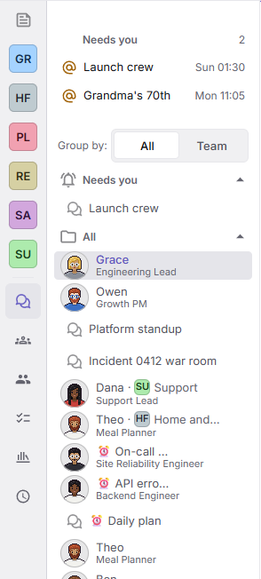

| | |
| --- | --- |
| Path | `Components/Layout/ActivityBar.razor`; the Sidebar's views live in `MainLayout.razor` |
| Sites | `ActivityBar` 1 |
| Key parameters | `Selected`, `SelectedChanged`, `Shortcuts`, `Top`, `Bottom` |
| Add a view | A `SidebarView` value and a `SidebarViews` entry in `SidebarView.cs`, and its section in `MainLayout` |

### Tab strip and page header


| | |
| --- | --- |
| Path | `Components/Layout/TabStrip.razor` (with `TabGroupPane`, `TabHost`, `TabPageHost`) |
| Sites | `TabStrip` 1. A page does not use it directly; it plugs in through `TabKeys.Describe` |

### Breadcrumbs


| | |
| --- | --- |
| Path | `Components/Shared/PageBreadcrumbs.razor` |
| Sites | 1, in the shell. A page never draws its own; the trail holds ancestors only |
| Key parameters | `Crumbs`, `OnNavigate` |

### Sidebar rows: `NavTabLink`, `RoomNavRow`, `ShowAllRow`

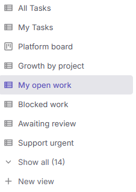


| Component | Path | Sites | Key parameters |
| --- | --- | --- | --- |
| `NavTabLink` | `Components/Layout/NavTabLink.razor` | 21 (12 files) | `Href`, `TabTitle`, `Icon`, `IconColor`, `Match`, `Highlight` |
| `RoomNavRow` | `Components/Shared/RoomNavRow.razor` | 7 (2 files) | `Room`, `Members`, `TeamLabel`, `OnError` |
| `ShowAllRow` | `Components/Shared/ShowAllRow.razor` | 7 (4 files) | `Total`, `Expanded`, `OnToggle` |

`NavTabLink` is any Sidebar link that opens a Tab. `ShowAllRow` is the "Show all (N)" row under a
list that can pass 8 rows (`SidebarRows.Limit`).


`RoomNavRow` owns its hover menu, shown above. Choosing **Delete** swaps the row for the narrow
[inline confirm](#inline-confirm). The menu itself is one of the
[hand-built patterns](#patterns-still-built-by-hand): eleven places build it separately.

### Sidebar switch and settings navigation

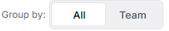


### Right sidebar and its panels

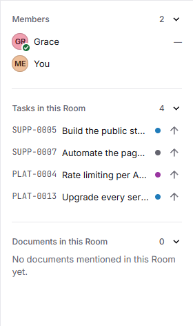


| Component | Path | Sites | Key parameters |
| --- | --- | --- | --- |
| `SidebarPanelFrame` | `Components/Sidebar/SidebarPanelFrame.razor` | 2 (1 file); every panel wraps its body in it | `PanelId`, `Title`, `Icon` |
| `PageSubjectSource` | `Components/Sidebar/PageSubjectSource.razor` | 4 (4 files) | `Value` |
| `RightSidebar` | `Components/Layout/RightSidebar.razor` | 1, in the shell | none |

A page tells the Right sidebar what it shows with `PageSubjectSource`, and never draws a drawer
of its own. A panel is one `AddSidebarPanel` line in `ServiceCollectionExtensions.cs`. The panel
draws the icon, title and count, and remembers whether the Human collapsed it. With no Subject,
the sidebar shows an [`EmptyState`](#empty-state).

## Faces and status

### Avatars


| Component | Path | Sites | Key parameters |
| --- | --- | --- | --- |
| `AgentAvatar` | `Components/Shared/AgentAvatar.razor` | 22 (17 files) | `Name`, `Avatar`, `Size`, `Shape`, `PendingImage` |
| `TeamAvatar` | `Components/Shared/TeamAvatar.razor` | 12 (9 files) | `Team`, `Avatar`, `Size` |
| `ProfileAvatar` | `Components/Shared/ProfileAvatar.razor` | 9 (7 files) | `Name`, `Avatar`, `Size`, `Team` |
| `AgentLabel` | `Components/Shared/AgentLabel.razor` | 2 (2 files) | `Name`, `State`, `Avatar`, `IsUser` |

`AgentAvatar` is every Agent face. `TeamAvatar` is the same with a rounded square shape, and the
Team's picture comes from `_team.md`. `ProfileAvatar` is an `AgentAvatar` inside a button that
opens the [profile popover](#profile-card-and-popover), so never use it where the avatar is
already inside a button or link.


### Presence and status

Presence appears as a small badge on an avatar's bottom-right rim (see the Members panel in the
[Right sidebar](#right-sidebar-and-its-panels) and the cards below).

| Component | Path | Sites | Key parameters |
| --- | --- | --- | --- |
| `PresenceAnchor` | `Components/Shared/PresenceAnchor.razor` | 5 (4 files) | `Cue`, `Detail`, `ChildContent` |
| `PresenceBadge` | `Components/Shared/PresenceBadge.razor` | 2 (2 files) | `Cue`, `OnAvatar`, `Detail` |
| `StatusDot` | `Components/Shared/StatusDot.razor` | 1 | `State`, `OnAvatar`, `Detail` |

`PresenceCue.From(...)` turns a Health or Presence value into one of four glyphs. A badge is a
glyph plus its own state word, never a colour alone.

### Profile card and popover


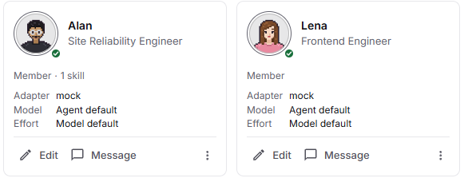

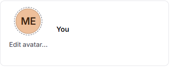

| Component | Path | Sites | Key parameters |
| --- | --- | --- | --- |
| `ProfileCard` | `Components/Shared/ProfileCard.razor` | 3 (3 files: `BuildTeam`, `ProfilePanel`, `ProfilePopover`) | `Profile`, `Manager`, `Existing`, `Membership`, `Actions`, `OnAvatarClick` |
| `ProfilePopover` | `Components/Shared/ProfilePopover.razor` | opened by `ProfileAvatar` | `Name`, `Team`, `OnClose` |

The Team page's Members tab is `BuildTeam` with `MembersOnly`, so the roster cards above are
`ProfileCard`. The caller passes the buttons in `Actions`.

### The Agents page card


The card on the **Agents** page is written inline in `Pages/Agents.razor` (an `AgentAvatar` in a
`PresenceAnchor` plus text). It is not a component, and nothing else uses its markup.

## Chips and filters

### `Chip` and its wrappers


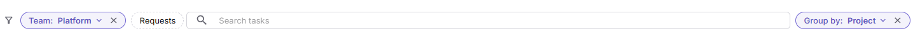

| Component | Path | Sites | Key parameters |
| --- | --- | --- | --- |
| `Chip` | `Components/Shared/Chip.razor` | 25 (20 files) | `Look` (`Status`, `Tag` or `Filter`), `Color`, `Icon`, `IsSet`, `Value`, `Text`, `OnClick`, `OnClear`, `MenuContent` |
| `StatusChip` | `Components/Shared/StatusChip.razor` | 25 (18 files) | `Color`, `Icon` |
| `TaskFilterChip` | `Components/Tasks/TaskFilterChip.razor` | 11 (4 files) | `Label`, `Value`, `IsSet`, `NoMenu`, `OnClear` |
| `ChipCloud` | `Components/Shared/ChipCloud.razor` | 2 (2 files) | `Title`, `Pool`, `Selected`, `Cap`, `Leading`, `OnToggle` |

`Chip` is the one chip, built on `MudChip` so a `MudChipSet` can hold it. `StatusChip` is its
tinted Status look. `TaskFilterChip` is a "Label: Value" chip with a menu, dashed while unset and
filled once set; with `NoMenu` it is the same pill for a choice made elsewhere. `ChipCloud` is a
wrapping cloud of toggle chips with a "Show all" button past `Cap`. A raw `<MudChip` anywhere
else fails the convention scan.

### Status chips on feed and board items


The chips here are `StatusChip` and `Chip`. A Feed line is built from avatar, text and these
chips in `Components/Feed/`.

### Segmented control

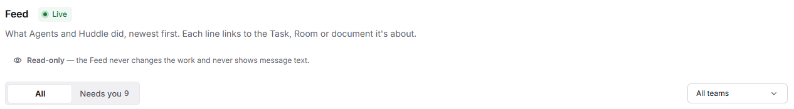


Both screenshots predate the 28 px change (B1, 2026-11-18).

| Component | Path | Sites | Key parameters |
| --- | --- | --- | --- |
| `SegmentedControl<T>` | `Components/Shared/SegmentedControl.razor` | 6 (6 files) | `Options` (`SegmentedOption<T>`: `Value`, `Label`, optional `Icon`, optional `Badge`), `Value`, `ValueChanged`, `Class` |

A two- to five-way mode switch, a toggle group with a sliding pill under the selected item. A
caller passes an options list and the selected value, never Mud parameters or child items; the
component writes `--segmented-count` and `--segmented-index` from the list, so the indicator
follows any number of options. Every site draws one 28 px row: 2 px from the track's edge to an
item (a Theme whose surface trait borders the track sets `--segmented-inset: 1px`, so border and
inset stay 2 px), 24 px items, 13 px text, the selected item at weight 500. The four colour
tokens (`--hu-control-track`, `-ink`, `-selected-ink`, `-selected-line`) are read by the
component only. It is used six times: the Feed's All and Needs you (with a badge), the Tasks
toolbar's List and Kanban (with icons), the Library's [Read, Edit and Split](#library-document-header),
the sidebar's [Group by switch](#sidebar-switch-and-settings-navigation), a Task Description's
Edit and Preview, and the Needs You level choice. Convention rule CV14 fails the build on a raw
`MudToggleGroup` anywhere else.

## Page furniture

### Buttons

| Component | Path | Sites | Key parameters |
| --- | --- | --- | --- |
| `ActionButton` | `Components/Shared/ActionButton.razor` | 33 tags in 21 files, plus the 4 inside `DialogFooter` | `Role` (`ButtonRole`), `ChildContent`, `StartIcon`, `EndIcon`, `Disabled`, `Busy`, `Href`, `Submit`, `FullWidth`, `Class`, `OnClick`, any other attribute (`aria-label`, `id`, `data-*`); `FocusAsync()` |

A caller names what the button is for and the role fixes the rest: always Small (28 px, 13 px at
500), at the control radius step (`--hu-radius-control`: 4.5 px in Lumen and Fluent, 6 px in
Nordic and Cobalt Soft). No caller writes `Variant`, `Color` or `Size`. `Busy` disables the
button and draws a spinner where the start icon would be. `Class` is for layout (margin, flex,
alignment) and a test or script hook only, never a colour, size, padding or radius. Built in
wave 2 (B2, 2026-11-18); convention rule CV15 counts a raw `MudButton` anywhere else.

| Role | Look | Use it for |
| --- | --- | --- |
| `Primary` | Filled, accent | The one primary action of a view or dialog |
| `Secondary` | Outlined | A secondary action, or a standalone action in a list or card |
| `Quiet` | Text | Cancel, Close, Back, and a quiet or link-like action in a row (the default) |
| `Danger` | Filled Error | The confirm that destroys (`InlineConfirm`, `ConfirmDialog` with `Danger`, Remove from Agents too) |
| `DangerQuiet` | Text in Error ink | A destructive trigger that asks first (Delete in Archived, Reset all to defaults, Remove a device) |

Two danger roles because a trigger and its confirm look different (`Q-B2-2`): a `Danger` flag on
the other roles would allow an Outlined Error, which is gone. A Warning button is gone too: the
Feed's Review in Needs You is `Secondary` with its warning icon, and the Skills update that
replaces local edits is `Danger`.

How the 136 per-site `Class` values split (measured before the move): 127 sites carry only hooks for tests and
scripts, with no rule or a layout-only one (`feed-show-more`, `library-document-save`, `role-card-add` and
`role-grid-toggle` set a margin or flex), or one of 11 layout utilities (`mt-1` to `mt-3`, `mb-1`, `mb-2`,
`ml-2`, `ml-3`, `ml-auto`): both stay as `Class`. 9 sites carry one of seven classes that restyled the button,
which are defects: `btn-action-tight` (a 2 px icon gap, removed) and `task-detail-save` and
`task-detail-cancel` (the card radius in `task-form.css`, removed) are folded into the component;
`task-detail-library-add` (recoloured, 12 px text) stays raw until its rule goes; and
`question-card-option`, `invite-agent-option` and `tags-tree-row` are not role buttons (an answer choice, an
option card, a tree row) and stay raw `MudButton`s in the baseline until their own component exists.

**Still raw.** The migration is done (136 of 141 tags moved, 2026-11-18). Five raw `MudButton` tags in
four files stay in the CV15 baseline (`tests/Huddle.Tests.Shell/Ui/Conventions/Baseline/`),
because each is not a plain role button:

| File | Tags | Why it stays raw |
| --- | --- | --- |
| `Shared/QuestionCard.razor` | 1 | An answer option tile (`question-card-option`) |
| `Shared/InviteAgent.razor` | 1 | An option card (`invite-agent-option`) |
| `Sidebar/TagsPanel.razor` | 1 | A tree row (`tags-tree-row`, `shell.css`) that sets its own width, height, alignment and padding |
| `Tasks/TaskDetail.razor` | 2 | "Link note" and "Add File" (`task-detail-library-add`, `task-form.css`): a recoloured button with 12 px text. It can become `Quiet` when its rule is deleted |

The map from the old combinations: Filled Primary is `Primary`, Outlined (default or Primary)
is `Secondary`, Text or no `Variant` is `Quiet`, Filled Error `Danger`, Text or Outlined Error
`DangerQuiet`. A Medium button becomes Small (all 15 moved in wave 2).

### Page header

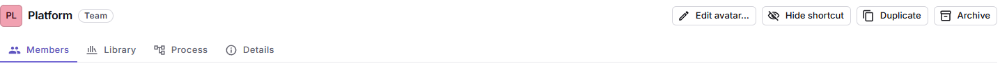


| | |
| --- | --- |
| Path | `Components/Shared/PageHeader.razor` |
| Sites | 16 (11 files) |
| Key parameters | `Title`, `Subtitle`, `Actions`, `Aside`, `TitleEditor`, `TitleTrailing`, `CreateText`, `OnCreate`, `CreatePrimary`, `Chrome`, `SetPageTitle` |

Every page's one `h1`, with its buttons at the right. `CreateText` plus `OnCreate` draws the
page's single create button, filled by default and outlined with `CreatePrimary="false"`.

### Empty state

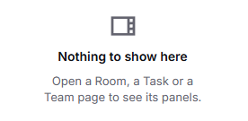

| | |
| --- | --- |
| Path | `Components/Shared/EmptyState.razor` |
| Sites | 24 (18 files) |
| Key parameters | `Title` and `Text` (both required), `Icon`, `Action`, `FullPane` |

Any "nothing here" state. Write the next step in `Text`, not just "No items".

### Notice

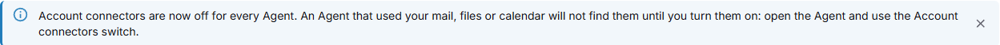


| Component | Path | Sites | Key parameters |
| --- | --- | --- | --- |
| `Notice` | `Components/Shared/Notice.razor` | 53 tags in 29 files; 34 raw `MudAlert` tags still to move | `Severity` (`NoticeLevel`: `Error`, `Warning`, `Info` (the default), `Success`), `Kind` (`NoticeKind`: `Interruption` or `Consequence`), `ChildContent`, `OnDismiss`, `Class`, any other attribute (`data-testid`, `id`) |

A caller names how serious the notice is and the component fixes the rest: always dense (padding
`0 12px`, one line or many), an 18 px icon in the severity colour, the 3 px leading bar, the
sentence in TextPrimary, and 12 px from a sibling before or after it but none at the start or end
of its container (`base.css` "Global MudBlazor overrides"). No caller writes `Dense`, `role`, an
icon or a margin class. `OnDismiss` draws a close button. `Class` is a test or script hook and
layout only. Built in wave 3 (A1, 2026-11-18); convention rule CV16 counts a raw `MudAlert`
anywhere else.

**The kind writes the role** (`Q-A1-1`). `role="alert"` only when the Human must act now: a
conflict, a refusal, a failed action, a missing Team or Project. Every other notice is
`role="status"`. Left unset, an Error is an interruption and Info, Success and Warning are
consequences, so a caller writes `Kind` only for a Warning that interrupts. The 36 Warning sites,
classified when they moved:

| Kind | Sites |
| --- | --- |
| Interruption (9) | `Library/LibraryDocument` freshness (changed on disk: Reload or Keep mine), `Pages/BuildTeam` missing Team, `Pages/Settings` admin access, `Settings/Skills/UpdateDialog` "You edited …", `Shared/FolderPickerDialog` listing error, `Tasks/TaskDetail` gate refusal and save conflict, `Pages/TeamPage` missing Team and missing Project |
| Consequence (25) | `Jobs/ScheduledPage` problems, `Library/LibraryDocument` moved or deleted, `Library/LibraryExplorer` unavailable, `Pages/Agents` files that didn't load, `Pages/BuildTeam` custom roles unreadable, `Pages/Tasks` (5: invalid View, View not found, rejected files, Sprint problems, item not found), `Settings/Helpers/HelperCard` (2), `Settings/PromptsPanel` relied-on warning, `Settings/RemoteAccess/RemoteAccessPanel` downgraded, `Settings/SessionsPanel` load error, `Settings/Skills/UpdateDialog` status, `Shared/NeedsYouLevelControl` unavailable, `Shared/AgentProfileCard` (3), `Teams/DuplicateTeamDialog` skipped, `Tasks/TaskDetail` deleted and budget, `Tasks/TaskReadView` deleted, `Teams/TeamDetails` workspace unreadable |
| Not a `Notice` (2) | The Room banners in `Pages/Chat`, below |

Four of the consequences were `role="alert"` before and are now `status`: the custom roles file
(`BuildTeam`), `SessionsPanel`'s load error, `NeedsYouLevelControl`'s "follows the Team" line and
`TeamDetails`'s workspace line; each reports a state the Human can fix later. Two are close calls:
the custom roles file blocks adding roles, and `NeedsYouLevelControl` names a missing Team; both
explain a fallback rather than ask for an act, so they are `status`. `FolderPickerDialog`'s listing
error stays an interruption: the folder the Human just opened cannot be read. `PromptsPanel`'s
issue list picks its severity at run time and leaves `Kind` unset, so an Error issue interrupts
and a Warning issue (before: also `alert`) reports.

**The Room banners stay raw.** `.budget-prompt` and `.member-health-alert` (`Pages/Chat.razor`)
carry a treatment no other notice gets: a 1 px top hairline shared with the Composer and the
Room strip, and in `paper` and `hairline` a warning tint, the panel radius and a second left bar
(`base.css`), with their own padding and an action row (`room.css`). They are banners, not notices,
so they keep `MudAlert` and their two CV16 counts in the Room baseline until a banner component
exists. They take the 18 px icon, which is global.

**Migration done (2026-11-18).** All 87 `MudAlert` tags are now `Notice` except the two Room banners above, which
stay raw and baselined (CV16 counts 2 in `Pages/Chat`). The migration removed the per-site `mb-*` and `mt-*`
margin classes, so a notice's spacing is now the 12 px between siblings; the Room notices in the 760 px
column (`reply-note`, `fresh-start-note`, `continue-note`, `WaitingNotice`, `FollowUpsNotice`) take that gap
too.

### Text field and select

| Component | Path | Sites | Key parameters |
| --- | --- | --- | --- |
| `TextField` | `Components/Shared/TextField.razor` | 48 tags in 19 files, plus `SearchField`; 14 raw `MudTextField` tags still to move | `Value`, `ValueChanged` (or `@bind-Value`), `Label`, `AriaLabel`, `Shape` (`TextFieldShape`: `Line` (the default), `Compact`, `LongText`, `Markdown`), `Rows`, `MaxRows`, `HelperText`, `Placeholder`, `Immediate`, `DebounceInterval`, `Disabled`, `Required`, `Error`, `ErrorText`, `MaxLength`, `InputType`, `InputMode`, `AutoFocus`, `Clearable`, `StartIcon`, `EndIcon`, `EndIconLabel`, `OnEndIconClick`, `OnKeyDown`, `OnBlur`, `Class`, any other attribute (`autocomplete`, `role`, `id`); `FocusAsync()` |
| `SelectField<T>` | `Components/Shared/SelectField.razor` | 28 tags in 12 files; 6 raw `MudSelect` tags still to move | `Value`, `ValueChanged` (or `@bind-Value`), `MultiSelection`, `SelectedValues`, `SelectedValuesChanged`, `ChildContent` (the `MudSelectItem`s), `Label`, `AriaLabel`, `HelperText`, `Disabled`, `Error`, `ErrorText`, `Compact`, `DenseItems`, `Class`, any other attribute (`title`, `aria-busy`) |

Both are always Outlined and Dense, so no caller writes `Variant` or `Margin`, and neither offers
`ReadOnly` (CV5: a field that cannot be edited is `Disabled`). A field with neither a `Label` nor
an `AriaLabel` (or a passed `aria-label`) throws on its first render, which closes D5. Built in
wave 3 (B3 and B4, 2026-11-18); convention rules CV17 and CV18 count a raw `MudTextField` or
`MudSelect` anywhere else. `SearchField` is now a `TextField` with a start search icon.

**The shape sets the look** (`Q-B3-1`). `Line` is the 32 px box with 14 px text. `Compact` is the
28 px toolbar box with 13 px text (it writes `toolbar-compact`). `LongText` is a 4-row textarea in
body1 (it writes `long-text-field`), and `Markdown` the same box in monospace at 13 px (it adds
`markdown-field`). `Rows` is only for a field whose content sets its height, and `MaxRows` makes it
grow with its text. One shape, not flags, so a compact multi-line field cannot be asked for. The
value is `LongText`, not `Long`, because CA1720 refuses a type name as an identifier.

How the 12 multi-line sites map (old `Lines`, then the new shape):

| Site | Before | After |
| --- | --- | --- |
| `JobEditorDialog` instruction, `AgentProfileCard` persona text | 4 | `LongText`, `Markdown` (4 rows) |
| `BuildTeam` purpose, `RoleFormDialog` instructions | 6 | `LongText`, `Markdown` (4 rows) |
| `ProfilePanel` description, `TaskTimeline` comment | 3 | `LongText`, `Markdown` (4 rows) |
| `RemoteAccessPanel` trusted proxies and allowed origins | 2, no class | `LongText` (4 rows; gains the body line height) |
| `ConflictRow` theirs and yours | 6, no class | `LongText`, `Rows="6"` (the whole text side by side; gains the body line height) |
| `PromptsPanel` prompt | from the text (`RowsFor`) | `Markdown`, `Rows` from the text |
| `TaskDetail` Description | 10, auto-grow to 30 | `Markdown`, `Rows="10"`, `MaxRows="30"` |

The other old parameters map one to one: `aria-label` is `AriaLabel`; `Adornment` with
`AdornmentIcon` is `StartIcon` or `EndIcon`; `AdornmentAriaLabel` is `EndIconLabel` and
`OnAdornmentClick` is `OnEndIconClick`; `UserAttributes` is splatted with `@attributes`;
`Sizing="InputSizing.Auto"` with `MaxLines` is `MaxRows`; `HelperTextOnFocus="false"` was the
default and is gone; the `long-text-field`, `markdown-field` and `toolbar-compact` classes are the
shape. On a select, `Dense="true"` (compact list rows) is `DenseItems`, `toolbar-compact` is
`Compact`, and the Feed's Team filter is now `Compact` too (28 px, like the Agents page's). The
Theme Lab's "Base Theme" is "Base theme".

The four fields that had no accessible name now do: the Prompts panel's prompt (its visible
`prompts-field-label`), the conflict's two texts ("Their Description", "Your Description") and the
board's column rename ("Column name"). The fifth the audit counted, the global search, was already
named through its attributes.

**Still to migrate.** The CV17 and CV18 baselines in
`tests/Huddle.Tests.Shell/Ui/Conventions/Baseline/` are the backlog, one owner per area:

| Area | Raw `MudTextField` (CV17) | Raw `MudSelect` (CV18) | Files |
| --- | --- | --- | --- |
| Room | 4 | 1 | `ElicitationCard` (2), `RetroProposalCard`, `SprintProposalCard`; `InviteAgent` |
| Settings | 6 | 0 | `AddWithAiDialog` (3), `SkillSourcesFolderDialog`, `ThemeLab` (2) |
| Shared | 3 | 4 | `AvatarLibraryPicker`, `FolderPickerDialog`, `NeedsYouLevelControl`; `AgentProfileCard` (4) |
| Tasks | 1 | 0 | `ReasonDialog` |
| Teams | 0 | 1 | `ProcessStep` |

Two of those are not plain tag swaps. `ElicitationCard` hides its label when the question already
shows it, so its owner must pass the question text as `AriaLabel` there. `AgentProfileCard`'s four
selects (Adapter, Model, Effort and Work mode) are its own copy of the picker, and Work mode needs
`ToStringFunc`, which `SelectField` does not offer; they move with A4, which replaces that copy.

### Settings intro and stored-at line

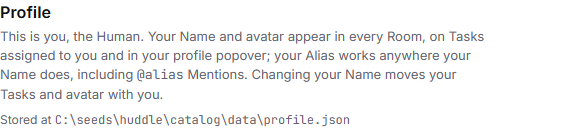

| Component | Path | Sites | Key parameters |
| --- | --- | --- | --- |
| `SettingsIntro` | `Components/Settings/SettingsIntro.razor` | 14 (14 files) | `ChildContent` |
| `StoredAt` | `Components/Settings/StoredAt.razor` | 10 (9 files) | `Label`, `Path` |
| `ProblemList` | `Components/Settings/ProblemList.razor` | 3 (3 files) | `Count` |

The top and foot of every Settings panel: the intro paragraph, the "Stored at" line and the
"Problems" list.

## Rooms and messages

### Composer


| | |
| --- | --- |
| Path | `Components/Shared/Composer.razor` |
| Sites | 1 (one Composer per Room) |
| Key parameters | `RoomId`, `RoomName` |

Its box shares the transcript's 760 px column. The browser behaviour is in `composer.js`.

### Reference picker

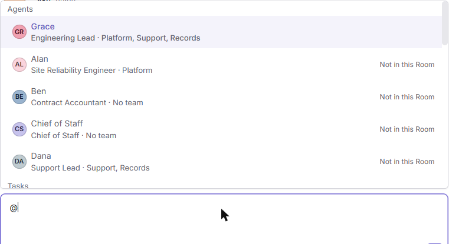

| | |
| --- | --- |
| Path | `Components/References/ReferencePicker.razor`, driven by `Composer` |
| Sites | 1 |
| Key parameters | `View`, `ListboxId`, `OnPick` |

### Invite an Agent

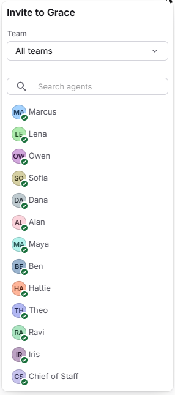

| | |
| --- | --- |
| Path | `Components/Shared/InviteAgent.razor` (rows are `AgentLabel`) |
| Sites | 1 |
| Key parameters | `RoomId`, `RoomName` |

### The transcript

The transcript is `Components/Shared/MessageList.razor` (1 site), drawn in the
[avatar screenshot](#avatars). Cards an Agent puts in it derive from `AgentCardBase` and draw
with `AgentCard` (5 sites in 5 files). They need a live Agent turn to appear, so they are not
shown here (see [Not captured](#not-captured)).

## Tasks

### Board and card


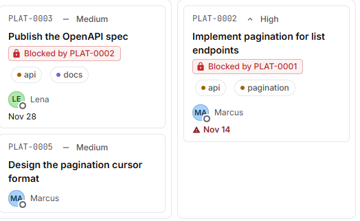

| Component | Path | Sites | Key parameters |
| --- | --- | --- | --- |
| `TaskBoard` | `Components/Tasks/TaskBoard.razor` | 2 (2 files) | `View`, `Tasks`, `Search`, `SelectedId`, `OnOpenTask` |
| `TaskCard` | `Components/Tasks/TaskCard.razor` | 1, in the board | `Task`, `Fields`, `Presence`, `Selected`, `OnOpen` |
| `TaskActionsMenu` | `Components/Tasks/TaskActionsMenu.razor` | 4 (4 files) | `Id`, `ShowMoveTo`, `OnCopyId`, `OnCopyLink`, `ExtraItems` |

### List


The list is `TaskListView` (2 sites). Its column resizing is `task-list-resize.js`; MudDataGrid's
own resizing is off because it round-trips per pointer move.

### Chips for a Task's fields

| Component | Path | Sites | Key parameters |
| --- | --- | --- | --- |
| `TaskStatusChip` | `Components/Tasks/TaskStatusChip.razor` | 4 (4 files) | `Status` |
| `TaskPriorityChip` | `Components/Tasks/TaskPriorityChip.razor` | 3 (3 files) | `Priority` |
| `TaskAssignee` | `Components/Tasks/TaskAssignee.razor` | 5 (5 files) | `Name`, `Presence`, `ShowProfile` |

They are visible in the detail below. Colour and icon come from `TaskColors`.

### Detail, timeline and Human gate

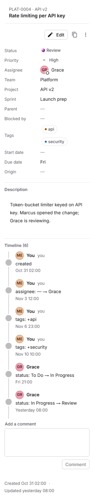

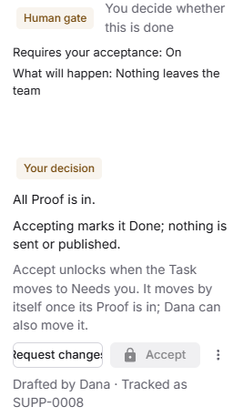

| Component | Path | Sites | Key parameters |
| --- | --- | --- | --- |
| `TaskTimeline` | `Components/Tasks/TaskTimeline.razor` | 2 (2 files) | `Task`, `ReadOnly` |
| `TaskHumanGate` | `Components/Tasks/TaskHumanGate.razor` | 2 (2 files) | `HumanGate`, `HumanGateChanged`, `Action`, `ReadOnly` |
| `TaskDecisionCard` | `Components/Tasks/TaskDecisionCard.razor` | 4 (4 files) | `Task`, `Proof`, `OnDecided` |
| `TaskProofList` | `Components/Tasks/TaskProofList.razor` | 2 (2 files) | `Task`, `Proof` |

The detail is written once for editing (`TaskDetail`) and once for reading (`TaskReadView`), and
the timeline and gate parts are shared between the two, so the two never drift. The property rows
themselves are not shared: see [Patterns still built by hand](#patterns-still-built-by-hand).

## Teams and Agents

### Roles and Team types


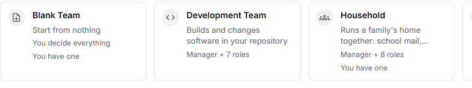


| Component | Path | Sites | Key parameters |
| --- | --- | --- | --- |
| `RoleCard` | `Components/Teams/RoleCard.razor` | 2 (1 file) | `RoleId`, `Title`, `Description`, `Custom`, `Suggested`, `OnAdd`, `OnEdit`, `OnDelete` |
| `TeamTypeCard` | `Components/Teams/TeamTypeCard.razor` | 1 | `TypeId`, `Name`, `Description`, `Roles`, `Selected`, `Owned`, `OnPick` |
| `BuildStepper` | `Components/Teams/BuildStepper.razor` | 1 | `Steps`, `Current`, `AriaLabel` |

`TeamTypeCard` takes plain values, because `TeamTypeManifest` is internal.

### The Agent card


| Component | Path | Sites | Key parameters |
| --- | --- | --- | --- |
| `AgentProfileCard` | `Components/Shared/AgentProfileCard.razor` (2,359 lines) | opened from 3 sites | `Mode`, `Name`, `Title`, `Alias`, `Model`, `Effort`, `WorkMode`, `Adapter` |
| `AdapterModelEffortPicker` | `Components/Shared/AdapterModelEffortPicker.razor` | 1 (the Helper card) | `Adapter`, `Model`, `Effort`, `Disabled`, `SelectionChanged` |
| `AgentConnectorsRow`, `AgentBrowserRow` | `Components/Shared/` | 1 each | `Name`, `Adapter`, `Restarting` |

`AdapterModelEffortPicker` holds the Adapter, Model and Effort cascade (a changed Adapter clears
Model and Effort and says so). `AgentProfileCard` does **not** use it: it writes its own Model,
Effort and Work mode selects, so the cascade exists twice (see
[Patterns still built by hand](#patterns-still-built-by-hand)).

## Library

### Tree and document header


### Library document header


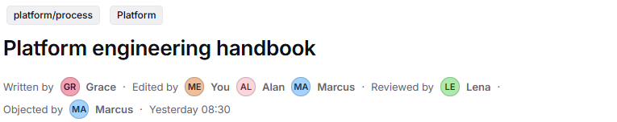

| Component | Path | Sites | Key parameters |
| --- | --- | --- | --- |
| `DocumentByline` | `Components/Library/DocumentByline.razor` | 2 (1 file) | `Path`, `OnOpenHistory` |
| `LibraryProperties` | `Components/Library/LibraryProperties.razor` | 1 | `Properties`, `Path`, `Tags` |

### Markdown toolbar

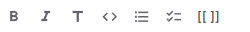

| | |
| --- | --- |
| Path | `Components/Library/MarkdownToolbar.razor` |
| Sites | 3 (2 files): the Library editor and a Task's Description |
| Key parameters | `ShowWikilink` |

A `role="toolbar"` with one tab stop. It raises no .NET event: `markdown-toolbar.js` wires it, so
a click edits in the browser with no round trip. This is the model of shared browser code (see
[Helpers and browser scripts](#helpers-and-browser-scripts)). Add a command as a button plus a
case in `markdown-commands.js`.

## Settings and lists

### A Helper card


| | |
| --- | --- |
| Path | `Components/Settings/Helpers/HelperCard.razor` |
| Sites | 1 (once per Helper) |
| Parts | A `StatusChip`, a `MudSwitch`, `AdapterModelEffortPicker`, two `MudAlert`s with an action |

### Skills table and Remote access


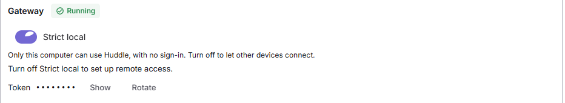

| Component | Path | Sites |
| --- | --- | --- |
| `SkillStateChips` | `Components/Settings/Skills/SkillStateChips.razor` | 5 (4 files) |
| `PackCard`, `SourceRow` | `Components/Settings/Skills/` | 1 each |
| `RemoteAccessPanel` | `Components/Settings/RemoteAccess/` | 1 |

### Archived list


| | |
| --- | --- |
| Path | `Components/Archived/ArchivedEntryList.razor` |
| Sites | 3 (1 file): one per tab |
| Key parameters | `Entries`, `Selected`, `SelectedChanged`, `OnActivate`, `Label`, `Icon`, `Actions` |

A toolbar and a single-select list (`role="listbox"`, rows in the Selected shape). Double-click
restores.

## Dialogs and confirms

### Dialog anatomy

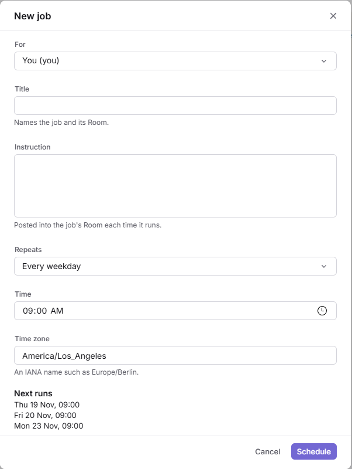

Every dialog has the same three parts: a title row with a close button, a body, and a footer with
Cancel and one primary button, drawn by [`DialogFooter`](#dialog-footer). A picker has no footer.

| Dialog | Path | Opened from |
| --- | --- | --- |
| `NameDialog` | `Components/Shared/Dialogs/NameDialog.razor` | 5 sites |
| `ConfirmDialog`, through `ConfirmAsync` | `Components/Shared/Dialogs/` | 20 sites |
| `AvatarEditorDialog` | `Components/Shared/AvatarEditorDialog.razor` | 4 sites |
| `AgentProfileCard` | `Components/Shared/` | 3 sites |
| `JobEditorDialog` | `Components/Jobs/` | 3 sites |
| `FolderPickerDialog` | `Components/Shared/` | 2 sites |

Open every dialog with `IDialogService.ShowAsync<T>` and the options from `HuddleDialogOptions`
(`SmallForm`, `ShortPicker` or `Picker`, 32 uses). Pass an id or a snapshot: an open dialog
ignores new parameters.

### Dialog footer

| Component | Path | Sites | Key parameters |
| --- | --- | --- | --- |
| `DialogFooter` | `Components/Shared/DialogFooter.razor` | 19 in 18 dialogs | `CancelText` (default "Cancel"), `OnCancel`, `ShowCancel`, `CancelTooltip`, `OnBack`, `ChildContent` (a middle option), `PrimaryText`, `OnPrimary`, `PrimaryDisabled`, `PrimaryIcon`, `Busy`, `BusyText`, `Destructive`, `CancelClass`, `PrimaryClass` |

Placed inside `<DialogActions>`, it draws Cancel (Quiet), Back when `OnBack` has a handler, a middle
option, then the one primary: `Primary`, or `Danger` with `Destructive`. All four were Medium in
the Task dialogs (30.2 px) and are 28 px now. `Busy` disables the primary and draws a spinner; Cancel stays
live. With no `PrimaryText` it is a Close- or Cancel-only row (`AddWithAiDialog`, `LibraryFilePickerDialog`,
`TaskDecisionDialog`). The cancel word varies ("Close", "Not now", "Skip", `HumanGateCopy.CancelButton`);
the look does not. `CancelClass` and `PrimaryClass` keep a dialog's test hooks. Of the 21 dialogs that had
`<DialogActions>`: 18 use it (Duplicate team twice, once per state, so its two primaries are never shown
together), `SkillsHelpDialog` and `NeedsYouLevelDialog` became pickers with no actions row (`Q-A2-1`), and
`PackDetailsDialog` writes three Quiet `ActionButton`s (Remove is `DangerQuiet`), because Close there is not a
Cancel.

`Busy` is set where the primary awaits real work: `NameDialog` (its `SubmitAsync`, a Library or Team write),
`MoveDialog` (the Library move, "Moving…"), `UpdateDialog` (applying a Pack update) and `AgentProfileCard`
(copying an Agent). The others close with an in-memory result for the caller to act on (`ConfirmDialog`,
`AvatarEditorDialog`, `FolderPickerDialog`, `DuplicatePickerDialog`, `ReasonDialog`, `RoleFormDialog`,
`RemovePackDialog`, `SkillSourcesFolderDialog`), or save synchronously, so a busy state could never render
(`JobEditorDialog`, `FieldsDialog`, `DuplicateTeamDialog`).

### Name dialog

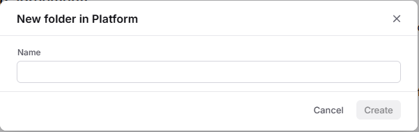

| | |
| --- | --- |
| Key parameters | `Label`, `ConfirmText`, `Location`, `InitialValue`, `Validate`, `SubmitAsync` |
| Behaviour | Live validation, Enter submits, focus on open. `Location` names the place in the title |

### Avatar editor

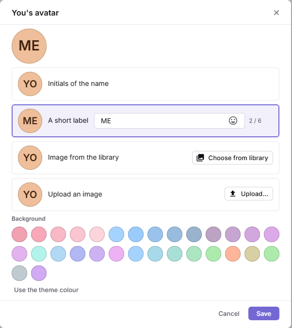

| Component | Path | Sites | Key parameters |
| --- | --- | --- | --- |
| `AvatarEditor` | `Components/Shared/AvatarEditor.razor` | 1, inside the dialog | `Name`, `Value`, `ValueChanged`, `SaveMode`, `AllowLibrary`, `AllowImages`, `Shape` |

Its choice cards are a `role="radiogroup"`; the background swatches are another.

### Inline confirm


| | |
| --- | --- |
| Path | `Components/Shared/InlineConfirm.razor` |
| Sites | 9 (8 files) |
| Key parameters | `Prompt`, `ConfirmText`, `Narrow`, `Busy`, `OnConfirm`, `OnCancel` |

A destructive yes or no that replaces a list row. `Narrow="true"` with `Prompt="Delete?"` is the
one-line sidebar form shown. Confirm takes focus and Escape cancels.

## Search

### Global search

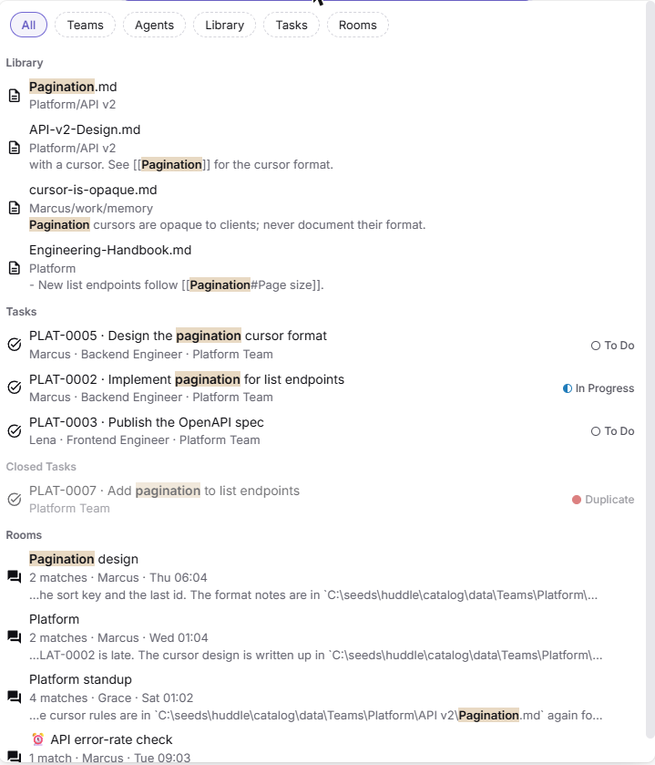

| Component | Path | Sites | Key parameters |
| --- | --- | --- | --- |
| `SearchCardShell` | `Components/Search/SearchCardShell.razor` | 5 (5 files) | `Icon`, `Title`, `Meta`, `Snippet`, `Trailing`, `AccessibleName`, `Archived` |
| `SearchCard` and five `*SearchCard`s | `Components/Search/` | 2 | `Hit`, `Phrase` |
| `SearchField` | `Components/Shared/SearchField.razor` | 4 (4 files) | `Value`, `ValueChanged`, `Placeholder`, `AriaLabel`, `Compact` |

A new kind of result fills the `SearchCardShell` slots; do not copy a card. `SearchField` is any
toolbar search box, one debounce.

## Helpers and browser scripts

These draw nothing. Counts are lines in `.cs` and `.razor` that mention the helper, its own file
included, so read them as a ranking rather than an exact number of call sites.

| Helper | Calls | What it is for |
| --- | --- | --- |
| `RendererDispatch` | 128 | Rendering safely from an event raised off the UI thread |
| `JsModule` | 40 | One handle per browser module in `wwwroot/` |
| `HuddleDialogOptions` | 32 | The size options for every dialog |
| `Plural` | 32 | "1 member" and "2 members" |
| `MenuDialogs` | 31 | A menu item that opens a dialog, and the "Actions for {name}" label |
| `HumanDate` | 24 | A date on screen, with `Full` for the tooltip |
| `BrowserStorage` | 23 | A remembered view choice, never a fault when storage is blocked |
| `ConfirmAsync` | 20 | A destructive confirmation through `ConfirmDialog` |
| `ActionIcons` | 23 | The icon for each recurring action |
| `TaskColors` | 14 | A Task's state, priority or presence colour and icon |
| `ClipboardCopier` | 10 | The one call to the clipboard, with a snackbar |
| `TaskClipboard` | 8 | Copying a Task's id or link, wording only |
| `ServerNavigator` | 5 | Navigating from a handler a server event started |
| `StatusColors` | 5 | A colour for a Needs You reason or a search notice |
| `RoomLinkCopier` | 2 | Copying a Room's link, wording only |

Browser code is an `export` in a `wwwroot/` module reached through `JsModule`, never a `window.*`
global. The app's own scripts total about 2,350 lines (the vendored `lib/` bundles are not
counted).

| Module | Lines | What it does |
| --- | --- | --- |
| `composer.js` | 376 | Composer key handling and the reference picker's keys |
| `library-editor.js` | 309 | The CodeMirror Markdown editor and its commands |
| `auth.js`, `auth-core.js` | 311, 44 | The gateway sign-in page and its crypto helpers |
| `markdown-commands.js` | 216 | The pure text plans behind each toolbar command |
| `task-list-resize.js` | 179 | Drag and keyboard resize of Task list columns |
| `theme-lab.js` | 151 | The Theme Lab inspector |
| `markdown-textarea.js` | 132 | The Markdown toolbar on a Task's Description textarea |
| `resize.js` | 93 | Drag and keyboard resize of the left and right drawers |
| `search.js` | 89 | Global search keys (`Ctrl+K` and `/`) |
| `markdown-toolbar.js` | 88 | The toolbar's click, roving focus and keyboard behaviour, shared by the two editors above |
| `sidebar.js` | 85 | Remembers which Right sidebar panels are collapsed |
| `emoji-picker.js` | 78 | The avatar editor's emoji picker |
| `scroll.js` | 43 | Scroll a Message into view |
| `tabs.js` | 40 | Tab shortcuts (`Alt` based) |
| `feed.js` | 37 | The Feed list's scroll awareness |
| `library-document.js` | 35 | Refresh an open document when the page is visible again |
| `avatar-library.js` | 22 | Escape handling in the avatar library search |
| `clipboard.js` | 20 | `copy`, with a fallback for a non-secure context |
| `storage.js` | 9 | Guarded `localStorage` `get` and `set` |

## Patterns still built by hand

These are shapes the app repeats with no component behind them, plus the standard controls we
want to wrap so that a change is made in one place. **Every row is planned to move into its own
component.** The names are working names, and none carries a prefix (D4, ruled).

Counts were measured at `3b592c70`. Sizes (S, M, L) are estimates, not measurements. When one
ships, move its row to the entry for the new component and delete it here.

### Hand-built shapes

| # | Planned component | Reuse cases | What it fixes | Size | Status |
| --- | --- | --- | --- | --- | --- |
| A3 | **RowActionsMenu**: a `MoreVert` menu with the hover-reveal classes and the "Actions for {name}" label | 11 hand-built (the Teams nav twice, Tasks, the board, the Views nav, `RoomNavRow`, Scheduled, and four in Skills settings); 9 files repeat the `hover-reveal-menu-button` class | The rule is in [UXDesignGuidelines.md](UXDesignGuidelines.md#i-need-use-this) but names no component. A twelfth `MoreVert` menu, on `TaskDecisionCard`, offers other decisions and is a different thing | S | Planned |
| A4 | **One Adapter, Model and Effort picker**, and a `ProbedSelect` for the select-with-progress-bar block | The cascade is written 2 times (`AdapterModelEffortPicker`, used once, and `AgentProfileCard`); the probe block appears 5 times | `AgentProfileCard` (2,359 lines) re-implements the shared picker, and adds a Work mode select the picker lacks | L | Planned |
| A5 | **ChipRadioGroup**: single-select `Chip Look=Filter` with `role="radio"` | 2 identical (`NotificationsPanel`, `SearchBar`) | `NotificationsPanel` adds its own arrow-key handler in C#; `SearchBar`'s copy shows none in its markup | S | Planned |
| A6 | **PropertyList** and **PropertyRow**: a label and a value per row | 30 `<dt>` rows in 5 files (`TaskReadView` 14, `FeedTaskPreview` 7, `FeedHelperPreview` 5, `ProfileCard` 3, `LibraryProperties` 1), plus 25 `.task-detail-prop` rows in `TaskDetail` | The edit and read views of a Task use different markup for the same fields | M | Planned |
| A7 | **SettingSwitch**: a `MudSwitch` with a helper line and a disabled reason | 14 switches in 13 files; about half carry a caption (estimate) | `AgentBrowserRow`, `AgentConnectorsRow`, `RemoteAccessPanel`, `TaskHumanGate` and `ProcessTab` each write their own | S | Planned |
| A8 | **BusyLabel**: a small spinner beside text | 9 `MudProgressCircular` sites in 9 files | One line each, so the gain is consistency (`mr-2`, `aria-label`) rather than size | S | Planned |

### Standard controls to wrap

| # | Planned component | Reuse cases | Evidence | Size | Status |
| --- | --- | --- | --- | --- | --- |
| B5 | **Icon button** with its tooltip pairing | 55 uses in 32 files | `aria-label` is already on all 55, and 26 sit beside a `MudTooltip`. Low gain, because the rule already holds | S | Planned |
| B6 | **Switch or checkbox**: state the rule first, then decide whether one component serves both | 14 switches, 6 checkboxes (`AddWithAiDialog`, `AgentProfileCard`, `ElicitationCard`, `JobEditorDialog`, `NewChat`, `UpdateDialog`) | `design-system.md`'s House defaults table has no row for either | S | Planned |

### Browser scripts

| # | Planned change | Reuse cases | Evidence | Size | Status |
| --- | --- | --- | --- | --- | --- |
| C1 | One pointer-drag helper: capture, move, release, arrow-key step, commit to .NET | 2 modules: `resize.js` and `task-list-resize.js` | Both do the same drag and keyboard flow with different step sizes and zoom handling | S | Planned |
| C2 | One roving-focus and arrow-key helper | Shared once in `markdown-toolbar.js`; written again in up to 6 places (`NotificationsPanel`, `ArchivedEntryList`, `MessageList`, `ReferencePicker`, `search.js`, `ActivityBar`) | A search for arrow keys and `tabindex`; each site was not read, so treat this as a lead | M | Planned |
| C3 | One `copy` to the clipboard | 2: `clipboard.js` and `theme-lab.js` | `theme-lab.js` lacks the fallback for a non-secure context | S | Planned |
| C4 | Shared guarded storage access | 2: `storage.js` and `auth.js` | `auth.js` also needs JSON and `sessionStorage`, so it may be right to keep apart | S | Planned |

### Rules and clean-up that come with them

| # | Item | Evidence |
| --- | --- | --- |
| D1 | A convention rule per wrapper that bans the raw Mud tag, as CV13 does for chips. **Checked 2026-11-18: it can allow what exists and block what is new.** The convention test holds each file to a per-file baseline that may only shrink (see [ComponentRollout.md](ComponentRollout.md#the-guard-that-stops-backsliding)) | The pattern exists: `Chip` plus CV13, whose baseline is empty because every chip has moved |
| D2 | Conflicting `.task-toolbar-kind` rules in `task-form.css` and `tasks.css`. **Done in B1, 2026-11-18**: the geometry and icon rules in both went to `SegmentedControl`; `tasks.css` keeps only the toolbar's layout (`flex: none` and the 5 rem item floor), `task-form.css` none | Padding 2px against 1px, indicator inset 2px against 1px, and the icon size set in both. Which one wins is not checked |
| D3 | A dead CSS hook, `needs-you-level-choice` | The class is on `NeedsYouLevelControl` and has no rules anywhere |
| D4 | One naming convention for the wrappers. **Ruled 2026-11-18: no prefix**, named for what it is (`Notice`, `SegmentedControl`, `DialogFooter`); a name that would clash with HTML or MudBlazor gets a sharper word (`ActionButton`). **Done in B1, 2026-11-18**: `HuddleSegmentedControl` is now `SegmentedControl`, its classes lost the `huddle-` prefix | `HuddleSegmentedControl` has a prefix; `Chip`, `EmptyState` and `SearchField` do not |
| D5 | Text fields with neither `Label` nor `aria-label`. **Done in B3, 2026-11-18**: `TextField` and `SelectField` throw on a render with no name, and the four nameless sites got one (the fifth, the global search, was named by its attributes) | 5 of 62 at `3b592c70` |

### Inconsistencies to fix, per planned component

How the copies of each planned component differ today, so its owner fixes them while building it.
Values marked *measured* were read with `getComputedStyle` on 2026-11-18 at `267f91f4`, in Lumen
Light (the `hairline` surface) at 1,500 px, on the `catalog` seed with the mock adapter; the dark
checks are Lumen Dark. Everything else is read from the code. Paths are under `src/Huddle.App/`,
and `.razor` files under `Components/`. A lead is a reading of the code not yet seen on screen.

Four Themes restyle shared controls through their `surface` trait: Lumen is `hairline`, Nordic
`paper`, Fluent `card` and Cobalt Soft `flat` (`Themes/Skins/*.light.json`). The `paper` and
`hairline` blocks in `wwwroot/css/base.css` (from line 700 and 852) and `sidebar.css` (from 786)
are the overrides to check. `agents/scripts/Css-Snapshot.ps1 -Mode Capture` records every route
in all 8 Theme and mode pairs at 1280 and 768 px; `-Mode Report` with a `-Declared` file of the
intended changes then lists anything else that moved.

#### A3 RowActionsMenu

| Variant | Where | How it looks different |
| --- | --- | --- |
| Sidebar, hover reveal | `Shared/RoomNavRow.razor:85`, `Tasks/TaskViewNav.razor:42`, `Teams/TeamsNav.razor:106` | 23.5 px, radius 6 px (`shell.css:1381` card step), opacity 0 until hover (*measured*) |
| Teams scope row | `Teams/TeamsNav.razor:393`, `sidebar.css:308-321` | Same look, written a second time with its own classes |
| Built-in activator | `ScheduledPage.razor:75`, `PackCard.razor:74`, `SkillsTab.razor:123`, `SourceRow.razor:30`, `SourcesTab.razor:78` | 23.5 px, radius 50%, always visible (*measured* on Skills: the class sits outside a `.hover-reveal-row`) |
| Page header | `Pages/Tasks.razor:147` | 28 px, radius 50% (`tasks.css:1221`) |
| Board column | `Tasks/TaskBoard.razor:74` | Label "{column} column menu", not "Actions for {name}"; menu not `Dense`: items 45.7 px against 30.2 px (*measured*) |
| Not dense | `TaskViewNav.razor:33`, `TaskBoard.razor:72` | `Dense` missing on the `MudMenu` |

Dense items measure 30.2 px at 14 px; the rule says 32 px at 13 px.

**Which is right.** design-system.md Menus: a `Dense` 32 px, 13 px item; the activator's label is
`MenuDialogs.ActivatorLabel`; Patterns worth copying: actions "revealed on hover or focus".

**Fix:**

1. `RowActionsMenu` owns the activator, `Dense`, the label and the reveal. `markup only`
2. The four Skills menus and `ScheduledPage` reveal on hover like the sidebar. `visual`
3. `TaskBoard.razor:74` takes `ActivatorLabel(column.Label)`. `markup only` (wording heard)
4. Delete `sidebar.css:308-330` once `TeamsNav.razor:393` uses the component. `markup only`
5. Menu items to 32 px and 13 px in `base.css`. `visual`

**How to prove.** Css-Snapshot Report on `/`, `/tasks/all-tasks`, `/settings/skills`,
`/scheduled`; declare `opacity` on the five built-in activators. Open one menu and read item height.

**Open questions for the owner:**

- `Q-A3-1` Activator radius: 50% (icon button) or the card step (sidebar today)? Recommended: 50%,
  the icon button's shape, so B5 decides it once.
- `Q-A3-2` Hover reveal in a table (Skills) as in the sidebar? Recommended: yes; touch keeps it shown.

#### A4 One Adapter, Model and Effort picker

| Variant | Where | How it looks different |
| --- | --- | --- |
| Shared picker | `Shared/AdapterModelEffortPicker.razor:17-64` | Adapter select always shown; probe labels "…this adapter offers"; no tooltips |
| Agent card copy | `Shared/AgentProfileCard.razor:520-626` | Adapter hidden with one choice (`:518`); `title` tooltips on Model and Effort; probe label "…this agent offers"; a Work mode select (`:607`) disabled by the Effort probe; a caption under the row (`:626`) |

Both use the same classes (`agent-profile-card-row`, `-cell`, `-probe`, `-probing`), so they look
alike on screen; the differences are the hidden Adapter, the tooltips and the caption. Not measured:
the picker sits on the Helper card, the copy in the Agent card dialog.

**Which is right.** No rule decides whether a one-choice Adapter select is shown. The
Agent card's comment above `:518` argues for hiding it.

**Fix:**

1. `AgentProfileCard` uses the picker with a `WorkMode` slot. `markup only`
2. Rename the shared classes off `agent-profile-card-*`. `markup only`
3. One probe wording. `markup only` (heard)

**How to prove.** Open the Helper card and an Agent card in Edit and compare the row heights.

**Open questions for the owner:**

- `Q-A4-1` Hide the Adapter select when only one Adapter exists? Recommended: yes, in both.
- `Q-A4-2` Keep the `title` tooltips? Recommended: no; the caption under the row says it.

#### A5 ChipRadioGroup

| Variant | Where | How it looks different |
| --- | --- | --- |
| Feed categories | `Feed/NotificationsPanel.razor:22-40` | Group label "Category"; a count after Needs you; gap 4 px, padding 8 px (`NotificationsPanel.razor.css:2`); arrows move the choice (`:167`) |
| Search scopes | `Search/SearchBar.razor:41-56` | Group label "Filter"; label text is the enum name (`filter.ToString()`); gap 4 px, padding 8 px (`gap-1 pa-2`); only Ctrl with an arrow moves it (`search.js:48`), because focus stays in the box |

Both draw `Chip Look=Filter`, 28 px, so the chips match; not measured, the dropdown and panel were
not opened.

**Which is right.** design-system.md Chips: the Filter look; selection reads as text and state,
never colour alone. No rule decides the keys.

**Fix:**

1. `ChipRadioGroup` takes the items, a label function and an optional count. `markup only`
2. Search labels come from a label function, not `ToString()`. `markup only`

**How to prove.** Read `role="radio"` and `aria-checked` on both after a change of choice.

**Open questions for the owner:**

- `Q-A5-1` Do plain arrows move the choice in both? Recommended: yes in the Feed; the search keeps
  Ctrl because the arrows belong to the text box.

#### A6 PropertyList and PropertyRow

| Variant | Where | Label column | Gap | Label size | Row |
| --- | --- | --- | --- | --- | --- |
| Task read view | `Tasks/TaskReadView.razor:111`, `tasks.css:34` | 96 px | 8 px | 12 px | 28 px min, a hairline under each (*measured*) |
| Task edit page | `Tasks/TaskDetail.razor`, `task-form.css:270` | 96 px *measured*; `task-form.css:316` asks 120 px in a container query that did not win at 1,500 px (lead) | 8 px *measured* | 13 px | 44 px, `padding-block: 8px` (`task-form.css:582`) |
| Feed previews | `Feed/FeedTaskPreview.razor:22`, `FeedHelperPreview.razor:26` | `max-content` | 16 px | inherited | no line |
| Library properties | `Library/LibraryProperties.razor:18`, `library.css:907` | `minmax(6rem, max-content)` | 24 px | inherited | no line |
| Roster card | `Shared/ProfileCard.razor:71`, `references.css:354` | `auto`, 45 px *measured* | 8 px | 12 px | no gap between rows |

The two Feed previews repeat the same grid in two scoped files.

**Which is right.** design-system.md Task form anatomy: a 120 px label column at 13 px
TextSecondary; the size ladder makes a Task edit page property a 32 px row. Nothing decides the
other lists.

**Fix:**

1. `PropertyList` takes `Compact` (12 px, 28 px rows, for cards and previews) and the default
   (13 px label, 32 px row, 120 px column). `visual`
2. The Task read and edit views use the default, so the same field lines up in both. `visual`
3. Delete the duplicate grid in `FeedHelperPreview.razor.css:31`. `markup only`

**How to prove.** Css-Snapshot Report on `/tasks/item/{id}` and `/tasks/item/{id}/edit`; declare
`grid-template-columns`, `column-gap` and `height` on the rows.

**Open questions for the owner:**

- `Q-A6-1` A fixed label column, or as wide as the longest label? Recommended: fixed, 120 px, so
  lists stacked on one page align.
- `Q-A6-2` A hairline between rows everywhere, or only in the Task read view? Recommended: only in
  long lists (more than 6 rows).

#### A7 SettingSwitch

| Variant | Where | How it looks different |
| --- | --- | --- |
| Medium, Primary | 11 sites, for example `HelperCard.razor:36`, `RemoteAccessPanel.razor:38` | Span 58 × 38 px, thumb 18 px, label 14 px (*measured*) |
| Small | `Settings/Skills/PackBar.razor:35`, `SkillsTab.razor:65` (both "Show hidden") | Span 44 × 24 px, 14 px label (*measured*) |
| No colour | `Settings/LibraryPanel.razor:64` ("Hide", 7 rows) | `Color.Default`: grey when on |
| Wording | "All Sources" `AddWithAiDialog.razor:55`; "On" `HelperCard.razor:36` | Title case; a label that names the state, not the setting |
| Helper line | caption: `RemoteAccessPanel.razor:40`, `AgentBrowserRow.razor:36`, `ProcessTab.razor:20`, `:51`; body2: `RemoteAccessPanel.razor:43`, `AgentBrowserRow.razor:32`, `AgentConnectorsRow.razor:21` | Two sizes for the line under a switch |
| Disabled reason | body2 note `AgentBrowserRow.razor:32`; lock icon and tooltip `TaskHumanGate.razor:29`; none beside `RemoteAccessPanel.razor:128` (lead) | |

**Which is right.** design-system.md Spacing has no row for a switch; Interface copy: sentence
case (UX-078). `Size.Small` is required on buttons, icon buttons, chips and toggle groups, not on
switches.

**Fix:**

1. `AddWithAiDialog.razor:55` "All sources". `visual`
2. `LibraryPanel.razor:64` takes `Color.Primary`. `visual`
3. One size (Q-A7-1) at all 14 sites. `visual`
4. `SettingSwitch` takes `Helper` (caption, TextSecondary) and `DisabledReason`. `visual`

**How to prove.** Css-Snapshot Report on `/settings/helpers`, `/settings/skills`,
`/settings/library`, `/settings/remoteaccess`; declare `.mud-switch-span | width` and `height`. In
Lumen Dark an on track measured `#8379d8`.

**Open questions for the owner:**

- `Q-A7-1` Small (44 × 24) or Medium (58 × 38) switches? Recommended: Small everywhere; Medium is
  taller than a 32 px row.
- `Q-A7-2` May a switch label be "On"? Recommended: no; name the setting ("Helper on").

#### A8 BusyLabel

| Variant | Where | How it looks different |
| --- | --- | --- |
| Spinner in a button | `PackBar.razor:29`, `SkillsTab.razor:48`, `AgentProfileCard.razor:665` | 24 px spinner and `mr-2` inside a 28 px button; Reload keeps its `Refresh` start icon too, so icon, spinner and text show at once |
| Label only | `BuildTeam.razor:472`, `Chat.razor:223`, `ElicitationCard.razor:201`, `QuestionCard.razor:108` | "Saving…", "Continuing…", "Sending…", no spinner |
| Spinner beside text | `SearchBar.razor:76` (`ml-2`, "Searching"), `ProfilePopover.razor:36` ("Loading profile") | Own `aria-label` |
| Bare spinner | `InlineConfirm.razor:19`, `AiReactingChip.razor:19`, `LibraryTree.razor:106`, `MessageList.razor:187` | No label on the spinner; the tree and the transcript label a wrapper `span` |

All nine are `Size.Small`, 24 px (MudBlazor 9.12.0). Not measured: a busy state needs a slow action.

**Which is right.** design-system.md Dialog anatomy: "a busy label ('Saving…') or a spinner". No
rule picks one.

**Fix:**

1. `BusyLabel` takes the busy text and hides the start icon while busy. `visual`
2. The three button sites drop `mr-2` for the component's gap. `visual`
3. Bare spinners get an `aria-label`. `markup only`

**How to prove.** Reload Skills and read the button's children while it runs.

**Open questions for the owner:**

- `Q-A8-1` In a button, spinner or "…ing" text? Recommended: the text ("Reloading…") with no
  spinner, as four sites already do; a spinner only where there is no button.

#### B5 Icon button

| Variant | Where | How it looks different (*measured*) |
| --- | --- | --- |
| Small, default | most of 55, for example the Room header, Task list rows, row menus | 23.5 px, padding 3 px |
| Small at 28 px | the Tasks toolbars (`tasks.css:1221`), Send | 28 px |
| Small at 24 px | `TeamsNav.razor:273` "Start a project" and its two siblings | 24 px, padding 0 |
| Top bar | `TopBar.razor` | 32 px |
| Radius | sidebar row menus 6 px; everything else 50% | |

**Which is right.** design-system.md size ladder: an icon button is 28 px. 23.5 px is off the
ladder, and only the Tasks toolbar applies 28 px.

**Fix:**

1. A global 28 px Small icon button in `base.css`; delete `tasks.css:1221-1226`. `visual`
2. One radius, with Q-A3-1. `visual`

**How to prove.** Css-Snapshot Report on every route; declare `.mud-icon-button | width`, `height`.

**Open questions for the owner:**

- `Q-B5-1` 28 px everywhere, a sidebar row included? Recommended: yes; the 32 px row holds it.

#### B6 Switch or checkbox

| Variant | Where | How it looks different |
| --- | --- | --- |
| Switch | 14 sites | Acts at once in `AgentBrowserRow` and `AgentConnectorsRow`; waits for Save in `HelperCard` and `RemoteAccessPanel` |
| Checkbox, Primary | `ElicitationCard.razor:145` | Accent box when ticked |
| Checkbox, no colour | `JobEditorDialog.razor:56`, `AddWithAiDialog.razor:61`, `UpdateDialog.razor:63`, `AgentProfileCard.razor:415`, `NewChat.razor:42` | `Color.Default`: grey when ticked |

All 6 checkboxes are `Dense`. Not measured: none was on the pages swept.

**Which is right.** No rule decides this (design-system.md House defaults has no row).

**Fix:**

1. Write the rule in design-system.md House defaults. `markup only`
2. The five checkboxes take `Color.Primary`. `visual`

**How to prove.** Open the New chat picker and the Job editor and read the ticked box's colour.

**Open questions for the owner:**

- `Q-B6-1` **Ruled 2026-11-18: by when it applies.** A switch is for a setting that takes effect
  the moment it is flipped; a checkbox is for picking items from a list, or a field saved with a
  form. The owner lists which of the 20 controls move: `HelperCard` and `RemoteAccessPanel`
  switches wait for Save, so they are the first candidates to become checkboxes.

### Suggested order

The waves, the owner brief and the visual proof are in [ComponentRollout.md](ComponentRollout.md).

**Build bottom-up, adopt top-down.** Building a component is cheap, because it is one file. Moving
call sites onto it is where the effort and the risk are. So a component is created when its first
real user needs it, and the other sites move over gradually.

Three rules for every wrapper:

- **Compose, do not inherit.** A wrapper is built from smaller parts, as `StatusChip` wraps `Chip`,
  which wraps `MudChip`. When a part changes, everything built from it follows.
- **A composite speaks in roles and states, never in Mud parameters.** `DialogFooter` takes
  confirm text, busy and disabled, not `Variant` or `Color`. Then swapping what is inside it later
  is a change to one file.
- **No primitive without a first real user.** Design its parameters from what that user needs. For
  the button, that is 40 sites with a start icon, 55 with `Disabled` and 136 with a per-site class.

The order:

1. **Foundations, no component yet.** The naming convention (D4) and the switch-or-checkbox rule
   (B6) are ruled; write the B6 rule into design-system.md. A convention rule can allow existing uses while blocking
   new ones (D1, checked): the per-file baseline only shrinks.
2. **Pilot with B1.** The segmented control is both a composite and a primitive, so it proves the
   options list, the `Look`, the convention rule and the visual check on six sites.
3. **B2, the button roles, with A2 (`DialogFooter`) as its first user.** **Built 2026-11-18** as
   [`ActionButton`](#buttons) and [`DialogFooter`](#dialog-footer); the other buttons move area by area.
4. **A1 (`Notice`), then B3 (text field) and B4 (select).**
5. **The composites that contain them:** A4 (the picker, which contains selects), A7 (`SettingSwitch`),
   A6 (`PropertyList`) and A3 (`RowActionsMenu`, with B5, the icon button, built as its first user).
6. **Opportunistic:** A5, A8 and group C. Fix D2 and D3 when working in those files.

Prove each visual change with `agents/scripts/Css-Snapshot.ps1` before and after, because four
themes restyle shared controls from outside them.

## Not captured

The screenshots do not cover:

- **Cards an Agent puts in the transcript** (`ProposalCard`, `QuestionCard`, `ElicitationCard`,
  `RetroProposalCard`, `SprintProposalCard`, drawn with `AgentCard`). They need a live Agent turn.
- **The decision card on its own page** (`NeedsYouPage`) and `TaskDecisionDialog`. In the seed, the
  Needs you page lists only two Rooms, so the card is shown inside the Task detail instead.
- **Dark theme and the other skins**, and narrow or phone layouts.
- **Hover, focus and error states** except where noted: the hover menu and the delete confirm.
- Dialogs not opened: `RoleFormDialog`, `DuplicateTeamDialog`, `FieldsDialog`, `FolderPickerDialog`,
  `ReasonDialog`, `MoveDialog` and the Skills dialogs. They follow the same
  [dialog anatomy](#dialog-anatomy).
- `NewChat`, `ConflictRow`, `EditPreview`, `TeamSpend` and `ProjectSpend`.

## Keeping this page current

The rule is in [UXDesignGuidelines.md](UXDesignGuidelines.md#before-you-build-check-the-catalog-and-keep-it-current).
Change this page in the same commit as a change to a shared component: a new component gets an
entry, a removed one loses it, and a count that moves by a site or two does not need a new
screenshot. When a hand-built pattern becomes a component, move its row from
[Patterns still built by hand](#patterns-still-built-by-hand) to the entry for the new component.

**Counting sites.** From the repository root:

```powershell
$root = 'src\Huddle.App\Components'
$files = Get-ChildItem $root -Recurse -Filter *.razor
$text = @{}; foreach ($f in $files) { $text[$f.FullName] = [IO.File]::ReadAllText($f.FullName) }
foreach ($f in $files) {
  $hits = ($text.GetEnumerator() | Where-Object Key -ne $f.FullName |
    ForEach-Object { [regex]::Matches($_.Value, "<$($f.BaseName)(?=[\s/>])").Count } |
    Measure-Object -Sum).Sum
  '{0,4}  {1}' -f $hits, $f.BaseName
}
```

**Taking the screenshots.** The images were made against an isolated app so no real data was used
and nothing was paid for:

```powershell
$env:Team__Acp__Enabled = 'true'
$env:Team__Acp__Adapters__0__Id = 'mock'
$env:Team__Acp__Adapters__0__Command = "$PWD\src\Huddle.MockAdapter\bin\Debug\net11.0\mock-acp.exe"
$env:Team__Acp__Adapters__0__Args__0 = '--mock'
$env:Team__Acp__Adapters__0__UsesToolNamePrefix = 'false'
$env:Team__DemoAgent__Enabled = 'false'
$env:Team__Tasks__WakeEnabled = 'false'
./run.ps1 -Seed -SeedRoot C:\seeds\huddle\catalog -Port 5311 -PipeName huddle-catalog -Configuration Debug
```

Then open `http://localhost:5311` in a browser and clip each component at 1:1.

- Name the file after the component, or the component and its state, in kebab case, and save it
  in `docs/images/components/` as a PNG.
- Clip the component and a little context, not the whole window.
- Cancel every dialog and never confirm a delete: the seed is disposable, but the run should still
  leave it as it found it.
- Use a seed root of your own (here `catalog`), because the seeder wipes its root and other runs may
  be using `software-co`. `agents/DataSeeding.md` has the rest of the lane rules.
