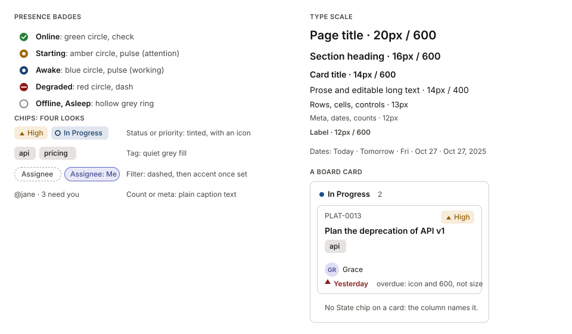

# Design system

How Huddle looks and the rules that keep it consistent: tokens, type, spacing,
components, layout containers, overlays and copy. Read it before you design a screen, add
a component or write a stylesheet for `src/Huddle.App`.
[UXDesignGuidelines.md](UXDesignGuidelines.md) is the hub that routes you here and to
every other UI resource.

**These rules are binding for new and changed code.** Where today's code does not follow
a rule yet, the gap is a row in [UX-Issues.md](UX-Issues.md), and the row's ID is named
next to the rule. Don't copy a pattern from the code without checking it against this
page: the code still holds drift, and this page wins. If a rule is wrong for your case,
change the rule in the same change and say why. Don't quietly make an exception.

[rules.md](rules.md) stays the binding list for behaviour the compiler can't check. This
page is the binding list for how things look, read and behave on screen.

**What this page doesn't cover.** Component APIs, parameters and paths are in the
[catalog](UXDesignGuidelines.md#reusable-parts-catalog). Theme values and the contrast
tests are in [theme-authoring.md](theme-authoring.md). This page states the rules and links
to both.

## The one idea

**MudBlazor is the design system.** Huddle does not keep a token file, a component
library or a second stylesheet beside it. A *Theme* is a `MudTheme` object
([ADR-0010](../adr/0010-a-theme-is-a-mudblazor-theme.md)), MudBlazor turns it into
`--mud-*` CSS custom properties, and `app.css` and every scoped stylesheet read only
those. Everything below follows from that.

| Layer | Owner | Where |
| --- | --- | --- |
| Palette, typography, corner radius, elevation | `MudTheme` built in C# | `src/Huddle.App/Themes/` |
| Components | MudBlazor 9.10.0, used with the house defaults below | `src/Huddle.App/Components/` |
| Compositions and Huddle-only widgets | Plain CSS over `--mud-*` variables | `wwwroot/app.css`, `*.razor.css` |
| The one non-MudBlazor token | `--font-mono` | `wwwroot/app-vars.css` |

[ADR-0009](../adr/0009-a-theme-is-a-stylesheet-layered-over-the-tokens.md) describes the
earlier design, a `theme.css` of 39 tokens. It is superseded; do not rebuild it.

**Consistency comes from one place per decision.** A colour comes from a palette role, a
status colour from a pure mapping function, an icon from an icon map, an avatar from
`TeammateAvatar`, and a recurring shape from a shared component. If you are about to
write the same markup or declaration block a second time, extract it instead.

## Foundations

**Visual reference.** One figure shows the presence badges, the four chip looks, the type
scale and a Board card in Huddle Light's values. The User Guide and theme-authoring.md link
the same drawing, so all three readers see one picture. Redraw it when one of those rules
changes.

### Colour

Colour comes from the palette of the active Theme. Use a semantic role, never a value.

| Role | MudBlazor variable | Use it for |
| --- | --- | --- |
| Surface | `--mud-palette-surface` | **The one shell surface**: the page, the sidebar, the top bar, the tab strip and every pane, plus cards, inputs and dialogs. Panes are separated by hairlines (see Lines), never by a darker ground with gaps around a card |
| Quiet fill | `--mud-palette-background-gray` | The segmented control's track, tag chips, preview blocks. Not a board lane: a lane is `Surface` (see [Tasks](#tasks)) |
| Ground, Sidebar | `--mud-palette-background`, `--mud-palette-drawer-background` | Not painted by the shell. They stay in each palette because MudBlazor and the theme tests read them |
| Text | `--mud-palette-text-primary`, `-secondary`, `-disabled` | Body, supporting text, disabled controls. `text-disabled` paints disabled controls only |
| Accent | `--mud-palette-primary` | **Only** a fill, an indicator bar or a border: the selected row's tint, the active tab's bar, a primary button, the Human's bubble tint. Never a text action's colour and never an open group's chevron |
| Accent text | `color-mix(in srgb, var(--mud-palette-primary) 70%, var(--mud-palette-text-primary))` | Any text or icon in the accent: links, the active sidebar row, the active tab, text and outlined buttons, a selected chip, an accent icon. Raw `Primary` is never text. The mix stays above 4.5:1 on a light and a dark Theme alike |
| Status | `-success`, `-warning`, `-error`, `-info`, `-secondary` | State, never decoration. Never a solid fill under text; see [Chips](#chips) |

**Lines.** Each kind of line has one token and one width (UX-061, UX-062).

| Line | Rule | Examples |
| --- | --- | --- |
| Chrome | `1px solid var(--mud-palette-lines-default)` | Top bar, tab strip, room header, pane splitter, drawer edge. On the one surface this is what separates panes, so it must be clearly visible: Huddle Light's is 2.1:1 and Huddle Dark's 2.5:1 against Surface |
| Card or row border | `1px solid var(--mud-palette-divider)` | Cards, tiles, board lanes, list-row separators, floating panels. At least 1.5:1 against Surface: Huddle Light's is 1.56:1 and Huddle Dark's 1.55:1. This is the only card border: `LinesDefault` is chrome only, never a card, an outlined card or a hover border |
| Rule inside a card | `1px solid var(--mud-palette-divider-light)` | A sub-section inside a card or dialog |
| Input border | MudBlazor's own (`--mud-palette-lines-inputs`) | Never restyle it |

**States.** Each interaction state has one treatment (UX-064 to UX-067).

| State | Treatment |
| --- | --- |
| Hover | `background: var(--mud-palette-action-default-hover)`. Not `table-hover`, except inside a table |
| Selected | `color-mix(in srgb, var(--mud-palette-primary) 14%, var(--mud-palette-surface))`, with accent-text colour and weight 500. It is worn by the active sidebar row, a selected Library tree row (which keeps its 2px bar), a selected Task List row (`task-row-selected`) and the `@` picker's active item, so a selected row never looks like a hovered one |
| Selected and hovered | The same mix at 20%, on hover and (in the sidebar) on focus |
| Accent-tinted surface (the Human's bubble) | 14% fill with a 28% border, over `surface`. Never a solid accent fill |
| Drop target | `1px dashed var(--mud-palette-primary)` plus the hover background |
| De-emphasised text | `color: var(--mud-palette-text-secondary)`. Don't use opacity, and don't use `text-disabled`, which is for disabled controls only |
| Archived or gone | `opacity: 0.6` on the whole item, the one use of opacity for muting |

Always mix a tint over `surface`, never over `transparent`, so it reads the same on every
ground.

**How to use colour in a component:**

- Write `Color="Color.Primary"`, not a hex. Write `var(--mud-palette-primary)` in CSS.
- Never write `Style="color: #..."` in a `.razor` file. Per-Teammate avatar colours are
  user data and arrive as an inline `style` built in C#; a test still forbids a literal.
- Don't colour body text with a status colour. Status colours mark a chip, a dot, an icon
  or a short value such as a date. A whole card of orange text fails contrast and hides the
  state. An overdue date is a warning icon and the date in weight 600, at the date's own
  size, in the error colour mixed 70% toward body text (5.79:1 Dark, 9.70:1 Light), not
  plain red text (UX-043). Overdue adds the icon and the weight, never size.
- A notice's sentence is body text too. Only its icon and its leading bar carry the status
  colour; see [Notices and snackbars](#notices-and-snackbars).

**One hue, one meaning across subjects.** `Warning` (amber) means "needs attention": High
priority, an overdue date, "need you", Starting, a folder warning. A neutral or working state
is never `Warning`, so a Board card never shows amber for its column, its assignee and its
priority at once. Before you give a new state a colour, check that its hue does not already
mean something else in this table.

**Status colours carry the same meaning everywhere.** A status colour is chosen by a pure
mapping function, never at a call site (UX-V14).

| Subject | Mapping | Source |
| --- | --- | --- |
| Task state | Backlog default (its column dot is dashed), To Do default, In Progress info, Review secondary, Done success, Cancelled/Duplicate/Rejected error | [`TaskColors.cs`](../../src/Huddle.App/Components/Tasks/TaskColors.cs), drawn by `TaskStatusChip` |
| Task priority | Low default, Medium info, High warning, Urgent error | `TaskColors.cs`, drawn by `TaskPriorityChip` |
| Task due date | Overdue is a warning icon plus the date in weight 600, in the error colour mixed 70% toward body text | `TaskDates.IsOverdue` decides |
| Presence and Teammate health | Drawn as a [presence badge](#avatars-and-status): a glyph plus a tone. `TaskColors.For(PresenceState)` gives Awake Info, Asleep and Offline Default | `PresenceCue.From` |
| Needs You reason, search notice | `StatusColors.For(NeedsYouReason)`, `StatusColors.For(SearchNoticeKind)` | [`StatusColors.cs`](../../src/Huddle.App/Components/Shared/StatusColors.cs). The Composer's upload chip still colours itself inline (UX-V14) |

A status colour never stands alone: a chip has its text, a dot has an accessible name
(UX-V08).

**Contrast floors.** Tests check 4.5:1; reviewers check 7:1 for body text. Supporting text
(paths, secondary tree text, breadcrumb separators, line numbers), icons and link text reach
4.5:1. Use `text-secondary` for supporting text and icons. A status colour used as an icon
or glyph on its own, such as the tree's orphan warning, is pulled toward the body text the
way the accent is
(`color-mix(in srgb, var(--mud-palette-warning) 75%, var(--mud-palette-text-primary))`).
Check every one in a light and a dark Theme.

**Contrast is tested.** `ThemeCatalogTests` holds every Theme to six pairs, including
`Primary` against both Background and Surface at 4.5:1 (WCAG 1.4.3). It also holds the
Huddle Themes' `Divider` to 1.5:1 against Surface and every Theme to a `DrawerText` and
`DrawerIcon` taken from its own text colours. The Human's accent colour goes through
`AccentPalette.ClampForContrast`, which darkens or lightens it until it clears the floor,
and its `PrimaryContrastText` is black or white, whichever reads better
(`ContrastColour.ReadableForeground`). Both Huddle Themes set `ActionDefault` equal to
`TextSecondary`, so an icon button reads as supporting text and not as MudBlazor's 54% black
(`ThemeCatalogTests` pins it); the 17 VS Code Themes keep MudBlazor's default. A palette
that fails these tests does not ship, and no shipped Theme carries an exception. The tests
cover palettes and the chips, not other tinted states; see [Known gaps](#known-gaps).

**The shipped palettes.** Huddle Light and Huddle Dark are authored in
[`HuddleTheme.cs`](../../src/Huddle.App/Themes/HuddleTheme.cs). Their neutrals are warm
neutral greys and near-neutral charcoals sampled from the Claude desktop app. Each Theme
has its own accent, because each is its own palette
([ADR-0017](../adr/0017-a-theme-is-a-palette-not-a-pair.md)). Their values and ratios are
in [theme-authoring.md › The Huddle accent](theme-authoring.md#the-huddle-accent) and
[Borders and status colours](theme-authoring.md#borders-and-status-colours). A text colour
on a Primary fill is never hard-coded; see the [lookup](UXDesignGuidelines.md#i-need-use-this).

The catalog also holds the Custom Accent pair
([`AccentTheme.cs`](../../src/Huddle.App/Themes/AccentTheme.cs)) and 17 palettes converted
from VS Code ([ADR-0016](../adr/0016-vs-codes-bundled-themes-are-converted-once-not-imported.md)).
The picker groups them as Light, Dark and High Contrast; the catalog holds the counts.

**One palette per Theme.** A Theme carries one palette and its own `ThemeMode`; the mode
is derived from the Theme and from nothing else
([ADR-0017](../adr/0017-a-theme-is-a-palette-not-a-pair.md)). The Human picks one light
and one dark Theme, and the top bar's `ThemeModeToggle` switches between them
([ADR-0054](../adr/0054-a-light-theme-and-a-dark-theme.md)).

### Typography

| Aspect | Value |
| --- | --- |
| UI face | Inter, then Helvetica Neue, then `sans-serif`; loaded from Google Fonts in `App.razor` |
| Monospace | `--font-mono`: `ui-monospace`, Cascadia Mono, Consolas, Courier New |
| Case | Sentence case everywhere. `Typo.button` is `text-transform: none`; tab rails must be too (UX-009). A Tab title is never italic: a preview Tab is weight 400 and the others 500 |
| Scale | Set in rendered px, once, in `ThemeDefaults.WithSharedTypography`. The page is not zoomed ([ADR-0056](../adr/0056-the-ui-renders-at-100-percent-with-a-px-type-scale.md)) |

Set up once in [`ThemeDefaults.cs`](../../src/Huddle.App/Themes/ThemeDefaults.cs). VS Code
themes carry no fonts, so every Theme inherits this stack.

**The type scale, by role.** Pick the role, then use its `Typo` and tag. The scale stops
at `h5`; don't use `h1` to `h4` as a `Typo`. The Rendered column is what the Human sees,
so drift shows when you read this table (`TypeScaleTests` pins it). Line heights are
unitless and set with the sizes in `ThemeDefaults.WithSharedTypography`.

| Role | `Typo` | `HtmlTag` | Rendered | Line height | Weight | Examples |
| --- | --- | --- | --- | --- | --- | --- |
| Page title | `h5` | `h1` | 20px | 1.3 | 600 | a Room's name (`C2`, UX-038), "Settings", a Team's name. Tasks is the one page without an `h1`; see [A page](#a-page), step 3 |
| Dialog or drawer title | `h6` | MudBlazor's | 16px | 1.35 | 600 | "New team", "SUPP-0005 · Build the public status page" |
| Section heading inside a page or panel | `subtitle2` | `h2` | 16px | 1.35 | 600 | Teammates groups, Prompts groups, "Roles", "Roster", the Task drawer's groups (UX-001) |
| Card title | `subtitle1` | | 14px | 1.4 | 600 | A Teammate tile's name, an agent card's "Nova is asking" (UX-031) |
| Group label inside a panel, small and uppercase | `overline` | | 11px, 0.04em tracking | 1.3 | 600 | "Background", "Problems", the search group headings |
| Prose, Transcript | `body1` | | 14px (the Library reader 16px at 1.65) | 1.55 | 400 | Intro paragraphs, "No tasks yet.", a message's body |
| Editable long text | `body1` | | 14px | 1.55 | 400 | Prompt fields, Teammate instructions, a Skill's body. Monospace only when the content is code. Never the input's default weight or line height |
| Dense UI text, rows, cells, controls | `body2` | | 13px | 1.4 | 400, 500 for controls | List rows, table cells, menu items, sidebar rows, Small buttons |
| Metadata, timestamps, helper lines, counts | `caption` | | 12px | 1.35 | 400 | "11:48", "3 Members + you" (UX-037) |
| Button | `button` | | 14px | 1.4 | 500 | A button's label (a Small button's is 13px, see [Spacing, density and size](#spacing-density-and-size)) |

**Minimum size.** No text renders below 11px. The one exception is an avatar monogram:
40% of the avatar's diameter, with a 10px floor, so a 24px avatar shows 10px letters.
`TypeScaleTests` fails on a literal font size under 11px.

**Weights.** Three: 400 for text, 500 for controls, 600 for emphasis and headings. Never
700; `strong` and `b` are 600. Never italic. What a Human types in a field is text, so it
is 400: MudBlazor draws every `.mud-input` in its `subtitle1` role (600 here), and
`app.css` "Global MudBlazor overrides" sets it back to `body1`'s weight.

**Measure.** Prose never runs wider than 75 characters: `max-width: 75ch` on the text
block. That covers intro paragraphs (`.settings-intro`, `.build-team-intro`,
`.page-lead`, `.page-header-subtitle`), `.settings-stored-at`, helper text and empty states.
A wide pane leaves the measure alone. The Transcript is one column of 760px, centred; an
Agent's `.message-body` is at most 75ch and the Human's bubble `min(75%, 75ch + 32px)`.
An empty state's sentence is capped tighter, at 45ch.

**Hierarchy.** The steps are 20, 16, 14, 13 and 12px, so a page reads as an outline: page
title, section heading, card title and body, rows, meta.

- A heading is never smaller than the text it heads, and a section heading is one size
  step above the text in its section, not only heavier. A card title may be the same size
  as its body at weight 600.
- A drawer or dialog title is the item's name, not its type: "SUPP-0005 · Build the public
  status page", never "Task". See [Drawer anatomy](#drawer-anatomy).
- A section heading inside a page is `subtitle2`, weight 600, in `TextPrimary`
  (`.group-heading`). Secondary-grey section headings belong to the sidebar.

**In stylesheets, font sizes come from the typography variables**:
`var(--mud-typography-body1-size)`, `-body2-size`, `-caption-size`, `-subtitle2-size` and
`-overline-size`. Don't write `0.8rem`, `0.85rem` or `14.5px` (UX-068, UX-V18). The
Library is the one place a size is derived rather than picked (see [The Library](#the-library)),
because long-form reading
needs a size the UI scale doesn't have: rendered Markdown (`.library-rendered`, Read mode
and Split's preview) is `body1` x 8/7 (16px) at a 1.65 line height, about 70 characters a
line, with headings stepping up from it (h1 x 1.5, h2 x 1.25, h3 x 1.125); the
raw editor is monospace at `body1` x 0.9375 (13px) with a 1.6 line height. A
hand-written `mud-typography-*` class on a `` is a `MudText` with `HtmlTag="span"`
(UX-V31).

**The sidebar follows the scale too.** Rows are `body2` (13px). A section header is
`caption` (12px) at weight 600 in the secondary text colour. See [The sidebar](#the-sidebar).

### Spacing, density and size

**Density is the default, and it is set on every control, not left to MudBlazor's
default.** MudBlazor's default `Size` is `Medium`, so a `MudButton` with no `Size`
renders at 30px against 25px for Small (UX-V01).

| Control | Required |
| --- | --- |
| `MudButton`, `MudIconButton`, `MudChip`, `MudToggleGroup` | `Size="Size.Small"` |
| `MudTextField`, `MudSelect`, `MudAutocomplete`, `MudNumericField`, `MudDatePicker` | `Variant="Variant.Outlined"`, `Margin="Margin.Dense"` |
| `MudToolBar` | `Dense="true"`, `Gutters="false"` so it lines up with the page title (UX-005) |
| `MudAlert` with one line | `Dense="true"` (UX-040) |
| `Size.Large` | Avatars on a profile card and an empty pane's icon only. No large buttons |

**A Small button is a row-sized control**: 28px high, 13px (`body2`) text, weight 500, for text,
outlined and filled alike. The Status and Tag chips set their own shape; see [Chips](#chips).

**Spacing in markup uses MudBlazor's utility classes**, on a 4px step:

| Place | Class |
| --- | --- |
| Page container, drawer content, dialog content | `pa-4` |
| Card, panel, tile | `pa-3` |
| Between sections | `mb-4` |
| Between related fields | `mb-2` |
| A stack | `MudStack` with `Spacing="2"` for fields and `Spacing="4"` for sections |

**There is one spacing scale: 4, 8, 12, 16 and 24px** (32px for the rare large gap), the
same steps as MudBlazor's utility classes (`pa-1` is 4px, `pa-4` 16px, `pa-6` 24px). In
a stylesheet, write spacing (`padding`, `margin`, `gap` and their sides) in px on that
scale; 1px and 2px hairline offsets are fine. A pane puts 16px between its edge and its
content and 24px above its first line.

**A clearance is the one larger step.** When padding only keeps text out from under a
control overlaid on the box (the Composer's Send and attach buttons, a role card's actions),
size it to that control at 40, 48, 64 or 80px. It is not rhythm, so don't use those values
for ordinary gaps.

CV11 flags spacing in rem and any px spacing off these values. Heights, widths and offsets
such as `top` or `right` are not spacing and keep their own units (UX-073, UX-V18).

The page is not zoomed, so a size in a stylesheet is the size on screen and a full-height
area is plain `100vh`. See
[ADR-0056](../adr/0056-the-ui-renders-at-100-percent-with-a-px-type-scale.md).

### Shape

| Token | Value | Use it for |
| --- | --- | --- |
| `var(--mud-default-borderradius)` | 8px in both Huddle Themes, 4px elsewhere | Cards, tiles, inputs, chips, preview blocks, drawers' inner panels |
| `calc(var(--mud-default-borderradius) * 1.5)` | 12px or 6px | Message bubbles, the Composer, larger containers |
| `calc(var(--mud-default-borderradius) * 0.75)` | 6px or 3px | An element nested inside a rounded one, such as the segmented indicator, and the Status and Tag chips |
| `50%` | Circle | Avatars and status dots, always |
| `999px` | Pill | Count badges, pill buttons |

**No literal radius.** `4px`, `6px`, `8px`, `10px`, `12px` and `14px` don't follow a VS
Code Theme's 4px radius, so a literal card stays at 8px while everything around it
drops to 4px (UX-060).

### Elevation and layering

**Prefer a hairline to a shadow.** A page, panel, card or tile is flat with a card border:
`MudPaper Outlined="true"` with `Elevation="0"`, never the default elevation-1 shadow
(UX-013). The drawer and the app bar are `Elevation="0"`.

| Layer | Elevation | `z-index` |
| --- | --- | --- |
| Page content, cards, tiles | 0 with a card border | none, or `1`/`2` for stacking inside one component |
| A floating panel anchored to a control (Invite, the `@` picker) | `var(--mud-elevation-4)` with a card border, through one shared `.floating-panel` class (UX-063) | `var(--mud-zindex-popover)` |
| Menus and popovers | MudBlazor's own | MudBlazor's own |
| Dialogs, drawers, snackbars, tooltips | MudBlazor's own | MudBlazor's own |
| The error banner `#blazor-error-ui` | | `var(--mud-zindex-snackbar)`, so the sidebar can't cover it (UX-V20) |

Write no literal `z-index` above `2`; use a `--mud-zindex-*` variable.

### Icons

Icons are MudBlazor's Material set. A Tab stores a symbolic name and
[`TabIcons.For`](../../src/Huddle.App/Tabs/TabIcons.cs) resolves it, so persisted state
never holds SVG. An icon MudBlazor lacks comes from
[`MaterialSymbols.cs`](../../src/Huddle.App/Tabs/MaterialSymbols.cs).

**One concept, one icon; one icon, one concept.** Take an entity's icon from `TabIcons`
and an action's icon from the table below, in the weight given. A new concept gets a new
row here before it gets an icon in the code (UX-083, UX-084, UX-R26).

| Entity | Icon |
| --- | --- |
| Room (chat) | `Filled.Chat` |
| Team | `Outlined.Groups` |
| Project | `Filled.LibraryBooks`, for nothing else |
| Teammates, a Team's members | `Filled.Group` |
| Tasks | `Outlined.TaskAlt` |
| Library | `Filled.MenuBook` |
| A folder, including a Library root | `Outlined.Folder` |
| A note or document | `Filled.Description` |
| Settings | `Filled.Settings` |
| Skill, including the Settings Skills section | `Outlined.AutoAwesome` |

| Action | Icon | Not this |
| --- | --- | --- |
| Add, New | `Filled.Add` | `Outlined.Add`, or a literal "+ " in the label |
| Close a dialog, panel or Tab; remove an item from a set the Human is building (a chip, an upload) | `Filled.Close` | Dismissing a notice |
| Delete permanently | `Filled.Delete` | `PersonRemove` |
| Remove from a Team or a list, where the thing itself survives | `Filled.PersonRemove` for a member, otherwise `Filled.RemoveCircleOutline` | `Delete` |
| Dismiss a notice or a Needs You row | `Filled.Check` | `Close` |
| Edit, Rename | `Filled.Edit` | |
| Copy text, an id or a path | `Filled.ContentCopy` | `ContentPaste` |
| Copy a link | `Filled.Link` | |
| Duplicate an entity | `Filled.FileCopy` | `ContentCopy` |
| More actions | `Filled.MoreVert` | A FAB or a chevron (UX-050b) |
| Search | `Filled.Search` | |

### Avatars and status

Component parameters are in the [catalog](UXDesignGuidelines.md#display).

- **`TeammateAvatar` is the only place an avatar becomes pixels.** Never draw a raw
  `MudAvatar` for a Teammate, and never compute a monogram elsewhere (UX-051). Keep its
  single `MudAvatar` root.
- **An avatar is a circle at one of four sizes.** `Small` (24px) in rows, the sidebar, the
  Board and the Room header; `.avatar-transcript` (32px) in the Transcript, where it fills the
  32px `.message-gutter`; `Medium` (40px) on cards and tiles, the Teammates tile and roster
  cards; `Large` (72px) on a `TeammateCard` and in the avatar editor. Pass the class and the
  `Size`; don't set a width or radius of your own.
- **A Teammate's handle is written `@alias`**, wherever it is shown.

**The look.** One recipe per Theme mode, drawn by one `app.css` rule, so every monogram clears
4.5:1 without choosing black or white per colour.

| Mode | Fill | Letters |
| --- | --- | --- |
| Light | The Teammate's colour at 20% over Surface | That colour mixed 75% toward `TextPrimary`, weight 600 |
| Dark | The colour at 35% over Surface, a deep fill | That colour mixed 75% toward white, weight 600 |

CSS can't read a Theme's mode, so `MainLayout.razor` renders a hidden
`` when the Theme is a Dark one, and
`:root:has(.theme-mode-dark)` in `app.css` switches the recipe.
`AvatarColours.MonogramStyle` emits only `--mud-palette-primary: #hex;` on the avatar, and the
rule turns that into the fill and the letters. A Teammate with no colour uses the Theme's
accent through the same recipe. The contrast tests sweep and sample both modes.

| Part | Rule |
| --- | --- |
| Letters | One word gives its first two letters ("Helen" gives HE). Several words give the first and last initials. A one-letter name stays one letter. An empty name gives "?" |
| Letter size | 40% of the diameter, never under 10px: 10px, 12.8px, 16px and 28.8px on 24px, 32px, 40px and 72px |
| Image | A photo or illustration keeps the same circle with a 1px inset hairline in `Divider`, so mixed kinds sit together. It shows from 32px up; at 24px (`Size.Small`) every avatar is the monogram, because an image at that size reads as a blur beside the letters. So a 1:1 Room's sidebar row shows the monogram |
| Stacked members | The Room header's stack is 24px avatars, each with a 2px Surface ring |
| Profile ring | On a `ProfileCard`, the avatar sits in a ring: 1px `TextSecondary`, 2px clear of the avatar. Dashed for a proposed Teammate, solid (`Existing`) for one that already exists. Nowhere else |

**The presence badge.** A badge is a circle at the avatar's bottom-right rim, ringed in 2px
of Surface, with a glyph as well as a colour. It is 10px, and 12px beside an avatar of 40px or
larger. It has `role="img"`, the state word as its `aria-label`, and the reason in its
tooltip. It sits in a `PresenceAnchor` around the avatar, because a `MudAvatar` clips its
children. Standalone, `StatusDot` draws the same 10px badge inline.

| Glyph and tone | Health (`PersonaState`) | Presence (`PresenceState`) |
| --- | --- | --- |
| Green circle, white check | Online | |
| Amber circle, white pulse | Starting | |
| Blue (`Info`) circle, white pulse | | Awake (a Turn is running). Working is not attention, so it is not amber |
| Red circle, white dash | Degraded | |
| Hollow grey ring | Offline | Asleep; Offline |

A filled tone is the palette colour mixed 20% toward black, so the white glyph keeps at least
3:1 against it in both Huddle Themes (a test holds it). Both rings are the neutral grey. The
pulse glyph breathes: the badge fades between full and about half opacity over 1.8s, and is
static under `prefers-reduced-motion`. The glyph carries the state, so the badge also reads in
greyscale.
**Health versus Presence.** Health says whether the Adapter can act at all; Presence says
what an assignee is doing now. They stay two systems that share one glyph set through
`PresenceCue.From`, and each keeps its own word.

- **A status dot is `StatusDot`**: a 10px circle drawn through `PresenceBadge`, with an
  accessible name and a title from its own label function (UX-070, UX-V08). Don't copy its
  state-to-class switch.
- **The Teammates tile carries no "Online" chip.** The badge on its avatar says it.

### Motion

| Motion | Rule |
| --- | --- |
| Hover or focus reveal, a small transform | `transition: opacity 120ms ease` (or the property that changes) |
| The segmented control's indicator | `300ms cubic-bezier(.4, 0, .2, 1)` |
| Anything longer, or anything that loops | Must have a `@media (prefers-reduced-motion: reduce)` branch that replaces it with a static cue. `.search-hit-flash` and the presence pulse show the pattern; the draft caret and ReconnectModal still lack it (UX-V06) |

Write durations in `ms`. Every hover reveal also has a `@media (hover: none)` branch
that shows the control, or it can't be reached on a touch screen (UX-075).

### Focus and accessibility

- **The focus ring is `2px solid var(--mud-palette-text-primary)`, offset 2px**, on
  `a:focus-visible` and `button:focus-visible`. MudBlazor resets the outline, so this
  rule restores it. It uses text colour and not the accent because the dark accent
  measured 1.63:1; text colour clears 3:1 in every Theme. Don't override it with the
  accent, a different width or a hover ring (UX-V07)
  ([app.css](../../src/Huddle.App/wwwroot/app.css) "Keyboard focus ring").
- **The Composer's focused border is the accent.** `.composer-input:focus-visible` draws a
  `Primary` border plus a 0.5px inset accent ring, which reads as 1.5px and moves no text.
  `Primary` clears 3:1 against Surface in both Huddle Themes, where `lines-default` would
  not.
- **Every `MudAlert` has a role**: `role="alert"` for an interruption, `role="status"` for
  a consequence (UX-V05).
- **An icon-only control has an `aria-label` that names its target** ("Delete Grace",
  not "Delete") when it repeats per row. A tooltip alone is not enough (UX-V09).
- **State is never shown by colour alone.** Use text, an icon or `aria-pressed` with it
  (UX-V08).
- **An inert input uses `Disabled`, not `ReadOnly`.** MudBlazor 9.10.0 styles only the
  disabled state (UX-V04).
- **An avatar image has an empty `alt`** because the Teammate's name is always rendered
  beside it.
- **A drag handle also works from the keyboard**: `tabindex="0"`, `aria-value*` and the
  arrow keys (UX-V10).
- **Use the MudBlazor control** rather than a raw `<button>`, a clickable `
` or a bare
  `<a>` (UX-V13).

## Layout containers

The shell and its regions are in
[`MainLayout.razor`](../../src/Huddle.App/Components/Layout/MainLayout.razor), and every
container's code (`S2`, `C7a`, `T3`) is in [wireframes.md](wireframes.md).

| Region | Component | Notes |
| --- | --- | --- |
| Top bar | `TopBar` (a `MudAppBar`) | Slots: `Search`, `Actions`. Shows the breadcrumb of the focused pane |
| Sidebar | `MudDrawer`, persistent, 240px | Sections in order: Needs you, Rooms, Teams, Teammates, Tasks, Library, then Archived chats and Settings pinned to the bottom with `.nav-settings { margin-top: auto }`. Section headers are sentence case |
| Workspace | `MudMainContent.main-column` | A flex column, `overflow: hidden`, holding `TabHost` |
| Tab groups | `TabHost` then `TabGroupPane` | One or two panes side by side, each a `TabStrip` over a `.tab-body`. The focused pane owns the URL; the other dims its active tab |
| Page | `TabPageHost` mounts a `DynamicComponent` | Only each group's active Tab is mounted |
| Inside a page | `MudTabs` (Team page, Settings), `MudSplitPanel` (Library) | `MudDrawer` is not resizable, so use `MudSplitPanel` for two resizable panes |

### The sidebar

The sidebar's content is about 677px tall in an 890px window, so it fits one screen, and at
900px every section header is visible.

- **Every row is one line, 32px high** (`--nav-row-height`). The label is a
  `span.sidebar-row-label` with the full name as its `title`, and it ellipsises. A row is
  `body2` (13px) in body colour, with a 24px avatar or an 18px icon (`--icon-size-row`) and an
  8px gap to the label. A section header is `caption` (12px) at weight 600 in
  `TextSecondary`, sentence case, 16px above and 4px below (UX-014). Footer entries are rows
  too, or icon-only buttons with an `aria-label` (UX-017).
- **Every row has a 24px leading slot.** An avatar fills it; an 18px icon is centred in it.
  Labels at one level therefore start at one x, whether the row shows an avatar or an icon.
- **A destination is a row, not a header.** "Teammates" and "Library" are rows (13px body,
  18px icon in the leading slot); only a group with children wears the section-header style.
- **The Needs You card's rows follow the row scale**: a 13px label and 12px meta, like every
  other sidebar row.
- **The active row wears the Selected treatment**: accent text and a 14% tint, 20% on hover
  or focus (see [States](#colour)).
- **Meta is trailing, never wrapped.** A Team row ends in a `span.sidebar-row-meta` member
  count whose tooltip reads "3 members" or "No members".
- **Groups start closed; the group holding the current page opens.** It also opens on
  navigation, and never closes by itself. Teams persist their open set under
  `teamsNav:expanded`.
- **A list over 8 rows folds behind "Show all (N)"** and "Show fewer" (`SidebarRows`,
  `ShowAllRow`). The active row stays visible.
- **The Library has one home.** The sidebar has one Library link to `/library` and no
  tree, root rows or "Add folder"; the tree lives on the Library page.
- **The first section is "Rooms"**, the defined term in [language.md](language.md).
- **Rows at the same level share one indent**, set by one rule in `app.css` "Left menu".
  Within a level, either every row has an icon or none does (UX-015).
- **A 1:1 Room shows the Teammate's small avatar; a group Room shows the Room icon**
  (UX-016). At 24px the avatar is the monogram, even when the Teammate has an image.
- **Sidebar action links** ("New chat", "Build a team", "New view") take the
  `nav-action-link` class: secondary text colour (not the accent), 2px between icon and
  label. Don't set `IconColor` on them, and don't repeat those rules inline.
- **The sidebar is the shell's surface**, not a tinted panel; a 1px `lines-default` edge
  separates it from the workspace. Its text is `DrawerText`, which every Theme sets to
  `TextPrimary`.
- **Row actions are revealed on hover or focus** with a `120ms` opacity transition, and
  stay reachable by keyboard and on touch.

### The tab strip, tab rail and breadcrumb

- **Tab strip.** A Tab title is 13px at weight 400, and 500 when active. A preview Tab is
  marked by `TextSecondary` colour, never by weight or italic; keeping it returns the body
  colour. Titles ellipsise, and the `title` attribute carries the full title.
- **Tab rail** (Settings, the Team page). Labels are 13px at 500 in `TextSecondary`; the
  active label is in accent text over a 2px accent indicator. The icon is 18px
  (`--icon-size-row`) and takes its label's colour. Scroll arrows appear only when the tabs
  overflow the rail.
- **Breadcrumb.** 13px, ancestors in `TextSecondary`, the current crumb in `TextPrimary`, and
  8px each side of the "›". It starts at the workspace's left edge (240px, past the sidebar),
  above the tab strip, so it reads as the trail of the page under it.

### The Room

The Room is the Transcript over the Composer in one column.

- **An Agent's message has no card.** It is plain 14px text beside a 32px avatar; the body is
  at most 75ch. The Human's bubble keeps its tint, at most `min(75%, 75ch + 32px)`, with a 12px
  radius. Both sit in the 760px centred column.
- **Names, times and gaps.** The sender is 13px at 600; the time is 12px `TextSecondary`, 8px
  after the name. There are 16px between senders and 4px between consecutive messages of one
  sender (`.grouped`).
- **Day separator.** 12px at 600 in `TextSecondary` on a hairline, 24px above and 16px below.
- **A Task link** in a message has a dotted underline, accent text and an 8px status dot.
- **References sit under their message**, in the same column: left-aligned under an Agent's
  body, right-aligned under the Human's bubble. Never detached beside it.
- **A notice sits in the column too.** An offline or error notice goes between the Transcript
  and the Composer at the same 760px width, so all three share one left edge; see
  [Notices and snackbars](#notices-and-snackbars).
- **The Composer shares the column.** Its box is the Transcript's 760px, centred, so it lines up
  with the messages ([catalog row](UXDesignGuidelines.md#actions-and-input)). Its placeholder is
  "Message {Room name}… (/invite @Teammate)", or "Message… (/invite @Teammate)" without a name.

### Tasks

- **A Board card** has 12px padding, a 1px `Divider` border, the card radius and 8px between
  cards. Its first row (`.task-card-header`) holds the ID (12px `TextSecondary`) and the
  priority [status chip](#chips). The title is 14px at 600 and runs to three lines. Tags are
  tag chips. The assignee is a 24px avatar with the name at 12px. The due date is `caption`
  (12px), like the ID, written as [Dates and times](#dates-and-times) says. A card shows no
  State chip and has no coloured edge.
- **A lane** is `Surface` with a 1px `Divider` border and the card radius, in every Theme. Its
  column header names the state; the lane itself carries no fill, so an empty lane is not a
  grey block in Light and a lane is not invisible in Dark.
- **A column header** is an 8px state dot in the colour of the column's first state (dashed for
  Backlog), the name at 13px/600 and the count at 12px `TextSecondary`.
- **An empty column** shows one centred 12px `TextSecondary` line: "Nothing done yet.", "Nothing
  in progress.", "Backlog is empty.", "Nothing to do yet.", "Nothing in review.", or "Nothing
  here yet." for a column of several states. The line ignores the pointer and hides while a
  card is dragged, so the column still takes the drop.
- **Overdue** is the warning icon and the date in one span; see [Colour](#colour). An overdue
  card shows its date even when the View hides `due_date`.
- **Header counts** are 13px, with the numbers at 600 in body colour; "need you" is the
  warning colour mixed 70% toward body text.
- **The List** has 36px rows (32px Dense), 13px body and header cells at 12px/600
  `TextSecondary`. The ID column is 110px, Priority 120px (`task-list-priority-cell`), the row
  menu 40px, and Title takes the rest.
- **The drawer** is in [Drawer anatomy](#drawer-anatomy).

### The Library

- **Tree rows** are 30px, 13px text, 16px icons and a 16px indent.
- **The reader** is `body1` x 8/7 (16px) at 1.65 with a 35em measure. A note's Markdown h1 is
  24px at 600, the one size above 20px in the app, and only in the reader.
- **The file path** is 12px `TextSecondary`, relative to its Library root ("Teams/Platform/
  Architecture.md"), middle-truncated by `LibraryPathDisplay.Shorten`. The absolute path on
  disk is in the tooltip only.
- **"Linked from N notes"** (`.library-backlinks`) is the width of the text column above it,
  its label 13px at 500. The Read, Edit and Split toggle is 13px.
- **A folder warning** is a 14px triangle in the warning colour mixed toward body text, with a
  tooltip. The empty state's "New note" matches the toolbar's Small text button.

### Settings, the Team page and Build a team

- **Settings.** `.settings-page` caps the content at 960px, left-aligned. The intro is 14px
  `TextSecondary` at 75ch; "Overrides stored at" is 12px with the path in 12px `--font-mono`;
  `{{tokens}}` are tag chips in 12px mono.
- **The Team page.** "Roles" and "Roster" are `subtitle2` `h3`s with a 12px `TextSecondary`
  count ("Roster · 4 members", "Roles · N roles available"). Roles fill two rows of `.role-grid`
  220px cards that scroll sideways, and the roster does the same with 20rem cards in `.roster-grid`
  (the one place a card grid scrolls; the team types still wrap): the description is up to three lines at 13px, "Hiring pool" is meta text, Add is
  a Small outlined button at the bottom left and "Suggested" sits to its right. A roster card
  has a 40px avatar with the presence badge and no status dot beside the name, the name at
  14px/600, the role at 13px `TextSecondary`, "Member", "New" or "1 skill" as meta text, and
  its actions on one row (Edit, Message, and Remove in the menu).
- **The save bar** renders only when there are unsaved changes, and is
  `position: sticky; bottom: 0` with a hairline on top (`.build-team-savebar`).
- **Build a team.** `PageHeader` stacks its subtitle on its own 13px `TextSecondary` line. A
  stepper label is 13px at 500 and its detail 12px `TextSecondary`. `.team-type-grid` wraps.
  Every team type is one quiet grey tile with a `TextSecondary` icon; only
  `.team-type-card-selected` is accent-tinted. "You have one" is meta text.

### Teammates

The grid is `repeat(auto-fill, minmax(240px, 1fr))`. The `<li>` is the bordered card and holds
the opening `<button class="teammate-tile">`, so the Task link is not nested in a button. A
tile has a 40px avatar with the badge, the name at 14px/600, the role at 13px `TextSecondary`,
`@alias · State` as 12px meta text, and "Working on SUPP-0002" at 12px with the Task as a link
to `/tasks/item/{id}`. A tile's content is left-aligned on one edge, the "Working on" line
included. Group headings are the section heading (16px/600) with a 12px count
(`.teammates-group-count`). The page's intro says what a Teammate is to the Human; how a
Persona file works belongs in the User Guide.

### A page

1. **Route it.** Make it a routable component (`@page`); `TabPageRoutes` resolves a Tab's
   URL to it. Teach `TabKeys.Describe` the URL's key, title and icon name. A page does not
   draw its own breadcrumb.
2. **Contain it.** Wrap it in a `MudContainer` with `Class="pa-4"` (UX-002). The one
   exception is a page that is nothing but split panes edge to edge, the Library page: it
   uses `pa-0`, and each pane pads itself (16px sides, 24px above its content) so the
   splitter's hairline runs the full height.

   | Kind | `MaxWidth` | Pages |
   | --- | --- | --- |
   | Reading page: forms, settings, a directory | `MaxWidth.Large` with `.page-reading` | Settings, Teammates, Build a team, the Team notice |
   | Wide page: boards, grids, split panes, tabs that hold those | `MaxWidth.False` | Tasks, Library, a Team or Project page |

   **Left alignment.** Every page's title starts at the same left edge. A reading page
   limits the width of its content, not its position, so `.page-reading` drops the
   container's auto margins and the title does not move when the Human switches Tabs.

3. **Title it.** Every page opens with a page header: the title as
   `MudText Typo="Typo.h5" HtmlTag="h1"` on the left and the page's actions on the right,
   each a `Size.Small` button at its natural width, never full width (UX-001, UX-004).
   A page's toolbar sits under the header, lined up with the title.

   - **The page title model.** The page name is the `h1`. The breadcrumb holds only the
     ancestors, so it never repeats the title: a Room shows "Rooms", a Team "Teams", a
     Project "Teams › {Team}", and Build a team "Teams". A page with no ancestor keeps a
     one-crumb trail.
   - **The document title is the bare page name**: "Platform", "Grace", "My Tasks". There
     is no "— Huddle" suffix. `PageHeader` sets it; a page that has no `PageHeader` sets
     `<PageTitle>` itself.
   - **The Tasks exception.** The Tasks page has no `h1`. The View's name is the
     breadcrumb's last crumb ("Tasks › My Tasks"), and that crumb is the View's display
     name, never its slug. Its `<PageTitle>` still sets the document title. The Team page
     and the Project page are not exceptions: both draw a `PageHeader` `h1`. Don't copy
     the Tasks exception to another page.
   - **The Settings title is for a screen reader.** Settings has no ancestor, so its Tab
     and its one-crumb trail both already read "Settings"; a visible title would be the
     third. It passes `HideTitle` to `PageHeader`, which keeps the `h1` and the document
     title but clips the `h1` out of view with `.visually-hidden`. Only a page whose name
     the Tab and a one-crumb trail both show may do this; a page with ancestors or a
     subtitle keeps a visible title.
4. **Fill the pane.** The page's root is `h-100`, with `min-height: 0` on a flex child so
   inner regions scroll instead of the page growing past the window (`.room-column` is the
   model). Split panes fill the height too (UX-006).
5. **Scroll inside the page, not the window.** A horizontally scrolling region keeps its
   scrollbar and headers in view (UX-007).

Two tabbed pages (Team page, Settings) use one tab-rail style (see
[the tab strip, tab rail and breadcrumb](#the-tab-strip-tab-rail-and-breadcrumb)): an icon per
tab from `TabIcons` or the entity table, and sentence-case labels (UX-008, UX-009). A control that
acts on one tab lives inside that tab, not above the rail (UX-010).

## Overlays

| Need | Use | Notes |
| --- | --- | --- |
| A form or a short flow | `MudDialog` through `IDialogService` | Pass an id or a snapshot, not live objects: an open dialog's parameters are frozen |
| A destructive yes or no | The shared confirm (see [Confirming](#confirming)) | Not a custom dialog per site |
| A destructive yes or no on a list row | `InlineConfirm` | Swaps in for the row |
| A side panel over a page | `ResizableEndDrawer` | Task detail. It wraps a temporary, end-anchored `MudDrawer` |
| A transient result | `ISnackbar` | Always with a `key` |
| A menu or picker | `MudMenu`, `MudPopover` | MudBlazor's own sizing; the page is not zoomed |

### Dialog anatomy

| Part | Rule |
| --- | --- |
| Options | `CloseButton = true`, `MaxWidth.Small`, `FullWidth = true` for a form; `BackdropClick = false` when it holds typed input. Don't hand-build a close button in `TitleContent` (UX-022, UX-023) |
| Title | `Typo.h6`: a verb phrase for an action ("New team", "Rename note") or the item's name for a view. When a caller passes a title, show it |
| Fields | `Variant.Outlined`, `Margin.Dense`. `AutoFocus` on the first field. In a single-field dialog, Enter submits (UX-024) |
| Validation | Live, through the feature's pure validator, shown with `Error` and `ErrorText` on the field. Disable the primary action while invalid |
| An error from the action | `MudAlert Severity.Error Dense role="alert"` above the actions. Not a raw `
` or a `MudText` (UX-025) |
| Actions | Right-aligned in this order: **Cancel** (`Variant.Text`), then **Back** if there is one, then the **primary action** (`Variant.Filled`, `Color.Primary`, or `Color.Error` when it destroys). All `Size.Small` (UX-020, UX-021) |
| Busy | The primary action disables and shows a busy label ("Saving…") or a spinner |
| Picker dialog | No actions row; `CloseButton = true` is the way out |

### Drawer anatomy

A side drawer (`T7`, the Task detail) has a header row, content in `pa-4` with
`MudStack Spacing="4"`, and its actions at the bottom in the dialog order. A resizable
drawer uses one shared handle (UX-048, UX-R05).

- **The title is the item's name** in `Typo.h6` (16px/600, up to three lines): the Task's
  name alone, or "New task" for a draft. The generic type word "Task" is only the fallback.
- **An eyebrow sits above the title.** `ResizableEndDrawer.Eyebrow` is a 12px `TextSecondary`
  line: the ID, then the Project or Team ("PLAT-0013 · Platform"). A draft has no eyebrow and
  keeps its in-body "ID: title" row after create.
- **A close `MudIconButton`** sits at the right of the header. Edit, copy and the menu are
  a right-aligned icon row just under the header, not in it.
- **A form in a drawer is grouped.** Put the fields under `subtitle2` headings
  (`.group-heading`): the Task detail uses Status and priority, People, Planning and Dates,
  with the group headings at 16px/600 and a 120px label column at 13px `TextSecondary`.
- **A property is a label and a value.** `.task-detail-groups` is a size container. At 368px
  of container width or more (a 400px drawer less its padding), `.task-detail-prop` is two
  columns, label left and value right. Narrower, it stacks. This mirrors the Library
  Properties grid, but shares no class.
- **Every field has a visible label.** Team and Project are two rows, and Description has
  a label. The control's own floating label stays in the DOM, visually hidden.
- **Created, Updated and Closed are footer meta.** They leave the Dates group and sit at the
  bottom in `.task-detail-footer-meta` (12px `TextSecondary`), after the change log.

### In-place action rows

Cards in the Transcript (`C8`), notices with actions (`C9c`) and banners lay their actions
out **left-aligned, primary first**: the Filled primary, then Outlined secondaries, then
Text quiet actions. This differs from dialogs on purpose: a left-aligned row reads from
its first button, and a dialog's footer reads from the right (UX-032).

### Confirming

- **Anything that can't be undone asks first**, including removing a Library root
  (UX-026).
- **The confirm button repeats the verb**: "Delete", "Remove", "Reset". Never "Confirm",
  "OK" or "Yes, …" (UX-080).
- **The title is a question ending in "?"**: "Delete 'Notes'?". One sentence of body
  says what is lost.
- A destructive confirm button is `Color.Error`. All destructive confirms go through one
  shared confirm component (UX-R12); a list row uses `InlineConfirm` (UX-R13).

### Notices and snackbars

- **A notice is a `MudAlert`** with a role, `Dense` when it is one line, placed in the
  page's notice zone (`C9`, `T9`, `L3d`). Not a styled `
` (UX-056, UX-V13).
- **A notice's sentence is `TextPrimary`.** Only its icon and its 3px leading bar carry the
  status colour. MudBlazor derives a coloured text from the severity; the override lives in
  `app.css` "Global MudBlazor overrides", so every notice gets it.
- **A notice in a Room sits in the 760px column**, between the Transcript and the Composer,
  so all three share one left edge. It never spans the pane.
- **A snackbar passes a `key`** so repeats collapse (UX-V25), and carries an action when
  there is a way forward, such as "Open task" or "Move anyway" (UX-V26).

## Components

### House defaults

Start from the pattern in the file the table names; the full list is in
[MudBlazorImplementation.md](../../agents/MudBlazorImplementation.md).

| Need | Component and defaults |
| --- | --- |
| Button | `MudButton Size="Size.Small"`. `Variant.Filled` for the one primary action per view, `Variant.Outlined` for secondary, `Variant.Text` for quiet and for Cancel |
| Icon button | `MudIconButton Size="Size.Small"`, with an `aria-label`, and a `MudTooltip` when it is not obvious |
| Text input | `MudTextField Variant="Variant.Outlined" Margin="Margin.Dense"` |
| Search field | The same, with a `Filled.Search` start adornment, `Clearable`, `Immediate`, one debounce constant, a placeholder ("Search members") and an `aria-label` (UX-055) |
| Choice | `MudSelect` and `MudAutocomplete` (Outlined, Dense), `MudRadioGroup`, `MudToggleGroup`; for a two- to five-way mode switch, `HuddleSegmentedControl` |
| Container | `MudPaper Outlined="true" Elevation="0"` for a panel or card; `MudStack` for layout |
| Status | `StatusChip` for a state in a word, `MudBadge` or `StatusDot` for presence; see [Chips](#chips) |
| Table | `MudSimpleTable` for short lists, with an empty row; `MudDataGrid` for sortable, groupable data |
| Disclosure | `MudExpansionPanels`, `MudCollapse` |

### Chips

**Four looks, one per job. Don't invent a fifth.** A status colour is never a solid fill
under text. Parameters are in the [catalog](UXDesignGuidelines.md#display).

| Look | Draws | Used for |
| --- | --- | --- |
| Status or priority, tinted: `.status-chip-*` | The colour at 14% over Surface; text and icon the colour mixed 70% toward `TextPrimary`; a leading icon | High, Urgent, In Progress |
| Tag, quiet: `.tag-chip` | `BackgroundGray` fill, `TextPrimary` text | `api`, `pricing` |
| Filter: `.filter-chip`, `TaskFilterChip` | Dashed while unset; a `Primary` border and 14% tint once set (`.filter-chip-set` or `mud-chip-selected`) | Assignee: Me |
| Count or meta: `.chip-meta` | No chip: plain caption text | "@jane", the Needs You count, "Next session" |

**The Status and Tag chips share one shape**: 22px high, `0 8px` padding, a 6px radius
(`calc(var(--mud-default-borderradius) * 0.75)`), 12px text at weight 500 and a 14px leading
icon.

**Text on a status fill reaches 4.5:1.** `StatusChipContrast` mirrors the tint in C#, and a
test holds every pair to the floor. Measured for the status colours, Huddle Light and
Huddle Dark:

| Colour | Light | Dark |
| --- | --- | --- |
| Info | 8.70 | 6.51 |
| Warning | 4.75 | 6.32 |
| Error | 7.68 | 4.94 |
| Success | 4.88 | 6.14 |
| Secondary | 6.10 | 6.00 |
| Neutral | 9.63 | 5.98 |

A Board card shows no State chip, because its column names it, and it carries no
per-state left edge. No palette has `*ContrastText` properties for status colours, because
no status colour is a fill under text.

### Component rules

The catalog of components, with paths and parameters, lives only in
[UXDesignGuidelines.md](UXDesignGuidelines.md#reusable-parts-catalog). These are the
rules that catalog's rows carry out.

- **Use `TeammateAvatar` and `StatusDot`**; see [Avatars and status](#avatars-and-status).
- **A chip is one of the four looks.** `StatusChip` draws the tinted one; a Task's state and
  priority go through `TaskStatusChip` and `TaskPriorityChip`.
  [Catalog row](UXDesignGuidelines.md#display).
- **A page starts with `PageHeader`**; a page never writes its own `h1` or a loose action
  row. See [A page](#a-page), step 3. [Catalog row](UXDesignGuidelines.md#display).
- **An empty list, table or pane uses `EmptyState`.** It is a centred stack: a 32px
  `TextSecondary` icon, a required `Title` (14px/600, `role="status"`), a 13px `TextSecondary`
  sentence that says what to do next, and an optional action. A full-pane one adds
  `empty-state-centered` and sits a third of the way down. In a table, put it in a `colspan`
  row. [Catalog row](UXDesignGuidelines.md#display).
- **A pill track with a sliding indicator is `HuddleSegmentedControl`**, up to five
  options, coloured from `background-gray` and `surface`.
- **A destructive yes or no is `ConfirmAsync`, or `InlineConfirm` on a list row.**
  Confirm takes focus, Escape cancels. See [Confirming](#confirming).
- **A one-field name dialog is `NameDialog`.**
  [Catalog row](UXDesignGuidelines.md#dialogs-o1).
- **Dialog options come from `HuddleDialogOptions`**, never built by hand.
- **A card an Agent puts in front of the Human derives from `AgentCardBase`** and is drawn
  with `AgentCard`. Once decided, the card goes and the decision appears as a posted
  Message (Spec §6.11). `QuestionCard` uses buttons with `aria-pressed` because it owns the
  selection; `ElicitationCard` uses radios and checkboxes (UX-030 to UX-035).
- **Selection in a chip cloud** reads as text and `aria-pressed`, never by colour alone.
  Use `ChipCloud` wherever chips filter a list.
- **A search box is `SearchField`**; a Teammate row is `TeammateLabel`; a Task filter is
  `TaskFilterChip`.
- **A right-hand drawer is `ResizableEndDrawer`** (see [Drawer anatomy](#drawer-anatomy)).
- **An inline edit of a title keeps the title's size.** The field renders at the title's
  size and weight, with no floating label: a Room's rename is `.title-inline-edit` at h5
  size, labelled by `aria-label="Room name"`. It stays `Variant.Outlined` and
  `Margin.Dense` because CV2 requires them, so the outline is the only cue that it is
  editable. There is no shared inline-rename component.
- **Helpers that remove per-site copies** are listed under
  [Helpers](UXDesignGuidelines.md#helpers). Use them; don't write another copy.

No further components are planned; the
[catalog](UXDesignGuidelines.md#components-to-build) says what to do when a shape turns
up twice.

### Patterns worth copying

- **Transcript.** An Agent's message is plain text beside an avatar gutter, with no card.
  The Human's message is a right-aligned `.message-bubble` tinted with the accent. Both sit
  in a 760px centred column, with the Composer in the same column. The body is `body1`, and
  the sender's name is set apart by weight 600, not by being smaller (UX-039). The numbers
  are in [The Room](#the-room).
- **Empty state.** `EmptyState`: an icon, a short title that says what is missing ("No pages
  are open"), and a sentence that says what to do next ("Choose one from the menu."). It is
  centred in its block with 32px above and below; a full-pane one sits a third of the way
  down (UX-077).
- **A list row with actions.** Actions sit in a `MoreVert` menu revealed on hover or
  focus. The same item has the same menu items and label everywhere it appears (UX-050a).

## Interface copy

Words follow [language.md](language.md). These rules decide the form.

- **Controls are sentence case**: buttons, menu items, tab labels, field labels, column
  headers and dialog titles. Only the first word is capitalised, even when a defined term
  follows: "New team", "Invite teammate", "Add folder", "New note", "Consult when" (UX-078).
- **Prose capitalises a defined term**, as language.md does: notices, helper text and
  empty states write "This Task was deleted" and "No Teammates in this Team yet".
- **One verb per meaning:**

  | Verb | Means | Not |
  | --- | --- | --- |
  | Cancel | Abandon this dialog or edit; nothing changes | Close, Dismiss |
  | Close | Put away a view; nothing is lost | Cancel |
  | Delete | Destroy permanently | Remove |
  | Remove | Take out of a set; the thing survives | Delete |
  | Archive | Hide, recoverably | |
  | Dismiss | Hide a notice or request without acting on it | Skip, Close |
  | Decline | Refuse an Agent's proposal | Reject, Leave paused |
  | Invite | Bring an existing Teammate into a Room | Add |
  | Add | Put something into a set | Create |
  | Create | The primary action of a "New …" dialog | OK |
  | Save | Write pending edits | Save to view |

- **One label per field and per action across the app**: "Team name", never "Team title"
  in one dialog and "Team name" in another (UX-079, UX-082).
- **Count with a plural helper**: "1 member", "2 members". Never "1 Members" (UX-037).
- **Show a display name, never a raw id or slug**: "Checks before merge", not
  "checks-before-merge" (UX-082).
- **Busy labels end in an ellipsis character**: "Saving…", "Sending…".

### Dates and times

Write a date the way a person says it. One helper formats every date on screen
(`HumanDate`), so a call site never picks a format string.

| Date | Shown as |
| --- | --- |
| Today, tomorrow, yesterday | "Today", "Tomorrow", "Yesterday" |
| Within the next six days | The weekday: "Fri" |
| Any other date this year | Month and day: "Oct 27" |
| A date in another year | With the year: "Oct 27, 2025" |
| A time | 24-hour, as the Transcript already shows: "01:49" |

The full date is in the tooltip. Never show an ISO date (`2026-10-27`) in the UI, except in
a raw-Markdown view where it is the file's content, and in a date picker's input.
- **Copy lives in markup**, not in a CSS `content:` (UX-V23).
- **Don't say "AI"**; language.md lists it under Avoid (UX-082).

## Writing the stylesheet

1. **Put a rule in `app.css`** when it targets a MudBlazor component's internals
   (`.mud-drawer-content`, `.mud-nav-link-text`, `.mud-toggle-item`). Blazor's CSS
   isolation stamps its attribute only onto HTML elements written in your own markup, so a
   `::deep` rule under a component root never matches and fails silently. This holds for a
   Huddle component's own scoped file too (UX-V16).
2. **Put a rule in a `.razor.css`** only when it targets markup in that component.
3. **Colour and font:** `var(--mud-palette-*)` and `var(--mud-typography-*)` only. A
   literal fails `AppCss_DeclaresNoColourLiteral` or `AppCss_DeclaresNoFontFamilyLiteral`.
   The one allowed exception is `#blazor-error-ui` in `MainLayout.razor.css`.
4. **Every `var()` names a MudBlazor variable or `--font-mono`.** An unresolved property
   resolves to nothing, not to a fallback, and a surface goes invisible
   (`AppCss_UsesOnlyMudBlazorVariables`, `ScopedCss_UsesOnlyMudBlazorVariables`). That
   includes a feature-local custom property such as `--task-ref-dot` (UX-V15).
5. **Sizes, radii and layers use the tokens above**: spacing in px on the 4/8/12/16/24
   scale, typography variables, radius tokens, `--mud-zindex-*`. No literal radius, no
   rem spacing, no literal font size, and nothing under 11px.
6. **Reuse before you write.** Search `app.css` for an existing class before writing a
   declaration block. Truncation is `.truncate`; screen-reader-only text is
   `.visually-hidden`, one global class in `app.css`. Add a utility there the first time a
   second site needs it (UX-R21, UX-R22).
7. **No `!important`**, except where it is the only way past an inline style MudBlazor
   writes, with a comment saying so (UX-V16, UX-V22).
8. **Global MudBlazor overrides** (`.mud-button-root`, `.mud-drawer`, `.mud-avatar img`)
   live in one "Global MudBlazor overrides" section near the top of `app.css`, never in a
   feature's section (UX-V17).
9. **Every feature has a section header** in the form
   `/* ---- Room list: the hover/focus-revealed row actions menu ---- */`. The headers are
   the index. Comment the reason, not the property (UX-V21).
10. **Inline `style=` is for user data only**, such as a Teammate's avatar colour. Layout
    and sizes go in a class (UX-V28).

## Adding a Theme or changing a palette

[theme-authoring.md](theme-authoring.md) walks through these steps in full, with the
palette table and the VS Code mapping.

1. Build the palette in C# and register a `ThemeDescriptor` in
   [`ThemeCatalog.BuiltIn`](../../src/Huddle.App/Themes/ThemeCatalog.cs). Never insert
   before `BuiltIn[0]`; three call sites treat it as the default.
2. Give the descriptor a `ThemeMode` and a `ThemeGroup`; the picker groups by `Group`.
3. For a converted VS Code palette, comment each value with the key it came from. No
   importer ships, so the comment is the only record
   ([ADR-0016](../adr/0016-vs-codes-bundled-themes-are-converted-once-not-imported.md)).
4. Run `ThemeCatalogTests`. Fix the colour (a darker or lighter `Primary`); a shipped Theme
   carries no exception. Set `DrawerText` and `DrawerIcon` from the palette's own text
   colours.
5. Update [manual-tests/appearance-theme.md](manual-tests/appearance-theme.md) if the
   picker changes.

## How the rules are enforced

| Rule | Enforced by |
| --- | --- |
| No colour or font-family literal in a stylesheet | `AppCss_DeclaresNoColourLiteral`, `AppCss_DeclaresNoFontFamilyLiteral` |
| Only MudBlazor variables and `--font-mono` in `var()` | `AppCss_UsesOnlyMudBlazorVariables`, `ScopedCss_UsesOnlyMudBlazorVariables` |
| Palette contrast, the Divider floor and `DrawerText` | `ThemeCatalogTests` |
| Type roles, 11px minimum, weights up to 600, input text at 400, 75ch and 760px | `TypeScaleTests` |
| How a date reads on screen | `HumanDateTests` |
| One hue per meaning: the state, priority and presence mappings | `TaskColorsTests` |
| Status chip contrast | `ChipStyleTests`, which holds the chip pairs to 4.5:1 in Huddle Light and Huddle Dark |
| No colour literal in an inline `style` attribute | `RazorComponents_NoInlineColourLiteralInStyleAttribute` |
| `Size.Small` on buttons, icon buttons, chips, toggles and FABs (CV1) | `UiConventionTests` |
| `Variant.Outlined` and `Margin.Dense` on inputs (CV2) | `UiConventionTests` |
| A `role` on every `MudAlert` (CV3) | `UiConventionTests` |
| A `key` on every `Snackbar.Add` (CV4) | `UiConventionTests` |
| No `ReadOnly` on an input; use `Disabled` (CV5) | `UiConventionTests` |
| No `Typo.h1` to `Typo.h4` and no raw `<h1>` to `<h6>` (CV6) | `UiConventionTests` |
| No `= default!` or `= null!` (CV7) | `UiConventionTests` |
| No `Outlined.Add`, `ContentPaste` or `+ ` label (CV8) | `UiConventionTests` |
| No `style=` with a literal value (CV9) | `UiConventionTests` |
| No component-local `DispatchAsync` (CV10) | `UiConventionTests` |
| In a stylesheet: radius, font size, spacing over 2px, `z-index` over 2 and `!important` come from the scales (CV11) | `UiConventionTests` |
| Everything else on this page | Review, and the checklist below |

`UiConventionTests` (`tests/Huddle.Tests/Ui/Conventions`) scans `src/Huddle.App` and fails
on any violation not listed in `Baseline/Exceptions.txt`. Every area baseline file is empty;
an exception names the rule, the file, a count and the reason, and only the manager adds
one. What the test can't see stays with review: copy, icon choice, layout and the checklist
below.

## Checklist for a new or changed screen

**Before you start**

- [ ] Read the rows of [UX-Issues.md](UX-Issues.md) for the area you are touching. If your
      change fixes a row, delete it in the same change.
- [ ] Find the nearest existing screen in [wireframes.md](wireframes.md) and reuse its
      containers and codes.

**Foundations**

- [ ] Every colour is a palette role or a `Color.*`; none is a literal. Status colours
      come from a mapping function.
- [ ] Every line, hover, selected and drop state uses the treatments under Colour.
- [ ] Every text size comes from the type roles and none renders under 11px; the page has
      one `h1` (the Tasks page has none, see [A page](#a-page)).
- [ ] Every spacing, radius and `z-index` value comes from the scales above.
- [ ] Every icon comes from the entity or action table.

**Components**

- [ ] Every `MudButton`, `MudIconButton` and `MudChip` is `Size.Small`; every input is
      `Variant.Outlined` and `Margin.Dense`.
- [ ] Dialogs, drawers, confirms and action rows follow their anatomy and button order.
- [ ] Every avatar is a `TeammateAvatar`; every chip is one of the four looks; every empty
      state says what to do next.
- [ ] No markup or CSS block was copied from another component; a shared one was used or
      built.

**Accessibility**

- [ ] Each icon-only control has an `aria-label` that names its target; each alert has a
      `role`.
- [ ] Keyboard focus is visible, nothing overrides the ring, and every control, including
      hover-revealed ones and drag handles, is reachable by keyboard and on touch.
- [ ] Any animation has a reduced-motion branch.

**Copy and verification**

- [ ] Labels are sentence case, verbs come from the verb table, counts are pluralised.
- [ ] It looks right in Huddle Light, Huddle Dark and one High Contrast Theme, run with
      `.\run.ps1 -Seed`.
- [ ] It fills its pane and scrolls inside it at a narrow width.
- [ ] The text census (`tools/text-census/`) shows no size under 11px and no contrast
      failure; see
      [After: check it in the running app](UXDesignGuidelines.md#working-on-a-ui-change).
- [ ] [Huddle.UserGuide.md](../Huddle.UserGuide.md) is updated if a Human sees the change,
      and [wireframes.md](wireframes.md) if a container changed shape.

## Known gaps

These are open questions, not decisions. Raise them before relying on them.

- **No global MudBlazor defaults.** MudBlazor 9.10.0 can't set `Size.Small` and
  `Variant.Outlined` once, so they are set per call site and kept by the convention test
  (CV1, CV2) rather than by a wrapper.
- **No narrow-width guidance for the shell.** The drawer is persistent at 240px with no
  collapse, and only the Task list has a narrow-width rule.
- **Contrast tests cover palettes and chips, not other component states.** A tinted
  background such as the Human's bubble or the selected row is not measured. The measured
  baseline for the two Huddle Themes is in
  [theme-authoring.md › The tinted-state gap](theme-authoring.md#the-tinted-state-gap).
- **A quiet fill against Surface has no floor.** `BackgroundGray` (a tag chip, the segmented
  track) is held to no contrast against `Surface`, so in a dark Theme it can nearly vanish.
  That is why a board lane is `Surface` with a border, not a fill. Untested until a floor is
  chosen.

## Keeping this document current

- **A rule changes here first**, then in the code.
- **A component's parameters, path and anatomy go in the
  [catalog](UXDesignGuidelines.md#reusable-parts-catalog)**, not here. A component that sets
  a pattern gets a one-line rule here that links to its catalog row.
- **A Theme value goes in [theme-authoring.md](theme-authoring.md).** Put the ratio here only
  where a rule depends on it.
- **A rendered size changes in `ThemeDefaults`, the Rendered column and `TypeScaleTests`
  together.**

## See also

- [UXDesignGuidelines.md](UXDesignGuidelines.md): the hub for every UI resource, by task.
- [UX-Issues.md](UX-Issues.md): where today's code breaks these rules.
- [wireframes.md](wireframes.md): the code and name of every UI container.
- [rules.md](rules.md): the binding behaviour rules, including the stylesheet and Avatar rows.
- [MudBlazorDesign.md](../../agents/MudBlazorDesign.md): choosing a component for a spec.
- [MudBlazorImplementation.md](../../agents/MudBlazorImplementation.md): the house
  patterns, and facts checked against 9.10.0.
- [Huddle.Tabs-Specifications.md](../Huddle.Tabs-Specifications.md): the tab and pane model.
- [language.md](language.md): the words to use in interface copy.
