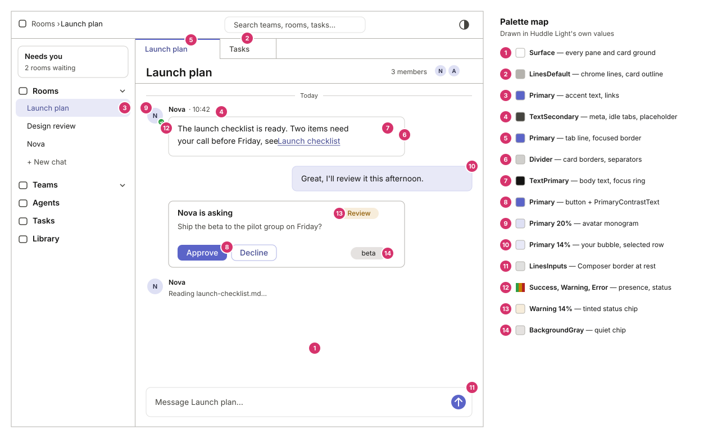

# Writing a Theme

How Themes work in Huddle, and what you need to know to add one. Read it before
you create a file under `src/Huddle.App/Themes/` or change a palette value.

It has two readers:

- **A designer or visual artist** who wants to know which named colour paints the thing
  they are looking at, and what else moves when they change it. Start at
  [Reading the screen](#reading-the-screen-from-what-you-see-to-the-palette). You need
  no code for that part.
- **An engineer** turning a palette into a shipped Theme. Start at
  [How a Theme reaches the screen](#how-a-theme-reaches-the-screen).

This page explains and walks through. It does not decide: the decisions are
[ADR-0010](../adr/0010-a-theme-is-a-mudblazor-theme.md),
[ADR-0016](../adr/0016-vs-codes-bundled-themes-are-converted-once-not-imported.md),
[ADR-0017](../adr/0017-a-theme-is-a-palette-not-a-pair.md) and
[ADR-0054](../adr/0054-a-light-theme-and-a-dark-theme.md), and the colour roles are
owned by [design-system.md](design-system.md#colour). Where this page and one of those
disagree, they win.

## A Theme in one paragraph

A **Theme** is one MudBlazor `MudTheme` object with exactly **one** palette filled in,
wrapped in a `ThemeDescriptor` that says what the Theme is called, whether it is light
or dark, and which picker heading it goes under. Every Theme is compiled C#, listed in
`ThemeCatalog.BuiltIn`. There is no Theme stylesheet, no override file and no run-time
importer: if a colour is on screen, it came from the palette of the one `MudTheme` that
is active.

## Reading the screen: from what you see to the palette

A Theme is about twenty named colours, the **palette properties**. Every pixel of colour
in the app comes from one of them, from a blend of two of them, or from a shade
MudBlazor works out from one of them. This section maps what you can see to those
names. The names are the same in the C# palette (`TextSecondary`) and in the CSS
variable (`--mud-palette-text-secondary`).

### The palette map



The figure is drawn in Huddle Light's real values, so it is also a reference sample of
that Theme. The shell is one surface: the page, the sidebar, the top bar, the tab strip and
every card are `Surface`, split by `LinesDefault` hairlines and `Divider` card borders, which
is why badge 1 covers all of them. The same screen in Huddle Dark is
[palette-map-dark.svg](../images/themes/palette-map-dark.svg); the badge numbers are the same.
Each badge marks one element:

| # | What you see | Palette property | How |
| --- | --- | --- | --- |
| 1 | Every pane and card ground: the page behind the messages, the top bar, the sidebar, the tab strip, the active tab, message cards, the Needs You card, the Composer, dialogs | `Surface` | Direct. `Background` and `DrawerBackground` are no longer painted by the shell |
| 2 | The line under the top bar, the tab strip and the Room header; the sidebar's right edge | `LinesDefault` | Direct. Chrome lines only: a card's border is `Divider` (badge 6) |
| 3 | The active sidebar row: its text and its fill; links in messages | `Primary` | Blend. Text is `Primary` 70% + `TextPrimary`; the row's fill is `Primary` 14% over `Surface`. "New chat" and other text actions are `TextSecondary` |
| 4 | Group headings (Rooms, Teams); a message's time; an inactive tab's title; the "Reading launch-checklist.md…" activity line; the Composer's placeholder | `TextSecondary` | Direct |
| 5 | The 2px line on top of the active tab; the Composer's border while it is focused | `Primary` | Direct |
| 6 | A quote's bar; the day separator's rule; card and tile borders | `Divider` | Direct |
| 7 | Body text, names, titles | `TextPrimary` | Direct |
| 8 | A filled button: fill and the text on it | `Primary`, `PrimaryContrastText` | Direct |
| 9 | An avatar monogram: the tint and the letters | `Primary` | Blend. Fill is the avatar's colour (`Primary` when none is chosen) 20% over `Surface`; letters are that colour 75% toward `TextPrimary` |
| 10 | Your own message bubble | `Primary` over `Surface` | Blend: 14% fill, 28% border |
| 11 | The Composer's border at rest | `LinesInputs` | Direct |
| 12 | Status and presence badges | Online `Success`; Starting `Warning`; Awake `Info`; Degraded `Error` | Blend. The filled tones are the colour 20% toward black, with a white glyph; Offline and Asleep are a hollow ring in the neutral grey. The glyphs are in [design-system.md › Avatars and status](design-system.md#avatars-and-status) |
| 13 | A tinted status chip ("Review") | `Warning` here; any status colour | Blend: the colour 14% over `Surface`; text and icon the colour 70% toward `TextPrimary` |
| 14 | A quiet chip ("beta") | `BackgroundGray` | Direct |

The badges, chips and a Board card are drawn larger, one of each, in the shared
[visual reference](../images/visual-reference.svg) that design-system.md and the User Guide
also use.

The outlined "Decline" button next to 12 is `Primary` text with a translucent `Primary`
border; MudBlazor sets the transparency.

### Three ways a colour reaches the screen

When something you see does not match any palette value exactly, it is one of these:

| Kind | What it means | Can a Theme change it? |
| --- | --- | --- |
| **Direct** | The element is painted with one palette property as it is | Yes: change that property |
| **Blend** | The stylesheet mixes two properties, almost always a colour over `Surface`, so it reads the same on every ground | Only through the two properties it mixes. The percentage is fixed in `app.css` |
| **Derived** | MudBlazor computes a shade from a property: a darker or lighter version, or a translucent hover | Only through the base property. Themes leave these to MudBlazor |

The blends the app uses:

| What you see | Recipe |
| --- | --- |
| Accent text: links and reference links, the active sidebar row and tab, text and outlined accent buttons | `Primary` 70% + `TextPrimary`, which darkens the accent on a light Theme and lightens it on a dark one so it reads as text. Raw `Primary` is for fills, bars and borders only |
| The orphan-folder warning glyph | `Warning` 75% + `TextPrimary` |
| The Library's raw Markdown side in Split | `TextPrimary` 3% over `Surface` |
| Your message bubble | `Primary` 14% over `Surface`, border `Primary` 28% |
| A selected row, card or Team type, and the active sidebar row | `Primary` 14% over `Surface` |
| A selected row, card or Team type while hovered (sidebar, Library tree, Task List, `@` picker, Team type tile) | `Primary` 20% over `Surface` |
| A search hit's flash, at its start | `Primary` 24% over `Surface` |
| The manager's card in a roster | `Primary` 8% over `Surface` |
| Team type icon tiles | `BackgroundGray` with a `TextSecondary` icon; the selected card's tile is `Primary` 14% over `Surface` with the accent-text icon |
| Roster tier labels | `Primary` 14%, `Info` 16% or `Success` 16% over `Surface` |
| A suggested role | `Success` 14% over `Surface`, border and text in `Success` |
| A tinted status chip | The status colour 14% over `Surface`; text and icon the colour 70% toward `TextPrimary`. Status colours are never a solid fill under text |
| An avatar monogram, Light Themes | The avatar's colour (`Primary` when none is chosen) 20% over `Surface`; letters the colour 75% toward `TextPrimary` |
| An avatar monogram, Dark Themes | The colour 35% over `Surface`; letters the colour 75% toward white (a deep fill, light letters). Dark is detected by the `theme-mode-dark` marker `MainLayout` renders |
| A presence badge (online, awake or starting, degraded) | `Success`, `Warning` or `Error` 80% + black (20% toward black), so the white glyph keeps at least 3:1 |

Derived shades you will meet:

| What you see | Derived from |
| --- | --- |
| Hover on rows, buttons, menu items, tabs | MudBlazor's hover shade (`ActionDefaultHover`), a faint translucent dark or light layer, not `TableHover` |
| A filled button while hovered | `Primary`, darkened |
| A selected filter chip's fill; selected text in the Library editor | `Primary`, as a translucent hover shade |
| Warning, info and error notice banners (`MudAlert`) | The status colour, made translucent for the fill; the icon and the 3px leading bar in the status colour. MudBlazor darkens the status colour for the text, but `app.css` overrides that: a notice's sentence is `TextPrimary` |
| A suggested role's text | `Success`, darkened |

### Where to look, screen by screen

The codes (`S1`, `C6` and so on) are the container names in
[wireframes.md](wireframes.md), so you can find each element in a wireframe figure.

**The shell** ([Figure 1](wireframes.md#figure-1-the-shell)):

| Code | Element | Palette |
| --- | --- | --- |
| `S1` | Top bar | Fill `Surface`; icons and text `TextSecondary`; bottom line `LinesDefault` |
| `S1a` | Breadcrumb | Earlier crumbs `TextSecondary`; the current page and a hovered crumb `TextPrimary` |
| `S1b` | Search bar | Input `Surface`, the same as the Composer; the highlighted result the hover shade |
| `S2` | Sidebar | `Surface`; right edge `LinesDefault`; row text `DrawerText` (every Theme sets it to `TextPrimary`) and icons `DrawerIcon` (`TextSecondary`) |
| `S2a` | Needs You card | `Surface`, outline the Edge rung (`Divider`) |
| `S2b`–`S2e` | Group headings | `TextSecondary` |
| `S2b`–`S2e` | Active row | Text `Primary` 70% + `TextPrimary`, fill `Primary` 14% over `Surface` (20% when hovered) |
| `S2b` | "New chat" and other action rows | `TextSecondary` text and icon |
| `S2c` | Expand chevrons, a Project's icon | `TextSecondary`, open or closed |
| any | Health and presence badges | The tones of badge 12; the glyph for each state is in [design-system.md › Avatars and status](design-system.md#avatars-and-status) |

**The workspace** ([Figure 2](wireframes.md#figure-2-the-workspace-with-two-tab-groups)):

| Code | Element | Palette |
| --- | --- | --- |
| `W3` | Tab strip | `TextPrimary` 4% over `Surface`, bottom line `LinesDefault` |
| `W4` | Inactive tab | The strip's tint (7% hovered), text `TextSecondary`, separators `LinesDefault` |
| `W4` | Active tab | `Surface`, text `TextPrimary`, top line `Primary` |
| `W2` | The unfocused group's active tab | Top line `LinesDefault` instead of `Primary` |
| `W8` | Empty group text | `TextSecondary` |

**A Room** ([Figure 3](wireframes.md#figure-3-a-room-the-chat-page)):

| Code | Element | Palette |
| --- | --- | --- |
| `C2` | Room header | On `Surface`; title `TextPrimary`; bottom line `LinesDefault` |
| `C4a` | Day separator | Label `TextSecondary`, rule `Divider` |
| `C4b` | System row | `TextSecondary` |
| `C5a` | Avatar monogram | The avatar's colour 20% over `Surface`, letters 75% toward `TextPrimary`; `Primary` is the colour unless the Teammate chose one (see below) |
| `C5b` | Message meta | Name `TextPrimary`, time `TextSecondary` |
| `C5c` | Message body | No card: plain `TextPrimary` text on the Transcript; quotes `TextSecondary` with a `Divider` bar; links `Primary` 70% + `TextPrimary` |
| `C6` | Your bubble | `Primary` 14% over `Surface`, border 28% |
| `C7b` | Turn detail | `TextSecondary`; an edit preview's removed and added sides are marked `Error` and `Success` |
| `C7c` | Draft caret, tool activity | `TextSecondary` |
| `C8` | Agent card | `Surface`, border `LinesDefault`; filled button `Primary` with `PrimaryContrastText` |
| `C9` | Notices | Warning or info banners: fill, icon and leading bar derived from `Warning` and `Info`; the sentence `TextPrimary` |
| `C10b` | Composer | `Surface`, border `LinesInputs`, placeholder `TextSecondary`; the focused border is `Primary` |
| `C10a` | Upload chip | Name `TextPrimary`, size `TextSecondary`, failure `Error` |
| `C11` | Reference picker | `Surface`; the highlighted item the hover shade; dimmed items `TextSecondary` |

**Tasks** ([Figure 4](wireframes.md#figure-4-the-tasks-page)):

| Code | Element | Palette |
| --- | --- | --- |
| `T2d` | Counts | `TextSecondary`, numbers `TextPrimary`; the "need you" count is `Warning` mixed 70% toward `TextPrimary` |
| `T3` | Filter chips | A dashed `LinesInputs` border while unset; a set chip has a `Primary` border and `Primary` 14% over `Surface` |
| `T4` | Board ground | `Surface` |
| `T5` | Column (lane) | `Surface` with a `Divider` border. There is no coloured edge per state; the state is named by the column header's dot and label |
| `T6` | Task card | `Surface`; assignee row rule `LinesDefault`; dragging border `Primary` |
| `T6` | Selected card or list row | `Primary` 14% over `Surface` (20% when hovered), plus a `Primary` outline on cards |
| `T6` | Priority chip (a card shows no State chip) | Tinted status chips: the status colour 14% over `Surface`, text and icon 70% toward `TextPrimary` |
| `T6` | Overdue date | A warning icon and the date at weight 600; no red text |
| `T7a` | Drawer resize handle | `ActionDefault`; `Primary` when focused |

**Library** ([Figure 5](wireframes.md#figure-5-the-library-page)):

| Code | Element | Palette |
| --- | --- | --- |
| `L4` | Splitter | `LinesDefault` |
| `L2a` | Tree drop target | Hover shade fill, `Primary` border |
| `L3a` | File path | `TextSecondary` |
| `L3a` | Toolbar's bottom line | `LinesDefault` |
| `L3b` | Read / Edit / Split switch | Track `TextPrimary` 6% over `Surface`, sliding indicator `Surface` with a `LinesDefault` border; active label `TextPrimary`, others `TextSecondary` |
| `L3e` | Editor | `Surface`, text `TextPrimary`; current line the hover shade; selection a translucent `Primary`; front matter block `BackgroundGray` |
| `L3e` | A link to a missing file | `TextSecondary`, with a dashed underline |

**Settings, Teammates, Team pages and Build a team** ([Figures 6, 7 and 9](wireframes.md#figure-6-tabbed-pages-team-page-and-settings)):

| Code | Element | Palette |
| --- | --- | --- |
| `G3` | "Stored at" lines | `TextSecondary` |
| `G3` | Theme picker | Border `DividerLight`; headings `TextSecondary` on `BackgroundGray` |
| `G3` | Prompt fields | Rules `DividerLight`; placeholder names `TextSecondary` on `BackgroundGray` |
| `P4` | Teammate tile | `Surface`, border `Divider`; on hover the hover shade, and the border stays `Divider`; role `TextSecondary` |
| `B3` | Step strip | Current and done steps: `Primary` badge with `PrimaryContrastText`; upcoming steps `TextSecondary` with a `Divider` ring |
| `B6a` | Team type card | `Surface`, border `Divider`; selected `Primary` 14% fill with a `Primary` border; icon tile `BackgroundGray` with a `TextSecondary` icon, the same quiet grey for every type |
| `B9c` | Roster card | `Surface`, border `Divider`; the manager's card `Primary` 8% with a `Primary` border; a removed card's border `Error` |
| `B9c` | Tier label | Strongest `Primary` 14%, balanced `Info` 16%, fast `Success` 16%, each over `Surface` |
| `B9a` | "Add a role" card | `Primary` text, `Divider` dashed border, `Primary` border on hover |

**Overlays** ([Figure 8](wireframes.md#figure-8-overlays)):

| Code | Element | Palette |
| --- | --- | --- |
| `O1`, `O5` | Dialog | `Surface`, text `TextPrimary`; the dimmed page behind it `OverlayDark` |
| `O2`, `T7` | Side drawer (Task detail and others) | `Surface`, the same as the sidebar |
| `O3`, `O9` | Menu, popover, profile popover | `Surface`; the profile popover's border `Divider` |
| `O4` | Snackbar | Derived from the status colour of the message |
| `O7` | Tooltip | **Not themed**: MudBlazor's own dark grey and white |
| `O8` | Reconnect modal | `Surface`, text `TextPrimary`, backdrop `OverlayDark`, button `Primary` (darker on hover) with `PrimaryContrastText`, spinner `Secondary` |

### Colours a Theme does not control

Some colour on screen does not come from the Theme at all. Do not look for it in a
palette:

- **A Teammate's avatar colour** is the Human's choice, stored per Teammate. Only an
  avatar with no colour chosen uses `Primary`. "Use the theme colour" in the avatar
  editor goes back to that.
- **Tooltips** use MudBlazor's fixed dark grey and white in every Theme.
- **The error banner** ("An unhandled error has occurred", `S0b`) is black on a fixed
  light yellow on purpose, so it stays readable even if a Theme is broken.
- **Fonts, sizes, spacing and shapes** are shared by every Theme. Only corner rounding
  is a Theme setting (Huddle's Themes use 8px, the others 4px).
- **Syntax colours.** The app does not highlight code.

### Trying a colour without code

You can preview a palette change in the running app before anyone writes C#:

1. Open the app in a browser and pick the Theme closest to your idea on **Settings ›
   Appearance**.
2. Open the browser's developer tools (F12) and select the `<html>` element. In the
   **Styles** panel, find the rule that lists the `--mud-palette-*` variables (MudBlazor
   writes it at `:root`).
3. Edit a value, for example `--mud-palette-surface`. Everything painted with it changes
   at once, including blends and the shades MudBlazor derives in CSS.

The change lasts until you reload. It is a sketch, not a Theme: shades MudBlazor works
out in C# (such as `PrimaryDarken`) do not follow, and nothing is saved.

### Handing a palette to an engineer

Give the engineer one row per property for **one** Theme. A light and a dark version are
two Themes, so two tables.

| Palette property | Your value | Notes |
| --- | --- | --- |
| `Background` | | Not painted by the shell; still checked against `TextPrimary` |
| `Surface` | | Cards, inputs, dialogs |
| `DrawerBackground` | | Not painted by the shell; still checked against `TextPrimary` |
| `DrawerText` | | Sidebar row text; set equal to `TextPrimary` |
| `DrawerIcon` | | Sidebar icons; set equal to `TextSecondary` |
| `BackgroundGray` | | Board columns, chips |
| `TableHover` | | Table row hover |
| `Divider` | | The Edge: card and tile borders, at least 1.5:1 against `Surface` (Huddle: 1.56:1 light, 1.55:1 dark). Must not be fainter than `DividerLight` |
| `DividerLight` | | The Rule: lines inside a card; fainter than `Divider` |
| `LinesInputs` | | The Field: input borders; at least as strong as `Divider` (Field ≥ Edge) |
| `LinesDefault` | | The Chrome: lines and pane dividers, which must be clearly visible on `Surface` (Huddle: 2.1:1 light, 2.5:1 dark); not fainter than `LinesInputs` |
| `TableLines` | | Table row lines. MudBlazor's default is `#e0e0e0`, a cool grey outside every palette, so the stylesheet draws table row lines on the Edge rung and overrides it. Set it to `Divider` if you set it at all |
| `TextPrimary` | | Body text and the focus ring |
| `TextSecondary` | | Supporting text |
| `ActionDefault` | | Icon buttons and the drawer resize handle; set equal to `TextSecondary` in the Huddle Themes (MudBlazor's default is a 54% black, too faint on a Tasks screen of icon buttons) |
| `TextDisabled` | | Disabled controls only. Never information: activity lines, placeholders and picker meta are `TextSecondary` |
| `Primary` | | The accent; must also read as text. Each Theme sets its own; the Huddle Themes do not share one |
| `PrimaryContrastText` | | Black or white, whichever reads better on `Primary` (Huddle Dark uses near-black `#141413`, not pure black) |
| `Secondary` | | A second fill colour (no longer a signal) |
| `Tertiary` | | The Review signal. At least 30° of hue from `Primary` and from `Info`. In a ported Theme, mapped from a VS Code chart colour distinct from `Info`, faithful value |
| `Success`, `Warning`, `Error`, `Info` | | Status |

**The lines are ranked.** Hand over lines in this order of strength against `Surface`:
`DividerLight` (Rule) < `Divider` (Edge) < `LinesInputs` (Field) ≤ `LinesDefault` (Chrome).
Today the table sets no floor for the Field; set **Field ≥ Edge**. The ranks, with their ink
percentages and measured examples, are in [The ink ladder, measured](#the-ink-ladder-measured).
Note that the stylesheet draws lines from the ladder custom properties (`--ink-strip`,
`--ink-wash`, `--ink-rule`, `--ink-edge`, `--ink-field` in `app-vars.css`), so a ported Theme
gets ranked lines without its faithful palette values being nudged.

Check these before you hand it over, because the build rejects a palette that fails them
(see [the six contrast pairs](#the-six-contrast-pairs)): `TextPrimary` against
`Background`, `Surface` and `DrawerBackground`; `TextSecondary` against `Surface`;
`Primary` against `Surface`; and `PrimaryContrastText` against `Primary`. Each must reach
**4.5:1**. Any WCAG contrast checker gives you the ratio.

## How a Theme reaches the screen

```text
ThemeCatalog.BuiltIn            every Theme, compiled in
        │
appearance.json                 {"theme": "...", "lightTheme": "...", "darkTheme": "..."}
        │  read and validated by AppearanceStore
        ▼
MainLayout                      finds the descriptor by id (falls back to BuiltIn[0])
        │  Theme   = descriptor.Theme   (or the accent-derived one, for Custom Accent)
        │  IsDark  = descriptor.Mode == ThemeMode.Dark
        ▼
<MudThemeProvider>              writes the palette out as --mud-palette-* CSS variables
        ▼
app.css and *.razor.css         read only var(--mud-palette-*) and var(--mud-typography-*)
```

Four things follow from that chain, and each one shapes how you write a Theme:

- **The stylesheets never name a colour.** `app.css` and every `.razor.css` read
  `var(--mud-palette-*)`. `ThemeSourceTests` fails the build on a colour literal, with
  one written exemption in `MainLayout.razor.css` (the Blazor error banner). So a Theme
  changes the whole app by changing values, and it can only change what a palette
  property can express.
- **The mode comes from the Theme.** `MainLayout` sets `IsDarkMode` from
  `ThemeDescriptor.Mode` and nothing else; `ObserveSystemDarkModeChange` is off on
  purpose. You cannot ship a Theme that "also works in light mode". If you want both,
  you write two Themes.
- **The Human picks one light Theme and one dark Theme.** The Appearance tab of
  `/settings` has a light list and a dark list, each filtered by `Mode`. The button at
  the right of the top bar (`ThemeModeToggle`) switches between the two choices. Your
  Theme appears in exactly one of those lists.
- **Switching is live.** Choosing a Theme re-renders `MudThemeProvider` in place. No
  reload, no JavaScript, and the correct palette is already in the prerendered HTML, so
  there is no flash of the wrong Theme on first paint.

## The parts of a Theme

| Part | Type | What it is for |
| --- | --- | --- |
| Id | `string` | What `appearance.json` stores. Lower-kebab-case (`solarized-light`). Unique. **Never change it once shipped**: an installation that chose it falls back to the default with a warning. |
| Label | `string` | What the picker shows (`Solarized Light`). Never stored, so it can be renamed freely. |
| Theme | `MudTheme` | The palette, plus the shared typography. Always built with `ThemeDefaults.CreateLight(...)` or `ThemeDefaults.CreateDark(...)`. |
| Mode | `ThemeMode` | `Light` or `Dark`: which palette slot is filled, and so whether choosing it puts the app in dark mode. |
| Group | `ThemeGroup` | The picker heading: `Light`, `Dark` or `HighContrast`. Usually the same as `Mode`; it differs only for a high-contrast Theme, which has a mode but its own heading. |

`MudTheme` has two palette slots, `PaletteLight` and `PaletteDark`. A Theme fills
**only the one its `Mode` names**; the other keeps MudBlazor's defaults and is never
rendered. `CreateLight` and `CreateDark` take a single palette, so there is nowhere to
put a second one. That is deliberate: a Theme used to carry both halves, and the
borrowed half let the screen show one Theme's colours under another's name
([ADR-0017](../adr/0017-a-theme-is-a-palette-not-a-pair.md)).

`ThemeDefaults` also applies what every Theme shares, so you do not set it yourself:

- the UI font stack (`Inter`, `Helvetica Neue`, `sans-serif`);
- sentence-case buttons (`Typography.Button.TextTransform = "none"`);
- the `H5` size and weight.

A Theme may change other `MudTheme` settings after building it. Only the Huddle Themes
do, rounding corners to 8px through `LayoutProperties.DefaultBorderRadius`, which the
stylesheets read as `--mud-default-borderradius`. Every other Theme keeps MudBlazor's
4px.

## The palette: what each property paints

These are the properties a Theme sets. The CSS variable is what the stylesheets read;
the last column is where you will see a mistake.

| Palette property | CSS variable | What it paints |
| --- | --- | --- |
| `Background` | `--mud-palette-background` | Nothing in the shell: the page is `Surface`. MudBlazor and the contrast tests still read it |
| `Surface` | `--mud-palette-surface` | Cards, inputs, dialogs, menus — the raised layer. Selected and accent-tinted states are mixed over it |
| `DrawerBackground` | `--mud-palette-drawer-background` | Nothing in the shell: the sidebar and side drawers are `Surface`. The contrast tests still read it |
| `DrawerText` | `--mud-palette-drawer-text` | Sidebar row text. Set equal to `TextPrimary` in every Theme |
| `DrawerIcon` | `--mud-palette-drawer-icon` | Sidebar icons. Set equal to `TextSecondary` in every Theme |
| `BackgroundGray` | `--mud-palette-background-gray` | Quiet fills: chips, preview blocks |
| `TableHover` | (MudBlazor tables) | Row hover inside a table only |
| `Divider` | `--mud-palette-divider` | The Edge: card, tile and list-row borders; at least 1.5:1 against `Surface` in the Huddle Themes |
| `DividerLight` | `--mud-palette-divider-light` | A rule inside a card or dialog |
| `LinesInputs` | `--mud-palette-lines-inputs` | Input borders, drawn by MudBlazor |
| `LinesDefault` | `--mud-palette-lines-default` | Chrome lines: top bar, tab strip, room header, pane splitter, drawer edge |
| `TextPrimary` | `--mud-palette-text-primary` | Body text, **and the keyboard focus ring** |
| `TextSecondary` | `--mud-palette-text-secondary` | Supporting text — the most-read colour after `TextPrimary` |
| `ActionDefault` | `--mud-palette-action-default` | Icon buttons (the Tasks row and drawer icons, the Team chevron) and the drawer resize handle. Equal to `TextSecondary` in both Huddle Themes; the 17 VS Code Themes keep MudBlazor's default |
| `TextDisabled` | `--mud-palette-text-disabled` | Disabled controls only |
| `Primary` | `--mud-palette-primary` | The accent: primary buttons, bars and borders, and (mixed 70% toward `TextPrimary`) the text of links and the active nav link; selected rows (as a 14% tint), the Human's bubble tint, the Composer's focused border |
| `PrimaryContrastText` | `--mud-palette-primary-text` | Text and icons printed on a solid `Primary` fill (filled buttons). Black or white, whichever reads better |
| `Secondary` | `--mud-palette-secondary` | A secondary fill, such as the reconnect modal's button |
| `Tertiary` | `--mud-palette-tertiary` | The Review signal: the Review state's dot, chip and column. Each authored Theme picks it at least 30° of hue from `Primary` and from `Info` |
| `TableLines` | `--mud-palette-table-lines` | Table row lines. Overridden by the stylesheet, which draws them on the Edge rung; MudBlazor's default is `#e0e0e0` |
| `Success`, `Warning`, `Error`, `Info` | `--mud-palette-success` and so on | Status only — tinted chips, dots, icons, short values. Never body text, never decoration, never a solid fill under text, so there are no `SuccessContrastText`-style properties |
| `OverlayDark` | `--mud-palette-overlay-dark` | The scrim behind dialogs. Use `rgba(0,0,0,0.4)` for a light Theme and `rgba(0,0,0,0.6)` for a dark one |

Leave these unset unless you have a reason: `PrimaryDarken`, `PrimaryLighten`,
`ErrorLighten`, `WarningLighten`, and the `ActionDefaultHover` colours. MudBlazor
derives them from the base colour. Only `HuddleTheme` overrides some of them by hand.

`TextPrimary` doubles as the focus ring. `app.css` paints it as
`outline: 2px solid var(--mud-palette-text-primary)` on purpose, so the ring is always
legible without a separate colour. Do not try to give your Theme a coloured focus ring.

## Step by step: adding a Theme

### 1. Create the file

One Theme per file. Your own design goes in `src/Huddle.App/Themes/`; a converted VS Code
Theme goes in `src/Huddle.App/Themes/VsCode/`, in namespace
`Agency.Huddle.App.Themes.VsCode`. The file holds an `internal static class` with a
private palette builder and one public `Descriptor`.

```csharp
using MudBlazor;

namespace Agency.Huddle.App.Themes;

/// <summary>"Harbour Dark", a low-glare blue-grey dark Theme.</summary>
internal static class HarbourDarkTheme
{
    /// <summary>
    /// Builds a fresh instance of Harbour Dark's palette on every call, so no
    /// <see cref="Palette"/> instance is shared - and mutated - across the themes in this catalog.
    /// </summary>
    /// <returns>A new <see cref="PaletteDark"/> carrying Harbour Dark's palette.</returns>
    private static PaletteDark Dark() => new()
    {
        Background = "#16191d",
        Surface = "#1e2227",
        DrawerBackground = "#121417",
        DrawerText = "#d8dde3",
        DrawerIcon = "#9aa4af",
        BackgroundGray = "#23282e",
        TableHover = "#262b31",
        Divider = "#2c3239",
        DividerLight = "#262b31",
        LinesInputs = "#3a414a",
        LinesDefault = "#2c3239",
        TextPrimary = "#d8dde3",
        TextSecondary = "#9aa4af",
        TextDisabled = "#6f7983",
        Primary = "#6cb6ff",
        PrimaryContrastText = "#000000",
        Secondary = "#3d7cc9",
        Success = "#5cc278",
        Error = "#ff6b6b",
        Warning = "#e0b24a",
        Info = "#6cb6ff",
        OverlayDark = "rgba(0,0,0,0.6)",
    };

    /// <summary>Harbour Dark's descriptor: a dark palette, listed under the Dark heading.</summary>
    public static ThemeDescriptor Descriptor { get; } = new(
        Id: "harbour-dark",
        Label: "Harbour Dark",
        Theme: ThemeDefaults.CreateDark(Dark()),
        Mode: ThemeMode.Dark,
        Group: ThemeGroup.Dark);
}
```

The palette is a **method that returns a new object**, not a shared field. MudBlazor
palettes are mutable, and `AccentTheme` mutates a fresh copy of Huddle's palette; a
shared instance would let one Theme's edit leak into another.

For a light Theme, return `PaletteLight` and use `ThemeDefaults.CreateLight` with
`ThemeMode.Light`.

### 2. Register it

Add the descriptor to `ThemeCatalog.BuiltIn` in
[`ThemeCatalog.cs`](../../src/Huddle.App/Themes/ThemeCatalog.cs). **Never insert before
`HuddleTheme.LightDescriptor`.** Three call sites read `BuiltIn[0]` as "the default
Theme", and `ThemeCatalogTests` pins it. Otherwise the catalog order is the authoring
order, and the picker lists Themes in that order inside each heading.

### 3. Pick `PrimaryContrastText`

Use whichever of pure black or pure white contrasts more with your `Primary`.
`ContrastColour.ReadableForeground` computes exactly this, and the VS Code Themes record
the measurement in a comment:

```csharp
PrimaryContrastText = "#000000", // computed: black 8.47:1 vs white 2.48:1 against Primary #4daafc
```

One of the two always reaches 4.5:1 against any colour; the proof is in
`ContrastColour`'s remarks.

The Huddle Themes follow the rule: white on Huddle Light's `#5b64c8` (5.12:1) and
near-black `#141413` on Huddle Dark's `#8f97e6` (6.79:1; pure black would read 7.74:1, but
`#141413` matches Huddle Light's `TextPrimary`).

<details>
<summary>The arithmetic for Huddle Dark</summary>

`#141413` has relative luminance 0.00696 and `#8f97e6` has 0.33686, so the ratio is
(0.33686 + 0.05) / (0.00696 + 0.05) = 6.79.

</details>

### 4. Run the tests

```powershell
dotnet build Huddle.slnx
dotnet test Huddle.slnx --
```

`ThemeCatalogTests` picks your Theme up automatically, because its tests run over every
entry in `BuiltIn`. What it checks is under [What the tests hold you to](#what-the-tests-hold-you-to).

### 5. Look at it

Run the app, choose your Theme on the Appearance tab, and walk the screens in
[manual-tests/appearance-theme.md](manual-tests/appearance-theme.md). The tests measure
the palette; they do not see tinted states such as a selected row or the Human's bubble,
which are `color-mix` blends of `Primary` over `Surface`. Check those by eye, against the
baseline in [the tinted-state gap](#the-tinted-state-gap).

If your change alters how the picker looks or what it lists (a new heading, a renamed
Theme someone's manual test names), update `manual-tests/appearance-theme.md` in the same
change.

## What the tests hold you to

`tests/Huddle.Tests/Ui/ThemeCatalogTests.cs` runs over every Theme:

| Test | What fails it |
| --- | --- |
| `BuiltIn_EveryIdIsUniqueAndNonEmpty` | A blank or duplicate id |
| `BuiltIn_EveryThemeFillsItsNativeSlotAndLeavesTheOther` | Filling both palette slots, or filling the slot `Mode` does not name |
| `BuiltIn_FirstEntryIsTheHuddleLightDefault` | Inserting before `BuiltIn[0]` |
| `Grouped_CoversEveryThemeOnceAndKeepsCatalogOrderWithinAGroup` | A grouping change that drops or reorders Themes |
| `BuiltIn_NativePaletteContrast_ClearsWcagFloor` | Any of the six contrast pairs below 4.5:1 |
| `DocumentedShortfalls_StillFallShort` | A listed exception that no longer falls short, or no longer at the recorded ratio |
| `BuiltIn_EveryThemeSetsEveryPalettePropertyAppCssReads` | Leaving a palette property unset that some stylesheet reads |
| `BuiltIn_EveryThemeSetsDrawerTextAndIconFromItsOwnTextColours` | `DrawerText` not equal to `TextPrimary`, or `DrawerIcon` not equal to `TextSecondary`, in any Theme |
| `Huddle_PrimaryAndBackgroundCarryTheExpectedValues` | Either Huddle Theme's `Primary`, `PrimaryContrastText` or `Background` drifting from the recorded value |
| `Huddle_DividerAgainstSurface_ReachesCardBorderVisibility` | A Huddle Theme's `Divider` under 1.5:1 against `Surface` |
| `BuiltIn_DividerVersusSurface_IsRecorded` | Records `Divider` against `Surface` for every Theme; it fails only on a non-finite ratio |
| `StatusChipText_ReachesFloor_InHuddleLightAndDark` | A tinted status chip's text under 4.5:1 on its tint (in `ChipStyleTests`) |

### The six contrast pairs

Every pair must reach **4.5:1**, WCAG 1.4.3's minimum for text:

| Foreground | Background |
| --- | --- |
| `TextPrimary` | `Background` |
| `TextPrimary` | `Surface` |
| `TextPrimary` | `DrawerBackground` |
| `TextSecondary` | `Surface` |
| `Primary` | `Surface` |
| `PrimaryContrastText` | `Primary` |

`Primary` is held to the **text** floor because it paints the active nav link's text, not
only fills. This is the pair new Themes fail most often: a vivid mid-tone accent that
looks fine on a button is often too faint as text on a light surface, or too dark on a
dark one. Lighten it for a dark Theme, darken it for a light one.

### When a pair genuinely cannot pass

Fix the colour first. Prefer a darker or lighter `Primary` to an exception.

If the value must stay — a faithful port of a third-party Theme, or a colour someone asked
for verbatim — add an entry to `DocumentedShortfalls` in `ThemeCatalogTests` with the
Theme id, the pair, the measured ratio to two decimals, the floor, and a sentence saying
why. The list is pinned **in both directions**: a listed pair is skipped by the contrast
test, and `DocumentedShortfalls_StillFallShort` fails if it ever stops falling short. A
fixed Theme therefore forces its own exception to be deleted rather than left as a stale
excuse.

The same list also holds **17 status-chip combinations** (pair `chip:<status>`, floor 4.5:1), measured by `StatusChipText_ReachesFloor_InEveryTheme` in `R3FixTests`, which reads `DocumentedShortfalls` and pins it both ways. Decided 2026-10-17 (UX-E17): the chip text stays at the **50% mix toward Ink**, and these combinations are recorded, not fixed. Each is a faithful palette value of a ported VS Code Theme, and the chip carries a second cue (glyph, dot or word) so colour never carries the meaning alone.

| Theme | Status | Chip text ratio |
| --- | --- | --- |
| Dark+ (`dark-plus`) | Secondary | 4.49:1 |
| Light+ (`light-plus`) | Warning | 3.47:1 |
| Light+ (`light-plus`) | Success | 4.00:1 |
| Light+ (`light-plus`) | Secondary | 4.16:1 |
| Light+ (`light-plus`) | Neutral | 4.20:1 |
| Abyss (`abyss`) | Secondary | 3.75:1 |
| Monokai Dimmed (`monokai-dimmed`) | Secondary | 4.43:1 |
| Quiet Light (`quiet-light`) | Warning | 3.47:1 |
| Quiet Light (`quiet-light`) | Error | 3.11:1 |
| Quiet Light (`quiet-light`) | Success | 4.00:1 |
| Quiet Light (`quiet-light`) | Neutral | 4.20:1 |
| Solarized Light (`solarized-light`) | Info | 4.21:1 |
| Solarized Light (`solarized-light`) | Warning | 3.19:1 |
| Solarized Light (`solarized-light`) | Success | 3.67:1 |
| Solarized Light (`solarized-light`) | Secondary | 2.98:1 |
| Solarized Light (`solarized-light`) | Primary | 4.16:1 |
| Solarized Light (`solarized-light`) | Neutral | 3.82:1 |

Today's exceptions are three ported light Themes (`light-plus`, `quiet-light` and
`solarized-light`: `TextSecondary` on `Surface`, from VS Code's own `#717171` default). No
Huddle or Custom Accent Theme has one: each Huddle Theme authors its own accent, as below.

### The Huddle accent

Each Huddle Theme sets its own `Primary`, because each is its own palette
([ADR-0017](../adr/0017-a-theme-is-a-palette-not-a-pair.md)). `Primary` also paints
accent-coloured text, so it is held to the text floor, and every pair below clears 4.5:1:

| Theme | `Primary` | `PrimaryContrastText` | On `Surface` | On `Background` | Contrast text on `Primary` |
| --- | --- | --- | --- | --- | --- |
| Huddle Light | `#5b64c8` | White | 5.12:1 | 4.50:1 | 5.12:1 |
| Huddle Dark | `#8f97e6` | Near-black `#141413` | 5.58:1 | 6.28:1 | 6.79:1 |

`PrimaryContrastText` is black or white, whichever reads better on `Primary`; Huddle Dark softens black to `#141413`.
`Huddle_PrimaryAndBackgroundCarryTheExpectedValues` pins the values and
`BuiltIn_NativePaletteContrast_ClearsWcagFloor` the ratios.

**Custom Accent** keeps Huddle's neutrals and replaces `Primary` with the Human's colour,
darkened (light) or lightened (dark) until it reaches 4.5:1 on `Background` and `Surface`.
`AccentTheme.ApplyAccent` then picks `PrimaryContrastText` with
`ContrastColour.ReadableForeground`, so text on the accent is black or white, whichever
reads better. `AccentThemeTests` holds it to 4.5:1 for pale, dark and brand accents.

### Borders and status colours

- **Card and tile borders.** `Divider` paints the border of message cards, tiles and roster
  cards, so it must be visible against `Surface`: at least **1.5:1** in the Huddle Themes
  (Huddle Light `#d0cfcc` is 1.56:1, Huddle Dark `#444442` is 1.55:1).
  `Huddle_DividerAgainstSurface_ReachesCardBorderVisibility` enforces it for those two, and
  `BuiltIn_DividerVersusSurface_IsRecorded` records the ratio for every Theme. The ported
  Themes are held to no floor here, because they are imported faithfully.
- **Status colours are never a solid fill under text.** Status chips are tinted: the colour
  at 14% over `Surface`, with text and icon 70% toward `TextPrimary`. That is why the
  palette has no `SuccessContrastText`, `WarningContrastText`, `ErrorContrastText` or
  `InfoContrastText`. `StatusChipText_ReachesFloor_InHuddleLightAndDark` holds the chip
  text to 4.5:1.

### The ink ladder, measured

The ladder is the set of fixed rungs that lines and quiet fills sit on: a **rung** is Ink mixed
n% over Ground, so the lines keep their order and proportions on any ground. These are the
measured examples behind the rules in [design-system.md](design-system.md#colour). The ratios are
computed per ground (sRGB mix, WCAG relative luminance), so a weak Theme gets weaker lines but the
order holds. "Pure HC" is a 21:1 black-and-white Theme; "weak port" is a Theme whose ink reaches
only 7:1 against its ground.

| Rung | Name | Used for | Huddle Light | Huddle Dark | Pure HC (21:1) | Weak port (7:1) |
| --- | --- | --- | --- | --- | --- | --- |
| Ink 4% | **Strip** | The tab strip | 1.08:1 | 1.11:1 | 1.06:1 | 1.06:1 |
| Ink 6% | **Wash** | Quiet fills: tag chip, segmented track, preview block | 1.13:1 | 1.18:1 | 1.10:1 | 1.09:1 |
| Ink 10% | **Rule** | A divider inside a card or dialog | 1.23:1 | 1.33:1 | 1.20:1 | 1.15:1 |
| Ink 18% | **Edge** | The border of a card, tile, lane, row or panel | 1.47:1 | 1.70:1 | 1.54:1 | 1.30:1 |
| Ink 30% | **Field** | The boundary of an input | 1.97:1 | 2.46:1 | 2.46:1 | 1.57:1 |
| Ink 30% | **Chrome** | Top bar, tab strip, toolbar and pane hairlines | 1.97:1 | 2.46:1 | 2.46:1 | 1.57:1 |

#### Where the Huddle palettes sat before the ladder

The same role sat on different rungs in the two Huddle palettes, which let a Field line come out
fainter than an Edge and a wash vanish on the dark ground:

| Role | Palette property | Huddle Light | Huddle Dark | Ladder |
| --- | --- | --- | --- | --- |
| Wash | `BackgroundGray` | 13% | **3%** | 6% |
| Rule | `DividerLight` | 8% | **3%** | 10% |
| Edge | `Divider` | 21% | 16% | 18% |
| Field | `LinesInputs` | **14%**, below Edge | 16% | 30% |
| Chrome | `LinesDefault` | 33% | 32% | 30% |
| Quiet ink | `TextSecondary` | 80% | 63% | 50-80% |

#### The measured line ratios (audit of 16 Oct 2026)

| Line | Huddle Light | Huddle Dark |
| --- | --- | --- |
| Field (`LinesInputs`: inputs, the Composer) | **1.32:1**, Ink 14% | 1.58:1, Ink 16% |
| Edge (`Divider`: cards) | 1.56:1, Ink 21% | 1.55:1, Ink 16% |
| Chrome (`LinesDefault`) | 2.12:1, Ink 33% | 2.55:1, Ink 32% |

On the light ground a field was fainter than the card it sat on, and the Composer read as a
floating placeholder. WCAG 1.4.11 asks for 3:1 on an input's boundary; the Field rung gives about
2:1 on Huddle's grounds, a deliberate compromise because the label and placeholder also mark the
field.

### The tinted-state gap

The contrast tests measure palette pairs. They do not measure a `color-mix` tint, such as a
selected row or the Human's bubble, so that gap is recorded in
[design-system.md's Known gaps](design-system.md#known-gaps). A baseline for the two
Huddle Themes, computed from the palette values (sRGB mix, WCAG relative luminance):

| State | Theme | Fill | Text | Ratio |
| --- | --- | --- | --- | --- |
| Selected sidebar row (`Primary` 14% over `Surface`) | Huddle Light | `#e8e9f7` | Accent text `#464c92` | 6.43:1 |
| Selected sidebar row | Huddle Dark | `#353640` | Accent text `#abb0e7` | 5.76:1 |
| Selected sidebar row, hovered (`Primary` 20% over `Surface`) | Huddle Light | `#dee0f4` | Accent text `#464c92` | 5.93:1 |
| Selected sidebar row, hovered | Huddle Dark | `#3b3d4c` | Accent text `#abb0e7` | 5.16:1 |
| Human bubble (`Primary` 14% over `Surface`) | Huddle Light | `#e8e9f7` | `TextPrimary` `#141413` | 15.30:1 |
| Human bubble | Huddle Dark | `#353640` | `TextPrimary` `#ececea` | 10.13:1 |

Accent text is `Primary` 70% + `TextPrimary`. Raw `Primary` on the same fill reads only
4.25:1 in Huddle Light and 4.41:1 in Huddle Dark, which is why raw `Primary` is not used
for text. Hovered, the row's fill goes to 20% (`#dee0f4` in Light, `#3b3d4c` in Dark) and the accent
text reads 5.93:1 (Light) and 5.16:1 (Dark).

### Adding a palette property to a stylesheet

If you are changing the stylesheets rather than a Theme: the moment a `.css` file reads a
new `var(--mud-palette-*)`, `BuiltIn_EveryThemeSetsEveryPalettePropertyAppCssReads`
requires every Theme to have a value for it. That is the point — a variable some Themes
leave empty is a silent gap that only shows up in the Theme nobody tested.

## Porting a VS Code Theme

Most of the Themes in the catalog are VS Code's bundled colour Themes, converted once by
hand. [`ThemeCatalog.BuiltIn`](../../src/Huddle.App/Themes/ThemeCatalog.cs) is the one place that
counts them, so quote a number from there rather than from here. Nothing reads VS Code
JSON at run time; the C# file **is** the artefact. To port another one, follow the same
mapping so it reads like the others.

### The mapping

For each palette property, take the first key in the chain that the Theme defines.
Every chain ends in a key every Theme has, so no property is ever empty.
[ADR-0016](../adr/0016-vs-codes-bundled-themes-are-converted-once-not-imported.md) owns
this table.

| Palette property | VS Code keys, first present wins |
| --- | --- |
| `Background` | `editor.background` |
| `Surface` | `editorWidget.background` → `editor.background` |
| `DrawerBackground` | `sideBar.background` → `activityBar.background` → `editor.background` |
| `DrawerText` | `sideBar.foreground` → `foreground` |
| `DrawerIcon` | the Theme's `TextSecondary` |
| `BackgroundGray` | `sideBarSectionHeader.background` → `panel.background` → `editor.background` |
| `TableHover` | `list.hoverBackground` → `list.inactiveSelectionBackground` |
| `Divider` | `panel.border` → `editorGroup.border` → `widget.border` → `contrastBorder` |
| `DividerLight` | `sideBar.border` → `tab.border` → `Divider` |
| `LinesInputs` | `input.border` → `dropdown.border` → `checkbox.border` → `Divider` |
| `LinesDefault` | `focusBorder` |
| `TextPrimary` | `foreground` → `editor.foreground` |
| `TextSecondary` | `descriptionForeground` → `sideBarTitle.foreground` |
| `ActionDefault` | not set: MudBlazor's default (only the Huddle Themes set it, equal to `TextSecondary`) |
| `TextDisabled` | disabled controls only: `disabledForeground` → `input.placeholderForeground` → `editorLineNumber.foreground` |
| `Primary` | `textLink.foreground` → `focusBorder` → `button.background` |
| `PrimaryContrastText` | computed: black or white, whichever contrasts more with `Primary` |
| `Secondary` | `button.background` → `activityBarBadge.background` → `focusBorder` |
| `Tertiary` | a VS Code chart colour distinct from `Info`, faithful value |
| `Success` | `charts.green` → `editorGutter.addedBackground` → `terminal.ansiGreen` |
| `Error` | `errorForeground` → `editorError.foreground` → `charts.red` → `terminal.ansiRed` |
| `Warning` | `charts.yellow` → `editorWarning.foreground` → `terminal.ansiYellow` |
| `Info` | `charts.blue` → `textLink.foreground` → `terminal.ansiBlue` |
| `OverlayDark` | fixed: `rgba(0,0,0,0.4)` light, `rgba(0,0,0,0.6)` dark |

**Two blues collide.** `Info` maps to `charts.blue` and `Primary` to `textLink.foreground`,
and both are blue in most VS Code Themes. A ported Theme may fall short of the 30° hue
distance an authored Theme meets, so it relies on second cues (a glyph, a shape, a word)
to carry the meaning.

**`Primary` is `textLink.foreground`, not `button.background`.** The button colour is
the obvious choice and it failed the text floor in sixteen of nineteen Themes, because a
button fill is designed to carry other text on top of it, not to be read as text itself.
A link colour, by definition, must read as text on the editor background. The button
colour goes to `Secondary`, where it is used as a fill.

### Where the values come from

- **Follow the include chain.** Many Theme files extend another (`dark_modern.json` →
  `dark_plus.json` → `dark_vs.json`). Merge child over parent. Some files have no
  `colors` at all and only change syntax colours.
- **Fall back to VS Code's registry defaults.** A missing key still has a colour inside
  VS Code: the `registerColor(...)` default compiled into the editor, which is not in any
  JSON file. Read it from the `microsoft/vscode` source at the tag of the version you
  ported from, for the right variant (`dark`, `light`, `hcDark`, `hcLight`). Some Themes,
  such as Light High Contrast, are almost entirely registry defaults. That is faithful,
  not a gap.
- **Composite alpha away.** A palette property is a flat colour, but many VS Code values
  carry alpha (`#FFFFFF14`). Blend each one source-over onto the surface it sits on — a
  hover colour over the drawer, a text colour over `Surface` — and store the opaque
  result. Hex values may be 3, 4, 6 or 8 digits.
- **Do not nudge values to pass tests.** Port the colours as they are and record any
  shortfall as a documented exception.
- **Skip duplicates.** If the UI palette resolves byte-identically to a Theme already in
  the catalog (VS Code's "Dark (Visual Studio)" and "Dark+" do), leave it out; the two
  differ only in syntax colours, which this app does not render.

### Provenance is mandatory

There is no importer, so the comments are the only record of the mapping. A bare
`Background = "#1f1f1f",` is unreviewable. [rules.md](rules.md) makes this binding.

Open the file with a header recording the source:

```csharp
// Source: theme-defaults/themes/dark_modern.json, from Visual Studio Code 1.138.0.
// Include chain: dark_modern.json -> dark_plus.json -> dark_vs.json, merged child-over-parent.
// The extension declares "license": "MIT", publisher vscode; the theme's contributes.themes
// id is "Dark Modern", uiTheme "vs-dark".
// Extracted 2026-09-16.
// Values VS Code's theme JSON does not carry (rows marked "registry default" below) came from
// the registerColor defaults in microsoft/vscode at tag 1.138.0 (MIT), selected for the "dark"
// variant.
// This file is generated once by hand from that source and is not read at run time - there is
// no importer in this application, no runtime JSON reading, no file provider. The C# below IS
// the artefact.
```

And end every palette line with the key it came from, whether it was the Theme's own value
or a registry default, any fallback taken, and any compositing:

```csharp
Surface = "#202020", // editorWidget.background (theme)
TableHover = "#2a2d2e", // list.hoverBackground (registry default)
DividerLight = "#ddd6c1", // tab.border (theme, sideBar.border absent)
TextDisabled = "#767676", // disabledForeground (registry default, composited from #cccccc80 over Surface #202020)
```

State only what you can verify on disk about the licence. The bundled Themes declare
`"license": "MIT"` with no per-Theme attribution, so their headers name no upstream
author.

### High-contrast Themes

Give a high-contrast Theme its real `Mode` (`Dark` or `Light`) and
`Group = ThemeGroup.HighContrast`. It then appears under the "High contrast" heading of
the list for its mode. Be aware that it will not look like VS Code's: VS Code draws
borders around everything through `contrastBorder`, and a MudBlazor palette has no
equivalent. It lands as a strong-contrast ordinary Theme.

## The Custom Accent Themes

`AccentTheme` is the one Theme whose colours are not fixed at build time. Its two
descriptors (`custom-accent` and `custom-accent-dark`) carry Huddle's palette only as a
placeholder. Once the Human picks a colour on the Appearance tab, it is stored as
`accentColor` in `appearance.json`, and `MainLayout` builds the real Theme at run time:
Huddle's neutrals, with `Primary` replaced by the chosen colour after
`AccentPalette.ClampForContrast` has darkened it (light) or lightened it (dark) in 2%
lightness steps until it reaches 4.5:1 against both `Background` and `Surface`. Text on
the clamped accent is black or white, whichever `ContrastColour.ReadableForeground` picks.

If you want a Theme that differs from Huddle's only in accent, you do not need a new
Theme: that is what Custom Accent is for.

## The mockup pairs

Four authored pairs come from the approved mockup directions in `E:\Repos\HuddleUX`, mapped
by that folder's `Huddle-Theme-Mapping.md`. Each is one file holding a light and a dark
palette and two descriptors, the shape of `HuddleTheme`:

| File | Ids | Radius | Feel |
| --- | --- | --- | --- |
| `LumenTheme.cs` | `lumen-light`, `lumen-dark` | 6px | Linear-style minimal, one soft-violet accent |
| `FluentTheme.cs` | `fluent-light`, `fluent-dark` | 6px | Teams / Fluent 2 enterprise |
| `NordicTheme.cs` | `nordic-light`, `nordic-dark` | 8px | Paper grounds, sage accent |
| `CobaltSoftTheme.cs` | `cobalt-soft-light`, `cobalt-soft-dark` | 8px | Pastel periwinkle |

Each value's comment names its mockup token; **ADJUSTED** marks one moved to clear a Huddle
floor. They are authored Themes, so the tests hold them to everything Huddle Light and Dark
meet, including two rules the mapping predates:

- **Review is `Tertiary`, not `Secondary`.** The mapping put each set's Review hue in
  `Secondary`. Here it is `Tertiary`, and `Secondary` takes another of the set's colours.
  Lumen has no Review hue, so its `Tertiary` is a magenta at 296 degrees.
- **Signals 30 degrees apart (audit A2).** Four moves keep every signal 30 degrees from
  the others and from the accent. Fluent's `Info` is its teal `--k-request`, not brand
  blue. Fluent's `Warning` is its amber `--warn`, not the orange `--attn`, which sits
  26 degrees from `--danger`. Nordic's `Success` is its teal `--lichen`, not the accent's
  own sage. Cobalt Soft's `Tertiary` is `--violet` turned to hue 262.

Fluent Dark's amber is darkened to `#edae1d` so a presence badge's white glyph reads 3:1.
The mapping's shared-style deltas (fonts, spacing, shadows, layered grounds) are proposals
that would change every Theme, and are not applied.
## What a Theme cannot do

Some things look like Theme features and are not. [known-limits.md](known-limits.md)
records why.

- **Change layout, spacing or component shape** beyond what `MudTheme` exposes. A Theme
  is colours, plus whatever `MudTheme` settings you change in code. It is not CSS.
- **Change the font.** Typography is shared through `ThemeDefaults`. Changing it there
  changes every Theme.
- **Follow the operating system's light or dark setting.** There is no "System" option;
  the top-bar toggle is manual.
- **Pair itself with a counterpart.** The Human chooses the light and dark Themes
  independently. Nothing ties "Solarized Light" to "Solarized Dark".
- **Be installed without a rebuild.** There is no `{DataDir}/themes/` folder and no
  importer for a Theme a Human supplies. That is [roadmap](roadmap.md) item 7, still open,
  and it will reuse the VS Code mapping above.
- **Be customised one colour at a time.** `appearance.json` holds Theme ids and the accent
  colour, nothing else. The per-colour override layer was removed with the old CSS Tokens.
- **Colour syntax.** VS Code's `tokenColors` are ignored; this app renders no syntax
  highlighting.

## Checklist

- [ ] One file, one `internal static class`, palette built by a method returning a new
      `PaletteLight` or `PaletteDark`.
- [ ] Built with `ThemeDefaults.CreateLight` or `CreateDark`; only one palette slot filled.
- [ ] Id is lower-kebab-case, unique, and final. Label reads well in the picker.
- [ ] `Mode` matches the palette; `Group` is `Light`, `Dark` or `HighContrast`.
- [ ] Every property in [the palette table](#the-palette-what-each-property-paints) is set, including `DrawerText` (`TextPrimary`) and `DrawerIcon` (`TextSecondary`).
- [ ] `PrimaryContrastText` is black or white, whichever contrasts more with `Primary`.
- [ ] `OverlayDark` is `rgba(0,0,0,0.4)` (light) or `rgba(0,0,0,0.6)` (dark).
- [ ] Registered in `ThemeCatalog.BuiltIn`, after `BuiltIn[0]`.
- [ ] For a port: a provenance header, and a trailing key comment on every value.
- [ ] `dotnet build Huddle.slnx` and `dotnet test Huddle.slnx --` are green; any
      contrast exception is in `DocumentedShortfalls` with its measured ratio and reason.
- [ ] Looked at in the running app: selected rows, the Human's bubble, chips, dialogs and
      the focus ring.
- [ ] `manual-tests/appearance-theme.md` updated if the picker changed.

## Round 3 five-Theme check

The running-app check of the five Themes UXG names (Huddle Light, Huddle Dark, one ported light, one ported dark, one High Contrast): the text census `lines` report, greyscale, and sibling-Tab title stability.

Run on 17 Oct 2026 against `feat/visual-audit-r3`, at 1440×900, with the census `lines` report on
the Platform board (and Teammates, a Room and the Library in Huddle Dark):

| Theme | Line order (Rule < Edge < Field ≤ Chrome) | Edge / Field rung | Text failures | Under 11px |
| --- | --- | --- | --- | --- |
| Huddle Light | Holds | 18% / 30% | None | Avatar letters only (10px floor, by design) |
| Huddle Dark | Holds | 18% / 30% | None | Avatar letters only |
| Light Modern | Holds | 18% / 30% | The High priority chip's text, 3.68:1. The chip text then moved to a 50% mix; 17 ported combinations still miss (UX-E17) | None |
| Dark Modern | Holds | 18% / 30% | None | None |
| Dark High Contrast | Holds | 18% / 30% | None | None |

- **Greyscale:** priority reads by glyph, Backlog by its hollow ring, and every state by its column
  or field name; nothing rests on hue alone.
- **Title position:** the Room's and Teammates' `h1` sit at the same y (96.5px), so switching Tabs
  doesn't move the title.
- **Washed shapes:** tag and reference chips keep their Edge outline on Huddle Dark, where the wash
  alone was 1.05:1 before round 3.

## See also

- [design-system.md](design-system.md#colour): the colour roles, lines and states the
  stylesheets use.
- [rules.md](rules.md): the binding rules on colour literals, provenance comments and
  contrast floors.
- [language.md](language.md): the defined words **Theme**, **Palette property** and
  **Appearance**.
- [known-limits.md](known-limits.md): what a Theme and an imported Theme cannot do.
- [manual-tests/appearance-theme.md](manual-tests/appearance-theme.md): the hand checks.
