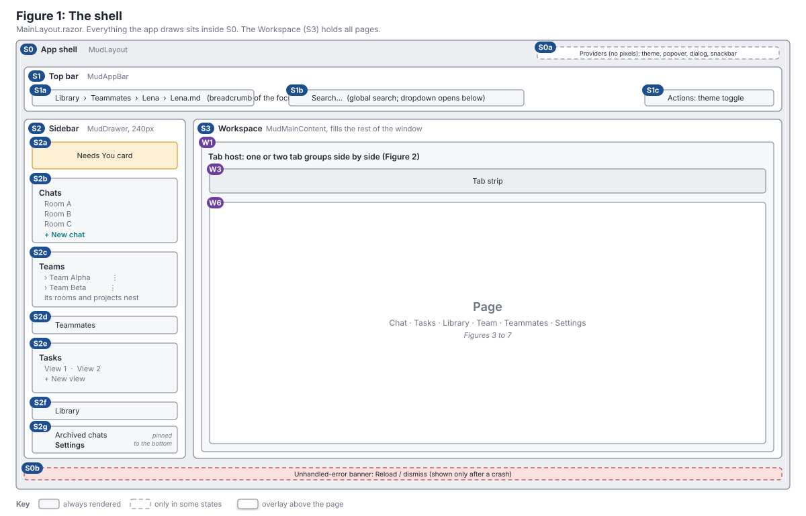
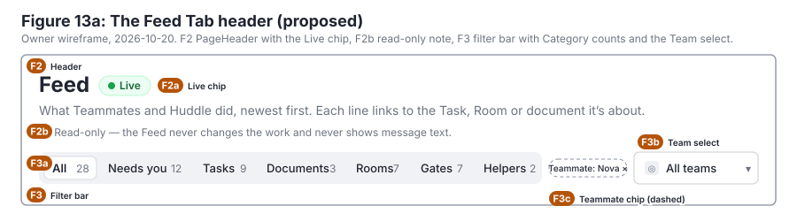
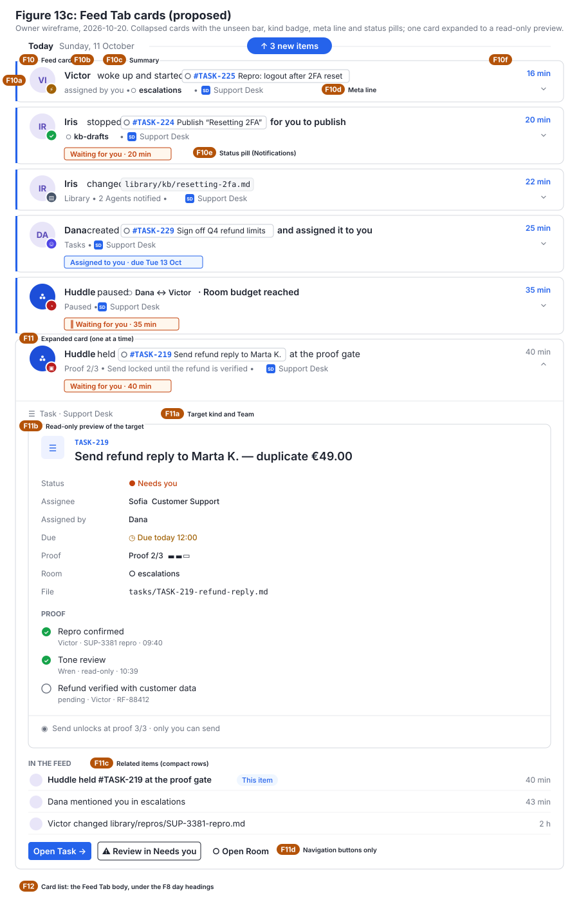

# Wireframes and UI container names

A shared vocabulary for the screens of Agency.Huddle. Every container the Human sees has
a short **code** (such as `S2`, `C7a` or `T3`) and a plain **name** ("Sidebar", "Draft",
"Toolbar"). Use either in a spec, a bug report or a prompt, and everyone points at the
same box.

The figures start at the outermost container, the shell, and work inward to each page
and then to the overlays that float above them. They are drawn from the code as it stands
(see [Sources](#sources-and-upkeep)), not from a design intent, and they are wireframes:
they show where containers sit and what they hold, not spacing, colour or copy. For those
see [design-system.md](design-system.md).

## Contents

- [How the codes work](#how-the-codes-work)
  - [Reading a figure](#reading-a-figure)
- [One word, one meaning](#one-word-one-meaning)
- [Figure 1: The shell](#figure-1-the-shell)
- [Figure 2: The workspace with two tab groups](#figure-2-the-workspace-with-two-tab-groups)
- [Figure 3: A Room (the Chat page)](#figure-3-a-room-the-chat-page)
- [Figure 4: The Tasks page](#figure-4-the-tasks-page)
- [Figure 5: The Library page](#figure-5-the-library-page)
- [Figure 6: Tabbed pages (Team page and Settings)](#figure-6-tabbed-pages-team-page-and-settings)
  - [Figure 6b: The Project page](#figure-6b-the-project-page)
- [Figure 7: The Agents page](#figure-7-the-agents-page)
- [Figure 8: Overlays](#figure-8-overlays)
- [Figure 9: The Build a team page](#figure-9-the-build-a-team-page)
- [Figure 10: The Needs you page](#figure-10-the-needs-you-page)
- [Figure 11: The Task read view](#figure-11-the-task-read-view)
- [Figure 12: The Task edit page](#figure-12-the-task-edit-page)
- [Figure 13: The Feed page](#figure-13-the-feed-page)
- [Using the codes](#using-the-codes)
- [Sources and upkeep](#sources-and-upkeep)
- [See also](#see-also)

## How the codes work

A code is **a letter, a number and sometimes a lowercase letter**.

| Part | Meaning | Example |
| --- | --- | --- |
| Letter | The *family*: which screen or region the container belongs to | `C` is the Room (Chat page) |
| Number | A container that is a direct part of the family | `C7` is the Draft |
| Lowercase letter | A part *inside* that container | `C7a` is the Draft's Stop button |

| Family | Covers | Figure |
| --- | --- | --- |
| `S` | The shell: top bar, activity bar, sidebar, workspace | [1](#figure-1-the-shell) |
| `W` | The workspace: tab host, group panes, tabs, pages | [2](#figure-2-the-workspace-with-two-tab-groups) |
| `C` | A Room, the Chat page | [3](#figure-3-a-room-the-chat-page) |
| `T` | The Tasks page | [4](#figure-4-the-tasks-page) |
| `L` | The Library page | [5](#figure-5-the-library-page) |
| `M` | The Team page and the Project page (`/teams/{Team}/projects/{Project}`) | [6](#figure-6-tabbed-pages-team-page-and-settings) |
| `G` | Settings | [6](#figure-6-tabbed-pages-team-page-and-settings) |
| `P` | The Agents page | [7](#figure-7-the-agents-page) |
| `O` | Overlays: dialogs, drawers, menus, toasts | [8](#figure-8-overlays) |
| `B` | The Build a team page | [9](#figure-9-the-build-a-team-page) |
| `N` | The Needs you page | [10](#figure-10-the-needs-you-page) |
| `K` | The Task edit page (`/tasks/item/{id}/edit`), in a Tab of its own | [12](#figure-12-the-task-edit-page) |
| `F` | The Feed page (`/feed`), in a Tab of its own | [13](#figure-13-the-feed-page) |

**Rules for keeping them stable**

- A code is never reused. If a container is removed, its code stays retired.
- A new container takes the next free number in its family, even when it sits in the
  middle of the layout. Numbers name things; they do not order them.
- The name in the figure and the name in the table are the same words. Rename both or
  neither.
- A code appears in a figure only if it has a row in that figure's table.

### Reading a figure

| Mark | Meaning |
| --- | --- |
| Solid outline | Always rendered |
| Dashed outline | Rendered only in some states: an error, a mode, a loaded setting |
| Soft shadow | An overlay that floats above the page |
| Round badge | The code, at the container's top-left corner |
| Grey bars and circles | Placeholder text and avatars |

## One word, one meaning

Several UI words get used loosely. In this document and in conversation, use them like
this.

| Say | Never mean | Because |
| --- | --- | --- |
| **Shell** | A single page | It is everything outside the pages: `S0` to `S5` |
| **Activity bar** | The Sidebar | It is the 48px strip of buttons at the far left (`S5`) that picks the Sidebar's view |
| **Sidebar** | A panel inside a page | It is the left navigation column beside the Activity bar (`S2`), showing one view at a time |
| **Right sidebar** | The detail drawer | It is the persistent right `MudDrawer` the Top bar toggles (`S4`). It pushes the Workspace aside rather than covering it, and shows the panels the Panel catalog picks for the focused pane's Subject |
| **Detail drawer** | The sidebar | It is a temporary drawer that slides over a page from the right (`O2`). The Task's details (`T7`) are no longer one: they show in the Right sidebar |
| **Workspace** | The window | It is the area right of the sidebar that holds Tab groups (`S3`) |
| **Pane** | A page | It is one Tab group: a strip over a body (`W2`) |
| **Tab** | A `MudTab` | It is a remembered page address in a strip (`W4`). A `MudTabs` rail inside a page is a **tab rail** (`M4a`, `G2a`) |
| **Page** | A pane or a route | It is the one routable component a Tab shows (`W6`) |
| **Panel** | A card | It is a region inside a page: a *tree panel*, a *document panel*, an *active panel* |
| **Card** | A tile | It is a bordered block with its own content: a *Needs You card*, a *proposal card*. A *tile* is a clickable directory entry (`P4`) |
| **Dialog** | A popover | It blocks the page behind a scrim (`O1`). A *popover* does not (`O3`) |
| **Message box** | A dialog you build | It is the stock confirmation from `ShowMessageBoxAsync` (`O5`) |
| **Notice** | A toast | It is an inline alert that stays until its cause goes (`C9`, `T9`). A *snackbar* fades out (`O4`) |
| **Room** | A chat window | It is the Chat page for one Room (`C1`) |

## Figure 1: The shell

`MainLayout.razor`. Everything the app draws is inside `S0`.

| Code | Name | Component | Notes |
| --- | --- | --- | --- |
| `S0` | App shell | `MudLayout` | The outermost container |
| `S0a` | Providers | `MudThemeProvider`, `MudPopoverProvider`, `MudDialogProvider`, `MudSnackbarProvider` | Draw nothing; menus, dialogs and toasts appear through them |
| `S0b` | Error banner | `#blazor-error-ui` | Hidden until an unhandled error, then offers Reload |
| `S1` | Top bar | `TopBar` (`MudAppBar`, fixed, dense) | Three slots: start, centre, end |
| `S1a` | Breadcrumb | `PageBreadcrumbs` | Starts at the window's left edge, inside the bar's 16px gutter, not past the sidebar. 13px; ancestors in TextSecondary, the current crumb in TextPrimary, 8px each side of the "›". The trail of the focused pane's active Tab: ancestors only when the page names itself with an h1. A Room's trail is "Rooms"; a Team page's is "Teams"; a Project page's is "Teams › {Team}"; a Tasks View's is "Tasks › {View name}" (the display name, never the slug): the Tasks page's h1 is visually hidden (`T2`), so the page sets this trail itself (`TabService.SetTrail`) after each render, and "Tasks" is a link. On the Library page it holds the open file's whole location, "Library › Agents › Lena › Lena.md": the Library page sets it (`TabService.SetTrail`) each time the open file changes, so the page's own toolbar (`L3a`) does not repeat it. Only "Library" is a link (it opens the page with nothing selected) |
| `S1b` | Search bar | `SearchBar` | Global search; its results open in a dropdown below it |
| `S1c` | Top bar actions | `TasksNeedYouPill` (`a.tasks-need-you-pill`), `NotificationsButton`, `RightSidebarToggle`, `ThemeModeToggle` | The pill reads "N Tasks need you" (open Tasks assigned to the Human, `TaskQuery.NeedsYou`) and opens My Tasks; it renders only when N is above 0 and is shown only by a style pack (Nordic, ADR-0057), hidden for every other Theme. `NotificationsButton` is the Material Outlined bell with a badge of the unseen Notifications (hidden at 0, 99+ above), `aria-pressed` while the Notifications panel shows in the Right sidebar; it is not drawn while the Feed is off. Of the two buttons after it, the first opens and closes the Right sidebar (`S4`): the Material Symbol `dock_to_left`, Primary and `aria-pressed` while open. The second switches between the chosen light and dark Theme. The top bar's icon buttons are 32px |
| `S2` | Sidebar | `div#sidebar-views` in the left `MudDrawer` (`.shell-nav`), 240px by default and 200-480px when dragged | Its right edge carries a resize handle (`SidebarResizeHandle`, `.sidebar-resize-handle`, a `role="separator"`) that the mouse drags and the arrow keys move (Shift for a larger step, Home and End for the limits); the width is remembered per browser under `shell:sidebarWidth` and the handle is hidden while the Sidebar is collapsed. Drawn dashed: it shows the one view the Activity bar (`S5a`) selects, and is hidden while no view is selected. It opens on Chats in each circuit. The views are Chats (`S2a`, `S2b`), Teams (`S2c`), Agents (`S2d`), Tasks (`S2e`) and Library (`S2f`); the figure draws Chats. Every view stays mounted while hidden, so it keeps its open groups. The drawer holds `S5` and `S2` side by side and is 49px collapsed, 289px open; not resizable. Rows are 32px (`--nav-row-height`) with 13px body-colour text, a 24px leading slot 4px inside the row's pill (an avatar, or an 18px icon centred in it) and a 4px gap: VS Code's Explorer proportions scaled to the 32px row. Every row of every view sits on one grid: the leading marks (section icon, row icon, avatar, a Team's chevron, the "+") are centred on one icon line, and the labels (section title, names, "Show all", "New chat") start on one text line; trailing counts and the section arrow end on one right edge. A Team's Rooms and Library folders are one step in (`--nav-level: 1`), so their icon sits under the Team's name, and the rows inside a folder a quarter step further; Agents and Library are rows, not headers. Section headers are 12px/600 in TextSecondary, sentence case, 16px above and 4px below. A group header is a 32px row, and opens by default when it is the only group in the view. Settings has no Sidebar view: opening it collapses the Sidebar. Every section header is visible at a 900px window |
| `S2a` | Needs You card | `NeedsYouCard` | Rooms waiting on the Human, then gated Tasks waiting for a decision, in a card outlined in Edge; the count is plain text, not a badge or a coloured chip, and covers both. Each row is 32px: the reason icon, the Room's name and a trailing time, with no second line. A Task row reads "{id} {title}" with "Waiting on you · Proof {m}/{n}" and links to `/needs-you#<id>` (`N2`) |
| `S2b` | Rooms group | `RoomList` (`MudNavGroup` folders, no "Rooms" title), `RoomNavRow`, `NewChat` | Above the folders sits the **Group by:** line (`S2b1`). With **All** it lists the Rooms that belong to no Team in two folders: **Needs you** on top (only while a Room waits on the Human) and **All** with the rest, plus **New chat**; every Room is listed, with no "Show all" row. A folder opens and closes by its header and the one holding the active page opens itself. The active row is accent text on Primary 14% over Surface (20% hovered), weight 500. A 1:1 Room's row leads with the Agent's 24px avatar and its presence badge, a group Room's with the Chat icon; shared actions in `RoomActions`. A Room that is waiting on the Human (the `S2a` card holds it, not dismissed) wears a **Needs you** pill (`NeedsYouPill`, `.needs-you-pill`, a warning-tinted capsule) after its name, in this list and under a Team in `S2c`; the name truncates before the pill does. The Room row's menu has an icon on every item and a divider before Delete (Error ink) |
| `S2b1` | Group by | `.room-list-grouping` in `RoomList`: the caption "Group by:" and a `HuddleSegmentedControl<RoomGrouping>` (`All`, `Team`) | **All** is the flat list of `S2b`. **Team** lists every unarchived Room, Team Rooms included, in one collapsible folder per Team (`.room-folder`, a `MudNavGroup` with the Folder icon): the Rooms of no Team first in "No team", then the Teams by name, except a Team named "Archive", which is always last and always starts collapsed (never remembered open; it still opens for the Room the Human is on); each folder ends in its own "Show all (N)" past 8 rows. Every folder but Archive starts open; the closed ones (`roomList:closedFolders`) and the grouping (`roomList:grouping`) are remembered per browser, and the folder holding the current Room opens itself. The Rooms group has no "Rooms" header of its own in either mode |
| `S2h` | New chat panel | `NewChat` (`.new-chat-panel`, `.floating-panel`) | A floating panel anchored under the "New chat" link or the Team row: an Edge outline and 32px/13px Agent rows. It floats over the rows below and moves nothing. It ends in **Cancel** then **Start chat** |
| `S2i` | Archived chats dialog | `ArchivedChatsDialog`, opened with `HuddleDialogOptions.ShortPicker` (600px, close button) | The archived Rooms. Each row is an icon, the Room's name, "Created Oct 3" (a Room has no archive timestamp), an **Unarchive** text button and a `MoreVert` menu holding **Delete** (Error ink, asked first). Opened from the Activity bar's Archived chats button (`S5b`) |
| `S2c` | Teams group | `TeamsNav` (`MudNavMenu`; a `MudNavGroup` per folder) | The Teams are the view's root rows, under no "Teams" header, with "Build a team" last. Each Team is collapsed behind a chevron until opened (or until the route is inside it); the opened Teams are remembered. An open Team holds two folders: **Rooms** (its Team Room, then its other Rooms) and **Library** (its Projects). A folder starts open, closes by its header for the session, reopens when the route is inside it, and is not drawn when empty. A Team row trails its member count (`sidebar-row-meta`, tooltip "N members" or "No members") instead of an italic "No members". Over 8 Teams, or 8 rows in a folder, the list ends in "Show all (N)". Each Team row has a hover menu |
| `S2d` | Agents link | `NavTabLink` to `/agents` | |
| `S2e` | Tasks group | `TaskViewNav` (`MudNavGroup`) | Saved Task Views and "New view" |
| `S2f` | Library link | `LibraryNavLink` | One link to the Library page. It lists no roots and has no "+ Add folder" |
| `S2g` | Sidebar footer | | Retired: Archived chats and Settings moved to the Activity bar's bottom toolbar (`S5b`) |
| `S3` | Workspace | `MudMainContent` `.main-column` | Also holds the invisible `TabSync`, `TabPersistence` and `LibraryLinkRouter` |
| `S4` | Right sidebar | `RightSidebar` (`MudDrawer`, end, persistent, 280px) | Drawn dashed: toggled from `S1c`; open when nothing is remembered, otherwise as the viewer last left it (local storage). In Notifications mode (opened by `NotificationsButton`) it draws one `SidebarPanelFrame` titled "Notifications" around `NotificationsPanel` (Figure 13, `F4`); otherwise it draws the panels the Panel catalog picks for the focused pane's Subject, sorted by `Order`. Each panel sits in a `SidebarPanelFrame`: a 32px header button with the icon, the title (13px/600), the count the panel reports (12px Quiet ink; none until it does) and a chevron that collapses the body, remembered per viewer; an Edge line separates one panel from the next. Rows are 32px and one line in Ink (the Outline's are 28px): a Task row is its ID (12px Quiet ink), the title and the state dot; a member row is a 24px avatar with the presence badge on its rim, then the name; the Outline heading in view wears the Selected treatment. The v1 panels: for a Task selected on the Tasks page, Task (`T7`, the read view); for a Room, Members, Tasks in this chat and Documents in this chat; for a Markdown document, Outline, Linked documents and History (the newest five entries of its History, with **See all** scrolling to `L3i`). It follows focus to the other pane or another Tab. When no panel applies, it shows an `EmptyState` with the single sentence "Nothing to show for this page." A Task selected on the Tasks page shows in it as the one panel, Task (`T7`) |
| `S4m` | Members panel row | `MembersPanel` (`.members-row`), inside the `S4` panel frame | An Agent's row is the 24px avatar with its presence badge, then a body of two lines: the name (`.members-name`, ellipsised) with the context meter's text beside it (`.members-context`, `sidebar-row-meta`), and under them a 3px bar (`.members-context-bar`, `MudProgressLinear`) showing how full the Agent's context window is in this Room. The text is the whole percent, "<1%" for a tiny non-zero fill, or "—" with no bar while nothing is known. The bar is Primary below 75%, Warning from 75% and Error from 90%; the text stays in the secondary ink and only the bar carries the band. The tooltip gives the token counts and says "in this Room", or "shared across all of {Name}'s Rooms" for a shared-mode session. A Human's row has the avatar and the name only. Rows stay alphabetical, never ordered by fill |
| `S5` | Activity bar | `ActivityBar` (`nav.activity-bar`), 48px | Always shown, at the left edge of the left `MudDrawer`, like VS Code's Activity Bar. Two toolbars: one aligned to the top, one to the bottom |
| `S5a` | Top toolbar | `.activity-bar-top`, the Feed link then one `MudIconButton` per view | Feed (a `NavTabLink` with the `DynamicFeed` icon to `/feed`, first; it opens a Tab (Figure 13) and is not drawn while `Team:Feed:Enabled` is false), then Chats, Teams, Agents, Tasks and Library, with their entity icons; Tasks and Library are left out when their feature is off. Each button is a 40px tile with the inset rounded shape (0.75 of the base radius). The selected button is pressed (`aria-pressed`) and wears the Accent tint (14%, 20% hovered) with the accent icon. Clicking another button switches the Sidebar (`S2`) to that view; clicking the pressed one collapses the Sidebar. Each button has a tooltip and an `aria-label`, and names `S2` in `aria-controls` |
| `S5b` | Bottom toolbar | `.activity-bar-bottom`, `MudNavMenu` `.nav-settings` | Archived chats and Settings: two icon-only 48px links, each with an `aria-label` and a tooltip (OP-4). Settings opens a Tab, so its link wears the active treatment on `/settings` |

`W1`, `W3` and `W6` appear here only to show where Figure 2 plugs in.

## Figure 2: The workspace with two tab groups

`TabHost`, `TabGroupPane`, `TabStrip`, `TabPageHost`. The browser URL names the focused
pane's active Tab.

| Code | Name | Component | Notes |
| --- | --- | --- | --- |
| `W1` | Tab host | `TabHost`, `.tab-groups` | One or two groups side by side, equal width |
| `W2` | Group pane | `TabGroupPane`, `section.tab-group` | The focused pane has the accent border; the other dims its active tab |
| `W3` | Tab strip | `TabStrip`, `role="tablist"` | A tint of TextPrimary over Surface; the active Tab is Surface and covers the strip's bottom hairline, so it opens into the page. Scrolls when tabs overflow. Titles are 13px at weight 400, the active title 500 |
| `W4` | Tab | A `.tab-item` in the strip | Icon, title, a menu chevron, a close button; may be pinned. A fixed 14rem, so the hover toolbar leaves the start of the title visible. Every unpinned Tab shows its close button, at 60% until the Tab is hovered or active. A preview Tab (`.tab-item.preview`) is marked by TextSecondary colour and an italic title, not by weight; it takes the body colour and upright text once kept. Titles ellipsize and the `title` attribute carries the full title |
| `W5` | Tab body | `.tab-body` | Holds the page, or the empty state |
| `W6` | Page | `TabPageHost` mounting a `DynamicComponent` | Only the active Tab of each group is mounted |
| `W7` | Tab menu | `MudMenu` in `TabStrip` | Pin or Unpin, Move Left, Move Right, Close |
| `W8` | Empty group | Text in `W5` | "No pages are open. Choose one from the menu." |

If a Tab's URL matches no page, `W6` shows "There is no page at …" instead.

## Figure 3: A Room (the Chat page)

`Chat.razor`, `MessageList.razor`, `Composer.razor`. Top to bottom: header, scrolling
list, notices, cards, composer.

| Code | Name | Component | Notes |
| --- | --- | --- | --- |
| `C1` | Room column | `MudStack` `.room-column`, full height | The list shrinks and scrolls; the composer stays on screen |
| `C2` | Room header | `PageHeader` with `Chrome` (the Room's name as `TitleEditor` while renaming) | The shell crumb is "Rooms" only (`S1a`); below it the Room's name as the h1 (a 32px row, 16px below the tab strip) with a Chrome line under the header. The old 36px `.room-header` band and its rule are gone. Members (`C3`) and Invite (`C3a`) sit in the header's right-hand actions |
| `C2a` | Rename | `MudIconButton` | Swaps the title for an outlined text field while editing. The field is h5-sized, takes the title's own size and weight and has no label, so the header does not jump |
| `C2b` | Copy link | `MudIconButton` | Copies the Room's link |
| `C3` | Members | `MudAvatarGroup` of `ProfileAvatar`s and a "N Members + you" label | Shows up to four 24px avatars with a 2px Surface ring, each opening its profile popover (`O9`), then one "+N" avatar for the rest (`.room-members-more`, drawn by `Chat.razor`: the group's own `Max` is not used, because it empties a hidden avatar and would leave an empty button) |
| `C3a` | Invite agent | `InviteAgent` | Brings an Agent into the Room. A panel titled "Invite to {Room}" with a compact search field and 32px/13px Agent rows |
| `C4` | Message list | `MessageList`, `.message-list` | The only part of the Room that scrolls. The Transcript column is capped at 760px and centred in a wider pane; the Composer (`C10`) shares that column. 16px between senders, 4px between consecutive messages of one sender (`.grouped`) |
| `C4a` | Day separator | `.day-separator` | 12px/600 TextSecondary on a hairline, 24px above and 16px below. It reads "Mon, Oct 5"; messages under it show the time only |
| `C4b` | System row | `.system-row` | A slim, expandable row such as "Task woke Nova" |
| `C5` | Agent message row | `.message-row` | A 32px avatar (`.avatar-transcript`, in a `.message-gutter` of the same width) beside plain text. There is no card |
| `C5a` | Avatar | `ProfileAvatar` around `AgentAvatar` | 32px. Image, then label, then monogram. A click opens the profile popover (`O9`) |
| `C5b` | Message meta | `.message-meta` | Name 13px/600 and the time 12px TextSecondary, 8px after the name. On the meta line heading each Agent's newest group only, its context fill (`.message-context`) sits at the line's right end in the same 12px TextSecondary: the whole percent, or "<1%". The tooltip gives the token counts and says "in this Room", or "shared across all of {Name}'s Rooms" for a shared-mode session. Nothing is shown until a reading exists, and never on the Human's or Huddle's Messages. The same reading as the Members panel row (`S4m`) |
| `C5c` | Message body | `.message-content > .message-body` | Plain 14px rendered Markdown with no bordered card (`.message-card` is gone), at most 75ch wide, plus `MessageReferences`. A file in a message is its name as a `.ref-link`, with the relative path in the tooltip. Task links have a dotted underline in accent text and an 8px status dot |
| `C6` | Human message bubble | `.message-bubble` | Right-aligned, accent-tinted, 12px radius, max `min(75%, 75ch + 32px)` |
| `C7` | Draft | `.message-row.streaming` | A reply still arriving |
| `C7a` | Stop | `MudIconButton` | Stops this Room's Turn |
| `C7b` | Turn detail | `.turn-detail-panel` | Recent tool calls; an edit opens its preview (`EditPreview`) |
| `C7c` | Draft text | `.message-body.streaming` | Ends in a blinking caret |
| `C8` | Agent cards | `ProposalCard`, `SprintProposalCard`, `RetroProposalCard`, `QuestionCard`, `ElicitationCard`, each an `AgentCard` shell | Appear when an Agent needs a decision, only in a Room that is not archived. The shell is an outlined `MudPaper` with `role="region"`, an `aria-label`, a `subtitle1` title ("Nova is asking"), the body, then one actions row. Never a `MudAlert`. A card sits in the 760px Transcript column with an Edge border |
| `C8a` | Question card | `QuestionCard` | Shown as the example. Its options are a column of 32px one-line rows |
| `C8b` | Card actions row | `.agent-card-actions` | Left-aligned, primary first: the Filled primary, then Outlined secondaries. The refusing verb is Decline for a proposal and Dismiss for a request answered with nothing. While a call runs the clicked button shows its busy label ("Approving…", "Accepting…", "Sending…") and the others are disabled |
| `C8c` | Retro change row | `.retro-change` | A change's diff with its own actions row (Accept, Decline) in the card body; the shared reason field sits above the changes |
| `C9` | Notices | `MudAlert` rows | Present only when something needs saying. An agent card (`C8`) is not a notice |
| `C9a` | Member health alert | `MudAlert` Warning, `role="alert"` | An Agent that is Offline or Degraded, with a reason. Sits in the Transcript's 760px column, like `C9c` |
| `C9b` | Reply note | `MudAlert` Info, dense, `role="status"` | Why nobody replied |
| `C9c` | Budget prompt | `MudAlert` Warning with Continue and Dismiss | The Room's reply budget is spent |
| `C10` | Composer | `Composer` | In the Transcript's centred 760px column (`C1`). Focused: an accent border plus a 0.5px inset accent ring, so nothing shifts |
| `C10a` | Attachment chips | `MudChip` row | Files being uploaded; absent when none |
| `C10b` | Input box | `.composer-box` | Multi-line text field. The placeholder is "Message {Room name}… (/invite @Agent)" (the `RoomName` parameter), or "Message… (/invite @Agent)" without a name |
| `C10c` | Attach | `MudFileUpload` button | Present only where attachments are available |
| `C10d` | Send | `MudIconButton` | Disabled while uploading |
| `C11` | Reference picker | `ReferencePicker` popover | Opens when the Human types `@` |

Not drawn: the empty state ("No rooms yet. Start an agent to create one."), the rename
error alert, the budget caption and the "continue" notes, which sit in the `C9` zone.

## Figure 4: The Tasks page

`Tasks.razor`. The Board is shown; choosing List replaces `T4`'s columns with a grid.

| Code | Name | Component | Notes |
| --- | --- | --- | --- |
| `T1` | Page container | `MudContainer`, full width, `pa-4` | Opens with the header row (`T2`) |
| `T2` | Header row | The first `MudToolBar` of `TaskToolbar` (`SplitHeader`), inside `.tasks-header` | No visible `PageHeader`: the sidebar row and the Tab already name the View. The View's display name (never the slug) stays as a `.visually-hidden` h1 for assistive tech; the shell crumb is "Tasks". The row: `T3a`, then the counts (`T2d`), on the left; the AI chip, **New task** (`.tasks-new-task`, the page's one filled primary button) and `T2a` on the right |
| `T2d` | Counts | `.tasks-counts` | "N open" (not Done, Cancelled, Duplicate or Rejected, over the Tasks the View shows), "N need you" (open and assigned to the Human) and "N all" (every Task in the store) |
| `T2a` | View actions | `MudMenu`, `MoreVert` icon button (`aria-label` "Actions for {View}") | Rename…, Fields…, then a divider and Delete view… (Error ink); no icons. Rename and Delete are the sidebar row's menu too |
| `T2c` | AI reacting chip | `AiReactingChip` | Tasks an Agent is acting on |
| `T9` | Notices | `MudAlert`, `WakeToasts` | Tasks off, invalid or missing View, load errors, ignored lines |
| `T3` | Toolbar | `TaskToolbar` | The second row. It leads with the Filter icon menu (T3b), then one 28px chip per filter that is set (Team, Project, Assignee, Sprint, Priority, Status - `T3h` and `T3i` are the Assignee and Status ones; Accent tint at 14% once set), then Requests (`T3g`), the compact search (`T3e`) and Dense (`T3f`), and ends in Group by (`T3c`) at the row's right edge. A filter chosen in `T3b` appears as a chip and its × removes it, so an unfiltered View shows none |
| `T3a` | View kind | `HuddleSegmentedControl` | List or Kanban (the saved `ViewKind.Kanban`, written "kanban"; the old "board" still reads), each with its sidebar row's icon. The unselected segment is the bare track; only the selected one is a raised tile |
| `T3b` | Filter | `MudMenu` | Every saved filter as an outlined multi-select: Team, Project, Assignee, Sprint, Status (with selectable All / Open / Closed group headers above their statuses), Priority. A change is saved to the View at once |
| `T3c` | Group by | `TaskFilterChip`, the toolbar row's last control, right-aligned | "Group by: Assignee ⌄ ×", the same chip as `T3h` and `T3i`: None, Team, Project, Assignee, Sprint, and Status on a List, with a clear button once one is chosen. On the Team page's tab, where there is one row, it stays a `MudSelect` in a "Group, Sort" menu |
| `T3h` | Assignee chip | `TaskFilterChip` | Any, Me, Unassigned or a name; dashed while Any, filled with a clear button once set. Edits the View's Assignee filter |
| `T3i` | Status chip | `TaskFilterChip` | A two-level menu: All, then Open (Backlog, To Do, In Progress, Review) and Closed (Done, Cancelled, Duplicate, Rejected), each choosable as a group and followed by its own statuses indented beneath it. The chip reads All, Open, Closed or the one status; same look as `T3h`. Edits the View's Status filter |
| `T3d` | Blocked filter | `MudSelect` in the Filter menu (`T3b`), then a `TaskFilterChip` | All, Blocked or Unblocked. Chosen in the Filter menu; once it is not All, a "Blocked: Blocked" chip with a clear button appears in the row. Edits the View's Blocked filter |
| `T3e` | Search | `SearchField` | The shared outlined, clearable, debounced search box, `Compact` (28px) |
| `T3f` | Dense | `MudSwitch` | The thumb, the track and the label share the row's centre line: the row's 28px icon-button size skips the switch's own thumb button (`.mud-switch-base`), and the switch's 38px body is centred on its 28px box |
| `T3g` | Requests chip | `MudChip`, `.task-toolbar-requests` | Dashed outline while off; Primary-bordered with a Primary tint and a check once on |
| `T4` | Content | `TaskBoard` or `TaskListView` | Or an empty state with "Reset filters". The List's rows are 36px (32px when Dense) with 13px text; a group row is Ground with a 13px/600 label, a 24px avatar for an assignee group and a 12px count; a due date in a column reads month and day; header cells are 12px/600 TextSecondary; columns: ID 110px, Priority 120px (`task-list-priority-cell`), the row menu 40px, Title flexible |
| `T5` | Column | A `MudDropZone` per lane and column | Columns are 260-300px. An empty terminal column (every state Done or in the Won't do family, and no Task in any lane) is a 40px rail: the dot, the count and the menu on top, the name running down it; a rail opens while a card is dragged or its name is renamed. A swimlane label is a section heading with its count under a Chrome line, and an empty cell is blank. Header (`.task-board-column-header`): an 8px dot in the colour of the column's first state, the label the Human can rename (13px/600) and the count (12px TextSecondary). An empty column shows one centred 12px TextSecondary line ("Nothing done yet.", "Nothing in progress.", "Backlog is empty.", "Nothing to do yet.", "Nothing in review.", or "Nothing here yet." for a column of several states); it ignores the pointer and hides while a card is dragged |
| `T6` | Task card | `TaskCard`, `MudBadge` | Draggable between columns; 12px padding, a 1px Divider border, 8px between cards. A header row (`.task-card-header`) holds the id (12px TextSecondary) and the priority as a tinted status chip with an icon; then the title (14px/600, up to 3 lines), tag chips, and the assignee (24px avatar, name 12px) with the presence badge on the avatar's rim. No left edge in the column colour. Overdue: a 14px warning icon before the date, the date in the error colour 70% + body text 30% at weight 600 (5.79:1 Dark, 9.70:1 Light); an overdue card shows its date even when the View hides Due date. On the List, the State and Priority cells are the same tinted chips |
| `T7` | Task detail | `TaskDetailPanel` in a `SidebarPanelFrame` titled "Task" in the Right sidebar (`S4`), for the Tasks page's `TaskDetailSubject`; it was a `ResizableEndDrawer` until 2026-10-28, and nothing of the Task is drawn over the page now | Read-only. Opening a row or card selects the Task, opens the Right sidebar and shows it there. Top to bottom: the eyebrow (12px TextSecondary, "PLAT-0013 · Platform": the id, then the Project or, with none, the Team) and the title (the Task's name only, up to 3 lines), both drawn by the read view; then the read view `T15` (Figure 11): text, chips and links, no form control and no footer. Edit opens the Task in the edit page (`K`, Figure 12) in a new Tab. The editor is nowhere else: **New task** and Make a copy… also open `K` (as `/tasks/item/new/edit` and `/tasks/item/{id}/copy`), and the Team and Project pages' Tasks tab opens a card on the Tasks page and its New task in `K`. The menu is Copy id, Copy link, Make a copy…, a divider, then Close task… (Reopen when closed) in Error ink; Close task… asks first ("Close PLAT-0003?"), because it wakes the assignee |
| `T7a` | Resize handle | `.resizable-drawer-handle`, `role="separator"`, `tabindex="0"` | Drag, or press Left and Right (Shift for larger steps, Home and End for the limits), to change the drawer's width |

The Human gate adds these containers (specification: [Huddle.HumanGate-Specifications.md](../Huddle.HumanGate-Specifications.md) §6.7 to §6.9). They are not drawn in the figure yet; the rows are the vocabulary.

| Code | Name | Component | Notes |
| --- | --- | --- | --- |
| `T6a` | Gate chip | `TaskCard`, a chip in `T6` | Only on a gated Task. "Needs you" on a gated card in the Needs You column that is not accepted, "Accepted" once the acceptance is valid; on a gated card in any other status, a lock icon with `aria-label` "Human gate" |
| `T10` | Human gate section | `TaskHumanGate`, `div.task-human-gate`, inside `T7`'s `TaskDetail` under the fields | The Human's rule for this Task. Rows top to bottom: `T10a`, `T10b`. The Action is not edited here |
| `T10a` | Gate header | `div.task-human-gate-header` | The chip "Human gate" and the sub-heading "You decide whether this is done" |
| `T10b` | Acceptance switch | `div.task-human-gate-switch`, `MudSwitch` "Requires your acceptance" | Locked on, with a lock icon (tooltip and `aria-label` "This Task names an Action that leaves the team."), while the Task has an Action |
| `T10g` | Helper note | `div.task-human-gate-helper-note`, under `T10b` | Only when the latest `human gate on` Change log entry is a Helper's: "Turned on by the Needs Human Helper: {reason}. If you turn it off, the Helper won't ask about this Task again." It tells the Human, before they act, that turning the gate off is final for that Helper |
| `T11` | Proof list | `TaskProofList`, `div.task-proof-list`, in `T7` under `T10` | On every Task with a Definition of Done. Heading `T11a`; one `T11b` per item |
| `T11a` | Proof heading | `div.task-proof-heading` | "Proof" on a gated Task; "Definition of Done (for information)" on an ordinary one |
| `T11b` | Proof row | `div.task-proof-row` (`data-met`) | A tick or open circle, then label, owner and detail (`.task-proof-label`, `.task-proof-owner`, `.task-proof-detail`), and on an open item with an owner `T11c` |
| `T11c` | Ask button | A text button in `T11b` | "Ask {owner}" (accessible name adds "for {label}"). Posts "@{owner}, {id} needs {label} before it can come to me." into the Task's Room and shows a Snackbar |
| `T12` | Decision card | `TaskDecisionCard`, `div.task-decision-card`, in `T7` for a gated Task in Review or Needs You, on `N2` and in `T14` | The Human's decision. Rows: `T12a` to `T12f` |
| `T12a` | Decision header | `div.task-decision-header` | The chip "Your decision" |
| `T12b` | Proof line | `div.task-decision-first-line`, then `div.task-decision-accept-sentence` | "{n} of {total} Proof items are in." or "All Proof is in.", then the sentence saying what Accept does |
| `T12c` | Notice | One of `#task-decision-locked`, `#task-decision-review`, `#task-decision-unsaved`, `.task-decision-stale`, `.task-decision-accepted`, `.task-decision-message` | At most the ones that apply: the locked-Proof notice, "Accept unlocks when {assignee} moves it to Needs you.", "Save your changes before deciding.", "Changed since you accepted it.", "Accepted by {Human}. {assignee} can now {action}.", a `role="alert"` error |
| `T12d` | Decision buttons | `div.task-decision-buttons` | **Request changes**, **Accept** (locked until allowed) and a "More decisions" menu holding **Decline**. Request changes and Decline open `ReasonDialog` ("Request changes on {id}" or "Decline {id}", field "Reason", required) |
| `T12e` | Trail | `div.task-decision-trail` | "Drafted by {assignee} · Checked by {names} · Tracked as {id}" |
| `T13` | Needs You column | `T5` for the Needs You status, between Review and Done | Header, count and empty note as `T5`. A gated card in it carries `T6a` |
| `T14` | Decision dialog | `O1` holding `T12`, titled "Your decision on {id}" | Opens when the Human drops a gated card with complete Proof from Needs You onto Done. Shows the Proof and the Task text; **Cancel** (or Escape) leaves the card where it was |

A View has no editor panel: every change to it is saved as it is made.

## Figure 5: The Library page

`Library.razor`, `LibraryExplorer.razor`, `LibraryDocument.razor`. `LibraryExplorer` (a `MudSplitPanel`) fills the page with no code of its own (`L1` and `L1a` are retired); the page has no `h1` and no root-path heading, since the shell breadcrumb (`S1a`) names it: the split is `h-100` with `min-height: 0` and both panels are full height; side by side on this page, other hosts can stack the panels. The page container is `pa-0`, so the two panes run edge to edge on the shell's one surface, split by the `lines-default` hairline; each pane pads itself 16px at the sides and 12px above its first control (the tree header's search box, level with the document toolbar's controls); the document's content starts 24px below the toolbar's hairline.

| Code | Name | Component | Notes |
| --- | --- | --- | --- |
| `L2` | Tree panel | First panel | Opens with its header (`L2c`), then the tree or the filtered results |
| `L2c` | Tree header | `.library-explorer-tree-header`: `SearchField` (`Compact`, 28px), New note and New folder (icon buttons) in one row | One row, 61px tall with a Chrome line under it, level with the document toolbar (`L3a`, also 61px with a Chrome line). Sticky at the top of `L2`; the same in every host, the Library page and the Team Files tab alike. Search notes (placeholder "Search notes") filters by name and swaps the tree for `L2b`; New note and New folder (`CreateNewFolder`, tooltip "New folder") each open the name prompt ("New note in {folder}") in the folder selected in the tree, else the scope's own folder. Shown only when the explorer has a scope to create in |
| `L2a` | Tree | `LibraryTree`, `MudTreeView` | Loads a folder's children when it opens. Rows are 30px with 13px text, 16px icons and a 16px indent, inset 4px and rounded to 0.75 of the base radius; the selected row keeps its 2px bar. The row menu: items that open dialogs end in an ellipsis and Delete is last after a divider in Error ink; a protected node (root, Team, Agent folder) shows no Rename, Move or Delete and ends in one Quiet-ink note. The Move dialog is 600px with indented picker rows (`.picker-row`) and folder icons. A folder warning triangle is 14px, with a tooltip. The open file's folders are expanded and its row selected, however it was opened (the tree, a search hit, a link, the URL or the remembered state) |
| `L2b` | Filtered results | `.library-search-results` | Replace the tree while a filter is set |
| `L4` | Divider | `MudSplitPanel` divider, `PanelGap="1"` | A 1px `lines-default` hairline with MudBlazor's 12px grab area each side; draggable; the position is remembered |
| `L3` | Document panel | Second panel, `LibraryDocument` | With nothing open, a full-pane empty state: the title "No note open", "Select a note in the tree to read it, or start a new one." and a small text New note button |
| `L3a` | Toolbar | `MudToolBar`, dense | A band with 12px above and below its controls, closed by a full-width `lines-default` hairline that marks where the document begins. Copy path (`MudIconButton`), then the open file's full system path on the left (with ● while unsaved), then the controls on its right. A path over 60 characters keeps its drive and first folder, an ellipsis and the file name (`C:\Users\…\Email-Ideas.md`, `LibraryPathDisplay`, 12px TextSecondary); the tooltip holds the whole path. The same in every host, the Library page and the Team Files tab alike, since both are one `LibraryExplorer`; the shell breadcrumb (`S1a`) names the file by its Library location |
| `L3b` | Mode switch | `HuddleSegmentedControl` | Read, Edit, Split |
| `L3c` | Document actions | `MudIconButton` row | Pop out, Close. Copy path is at the start of `L3a` |
| `L3d` | Banners | Dense `MudAlert` with a role, `.library-document-banner` | Moved or deleted, newer on disk (Reload or Keep mine), save error, read-only reason. The Move dialog's refusal is the same Dense `MudAlert` |
| `L3g` | Markdown toolbar | `MarkdownToolbar`, `.markdown-toolbar` (`role="toolbar"`) | Between the banners and the editor, in Edit and Split for an editable `.md` file only; never in Read or for another file kind. One 28px row of dense icon buttons, 16px in, closed by a Chrome hairline: Bold, Italic, Heading, Code, Bulleted list, Task list, then a `[[ ]]` text button. Each has a tooltip (with its shortcut where it has one: Ctrl+B, Ctrl+I, Ctrl+E) and an `aria-label`. One tab stop; the arrow keys move between buttons. Typing `[[` in the editor lists notes of the same Library Root, nearest first, in a popup under the caret whose picked row wears the Selected treatment |
| `L3e` | Content | `LibraryEditor` (CodeMirror), `.library-rendered` | Editor, preview, or both. Read and Split's preview share the reading styles: a 16px body at line-height 1.65 in a 46.29em column centred in the pane, with a 24px/600 note title (the one size above 20px). Split is two equal columns split by a hairline, with the raw side tinted, monospace and line-numbered. A leading frontmatter block renders as `LibraryProperties` (`.library-properties`): a "Properties" card of key/value rows, with a list field's items as chips and no `#` on a tag |
| `L3h` | Byline | `DocumentByline`, `.doc-byline` | A Markdown file only, drawn inside the rendered note directly under its first heading (above the body when the note has no heading; under the toolbar above an editor in Edit mode), absent when the document has no History. The note's tags (`.library-document-tags`, `LibraryDocumentTags`) are a chip row above the heading. One line of "Written by", "Edited by", "Reviewed by" and "Objected by" parts separated by "·", each Name bold with its avatar (a profile popover for an Agent) and "+N" past three, then the last change as "today 11:02" (a button; the full date is its tooltip). A click on the line scrolls to `L3i` |
| `L3i` | History | `DocumentHistory`, `.doc-history`, id `doc-history` | Read mode only, after the backlinks (`L3f`): every entry grouped under Today, Yesterday or a date, each with a clock time, the author, a **you** or **Agent** chip, a kind chip, the tinted `StatusChip` with a leading icon (Created Info, Edited and Saved Default, Reviewed Success, Objected Warning), and the summary in full as Markdown. 50 at a time with **Show older**; "No changes logged yet." when empty |
| `L3f` | Backlinks panel | `BacklinksPanel`, `.library-backlinks` | Files that link here, "Linked from N notes" (label 13px/500); as wide as the text column above it. The Right sidebar's Backlinks panel draws the same rows (`.backlink-item`), then one `.backlink-task-item` row per open Task that links here: a task icon, the title as a link to `/tasks/item/{id}`, the line that links and the state dot; "Nothing links here." when there are no rows |

## Figure 6: Tabbed pages (Team page and Settings)

`TeamPage.razor` is a container, a tab rail and one active panel. `Settings.razor` keeps the
container and the single active panel but moves the sections into a vertical menu on the left
of the page. Left, the Team page with its Members tab open; right, Settings. The Members
panel (`M6`) is not a copy of anything: it is Build a team's own Hire section (Figure 9), so its
slate `B` badges name the same containers.

| Code | Name | Component | Notes |
| --- | --- | --- | --- |
| `M1` | Team page container | `MudContainer`, `MaxWidth.False`, `pa-4` (`.team-page-wide` only sizes the panels) | Opens with an h1 (`PageHeader`) naming the Team or Project; the shell breadcrumb (`S1a`) holds only the ancestors, "Teams" for a Team and "Teams › {Team}" for a Project. A Team page's h1 row carries `M2` on its right. `MaxWidth.Large` applies only to the not-found and "turned off" notices, which are `role="status"` or `role="alert"` as the case needs |
| `M2` | Duplicate | `MudButton`, Outlined, in `PageHeader`'s `Actions` (`.team-page-actions`) | On the right of the Team name's h1 row, at its natural width, above the spend strip; Team pages only, not Project pages. It opens "Duplicate {Team}" with a Browse button for the folder; its primary is disabled until the copy is named |
| `M3` | Team spend | `TeamSpend` | One line per currency |
| `M4` | Tabs | `MudTabs` `.team-page-tabs` | Keyed by Team and Project |
| `M4a` | Tab rail | `MudTabPanel` headers, each with its `TabIcons` entity icon | Members, Files, Tasks, Process, Details (Info icon, always last on a Team page); a Project page and a disabled feature show fewer. Labels 13px/500 in TextSecondary, the active label in accent text, a 2px accent indicator, 18px icons in the label's colour |
| `M4b` | Active panel | `TeamRoster`, `TeamFilesTab`, `TeamTasksTab`, `ProcessTab` or `TeamDetails` | Only the selected panel is rendered. The Files panel is the Library explorer alone, with no toolbar above it: its search, New note and New folder are in the tree header (`L2c`) |
| `M5` | Search | Retired | Moved into the Library tree header (`L2c`); the Tasks panel keeps its own search in its toolbar (`T3e`). The code stays retired |
| `M6` | Members panel | `TeamRoster`: `BuildTeam` with `MembersOnly` | Drawn in Figure 6 with the reused containers badged as in Figure 9: the roles grid (`B9a`), the roster (`B12`, the cards of `B9c`) and the save row (`B10` without its heading). Build a team's Hire section (`B9`, `B9a`, `B9c`) for the Team, with no number badge and, under "Roles", the team type cloud (`B9f`, with `B9g` floated to its left once a type is picked) that filters the roles grid, then the Manager select and a Save row (`B10` without its heading). A member's roster card (`B12`) shows its presence badge on the avatar (no status dot beside the Name) and, on one row of actions, Edit, Message (once it has connected; opens the Team's own one-to-one) and a Remove menu: Remove from Team (keeps the Agent) or Delete Agent. Save changes redraws the panel in place. The Save row is a save bar (`.build-team-savebar`) that renders only while there are unsaved changes, sticky to the bottom of the pane with a top hairline |
| `M7` | Not-found notice | `MudAlert` Warning, `role="alert"` | Not drawn. "There is no Team named …" (link to Agents), or on a Project route "There is no Project named … in Team …" (link to the Team page). Nothing else is rendered, and nothing is created |
| `M8` | Features-off notice | `MudAlert` Info, `role="status"` | Not drawn. "Files and Tasks are turned off in this installation." replaces `M4` when no tab is available |
| `G1` | Settings container | `MudContainer`, `MaxWidth.Large`, `.settings-page` | Content is left-aligned, not centred, and capped at 1184px: the 200px menu, a 24px gap and a 960px reading column |
| `G1a` | Reset all | `ResetAllControl` | In the Prompts panel's action row beside Save; "Reset all to defaults", disabled until a prompt has been changed, then asks inline (`InlineConfirm`) |
| `G2` | Section layout | `.settings-layout` | Two columns at the top of the page: the menu (200px) and the active section. Below 600px the menu stacks above the section. The page opens with the `PageHeader` "Settings" (an h1); a Settings page shows no breadcrumb. `/settings/team-types` redirects to `/settings/teamtypes` |
| `G2a` | Section menu | `nav.settings-nav` (`aria-label` "Settings sections") holding a `MudNavMenu` of `MudNavLink`s | Profile, Prompts, Helpers, Appearance, Personas, Skills, Team types, Library, each with an icon and a link to `/settings/{section}`. The Skills row carries an Error-tinted count chip (`.settings-nav-badge`) when any Pack, catalog or Skill is Broken or the Skill store has an issue; zero shows none. Sticky while the section scrolls. The highlight follows the parsed route, not NavLink's URL match, so `/settings`, an unknown segment and a blank system all highlight Profile; the rows are 32px and the active row takes the inset rounded Selected shape (Primary 14% over Surface, accent-text label and icon) and `aria-current="page"` |
| `G3` | Active section | `.settings-section`: `ProfilePanel`, `PromptsPanel`, `HelpersPanel` (`G9`), `Appearance`, `Personas`, `SkillsPanel`, `TeamTypesPanel` or `LibraryPanel` | Each opens with `SettingsIntro` (14px TextSecondary, 75ch), `StoredAt` ("Overrides stored at", 12px TextSecondary, the path in 12px mono) and an action row. `{{tokens}}` are tag chips in 12px mono. The Prompts and Skills panels mark placeholders, status and source with tinted chips that carry an icon. Appearance lists the Light and Dark Themes at full height with a Ground, Ink and Accent swatch before each name, no Group labels, and a "Licences" disclosure under the picker. Library's inline add row is one 28px height with Name and Path placeholders and a "Hide" switch per root. The fourth built-in, **Skill Sources**, carries a 12px TextSecondary *Read only* caption before its Hide switch and no remove control. Skills is now three tabs (`G4`, `G4a`) whose Skills tab (`G4e`) lists display names ("Team building") with the description below the name |
| `G3a` | Save | `MudButton` Filled | Prompts panel only, in a sticky action row with Reset all |
| `G3b` | Profile card | `ProfileCard` with `OnAvatarClick` | The Human's own card at the top of the Profile panel: the avatar is a **Change avatar** button opening `AvatarEditorDialog` (saves at once), with Name, Alias, Title and Description fields and a Save below. A welcome `MudAlert` sits above it until `profile.json` exists |
| `G4` | Skills section | `SkillsPanel` | Replaces the single table of `G3`. Three tabs over one registry snapshot. The Skills row in the section menu (`G2a`) shows a badge: the count of Broken rows plus Skill issues |
| `G4a` | Skills tab rail | `MudTabs` | **Skills**, **Packs**, **Sources**; Skills and Packs carry a badge with the count of New items on that tab, Sources none. The selected tab is `?view=` in the URL |
| `G4b` | Pack bar | `PackBar` | `MudToolBar` with `.toolbar-hairline`: **Add with your AI tool** (filled), **Check for updates**, **Reload** (spins while it runs, then the `skills-reload` snackbar), **Show hidden**, then the caption "3 Sources · 1 new · 1 problem · SKILLS.md read 1 minute ago", zero counts left out |
| `G4c` | Pack card | `PackCard` | Outlined paper: title (600, opens `G6`), version, chips; Source · Skill count · updated date (full date in the tooltip); "For" roles, three then `+N`; the cause line as caption text; **Copy fix prompt** when Broken or Not downloaded; **⋯** (Details, Copy fix prompt, Hide or Unhide, Show in Library). `?highlight=` flashes it |
| `G4d` | Packs empty state | `PackEmptyState` on `EmptyState` | Shown while SKILLS.md lists no Packs: "No Packs yet", what Huddle does not do, three numbered steps, **Add with your AI tool**; the bar stays above |
| `G4e` | Skills list | `SkillsTab` (`MudDataGrid`) | Every Skill: built in, yours, fetched, and catalog Skills not downloaded. Search, State filter, **Show hidden**, **Import skill**, **Reload**. Name with the description below, Source, State chips, Used by, **⋯** (Copy prompt, Hide or Unhide, Show catalog in Library, Restore default). Virtualised past 500 rows |
| `G4f` | Sources tab | `SourcesTab`, `SourceRow` | Install file path with **Copy path ▾** and "This computer: DESK-01"; the Skill Sources folder with **Change…** (refuses a missing folder) and **Use default**; the skills repository, read only; one outlined row per Source (kind icon, id, URL, commit and fetched line, status chip, counts, the reason or the moved line with **Copy prompt**, **⋯**: Show notes, Check for updates, Copy prompt, Remove); one row per catalog (state chip, counts, last updated, **⋯**: Show in Library, Copy fix prompt, Remove); Problems |
| `G5` | Prompt dialog | `AddWithAiDialog` (a form dialog, `O2`) | "Add with your AI tool": the four tasks (`G5a`), the fields the task needs, the built prompt in a read-only text block, **Copy path ▾** (`G5b`) and **Copy prompt** in the body, three numbered steps and "Huddle sends this nowhere. It goes to your clipboard only."; **Close** only. A required field left empty disables the prompt and both copy buttons. Writes nothing |
| `G5a` | Task choice | `MudRadioGroup<SkillTask>` | **Add from a link or folder**, **Find Packs for a role**, **Check for updates**, **Fix a problem**, each with a caption saying what the AI tool will do |
| `G5b` | Copy path menu | `CopyPathMenu` | **Windows path**, **WSL path** (disabled for a network path), **Forward slashes**, each with its own result; choosing one sets the form for the circuit, copies the path and says "Path copied." |
| `G6` | Details card | `PackDetailsDialog` | Small form dialog: Source @ commit · updated date and the chips; "What this state means" (the sentence and the cause line, as text); the SKILLS.md row; For and Consult when; a Skills table (Skill, State, Licence, Files, Warnings) with each warning's sentence below; the findings; Notes from your AI tool (**Show notes**, the first 20 lines); **Show in Library**, **Close** |
| `G6a` | Remove Pack dialog | `RemovePackDialog` | When Agents hold the Pack: who has it, what **Keep their Skills** and **Remove from Agents too** each do, and that the row and an in-folder file go either way; **Cancel**, **Keep their Skills** (outlined), **Remove from Agents too** (filled, error). With no holders, Remove is the shared confirm |
| `G7` | Update card | `UpdateDialog` | "Update: {title}" with from → to versions; "Skill files that change for everyone" (one row per Skill: commits, files changed, who uses it; no checkboxes; a Modified locally warning); "Skills added or removed" (`+` Skills, the consult when phrase, a checked box per Agent saying what changes); **Not now** and **Update N**, **Update files**, or **Update and replace my edits** (warning colour); a Deprecated or Withdrawn line on top |
| `G9` | Helpers section | `HelpersPanel` (`/settings/helpers`) | Opens with `SettingsIntro` ("Helpers are small background agents that make one judgement and let Huddle act on it. They don't chat, keep memory or use tools.") and `StoredAt` (the `team.db` path), then one `HelperCard` (`G9a`) per registered Helper in registration order. When `Team:Acp:Enabled` is false a `role="status"` Info notice reads "Helpers run on an Adapter, and Adapters are off in this installation." and every card is read only |
| `G9a` | Helper card | `HelperCard`: a `MudPaper` Outlined, `.helper-card` | Top to bottom: the Helper's name (an h2) with a state chip (**On**, **Off** or **Paused**, each with an icon so the state is not colour alone); its one-sentence description; the **On** `MudSwitch`; the `AdapterModelEffortPicker` (Adapter when more than one is configured, then Model and Effort in one row, each Disabled with a progress bar while its catalog is read, and a `role="status"` note when a choice cleared the ones after it); the **Daily cap** `MudNumericField` (minimum 1, helper text "Calls a day before it pauses and asks you."); the link **Edit the prompt** to `/settings/prompts?highlight=<key>`; "12 of 50 calls today", then "· 3 skipped while paused" and the reported cost when there are any; "Last run 10:42 · Turned the gate on for RSH-0208"; a Warning `MudAlert` `role="status"` "Last error 10:40 · Timed out after 60 s" while the latest run failed; when paused, a Warning `MudAlert` "Paused — daily cap reached" with the button **Continue (+10 today)**; and **Save** (enabled when the draft differs) and **Reset to defaults**. It repaints when the dispatcher reports a finished judgement |
| `G8` | Skills help | `SkillsHelpDialog` | In-app help for one tab, opened by **Learn more** at the end of each intro and by the empty state. Titled with the tab; **Close** only; the text is the tab's User Guide subsection, word for word |

### Figure 6b: The Project page

`/teams/{Team}/projects/{Project}` (and `…/{Tab}`) is the same component as the Team page,
`TeamPage.razor`, so it uses the same containers and codes. It differs only by omission.

| Code | On the Project page |
| --- | --- |
| `S1a` | The breadcrumb is "Teams › Growth": the ancestors only, because the page names itself with an h1 (see `M1`) |
| `L2`, `L2c`, `L3` | The Files panel's tree, its header and the document panel, as in Figure 5 |
| `M1` | Same container. It opens with an h1 (`PageHeader`) naming the Project, "Lifecycle Emails", and the shell breadcrumb (`S1a`) holds only the ancestors, "Teams › Growth". The Team page's own tab in the strip (`W4`) is a separate Tab from the Project's |
| `M2` | Absent: Duplicate is for a Team only |
| `M3` | Present, and still the spend of the whole Team's members |
| `M4a` | Files and Tasks only, in that order; with Library off only Tasks shows, with Tasks off only Files. The default tab is the first one shown |
| `M4b` | `TeamFilesTab` and `TeamTasksTab`, each given the Project so they list only its files and Tasks. No Members, Process or Details panel. The Files panel is the `LibraryExplorer` (Figure 5) alone, with no toolbar above it: the tree (`L2`) on the left, headed by its search and New note / New folder row (`L2c`), and on the right `L3` with its empty state "Select a note to read it, or start a new one." and a New note button |
| `M5` | Retired, as on the Team page: the search is in the tree header (`L2c`) |
| `M7`, `M8` | As on the Team page |

## Figure 7: The Agents page

`Agents.razor`. A tile opens the Agent card, a dialog.

| Code | Name | Component | Notes |
| --- | --- | --- | --- |
| `P1` | Page container | `MudContainer`, `MaxWidth.Large` | Content is left-aligned, not centred. Opens with the `PageHeader` "Agents" whose Small filled **New agent** button (`P2a`) sits at the right; the intro line is `body1` through the header's `Subtitle` |
| `P2` | Toolbar | `MudToolBar`, dense | Holds only the 28px "Team" select (`P2b`) |
| `P2a` | New agent | `PageHeader`'s create button | Starts the create flow |
| `P2b` | Team filter | `MudSelect`, Outlined and Dense | Narrows the groups to one Team; shown once there are Agents |
| `P5` | Load notice | `MudAlert` Warning | "Files that didn't load" |
| `P3` | Group | `section.agents-group` | One per Team, with a heading and a list |
| `P4` | Agent tile | `li.agents-item` holding `button.agent-tile` | The `<li>` is the bordered card in a grid of `repeat(auto-fill, minmax(240px, 1fr))`; it holds the opening button, so the Task link is not inside a button. Parts: a 40px avatar (`AgentAvatar`, medium) in a `PresenceAnchor` that draws the presence badge on its rim, the name (14px/600), the role (13px TextSecondary), `@alias · State` as 12px TextSecondary meta (the tile is 12px padded) and, when it has a Task, "Working on SUPP-0002" (12px TextSecondary) whose Task is a link to `/tasks/item/{id}`. There is no status chip. Group headings (`P3`) are 14px/600 with a 12px count span (`.agents-group-count`) |
| `P6` | Agent card | `AgentProfileCard` dialog (`HuddleDialogOptions.SmallForm`) | The dialog's title is the Agent's name ("coo"), the only 16px text; the body repeats no name. Under it `@alias`, then Group labels (no boxes) for Persona, Model, Effort, Work mode and Persona file. The Persona block is 13px monospace on the Wash with an Edge. The adapter's commands are helper text under the Restart row. Remove is a `MoreVert` menu ("Actions for coo") holding **Delete agent**, confirmed inline (`O6`) with Cancel then Delete |
| `P7` | Edit and New agent | `AgentProfileCard` | Group labels Identity, Persona, Model; one label "Persona text"; "e.g." placeholders. While the model or effort list is read the select stays enabled and a thin progress bar sits under it |
| `P8` | Avatar editor | `AvatarEditorDialog` hosting `AvatarEditor` | Titled "coo's avatar". Top to bottom: the Large live preview, then a radio group of four choice cards (`.avatar-choice-card`), each a bordered row with a Medium avatar showing what that choice gives: **Initials of the name**; **A short label** with its field (counter at the label limit) in the card, where typing chooses the card; **Image from the library** with its **Choose from library** button (only when a library is configured); **Upload an image** with its **Upload…** button, which opens the file picker. The chosen card takes a Primary tint and a 2px Primary border. A card's buttons sit at its right edge. The upload card is the former "An image" choice and behaves as it did: it can be chosen with no image (the avatar shows initials until one is picked), its button opens the file picker, the file name or "New image selected (not yet saved)" shows in the card with **Remove image**, which keeps the card chosen, and an avatar with nothing stored opens on it. The library card is not selectable until it holds a picture: a click on the card does nothing, only its button opens the library, and Back leaves the earlier choice; it then shows the picture and its own **Remove image**. A saved image reopens on the upload card, because the stored avatar does not record where its image came from. Below the cards the Background is a radio group of 32px circles drawn with the avatar recipe, each named by its colour, with **Use the theme colour** once a colour is chosen; both are hidden while an image card is chosen, keeping their space so the dialog does not change height. Cancel and Save (Apply in a deferred card) close the dialog. **Choose from library** replaces the dialog's content with a Back button (the title reads "Choose an avatar"), never a third dialog; the library caps Professions and Tags at 12 with "Show all", and the skin-tone chips are Filter chips |

Not drawn: the empty lines "No Personas yet" and "No agents in this team".

## Figure 8: Overlays

Containers that float above a page. Each cell shows one over a dimmed page, except the profile
popover (`O9`), which leaves the page as it is.

| Code | Name | Component | Use it for |
| --- | --- | --- | --- |
| `O1` | Dialog | `MudDialog` through `IDialogService` | A form or a short flow (forms and one-column pickers are 600px, `ShortPicker`; two-pane pickers 960px): the Agent card (opened with `HuddleDialogOptions.SmallForm`: MudBlazor's close button, no backdrop dismissal; its avatar opens a second `O1` dialog hosting `AvatarEditor`), New team, Add member, the Task detail dialog |
| `O1a` | Dialog title | `.mud-dialog-title` | May carry a close button |
| `O1b` | Dialog content | `.mud-dialog-content` | |
| `O1c` | Dialog actions | `.mud-dialog-actions` | Cancel on the left of the primary action |
| `O2` | Detail drawer | `MudDrawer`, `DrawerVariant.Temporary`, `Anchor.End` | A side view of one item over a page |
| `O2a` | Drawer resize handle | A draggable edge | The Tasks drawers have one; `MudDrawer` itself has no resize. The drawer's footer is sticky (`ResizableEndDrawer.Footer`) |
| `O3` | Menu or popover | `MudMenu`, `MudPopover` | Row actions, the Tab menu, the reference picker. An item that opens a dialog ends in an ellipsis, and the menu closes before the dialog opens (`MenuDialogs.AfterClosingAsync`) |
| `O4` | Snackbar | `ISnackbar` | A transient result; repeated messages with one key collapse |
| `O4a` | Toast | | The message and an optional action |
| `O5` | Message box | `ShowMessageBoxAsync` | A yes or no: a title, one line, Cancel and the action |
| `O6` | Inline confirm | `InlineConfirm` | A destructive yes or no that swaps in for the row itself, Cancel then the verb; the Agent card's Remove ("Remove {name}?" / "Remove") and Reset ("Reset to default?" / "Reset") use it |
| `O7` | Tooltip | `MudTooltip` | Names an icon-only control; not a substitute for an `aria-label` |
| `O8` | Reconnect modal | `ReconnectModal.razor`, a `<dialog>` | The circuit dropped; offers Retry or Resume |
| `O9` | Profile popover | `ProfileAvatar` (the button) opening `ProfilePopover`: a `MudPopover` with `.floating-panel` over a transparent `MudOverlay` | An Agent's profile, from a click on their avatar in a message row (`C5a`, and a Draft's), in the Room's Members (`C3`), or on a Task List row's assignee when that assignee is an Agent (the Human's own avatar stays plain). It holds the same `ProfileCard` as the roster (`B9c`, `B12`): ring and presence badge on the avatar, Name, title, Manager badge (in a Team's Room, for its manager), description, Member chip (in a Team's Room), tier and skills, then an Adapter, Model and Effort list for an Agent (the Human's card has none): the Adapter it actually runs on by display name (the default when none is set or the set one is no longer configured), the Model and Effort by display name ("Sonnet", "High") when the model catalog has already cached them, else as their stored ids. When none is stored it reads "{name} (default)", for example "Opus 5.5 (default)" and "High (default)", once the Adapter's defaults are cached, else "Agent default" and "Model default", the Agent card's own words. It never probes while opening: an empty cache starts a background warm-up, so the next open shows the names. Built when it opens, not when the avatar draws; "No profile for {Name}." for a name with no Persona behind it. Click-away or Escape closes it and focus returns to the avatar. An avatar inside another control keeps the plain `AgentAvatar`: the sidebar room rows, picker rows, search results, Agent tiles (`P4`) and a Task card (`T6`, whose body is a button) |
| `O9a` | Profile actions | `ProfileCard`'s `Actions` | Edit (closes the popover, opens the Agent card) and Message (only once the Agent has connected; opens the Team's one-to-one in a Team's Room, else the root one-to-one). No Remove, Re-roll or Undo: those are roster decisions |

## Figure 9: The Build a team page

`BuildTeam.razor` at `/teams/build`. The Chief of Staff's four steps, of which steps 1 (Team type), 2 (Team details), 3 (Hire) and 4 (Approve) are built. The figure shows every step, and the three dialogs the page opens (`B8b`, `B9b`, `B9e`) below them. For an existing Team, its type and details sections are the Team page's Details panel (`B11`) and its Hire section is the Members panel (`B12`, `M6`). Figure 6 draws the Members panel, with the reused `B` containers badged; the Details panel is not drawn.

| Code | Name | Component | Notes |
| --- | --- | --- | --- |
| `B1` | Page container | `MudContainer`, `MaxWidth.Large` | Content is left-aligned, not centred |
| `B2` | Page header | `PageHeader` with `Subtitle` | The h1 "Build a team", then "with {Chief of Staff}, your Chief of Staff" stacked on its own 13px TextSecondary line; the subtitle is left out when no Persona is the Chief of Staff |
| `B3` | Step strip | `BuildStepper` (`ol.build-stepper`) | Labels 13px/500, detail 12px TextSecondary. Four steps: Team type, Team details, Hire, Approve; Hire's detail counts the drafted Agents ("2 Agents drafted"). A step before the current one shows a check; the current step carries `aria-current="step"`. Choosing a type makes step 2 current |
| `B4` | Step section | `section.build-team-section` | A numbered badge and the step's name (`Typo.h6`) |
| `B5` | Intro | `MudText` body2 | How many types there are and which ones the Human already runs |
| `B6` | Team type grid | `div.team-type-grid` | The Blank Team (hard-coded: no roles, no process, an optional folder, name and purpose left empty) first, then every team type; the grid wraps. Every type is one quiet grey tile with a TextSecondary icon; only the chosen card (`.team-type-card-selected`) is accent-tinted |
| `B6a` | Team type card | `TeamTypeCard` (`button.team-type-card`) | A grey icon tile, the name, the first sentence of the description (two lines at most), "Manager + N roles", "You have one" as meta text when a Team of this type exists, and a check mark when chosen; pressed state is `aria-pressed` |
| `B8` | Team details section | `section.build-team-details` | Step 2; drawn only once a type is chosen. A numbered badge and "Team details", then `B8a` |
| `B8a` | Team details card | `MudPaper` Outlined, `pa-3` | Three fields in a `MudStack`: Team name (starts as the type's name), "What it's for" (starts as the type's description, six lines), and the "Library folder", the same for every type. It starts as the Teams folder under the data folder, may be left blank, and must be a folder that exists when filled. Step 2 of `B3` is done once the name is free and the folder is allowed |
| `B8b` | Folder picker | `FolderPickerDialog` (a picker dialog, `O1`) | Opened by the folder icon at the end of the Library folder field in `B8a`. Up one folder, a Folder field (type a path, Enter jumps), the sub-folders of the folder shown, Cancel and Select. A drive root goes up to the list of drives |
| `B9` | Hire section | `section.build-team-hire` | Step 3; drawn once step 2 is complete. A numbered badge and "Hire", the sub-heading "Roles" with its count ("N roles available"), then (in the Team page's Members tab only) the team type filter `B9f` or `B9g`, then `B9a`. Its step in `B3` is done once at least one role is chosen |
| `B9a` | Roles grid | `.role-grid` | The cards are 220px wide, in two rows that fill down and then across; what does not fit is reached by scrolling sideways (the team types in `B6` still wrap); the sub-heading "Roles" is h3 subtitle2 (14px/600) with a 12px TextSecondary count ("Roles · N roles available"). A blank dashed card with a large + ("Add a role") first, then the pool roles the chosen type's template defines (a "Suggested" chip), then the Human's own roles, then the rest of the hiring pool. A role card has, on one bottom row, a small outlined Add button at the left and the "Suggested" chip (when it applies) to its right, and, once the roster has an Agent for the role, a subtle green check ("On the draft roster"), which puts a new Agent for the role on the draft roster (`B9c`); a role the Human wrote also has Edit and Delete icon buttons, and Delete asks first |
| `B9b` | Role form | `RoleFormDialog` (a form dialog, `O2`) | Opened by the + card and by Edit: Title, What it does, Instructions (six lines), Skills (a multi-select of the installed Skills and the registry Skills Huddle can copy, each with where it came from; a copyable one is captioned "Huddle copies it into Skills/ when an Agent in this role is hired."; the helper says "Skills not downloaded are listed below; ask your AI tool to fetch them.", and below the select a "Not on this computer yet (N)" toggle lists the catalog Skills with no folder here; a Skill the role already names that is not downloaded stays checked, captioned "Not downloaded") and Model strength. Save is disabled until there is a title. Saved to `custom-roles.json` |
| `B9c` | Draft roster | `.roster-grid` of `ProfileCard` (`.roster-card`) | Each card is the shared `ProfileCard`, the same card the profile popover (`O9`) shows, except that a draft draws no Adapter, Model and Effort list (a draft has no stored Model or Effort yet, and the extra rows would make the cards uneven); Build a team supplies its buttons. Under the roles: "Draft roster", a count and "dashed ring = not hired yet", then one card per draft Agent, 20rem wide, in the same two scrolling rows as `B9a` (they fill down and then across, so one draft takes one row, two stack in the first column, and what does not fit is reached by scrolling sideways) (while the roster is empty, a dashed placeholder box of the same height keeps the space): a dashed-ring avatar (drawn with the Name from the avatar library: one of the role's suggested images, else any; the colour and initials show when the library has none), Name, role title, a Manager badge when the template makes the role its manager, the role's description, its model tier, a count of its Skills ("3 skills", the names on hover) and, when a default is missing, a warning line ("Needs setup: …" such as no adapter for its strength, an unconnected connector, or *Pack "MSBuild Authoring" not downloaded*), with **Copy prompt** when a Pack or Skill is not ready (the prompt asks the AI tool to fetch them all, grouped by Pack; the card clears by itself once the files arrive) or "Edit the draft to drop it." for a withdrawn one, and Re-roll (another free Name and avatar), Edit (the Agent card in draft mode: Save draft changes the draft only) and Remove. Step 3 of `B3` is done once the roster has an Agent |
| `B9d` | Role card | `RoleCard` | One hireable role: an icon tile, the title, description up to 3 lines at 13px (ellipsis beyond), "Hiring pool" or "Your role" as meta, and one bottom row with a small outlined Add button at the left and, to its right, the "Suggested" chip (when the chosen type's template defines the role). A role the Human wrote adds Edit and Delete icon buttons at the top right, and a role with an Agent on the roster shows a subtle green check at the bottom right |
| `B9e` | Edit draft dialog | `AgentProfileCard` in draft mode (a form dialog, `O2`) | Opened by Edit on a roster card: the Agent card as for a new Agent (avatar, Name with the random-name button, Title, Alias, Teams, persona body, Skills, Model, Effort, Work mode), started from the draft including its avatar. The role's Packs come from `SKILLS.md` and are drawn by state: a chip to toggle (an icon for Update available or Deprecated, with **Update available** as a link to `G7`), a red chip for a withdrawn one, and a line *Pack "…" is not downloaded.* with **Copy prompt**; "Find more Packs for {role}" opens `G5` on **Find Packs for a role**. The Skills select adds copyable registry Skills ("Huddle copies it into Skills/ when you approve.") and a "Not on this computer yet (N)" list, each row with **Copy prompt**. "Save draft" returns the edited Name, title, text and avatar to the roster card; nothing is created. A Name an existing Agent or another draft has is refused |
| `B9f` | Team type cloud | `ChipCloud` in `div.build-team-role-type-filter` | Members tab only, under the "Roles" heading and over the roles (Build a team has none: it already chose a type in step 1). Titled "Team types": a chip for every catalog type, in catalog order, first twelve with "Show all" for the rest; the Blank Team is left out, since it defines no roles to filter by. Pressing a chip filters the roles by that type, takes it out of the cloud and floats it to the left of the cloud as `B9g`; pressing another chip changes the choice |
| `B9g` | Team type filter chip | `TaskFilterChip` with `NoMenu`, the first item of `B9f`'s group | Members tab only; drawn once a type is picked, at the left of the cloud, which keeps the other types after it. "Team type: Development Team ×", the Tasks toolbar's chip (`T3h`) with the same look but no caret and no menu: the cloud makes the choice, so this only shows it. × clears it and puts the type back among the cloud's chips. While it shows, the roles grid (`B9a`) keeps its Add card and only the roles that type's template defines (the pool jobs it lists, and the Human's own roles it names); a type with none says "{Type} has no roles to hire from here." below the grid. The "Suggested" chip still means the Team's own type. Not drawn: Figure 6 shows the cloud |
| `B10` | Approve section | `section.build-team-approve` | Step 4; drawn once a type is chosen. A numbered badge and "Approve", an error alert when a hire is refused, then the filled primary button "Approve & hire" with a hint beside it ("Finish the team details first.", "Add at least one Agent to the roster." or, while a draft needs Skill setup, "Some Agents need setup. Copy their prompt, paste it into your AI tool, and they update here by themselves."). The button is on only when step 2 is complete, the roster has at least one Agent and no new draft needs Skill setup. It first copies the registry Skills the roster needs into `Skills/` (a Skill that cannot be copied, such as a folder removed in the meantime, stops the approval with "Skills not ready: …" and the reason; nothing is created), then creates the Team (`_team.md` with the type, Library folder and purpose), writes each draft as an Agent of it with its avatar, sets the manager, and opens the Team. A refusal found before anything is written (a name in use) leaves nothing behind; a failure part-way keeps the Team and offers "Open team" |
| `B11` | Details panel | `TeamDetails`: `BuildTeam` with only `Team` set | The Team page's last tab. No header, no `B3` steps and no section numbers: "Team type" with only the Team's own card ("A Team's type can't be changed."), "Team details" (`B8a`) with the name field disabled, then a Save row (`B10` without its heading). "Save changes" is off until "What it's for" or the Library folder changed, writes them to `_team.md`, and the panel redraws in place |
| `B12` | Roster in the Members panel | `B9c` with `MembersOnly` | Titled "Roster" (h3 subtitle2, with a 12px TextSecondary count: "Roster · 4 members"), in the same two scrolling rows as `B9c`. Each card is a 40px avatar with the presence badge (no status dot beside the Name), the Name (14px/600), the role (13px TextSecondary), "Member" / "New" / "1 skill" as meta text, and one row of actions (Edit, Message, and Remove as a menu). Members come first with a solid ring; new drafts follow. A member's Remove menu marks the card (red dashed border, struck-through Name, "Will leave the Team when you save" or "Will be deleted when you save") and Undo clears it. A "Manager" select under the roster lists the members and drafts in a manager role of the type. "Save changes" is off while nothing changed, while the roster would be empty, or while the manager is marked to go without a replacement ("Choose a new manager before removing {Name}."). Saving asks "Delete N Agents?" when any are marked for deletion, then hires the new drafts, replaces the manager, takes the leaving members off the Team, deletes the marked Agents, and reloads |

## Empty states

`EmptyState` is the one component for "nothing here": a 32px TextSecondary icon, a required `Title` (14px/600, `role="status"`), a `Text` sentence (13px TextSecondary, 75ch) and an optional `Action`. Inline it sits centred in its block; a full-pane state adds `empty-state-centered`, which centres it horizontally and rests it a third of the way down the pane (two flex spacers split the free height 1:2). Every caller supplies both a title and a sentence. A column's one-line empty note (`T5`) is the exception: it is plain caption text.

## Figure 10: The Needs you page

`NeedsYouPage.razor`, route `/needs-you` (Tab title "Needs you"). Not drawn yet: the rows are the vocabulary. The sidebar's card (`S2a`) links here.

| Code | Name | Component | Notes |
| --- | --- | --- | --- |
| `N1` | Page container | `MudContainer` (`page-reading`, `pa-4`) with `PageHeader` "Needs you" | Everything waiting on the Human, in one reading column |
| `N2` | Task entry | `div.needs-you-page-task`, `id` = the Task id, around a `T12` | One per gated Task in Needs You that is not accepted, oldest first. `/needs-you#<id>` scrolls to it. It has no check: a decision or a status change removes it |
| `N3` | Room entries | `NeedsYouList` | The Rooms waiting on the Human, below the Task entries |
| `N4` | Empty state | `EmptyState` "Nothing needs you" | Shown when there are no Task and no Room entries: "Tasks waiting for your decision and Rooms waiting on you appear here." |

## Figure 11: The Task read view

`T7` (the Task panel of the Right sidebar, `S4`, since 2026-10-28; the figure still draws the drawer it replaced) hosting `TaskReadView`.

| Code | Name | Component | Notes |
| --- | --- | --- | --- |
| `T7` | Task detail | `TaskDetailPanel`, in the Right sidebar | The eyebrow and title are drawn by `TaskReadView` (`ShowHeader`); the sidebar's toggle closes it. The body is `T15`. There is no footer |
| `T15` | Read view | `TaskReadView`, `div.task-read-view`, `pa-4` | Top to bottom: `T15a`, `T15c`, `T15d`, `T15e`, `T15f`, `T11`, `T12`, `T15g`. It subscribes to `TaskEvents` and redraws when the Task changes, so a Save in the edit page shows here at once. A deleted Task shows the existing "This Task was deleted" alert and a Close button |
| `T15a` | Action row | `div.task-read-view-actions`, right-aligned, 32px | `T15b`, then Copy id (`ContentCopy`, tooltip "Copy id"), then `TaskActionsMenu` with its existing items. The Closed chip (`StatusChip`, lock icon) sits at the row's left when the Task is closed |
| `T15b` | Edit | `MudButton`, `Variant.Outlined`, `Size.Small`, start icon `Edit` | Label "Edit". Tooltip and `aria-label` "Edit {id} in a new tab". Opens the edit page (D-2). It is the read view's only button, so it is outlined rather than filled: the decision card's Accept stays the one filled primary |
| `T15c` | Request strip | `div.task-detail-request`, moved as is | Drawn dashed: only on a Request. The same chip, triage chip and labels as today |
| `T15d` | Property grid | `dl.task-read-view-props` | One `dt` \| `dd` pair per field, 28px rows with an Edge hairline between them. Labels are 12px TextSecondary in a 96px column; values are 13px Ink. From 440px of panel width there are two pairs per row (a container query, as `TaskDetail`'s 400px rule). Order: Status and Priority; Assignee; Team and Project; Sprint and Parent; Blocked by; Tags; Start and Due; Origin. A Duplicate Task adds "Duplicate of" after Status; a Cancelled or Rejected Task adds "Reason". An empty value is "—" in Quiet ink, so rows never jump. Status is `TaskStateDot` plus `TaskStatusChip`; Priority is `TaskPriorityChip`; Assignee is the 24px avatar and the name, with the existing "Woken in Room {name}" link after it; Parent, Duplicate of and Blocked by are Task-id links that open that Task in `T7`; Tags are the existing quiet tag chips; Origin is the Room link, or "(Room no longer exists)"; Due follows `TaskCard`'s overdue treatment |
| `T15e` | Description | `section.task-read-view-description`, Group label "Description" | Today's Preview, always: `MarkdownRenderer.ToHtml` with the same Task-id and Library links. No Edit \| Preview toggle, no Link or Attach buttons. An empty description reads "No description." in Quiet ink |
| `T15f` | Human gate summary | `TaskHumanGate` with `ReadOnly="true"` | Drawn dashed: on a gated Task only. The same rows as `T10` (`T10a`), with `T10b` and the Action as text: "Requires your acceptance: On" and "What will happen: {action}" (or the existing placeholder sentence). An ungated Task shows nothing here, where `T10` today shows the switch turned off |
| `T11` | Proof list | `TaskProofList`, unchanged | Drawn dashed: when the Team has a Definition of Done. Ask (`T11c`) still works |
| `T12` | Decision card | `TaskDecisionCard`, unchanged | Drawn dashed: a gated Task in Review or Needs You. `Blocked` is always false here, because the read view never has pending edits |
| `T15g` | History and meta | `section.task-detail-history` (an h3 "History (n)" over `TaskHistory`) and `.task-detail-footer-meta` | Always open, no expansion panel; the same timeline as the document History panel |

## Figure 12: The Task edit page

`TaskEditPage.razor`, route `/tasks/item/{TaskIdText}/edit`.

![The Task edit page: a tab strip with a permanent Tab titled Edit PLAT-0013 marked unsaved; below it a page container with a page header holding the id line, the Task's title as an h1, a View task button, copy, menu, Cancel and Save; the editor body in two columns, fields on the left and the human gate, Proof list, decision card and change log on the right; a Markdown toolbar above the description; and an inset showing the same editor narrower than 1024px as one column, beside the Right sidebar with its Activity, Blocked by, Blocks and Linked documents panels](images/wireframes/12-task-edit-page.svg)

| Code | Name | Component | Notes |
| --- | --- | --- | --- |
| `K1` | Page container | `MudContainer`, `MaxWidth.Large`, `pa-4`, left-aligned | Fills the Tab body (`W5`) and scrolls under `K2` |
| `K2` | Page header | `PageHeader`, sticky to the top of `K1`, Surface background, a Chrome line under it | The eyebrow is `T7`'s ("PLAT-0013 · Platform"). The h1 is the Task's saved title; `TaskDetail`'s own Edit title control edits it. Actions on the right, in this order: **View task** (text button, opens `/tasks/item/{id}`, the Tasks page with the read view in `T7`), Copy id, the existing `TaskActionsMenu`, then `K2a`. The shell crumb (`S1a`) is "Tasks", a link |
| `K2a` | Cancel and Save | `div.task-edit-page-actions`, the last item of `K2`'s actions | Always shown, unlike the drawer footer, because a page has no other way out (D-5). **Cancel** (text), then **Save** (filled primary, the header's one filled button) with `TaskDetail.SaveLabel`'s wording ("Save", "Save and wake Nova"). Save is disabled while nothing has changed, by `TaskDetail`'s existing rule. Under 600px of page width the header's actions wrap below the title, and `K2a` keeps its two buttons together |
| `K3` | Editor | `div.task-edit-page-editor` around `TaskDetail`, `Mode="Expanded"`, `ExternalFooter="true"` | `TaskDetail` as today, plus the Markdown toolbar on the Description (`K3a`, D-7). Two columns from 1024px of `K3`'s own width, one column below it (D-6). Its notices (save error, gate refusal, conflict) sit at its top, as in the dialog today |
| `K3a` | Description toolbar | `MarkdownToolbar` (`L3g`) with `ShowWikilink="false"`, `div.markdown-toolbar` | Between the Description's label line (Link a Library file, Attach a file, Edit \| Preview) and the field, while the field is in Edit; gone in Preview. Bold, Italic, Heading, Code, Bulleted list, Task list: the same buttons, tooltips, shortcuts (Ctrl+B, Ctrl+I, Ctrl+E) and roving tab stop as in the Library. A command edits the field's text at the selection, and the edit counts as a pending change like typing does |
| `K5` | Missing Task notice | `EmptyState`, full pane | Not drawn. "There is no Task {id}" with the sentence "It may have been deleted or moved." and an **Open Tasks** action. Also shown for an id that does not parse |
| `K6` | Tasks off notice | `MudAlert` Info, `role="status"` | Not drawn. The same Tasks-off notice, in the same words, as the Tasks page shows in `T9` |

The Tab (`W4`):

| Property | Value |
| --- | --- |
| Key | `task-edit:{id}` |
| Title | "Edit {id}", such as "Edit PLAT-0013" |
| Icon | The Tasks entity icon (`TabIcons`) |
| Unsaved marker | " ●" after the title while `TaskDetail.HasPending` is true, as the Library's document title does |

### Right sidebar panels for the edit page

Each panel is a `SidebarPanel` registered in `ServiceCollectionExtensions` beside the
existing ones, applies to `TaskSubject`, and sits in the standard `SidebarPanelFrame`
(32px header with title, count and collapse chevron; rows 32px, one line, in Ink). Drawn in
Figure 12's narrow inset as `S4`.

| Id | Title, icon, order | Shows | Source, as used today | Empty |
| --- | --- | --- | --- | --- |
| `task-activity` | Activity, `Bolt`, 10 | Up to three rows. "Woken in Room {name}" with its time, the Room a link (what `TaskDetail`'s People group shows today). "Wakes: {used} of {granted}", in Error ink when exhausted. "{Agent} is working on it", with the avatar and presence badge, while the `AiReactingChip` rule holds for this Task. No count in the header | `TaskActivity.LastWake` (`WakeRecord`), `TaskActivity.Budget` (`WakeBudget`), the rule in `AiReactingChip` over `TurnActivity` | "Not woken yet." |
| `task-blockers` | Blocked by, `Block`, 20 | One row per Task in Blocked by: the id (12px Quiet ink), the title and the live state dot, the Right sidebar's Task row. A click opens it at `/tasks/item/{id}`. The count is the open blockers | `TaskStore.Get` for each id in the saved Blocked by | Hidden when Blocked by is empty (the panel's `AppliesTo` also checks this) |
| `task-blocks` | Blocks, `Block`, 25 | One row per open Task whose Blocked by names this one, in the same row format. A click opens it. The count is the rows | The query `TaskTriggerService` runs to wake dependants (`TaskStore.All` where Blocked by contains the id), moved to one `TaskStore` method both use | Hidden when no Task names this one |
| `task-documents` | Linked documents, `Link`, 30 | One row per Library file the saved Description links to, as the Description preview resolves them: the file's icon and name, the folder as a tooltip. A click opens the file. A link that does not resolve is a row in Quiet ink with "Not found" | `ILibraryReferenceResolver`, as `MarkdownRenderer.ToHtml` uses it for the Description | "The description links to no files." Not registered while the Library is off (`IsEnabled`) |

## Figure 13: The Feed page

`FeedPage.razor`, route `/feed` (Tab title "Feed"); built to the
[Feed spec §6.9](../Huddle.Feed-Specifications.md#69-the-feed-tab) (2026-10-20, slice 1; the Helpers segment is slice 3, [Helpers in the Feed](../Huddle.HelpersInFeed-Specifications.md)). Drawn from the owner's header and row wireframes (2026-10-20).

Opened
from the Activity bar's "Feed" link (`S5a`) and the Notifications panel's "See all activity".

| Code | Name | Component | Notes |
| --- | --- | --- | --- |
| `F1` | Page container | `MudContainer` (`page-reading`) | The header, the filter bar, then the items in one reading column |
| `F2` | Header | `PageHeader` "Feed", with Subtitle | "What Agents and Huddle did, newest first. Each line links to the Task, Room or document it's about." |
| `F2a` | Live chip | A small Success-tinted chip in `TitleTrailing` | A filled dot and "Live": new items arrive on their own. One state in v1 |
| `F2b` | Read-only note | Caption line, Quiet ink, leading `Visibility` icon | "Read-only — the Feed never changes the work and never shows message text." |
| `F3` | Filter bar | `div`, one row | `F3a` at the left; `F3c` then `F3b` at the right |
| `F3a` | Category | `HuddleSegmentedControl<FeedCategory>`, seven segments | All, Needs you, Tasks, Documents, Rooms, Gates, Helpers, each with its count. Needs you overlaps the others, so the counts don't add up. Sets `?category=` |
| `F3b` | Team select | `MudSelect`, Dense, Outlined, the `Groups` icon | "All teams", then each Team. Sets `?team=` |
| `F3c` | Agent chip | `TaskFilterChip` | Drawn dashed: only when an avatar was clicked. "Agent: Nova ×" |
| `F4` | Item list (panel) | `NotificationsPanel` over `FeedList`: `F8` day groups of `F9` rows, newest first | The Right sidebar's Feed panel (spec §6.8), with a wrapping Category chip set that opens on Needs you. The Feed Tab draws `F12` cards instead |
| `F5` | Show more | `MudButton`, Text variant | Loads the next page by id |
| `F6` | Empty state | `EmptyState` | Drawn dashed: the copy depends on the filter (spec §6.9). `F2` and `F3` stay drawn |
| `F7` | New items pill | Floating Accent pill, top centre of `F4` | Drawn dashed: only while new items wait because the list is scrolled. "↑ 3 new items"; a click inserts them and scrolls to the top |
| `F8` | Day heading | `div`, 600 day word, Quiet date, Edge hairline to the right | "Today Mon, Oct 13", "Yesterday Sun, Oct 12", "Friday Oct 10", then "Oct 3" |
| `F9` | Feed item row | `FeedItemRow`, a three-column grid | One item, or one group drawn as a row ("and 2 more Tasks"; a click on "2 more" expands it). The row opens its target |
| `F9a` | Avatar | 20px `AgentAvatar`; "You" for the Human; Huddle's icon for Huddle | Top-aligned with the first line |
| `F9b` | Summary | 13px, wraps to at most 3 lines, then "…" | Actor Name in 600, the summary with reference chips (Task: state icon, `#id`, truncated title; Room: chat icon and Name, "A ↔ B" for two Members; Document: monospace path), trailing context in Quiet ink after " · ". Never a 4th line |
| `F9c` | Status line | 12px Quiet ink, one line | Drawn dashed: Notifications only. An Accent dot while waiting ("Asked 14:31 · waiting for you"), a Success ✓ once resolved ("… · done 12:52") |
| `F9d` | Age | Right-aligned on the first line | "19m", "1h", "3d"; Accent with a dot while the Notification waits, else Quiet. Tooltip: the full date |
| `F10` | Feed card | `FeedCard`, outlined, corner radius from the `feed.card.radius` token (8px in Lumen and Fluent, 12px in Nordic and Cobalt Soft) | One item (or one drawn group) in the Feed Tab. Clicking its empty space expands it; the Open button and the chips open the target |
| `F10a` | Unseen bar | 3px Accent bar on the left edge | Drawn dashed: items newer than the Tab's seen mark, any kind. The age is Accent while it shows |
| `F10b` | Avatar with kind badge | 40px `AgentAvatar`, 16px round badge at bottom right | The badge names the kind (check, document, person, gauge, lock, @, ?, form, plus, alert). A Helper's item wears the Helper mark (`Psychology` in the outlined tile) in place of the avatar, and Huddle's items the Huddle mark |
| `F10c` | Summary | 14px, wraps to at most 3 lines | Name in 600, verb, reference chips, a trailing purpose in 600 ("for you to publish") |
| `F10d` | Meta line | 12px Quiet ink, " • " between parts | Relation ("assigned by you", "Library"), Room chip, Team chip (two-letter monogram tile and Name) |
| `F10e` | Status pills | Outlined pills, one line | Drawn dashed: Notifications only. "Waiting for you · 20 min" (Warning), "Assigned to you · due Tue 13 Oct" (Info), "Done · 13:25" once resolved. The "Post by 11:30" deadline pill of the wireframe is not built: a Task's due date has no time |
| `F10f` | Age and chevron | Right column | Age ("16 min"), then the expand chevron (`aria-expanded`, "Show details") |
| `F11` | Expanded card | `FeedCard` expanded in place | Drawn dashed: one card at a time; `Escape` collapses. `F11a` to `F11d` under an Edge line |
| `F11a` | Target kind and Team | Caption | "Task · Support Desk", "Room · …", "Document · Library" |
| `F11b` | Target preview | Inset outlined box, read-only | Task: id, title, property grid (Status, Assignee as avatar and Name with no job title, Assigned by, Due, Proof, Room, File), the Proof list and the gate sentence. Room: Scope, Members, why it waits, last activity. Document: root, path, last three History entries |
| `F11c` | In the Feed | Caption and up to 5 `F9` rows | Items about the same target, and for a Task its origin Room and linked files; the card's own item tagged "This item" |
| `F11d` | Navigation buttons | `MudButton`s: filled, outlined, text | Open Task (or Open Room, Open document), Review in Needs you (only for an unresolved gated Task in Needs You), Open Room. None changes anything |
| `F12` | Card list | `FeedList` in card mode: `F8` day headings over `F10` `FeedCard`s | The Feed Tab body. The Right sidebar panel draws `F9` rows instead |
| `F13` | End note | `p.feed-end` in `FeedPage`, after `F5` | A centred closing note under the last card: "Older entries stay in the Feed. It remembers that you were asked, when, and how it was handled, even after a restart." Drawn only while no further page exists and the list is not empty (not on `F6`), and only in Themes whose `reading` trait is `book` (Nordic Paper), where it is italic Literata, 13.5px, Quiet ink, 52ch wide. It carries no role and no message text |

## Using the codes

Name the container, then the change.

- "In `C9c`, put Continue before Dismiss."
- "`T3` loses `T3f`; Dense moves into the Filter menu."
- "The Tab menu (`W7`) needs a Duplicate item."
- "`P4` should show the Agent's Adapter under the role."
- "`S2c` and `S2b` should share one row component."

For a new screen, give each container a code before you discuss it, in the same shape:
family letter, then numbers in the order you introduce them. Add the figure and table
rows when the screen ships.

When you are unsure what to call something, find the nearest container in the figures and
say "inside `C4`" or "between `S1` and `S3`".

## Sources and upkeep

**Anyone who changes the UI keeps this page true**, in the same commit as the code: a new, removed, moved or renamed container, or a different component behind one, changes its figure and its row. [UXDesignGuidelines.md](UXDesignGuidelines.md#two-obligations-for-anyone-changing-the-ui) lists which changes count.

- **Figures** are plain SVG in [`docs/images/wireframes/`](../images/wireframes/), one
  per section above, so they diff and can be edited by hand. A badge is a rounded
  rectangle with its code; keep it at the container's top-left corner.
- **Layout and component names** come from `MainLayout.razor`, `TopBar.razor`,
  `TabHost.razor`, `TabGroupPane.razor`, `TabStrip.razor`, `TabPageHost.razor` and each
  page named in its section. When one of those changes shape, change the figure and its
  table in the same commit.
- **Add a row, then a badge.** If you draw a new container, add its table row first; a
  code with no row, or a row with no code, is a defect.
- The figures draw the structure at one representative state. A container that appears
  only in other states is listed under "Not drawn" in its section.
- Update [Index.md](../Index.md) when you add a page to `docs/`.

## See also

- [UXDesignGuidelines.md](UXDesignGuidelines.md): the hub for every UI resource, by task.
- [design-system.md](design-system.md): colour, type, spacing and component rules.
- [Huddle.Tabs-Specifications.md](../Huddle.Tabs-Specifications.md): the Tab and group model behind `W1` to `W8`.
- [language.md](language.md): the product vocabulary (Room, Agent, Turn, Draft).
- [MudBlazorImplementation.md](../../agents/MudBlazorImplementation.md): the house pattern for each MudBlazor component named above.
