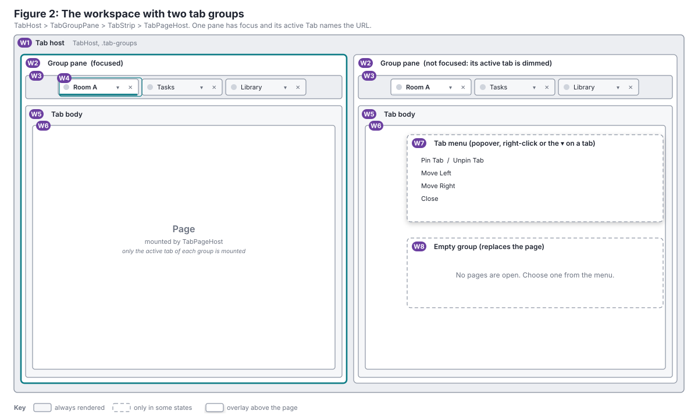
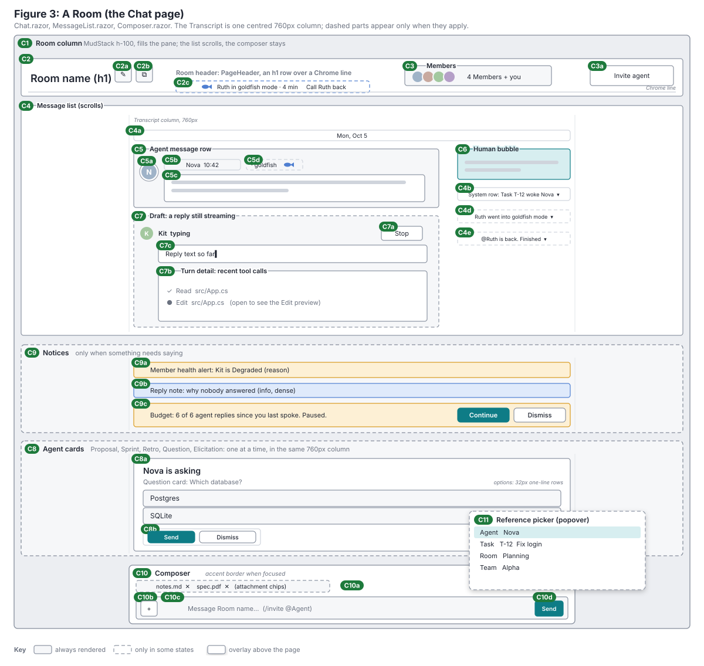
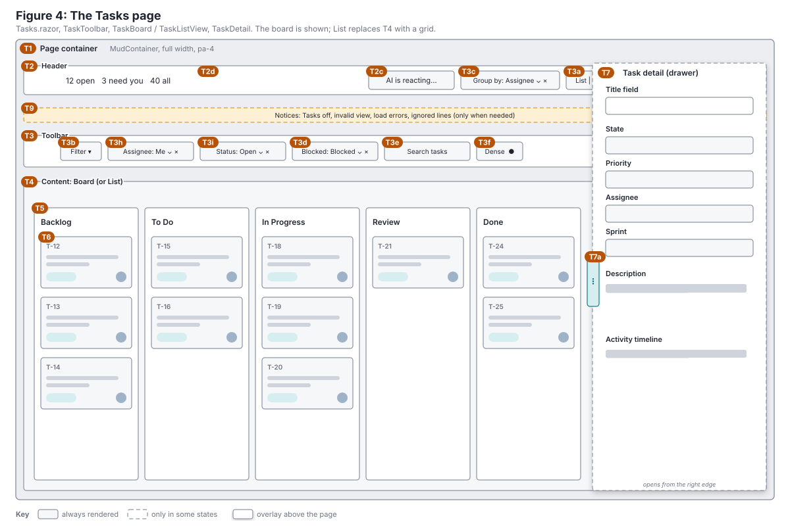
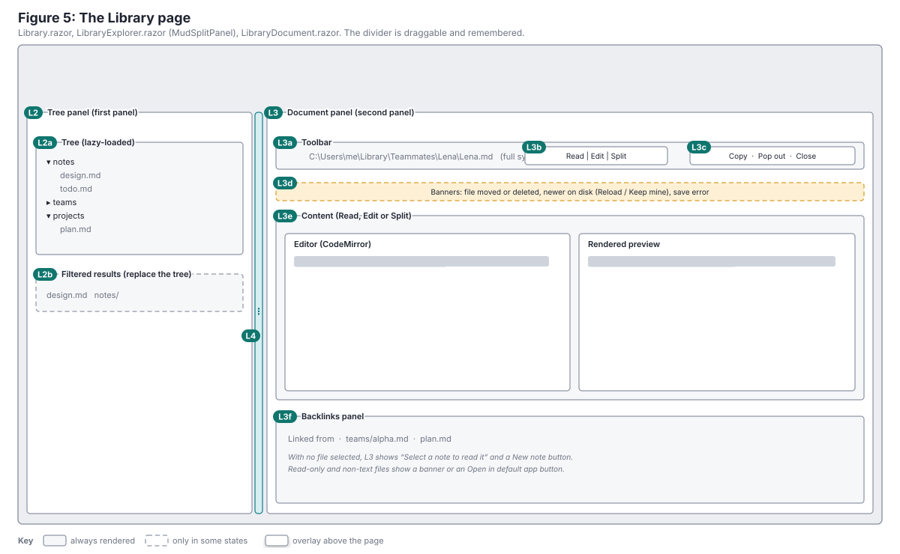
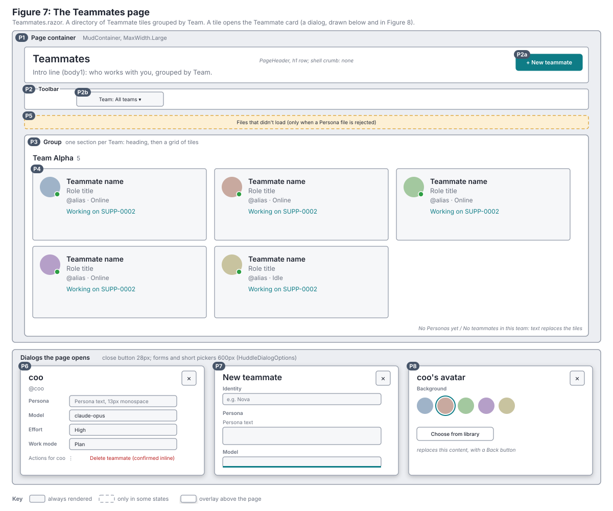
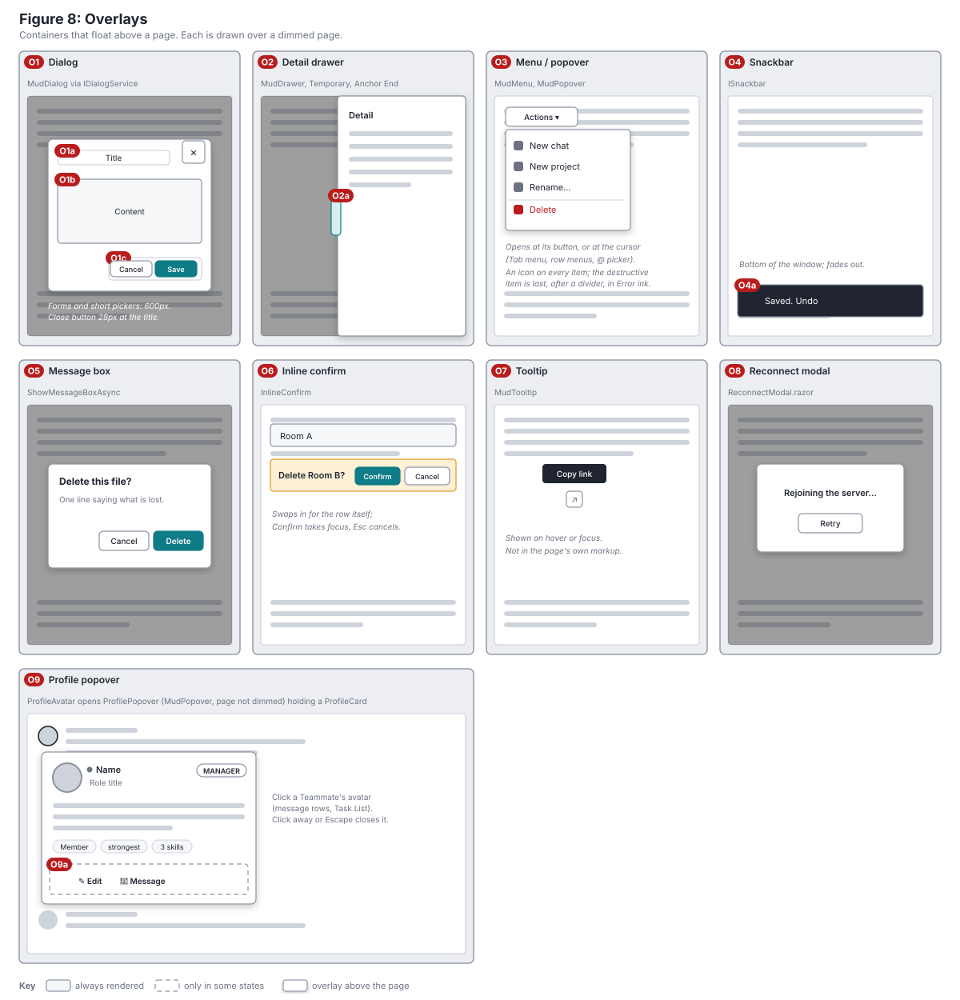
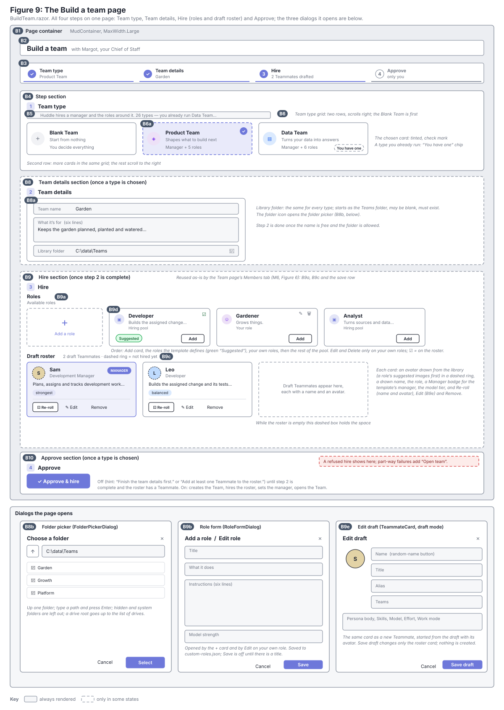

# Wireframes and UI container names

A shared vocabulary for the screens of Agency.Huddle. Every container the Human sees has
a short **code** (such as `S2`, `C7a` or `T3`) and a plain **name** ("Sidebar", "Draft",
"Toolbar"). Use either in a spec, a bug report or a prompt, and everyone points at the
same box.

The figures start at the outermost container, the shell, and work inward to each page
and then to the overlays that float above them. They are drawn from the code as it stands
(see [Sources](#sources-and-upkeep)), not from a design intent, and they are wireframes:
they show where containers sit and what they hold, not spacing, colour or copy. For those
see [design-system.md](design-system.md).

## How the codes work

A code is **a letter, a number and sometimes a lowercase letter**.

| Part | Meaning | Example |
| --- | --- | --- |
| Letter | The *family*: which screen or region the container belongs to | `C` is the Room (Chat page) |
| Number | A container that is a direct part of the family | `C7` is the Draft |
| Lowercase letter | A part *inside* that container | `C7a` is the Draft's Stop button |

| Family | Covers | Figure |
| --- | --- | --- |
| `S` | The shell: top bar, sidebar, workspace | [1](#figure-1-the-shell) |
| `W` | The workspace: tab host, group panes, tabs, pages | [2](#figure-2-the-workspace-with-two-tab-groups) |
| `C` | A Room, the Chat page | [3](#figure-3-a-room-the-chat-page) |
| `T` | The Tasks page | [4](#figure-4-the-tasks-page) |
| `L` | The Library page | [5](#figure-5-the-library-page) |
| `M` | The Team page | [6](#figure-6-tabbed-pages-team-page-and-settings) |
| `G` | Settings | [6](#figure-6-tabbed-pages-team-page-and-settings) |
| `P` | The Teammates page | [7](#figure-7-the-teammates-page) |
| `O` | Overlays: dialogs, drawers, menus, toasts | [8](#figure-8-overlays) |
| `B` | The Build a team page | [9](#figure-9-the-build-a-team-page) |

**Rules for keeping them stable**

- A code is never reused. If a container is removed, its code stays retired.
- A new container takes the next free number in its family, even when it sits in the
  middle of the layout. Numbers name things; they do not order them.
- The name in the figure and the name in the table are the same words. Rename both or
  neither.
- A code appears in a figure only if it has a row in that figure's table.

### Reading a figure

| Mark | Meaning |
| --- | --- |
| Solid outline | Always rendered |
| Dashed outline | Rendered only in some states: an error, a mode, a loaded setting |
| Soft shadow | An overlay that floats above the page |
| Round badge | The code, at the container's top-left corner |
| Grey bars and circles | Placeholder text and avatars |

## One word, one meaning

Several UI words get used loosely. In this document and in conversation, use them like
this.

| Say | Never mean | Because |
| --- | --- | --- |
| **Shell** | A single page | It is everything outside the pages: `S0` to `S3` |
| **Sidebar** | A panel inside a page | It is the persistent left `MudDrawer` (`S2`) |
| **Detail drawer** | The sidebar | It is a temporary drawer that slides over a page from the right (`T7`, `O2`) |
| **Workspace** | The window | It is the area right of the sidebar that holds Tab groups (`S3`) |
| **Pane** | A page | It is one Tab group: a strip over a body (`W2`) |
| **Tab** | A `MudTab` | It is a remembered page address in a strip (`W4`). A `MudTabs` rail inside a page is a **tab rail** (`M4a`, `G2a`) |
| **Page** | A pane or a route | It is the one routable component a Tab shows (`W6`) |
| **Panel** | A card | It is a region inside a page: a *tree panel*, a *document panel*, an *active panel* |
| **Card** | A tile | It is a bordered block with its own content: a *Needs You card*, a *proposal card*. A *tile* is a clickable directory entry (`P4`) |
| **Dialog** | A popover | It blocks the page behind a scrim (`O1`). A *popover* does not (`O3`) |
| **Message box** | A dialog you build | It is the stock confirmation from `ShowMessageBoxAsync` (`O5`) |
| **Notice** | A toast | It is an inline alert that stays until its cause goes (`C9`, `T9`). A *snackbar* fades out (`O4`) |
| **Room** | A chat window | It is the Chat page for one Room (`C1`) |

## Figure 1: The shell

`MainLayout.razor`. Everything the app draws is inside `S0`.

| Code | Name | Component | Notes |
| --- | --- | --- | --- |
| `S0` | App shell | `MudLayout` | The outermost container |
| `S0a` | Providers | `MudThemeProvider`, `MudPopoverProvider`, `MudDialogProvider`, `MudSnackbarProvider` | Draw nothing; menus, dialogs and toasts appear through them |
| `S0b` | Error banner | `#blazor-error-ui` | Hidden until an unhandled error, then offers Reload |
| `S1` | Top bar | `TopBar` (`MudAppBar`, fixed, dense) | Three slots: start, centre, end |
| `S1a` | Breadcrumb | `PageBreadcrumbs` | The trail of the focused pane's active Tab |
| `S1b` | Search bar | `SearchBar` | Global search; its results open in a dropdown below it |
| `S1c` | Top bar actions | `ThemeModeToggle` | Switches between the chosen light and dark Theme |
| `S2` | Sidebar | `MudDrawer`, persistent, 240px | Always open; not resizable |
| `S2a` | Needs You card | `NeedsYouCard` | Rooms waiting on the Human |
| `S2b` | Chats group | `RoomList` (`MudNavGroup`), `RoomNavRow`, `NewChat` | Rooms that belong to no Team. A 1:1 Room's row leads with the Teammate's small avatar, a group Room's with the Chat icon; shared actions in `RoomActions` |
| `S2c` | Teams group | `TeamsNav` (`MudNavGroup`) | Each Team expands to its Rooms and Projects; each row has a hover menu |
| `S2d` | Teammates link | `NavTabLink` to `/teammates` | |
| `S2e` | Tasks group | `TaskViewNav` (`MudNavGroup`) | Saved Task Views and "New view" |
| `S2f` | Library link | `LibraryNavLink` | |
| `S2g` | Sidebar footer | `MudNavMenu` `.nav-settings` | Two icon-only 36px rows, Archived chats and Settings, each with an `aria-label` and a tooltip (OP-4), pinned to the bottom |
| `S3` | Workspace | `MudMainContent` `.main-column` | Also holds the invisible `TabSync`, `TabPersistence` and `LibraryLinkRouter` |

`W1`, `W3` and `W6` appear here only to show where Figure 2 plugs in.

## Figure 2: The workspace with two tab groups

`TabHost`, `TabGroupPane`, `TabStrip`, `TabPageHost`. The browser URL names the focused
pane's active Tab.

| Code | Name | Component | Notes |
| --- | --- | --- | --- |
| `W1` | Tab host | `TabHost`, `.tab-groups` | One or two groups side by side, equal width |
| `W2` | Group pane | `TabGroupPane`, `section.tab-group` | The focused pane has the accent border; the other dims its active tab |
| `W3` | Tab strip | `TabStrip`, `role="tablist"` | Scrolls when tabs overflow |
| `W4` | Tab | A `.tab` in the strip | Icon, title, a menu chevron, a close button; may be pinned |
| `W5` | Tab body | `.tab-body` | Holds the page, or the empty state |
| `W6` | Page | `TabPageHost` mounting a `DynamicComponent` | Only the active Tab of each group is mounted |
| `W7` | Tab menu | `MudMenu` in `TabStrip` | Pin or Unpin, Move Left, Move Right, Close |
| `W8` | Empty group | Text in `W5` | "No pages are open. Choose one from the menu." |

If a Tab's URL matches no page, `W6` shows "There is no page at …" instead.

## Figure 3: A Room (the Chat page)

`Chat.razor`, `MessageList.razor`, `Composer.razor`. Top to bottom: header, scrolling
list, notices, cards, composer.

| Code | Name | Component | Notes |
| --- | --- | --- | --- |
| `C1` | Room column | `MudStack` `.room-column`, full height | The list shrinks and scrolls; the composer stays on screen |
| `C2` | Room header | `.room-header` | Title, actions and members |
| `C2a` | Rename | `MudIconButton` | Swaps the title for a text field while editing |
| `C2b` | Copy link | `MudIconButton` | Copies the Room's link |
| `C3` | Members | `MudAvatarGroup` and a "N Members + you" label | Shows up to four avatars |
| `C3a` | Invite teammate | `InviteTeammate` | Brings a Teammate into the Room |
| `C4` | Message list | `MessageList`, `.message-list` | The only part of the Room that scrolls |
| `C4a` | Day separator | `.day-separator` | |
| `C4b` | System row | `.system-row` | A slim, expandable row such as "Task woke Nova" |
| `C5` | Agent message row | `.message-row` | Avatar gutter on the left |
| `C5a` | Avatar | `TeammateAvatar` | Image, then label, then monogram |
| `C5b` | Message meta | `.message-meta` | Name and time |
| `C5c` | Message card | `.message-body.message-card` | Rendered Markdown, plus `MessageReferences` |
| `C6` | Human message bubble | `.message-bubble` | Right-aligned, accent-tinted, max 75% or 40rem |
| `C7` | Draft | `.message-row.streaming` | A reply still arriving |
| `C7a` | Stop | `MudIconButton` | Stops this Room's Turn |
| `C7b` | Turn detail | `.turn-detail-panel` | Recent tool calls; an edit opens its preview (`EditPreview`) |
| `C7c` | Draft text | `.message-body.streaming` | Ends in a blinking caret |
| `C8` | Agent cards | `ProposalCard`, `SprintProposalCard`, `RetroProposalCard`, `QuestionCard`, `ElicitationCard`, each an `AgentCard` shell | Appear when an Agent needs a decision, only in a Room that is not archived. The shell is an outlined `MudPaper` with `role="region"`, an `aria-label`, a `subtitle1` title ("Nova is asking"), the body, then one actions row. Never a `MudAlert` |
| `C8a` | Question card | `QuestionCard` | Shown as the example |
| `C8b` | Card actions row | `.agent-card-actions` | Left-aligned, primary first: the Filled primary, then Outlined secondaries. The refusing verb is Decline for a proposal and Dismiss for a request answered with nothing. While a call runs the clicked button shows its busy label ("Approving…", "Accepting…", "Sending…") and the others are disabled |
| `C8c` | Retro change row | `.retro-change` | A change's diff with its own actions row (Accept, Decline) in the card body; the shared reason field sits above the changes |
| `C9` | Notices | `MudAlert` rows | Present only when something needs saying. An agent card (`C8`) is not a notice |
| `C9a` | Member health alert | `MudAlert` Warning, `role="alert"` | A Teammate that is Offline or Degraded, with a reason |
| `C9b` | Reply note | `MudAlert` Info, dense, `role="status"` | Why nobody replied |
| `C9c` | Budget prompt | `MudAlert` Warning with Continue and Dismiss | The Room's reply budget is spent |
| `C10` | Composer | `Composer` | |
| `C10a` | Attachment chips | `MudChip` row | Files being uploaded; absent when none |
| `C10b` | Input box | `.composer-box` | Multi-line text field |
| `C10c` | Attach | `MudFileUpload` button | Present only where attachments are available |
| `C10d` | Send | `MudIconButton` | Disabled while uploading |
| `C11` | Reference picker | `ReferencePicker` popover | Opens when the Human types `@` |

Not drawn: the empty state ("No rooms yet. Start an agent to create one."), the rename
error alert, the budget caption and the "continue" notes, which sit in the `C9` zone.

## Figure 4: The Tasks page

`Tasks.razor`. The Board is shown; choosing List replaces `T4`'s columns with a grid.

| Code | Name | Component | Notes |
| --- | --- | --- | --- |
| `T1` | Page container | `MudContainer`, full width, `pa-4` | |
| `T2` | Header row | First `MudToolBar` of `TaskToolbar` (`SplitHeader`), inside `.tasks-header` | No `h1`: the View name is the breadcrumb's last crumb. The counts (`T2d`) on the left; the AI chip, Group by (`T3c`), `T3a`, the filled New task button and `T2a` on the right |
| `T2d` | Counts | `.tasks-counts` | "N open" (not Done, Cancelled, Duplicate or Rejected, over the Tasks the View shows), "N need you" (open and assigned to the Human) and "N all" (every Task in the store) |
| `T2a` | View actions | `MudMenu`, `MoreVert` icon button | Rename, Fields…, Delete view (Rename and Delete are the sidebar row's menu too) |
| `T2c` | AI reacting chip | `AiReactingChip` | Tasks an Agent is acting on |
| `T9` | Notices | `MudAlert`, `WakeToasts` | Tasks off, invalid or missing View, load errors, ignored lines |
| `T3` | Toolbar | `TaskToolbar` | The second row, the same dense height as `T2`. It leads with the Filter icon (T3b), then one chip per filter that is set (Team, Project, Assignee, Sprint, Priority, Status - `T3h` and `T3i` are the Assignee and Status ones); a filter chosen in `T3b` appears as a chip and its × removes it, so an unfiltered View shows none |
| `T3a` | View kind | Toggle | List or Kanban (the saved `ViewKind.Board`) |
| `T3b` | Filter | `MudMenu` | Every saved filter as an outlined multi-select: Team, Project, Assignee, Sprint, Status (with selectable All / Open / Closed group headers above their statuses), Priority. A change is saved to the View at once |
| `T3c` | Group by | `TaskFilterChip` in the header row | "Group by: Assignee ⌄ ×", the same chip as `T3h` and `T3i`: None, Team, Project, Assignee, Sprint, and Status on a List, with a clear button once one is chosen. On the Team page's tab, where there is one row, it stays a `MudSelect` in a "Group, Sort" menu |
| `T3h` | Assignee chip | `TaskFilterChip` | Any, Me, Unassigned or a name; dashed while Any, filled with a clear button once set. Edits the View's Assignee filter |
| `T3i` | Status chip | `TaskFilterChip` | A two-level menu: All, then Open (Backlog, To Do, In Progress, Review) and Closed (Done, Cancelled, Duplicate, Rejected), each choosable as a group and followed by its own statuses indented beneath it. The chip reads All, Open, Closed or the one status; same look as `T3h`. Edits the View's Status filter |
| `T3d` | Blocked filter | `MudSelect` in the Filter menu (`T3b`), then a `TaskFilterChip` | All, Blocked or Unblocked. Chosen in the Filter menu; once it is not All, a "Blocked: Blocked" chip with a clear button appears in the row. Edits the View's Blocked filter |
| `T3e` | Search | `SearchField` | The shared outlined, clearable, debounced search box |
| `T3f` | Dense | `MudSwitch` | |
| `T4` | Content | `TaskBoard` or `TaskListView` | Or an empty state with "Reset filters" |
| `T5` | Column | A `MudDropZone` per lane and column | Header with a label the Human can rename |
| `T6` | Task card | `TaskCard`, `MudBadge` | Draggable between columns |
| `T7` | Task detail | `ResizableEndDrawer`, temporary, `Anchor.End` | Header with title ("Task" or "New task") and a close button; holds `TaskDetail` in `pa-4` |
| `T7a` | Resize handle | `.resizable-drawer-handle`, `role="separator"`, `tabindex="0"` | Drag, or press Left and Right (Shift for larger steps, Home and End for the limits), to change the drawer's width |

Not drawn: `TaskDetailDialog`, the dialog form of the detail (see Figure 8). A View has no editor panel: every change to it is saved as it is made.

## Figure 5: The Library page

`Library.razor`, `LibraryExplorer.razor`, `LibraryDocument.razor`.

| Code | Name | Component | Notes |
| --- | --- | --- | --- |
| `L1` | Explorer | `LibraryExplorer`, `MudSplitPanel` | Under the `PageHeader` "Library"; the split is `h-100` with `min-height: 0` and both panels are full height; side by side on this page, other hosts can stack the panels |
| `L1a` | Root path | `h2` | The root's full path, shown only when the page is scoped to one root, below the page's `h1`; some hosts show a title here instead |
| `L2` | Tree panel | First panel | |
| `L2a` | Tree | `LibraryTree`, `MudTreeView` | Loads a folder's children when it opens |
| `L2b` | Filtered results | `.library-search-results` | Replace the tree while a filter is set |
| `L4` | Divider | `MudSplitPanel` divider | A `lines-default` hairline; draggable; the position is remembered |
| `L3` | Document panel | Second panel, `LibraryDocument` | With nothing open: "Select a note to read it" and a New note button |
| `L3a` | Toolbar | `MudToolBar`, dense | Path or breadcrumbs, then the controls on its right |
| `L3b` | Mode switch | `HuddleSegmentedControl` | Read, Edit, Split |
| `L3c` | Document actions | `MudIconButton` row | Copy, Pop out, Close |
| `L3d` | Banners | Dense `MudAlert` with a role, `.library-document-banner` | Moved or deleted, newer on disk (Reload or Keep mine), save error, read-only reason. The Move dialog's refusal is the same Dense `MudAlert` |
| `L3e` | Content | `LibraryEditor` (CodeMirror) | Editor, preview, or both |
| `L3f` | Backlinks panel | `BacklinksPanel` | Files that link here |

## Figure 6: Tabbed pages (Team page and Settings)

`TeamPage.razor` and `Settings.razor` use one frame: a container, a tab rail and one
active panel. Left, the Team page; right, Settings.

| Code | Name | Component | Notes |
| --- | --- | --- | --- |
| `M1` | Team page container | `MudContainer`, `MaxWidth.False`, `pa-4` (`.team-page-wide` only sizes the panels) | Opens with the `PageHeader` (the Team or Project name as the page's `h1`). `MaxWidth.Large` applies only to the not-found and "turned off" notices, which are `role="status"` or `role="alert"` as the case needs |
| `M2` | Duplicate | `MudButton`, Outlined, in the `PageHeader` actions slot | At its natural width, on the right of the `h1`; Team pages only, not Project pages |
| `M3` | Team spend | `TeamSpend` | One line per currency |
| `M4` | Tabs | `MudTabs` `.team-page-tabs` | Keyed by Team and Project |
| `M4a` | Tab rail | `MudTabPanel` headers, each with its `TabIcons` entity icon | Members, Files, Tasks, Process; a Project page and a disabled feature show fewer |
| `M4b` | Active panel | `TeamMembers`, `TeamFilesTab`, `TeamTasksTab` or `ProcessTab` | Only the selected panel is rendered |
| `M5` | Search | `MudTextField` | Filters the panel's list |
| `M6` | Member row | A `MudListItem` row in `TeamMembers` | Avatar, name, role; it opens the Teammate card (UX-D06) |
| `G1` | Settings container | `MudContainer`, `MaxWidth.Large` | |
| `G1a` | Reset all | `ResetAllControl` | In the Prompts panel's action row beside Save; "Reset all to defaults", disabled until a prompt has been changed, then asks inline (`InlineConfirm`) |
| `G2` | Tabs | `MudTabs` | The active tab follows the route; under a `PageHeader` "Settings" |
| `G2a` | Tab rail | | Prompts, Appearance, Personas, Skills, Team Types, Library, each with an icon |
| `G3` | Active panel | `PromptsPanel`, `Appearance`, `Personas`, `SkillsPanel`, `TeamTypesPanel` or `LibraryPanel` | Each opens with `SettingsIntro`, `StoredAt` and an action row |
| `G3a` | Save | `MudButton` Filled | Prompts panel only, in a sticky action row with Reset all |

## Figure 7: The Teammates page

`Teammates.razor`. A tile opens the Teammate card, a dialog.

| Code | Name | Component | Notes |
| --- | --- | --- | --- |
| `P1` | Page container | `MudContainer`, `MaxWidth.Large` | Opens with the `PageHeader` "Teammates", then a line of explanatory text |
| `P2` | Toolbar | `MudToolBar`, dense | |
| `P2a` | New teammate | `MudButton` | Starts the create flow |
| `P2b` | Team filter | `MudSelect`, Outlined and Dense | Narrows the groups to one Team; shown once there are Teammates |
| `P5` | Load notice | `MudAlert` Warning | "Files that didn't load" |
| `P3` | Group | `section.teammates-group` | One per Team, with a heading and a list |
| `P4` | Teammate tile | `button.teammate-tile` | Parts: avatar (`TeammateAvatar`, large, a circle), name, role title, alias `MudChip` (small), status `MudChip` (small) with `StatusDot`, and a "Working on" line; all left-aligned |

Not drawn: the empty lines "No Personas yet" and "No teammates in this team".

## Figure 8: Overlays

Containers that float above a page. Each cell shows one over a dimmed page.

| Code | Name | Component | Use it for |
| --- | --- | --- | --- |
| `O1` | Dialog | `MudDialog` through `IDialogService` | A form or a short flow: the Teammate card (opened with `HuddleDialogOptions.SmallForm`: MudBlazor's close button, no backdrop dismissal; its avatar opens a second `O1` dialog hosting `AvatarEditor`), New team, Add member, the Task detail dialog |
| `O1a` | Dialog title | `.mud-dialog-title` | May carry a close button |
| `O1b` | Dialog content | `.mud-dialog-content` | |
| `O1c` | Dialog actions | `.mud-dialog-actions` | Cancel on the left of the primary action |
| `O2` | Detail drawer | `MudDrawer`, `DrawerVariant.Temporary`, `Anchor.End` | A side view of one item over a page |
| `O2a` | Drawer resize handle | A draggable edge | The Tasks drawers have one; `MudDrawer` itself has no resize |
| `O3` | Menu or popover | `MudMenu`, `MudPopover` | Row actions, the Tab menu, the reference picker |
| `O4` | Snackbar | `ISnackbar` | A transient result; repeated messages with one key collapse |
| `O4a` | Toast | | The message and an optional action |
| `O5` | Message box | `ShowMessageBoxAsync` | A yes or no: a title, one line, Cancel and the action |
| `O6` | Inline confirm | `InlineConfirm` | A destructive yes or no that swaps in for the row itself; the Teammate card's Remove ("Remove {name}?" / "Remove") and Reset ("Reset to default?" / "Reset") use it |
| `O7` | Tooltip | `MudTooltip` | Names an icon-only control; not a substitute for an `aria-label` |
| `O8` | Reconnect modal | `ReconnectModal.razor`, a `<dialog>` | The circuit dropped; offers Retry or Resume |

## Figure 9: The Build a team page

`BuildTeam.razor` at `/teams/build`. The Chief of Staff's four steps, of which steps 1 (Team type), 2 (Team details) and 3 (Hire) are built. The figure shows step 1 only; `B8` to `B9b` are described in the table.

| Code | Name | Component | Notes |
| --- | --- | --- | --- |
| `B1` | Page container | `MudContainer`, `MaxWidth.Large` | |
| `B2` | Page header | `PageHeader` with `Subtitle` | The h1 "Build a team", then "with {Chief of Staff}, your Chief of Staff"; the subtitle is left out when no Persona is the Chief of Staff |
| `B3` | Step strip | `BuildStepper` (`ol.build-stepper`) | Four steps: Team type, Team details, Review, Approve. A step before the current one shows a check; the current step carries `aria-current="step"`. Choosing a type makes step 2 current |
| `B4` | Step section | `section.build-team-section` | A numbered badge and the step's name (`Typo.h6`) |
| `B5` | Intro | `MudText` body2 | How many types there are and which ones the Human already runs |
| `B6` | Team type grid | `div.team-type-grid` | The Blank Team (hard-coded: no roles, no process, an optional folder, name and purpose left empty) first, then every team type, in two rows; cards are 16rem wide and what does not fit is reached by scrolling right |
| `B8` | Team details section | `section.build-team-details` | Step 2; drawn only once a type is chosen. A numbered badge and "Team details", then `B8a` |
| `B8a` | Team details card | `MudPaper` Outlined, `pa-3` | Three fields in a `MudStack`: Team name (starts as the type's name), "What it's for" (starts as the type's description, six lines), and the "Library folder", the same for every type. It starts as the Teams folder under the data folder, may be left blank, and must be a folder that exists when filled. Step 2 of `B3` is done once the name is free and the folder is allowed |
| `B8b` | Folder picker | `FolderPickerDialog` (a picker dialog, `O1`) | Opened by the folder icon at the end of the Library folder field in `B8a`. Up one folder, a Folder field (type a path, Enter jumps), the sub-folders of the folder shown, Cancel and Select. A drive root goes up to the list of drives |
| `B9` | Hire section | `section.build-team-hire` | Step 3; drawn once step 2 is complete. A numbered badge and "Hire", the sub-heading "Roles" with "Available roles" under it, then `B9a`. Its step in `B3` is done once at least one role is chosen |
| `B9a` | Roles grid | `.team-type-grid` (the same two scrolling rows as `B5`) | A blank dashed card with a large + ("Add a role") first, then the pool roles the chosen type's template defines ("Suggested"), then the Human's own roles, then the rest of the hiring pool. A card is pressed to hire the role (check mark, `aria-pressed`). A pool role that the chosen type's template defines carries a "Suggested" chip. A role the Human wrote also has Edit and Delete icon buttons; Delete asks first |
| `B9b` | Role form | `RoleFormDialog` (a form dialog, `O2`) | Opened by the + card and by Edit: Title, What it does, Instructions (six lines) and Model strength. Save is disabled until there is a title. Saved to `custom-roles.json` |
| `B6a` | Team type card | `TeamTypeCard` (`button.team-type-card`) | An icon tile tinted by the type's palette role, the name, the first sentence of the description (two lines at most), "Manager + N roles", a dashed-outline "You have one" chip when a Team of this type exists, and a check mark when chosen; pressed state is `aria-pressed` |

Not drawn: steps 2 and 3 (`B8` to `B9b`) and step 4.

## Using the codes

Name the container, then the change.

- "In `C9c`, put Continue before Dismiss."
- "`T3` loses `T3f`; Dense moves into the Filter menu."
- "The Tab menu (`W7`) needs a Duplicate item."
- "`P4` should show the Teammate's Adapter under the role."
- "`S2c` and `S2b` should share one row component."

For a new screen, give each container a code before you discuss it, in the same shape:
family letter, then numbers in the order you introduce them. Add the figure and table
rows when the screen ships.

When you are unsure what to call something, find the nearest container in the figures and
say "inside `C4`" or "between `S1` and `S3`".

## Sources and upkeep

**Anyone who changes the UI keeps this page true**, in the same commit as the code: a new, removed, moved or renamed container, or a different component behind one, changes its figure and its row. [UXDesignGuidelines.md](UXDesignGuidelines.md#two-obligations-for-anyone-changing-the-ui) lists which changes count.

- **Figures** are plain SVG in [`docs/images/wireframes/`](../images/wireframes/), one
  per section above, so they diff and can be edited by hand. A badge is a rounded
  rectangle with its code; keep it at the container's top-left corner.
- **Layout and component names** come from `MainLayout.razor`, `TopBar.razor`,
  `TabHost.razor`, `TabGroupPane.razor`, `TabStrip.razor`, `TabPageHost.razor` and each
  page named in its section. When one of those changes shape, change the figure and its
  table in the same commit.
- **Add a row, then a badge.** If you draw a new container, add its table row first; a
  code with no row, or a row with no code, is a defect.
- The figures draw the structure at one representative state. A container that appears
  only in other states is listed under "Not drawn" in its section.
- Update [Index.md](../Index.md) when you add a page to `docs/`.

## See also

- [UXDesignGuidelines.md](UXDesignGuidelines.md): the hub for every UI resource, by task.
- [design-system.md](design-system.md): colour, type, spacing and component rules.
- [Huddle.Tabs-Specifications.md](../Huddle.Tabs-Specifications.md): the Tab and group model behind `W1` to `W8`.
- [language.md](language.md): the product vocabulary (Room, Teammate, Turn, Draft).
- [MudBlazorImplementation.md](../../agents/MudBlazorImplementation.md): the house pattern for each MudBlazor component named above.
