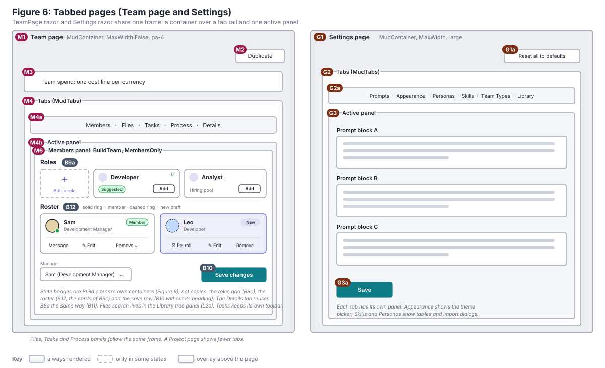
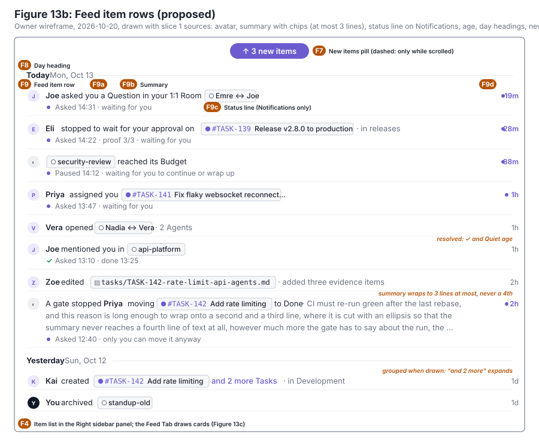

# Wireframes and UI container names

A shared vocabulary for the screens of Agency.Huddle. Every container the Human sees has
a short **code** (such as `S2`, `C7a` or `T3`) and a plain **name** ("Sidebar", "Draft",
"Toolbar"). Use either in a spec, a bug report or a prompt, and everyone points at the
same box.

The figures start at the outermost container, the shell, and work inward to each page
and then to the overlays that float above them. They are drawn from the code as it stands
(see [Sources](#sources-and-upkeep)), not from a design intent, and they are wireframes:
they show where containers sit and what they hold, not spacing, colour or copy. For those
see [design-system.md](design-system.md).

## Contents

- [How the codes work](#how-the-codes-work)
  - [Reading a figure](#reading-a-figure)
- [One word, one meaning](#one-word-one-meaning)
- [Figure 1: The shell](#figure-1-the-shell)
- [Figure 2: The workspace with two tab groups](#figure-2-the-workspace-with-two-tab-groups)
- [Figure 3: A Room (the Chat page)](#figure-3-a-room-the-chat-page)
- [Figure 4: The Tasks page](#figure-4-the-tasks-page)
- [Figure 5: The Library page](#figure-5-the-library-page)
- [Figure 6: Tabbed pages (Team page and Settings)](#figure-6-tabbed-pages-team-page-and-settings)
  - [Figure 6b: The Project page](#figure-6b-the-project-page)
- [Figure 7: The Agent card](#figure-7-the-agent-card)
- [Figure 8: Overlays](#figure-8-overlays)
- [Figure 9: The Build a team page](#figure-9-the-build-a-team-page)
- [Figure 10: The Needs you page](#figure-10-the-needs-you-page)
- [Figure 11: The Task read view](#figure-11-the-task-read-view)
- [Figure 12: The Task edit page](#figure-12-the-task-edit-page)
- [Figure 13: The Feed page](#figure-13-the-feed-page)
- [Figure 14: The connect page](#figure-14-the-connect-page)
- [Figure 15: The Scheduled page](#figure-15-the-scheduled-page)
- [Using the codes](#using-the-codes)
- [Sources and upkeep](#sources-and-upkeep)
- [See also](#see-also)

## How the codes work

A code is **a letter, a number and sometimes a lowercase letter**.

| Part | Meaning | Example |
| --- | --- | --- |
| Letter | The *family*: which screen or region the container belongs to | `C` is the Room (Chat page) |
| Number | A container that is a direct part of the family | `C7` is the Draft |
| Lowercase letter | A part *inside* that container | `C7a` is the Draft's Stop button |

| Family | Covers | Figure |
| --- | --- | --- |
| `S` | The shell: top bar, activity bar, sidebar, workspace | [1](#figure-1-the-shell) |
| `W` | The workspace: tab host, group panes, tabs, pages | [2](#figure-2-the-workspace-with-two-tab-groups) |
| `C` | A Room, the Chat page | [3](#figure-3-a-room-the-chat-page) |
| `T` | The Tasks page | [4](#figure-4-the-tasks-page) |
| `L` | The Library page | [5](#figure-5-the-library-page) |
| `M` | The Team page and the Project page (`/teams/{Team}/projects/{Project}`) | [6](#figure-6-tabbed-pages-team-page-and-settings) |
| `G` | Settings | [6](#figure-6-tabbed-pages-team-page-and-settings) |
| `P` | The Agent card | [7](#figure-7-the-agent-card) |
| `O` | Overlays: dialogs, drawers, menus, toasts | [8](#figure-8-overlays) |
| `B` | The Build a team page | [9](#figure-9-the-build-a-team-page) |
| `N` | The Needs you page | [10](#figure-10-the-needs-you-page) |
| `J` | The Scheduled page (`/scheduled`) and a Job's page (`/scheduled/{id}`) | [15](#figure-15-the-scheduled-page) |
| `K` | The Task edit page (`/tasks/item/{id}/edit`), in a Tab of its own | [12](#figure-12-the-task-edit-page) |
| `F` | The Feed page (`/feed`), in a Tab of its own | [13](#figure-13-the-feed-page) |
| `A` | The connect page (`/auth`), outside the shell | [14](#figure-14-the-connect-page) |

**Rules for keeping them stable**

- A code is never reused. If a container is removed, its code stays retired.
- A new container takes the next free number in its family, even when it sits in the
  middle of the layout. Numbers name things; they do not order them.
- The name in the figure and the name in the table are the same words. Rename both or
  neither.
- A code appears in a figure only if it has a row in that figure's table.

### Reading a figure

| Mark | Meaning |
| --- | --- |
| Solid outline | Always rendered |
| Dashed outline | Rendered only in some states: an error, a mode, a loaded setting |
| Soft shadow | An overlay that floats above the page |
| Round badge | The code, at the container's top-left corner |
| Grey bars and circles | Placeholder text and avatars |

## One word, one meaning

Several UI words get used loosely. In this document and in conversation, use them like
this.

| Say | Never mean | Because |
| --- | --- | --- |
| **Shell** | A single page | It is everything outside the pages: `S0` to `S5` |
| **Activity bar** | The Sidebar | It is the 52px strip of buttons at the far left (`S5`) that picks the Sidebar's view |
| **Sidebar** | A panel inside a page | It is the left navigation column beside the Activity bar (`S2`), showing one view at a time |
| **Right sidebar** | The detail drawer | It is the persistent right `MudDrawer` the Top bar toggles (`S4`). It pushes the Workspace aside rather than covering it, and shows the panels the Panel catalog picks for the focused pane's Subject |
| **Detail drawer** | The sidebar | It is a temporary drawer that slides over a page from the right (`O2`). The Task's details (`T7`) are no longer one: they show in the Right sidebar |
| **Workspace** | The window | It is the area right of the sidebar that holds Tab groups (`S3`) |
| **Pane** | A page | It is one Tab group: a strip over a body (`W2`) |
| **Tab** | A `MudTab` | It is a remembered page address in a strip (`W4`). A `MudTabs` rail inside a page is a **tab rail** (`M4a`, `G2a`) |
| **Page** | A pane or a route | It is the one routable component a Tab shows (`W6`) |
| **Panel** | A card | It is a region inside a page: a *tree panel*, a *document panel*, an *active panel* |
| **Card** | A tile | It is a bordered block with its own content: a *Needs You card*, a *proposal card*. A *tile* is a clickable directory entry (`M6c`) |
| **Dialog** | A popover | It blocks the page behind a scrim (`O1`). A *popover* does not (`O3`) |
| **Message box** | A dialog you build | It is the stock confirmation from `ShowMessageBoxAsync` (`O5`) |
| **Notice** | A toast | It is an inline alert that stays until its cause goes (`C9`, `T9`). A *snackbar* fades out (`O4`) |
| **Room** | A chat window | It is the Chat page for one Room (`C1`) |

## Figure 1: The shell

`MainLayout.razor`. Everything the app draws is inside `S0`.


| Code | Name | Component | Notes |
| --- | --- | --- | --- |
| `S0` | App shell | `MudLayout` | The outermost container |
| `S0a` | Providers | `MudThemeProvider`, `MudPopoverProvider`, `MudDialogProvider`, `MudSnackbarProvider` | Draw nothing; menus, dialogs and toasts appear through them |
| `S0b` | Error banner | `#blazor-error-ui` | Hidden until an unhandled error, then offers Reload |
| `S1` | Top bar | `TopBar` (`MudAppBar`, fixed, dense) | Three slots: start, centre, end |
| `S1a` | Breadcrumb | `PageBreadcrumbs` | Starts at the window's left edge, inside the bar's 16px gutter, not past the sidebar. 13px; ancestors in TextSecondary, the current crumb in TextPrimary, 8px each side of the "›". The trail of the focused pane's active Tab: ancestors only when the page names itself with an h1. A Room's trail is "Rooms"; a Team page's is "Teams"; a Project page's is "Teams › {Team} › {Project}", the one trail that ends in its own page, so the bar names the Project the Teams sidebar has selected; a Tasks View's is "Tasks › {View name}" (the display name, never the slug): the Tasks page's h1 is visually hidden (`T2`), so the page sets this trail itself (`TabService.SetTrail`) after each render, and "Tasks" is a link. On the Library page it holds the open file's whole location, "Library › Agents › Lena › Lena.md": the Library page sets it (`TabService.SetTrail`) each time the open file changes, so the page's own toolbar (`L3a`) does not repeat it. Only "Library" is a link (it opens the page with nothing selected) |
| `S1b` | Search bar | `SearchBar` | Global search; its results open in a dropdown below it |
| `S1c` | Top bar actions | `TasksNeedYouPill` (`a.tasks-need-you-pill`), `NotificationsButton`, `RightSidebarToggle`, `ThemeModeToggle` | The pill reads "N Tasks need you" (across the store: gated Tasks waiting in Needs You and not yet accepted, `TaskQuery.WaitsOnHuman`, the Needs you page's Task cards; the Tasks page's "assigned to you" count `T2d` is a different count) and opens My Tasks; it renders only when N is above 0 and is shown only by a style pack (Nordic, ADR-0057), hidden for every other Theme. `NotificationsButton` is the Material Outlined bell with a badge of the unseen Notifications (hidden at 0, 99+ above), `aria-pressed` while the Notifications panel shows in the Right sidebar; it is not drawn while the Feed is off. Of the two buttons after it, the first opens and closes the Right sidebar (`S4`): the Material Symbol `dock_to_left`, Primary and `aria-pressed` while open. The second switches between the chosen light and dark Theme. The top bar's icon buttons are 32px |
| `S2` | Sidebar | `div#sidebar-views` in the left `MudDrawer` (`.shell-nav`), 240px by default and 200-480px when dragged | Its right edge carries a resize handle (`SidebarResizeHandle`, `.sidebar-resize-handle`, a `role="separator"`) that the mouse drags and the arrow keys move (Shift for a larger step, Home and End for the limits); the width is remembered per browser under `shell:sidebarWidth` and the handle is hidden while the Sidebar is collapsed. Drawn dashed: it shows the one view the Activity bar (`S5a`) selects, and is hidden while no view is selected. It opens on Rooms in each circuit. The views are Rooms (`S2a`, `S2b`), Teams (`S2c`), Agents (`S2d`), Tasks (`S2e`), Library (`S2f`) and Scheduled (`S2j`); the figure draws Rooms. Every view stays mounted while hidden, so it keeps its open groups. The drawer holds `S5` and `S2` side by side and is 49px collapsed, 289px open; not resizable. Rows are 32px (`--nav-row-height`) with 13px body-colour text, a 24px leading slot 4px inside the row's pill (an avatar, or an 18px icon centred in it) and a 4px gap: VS Code's Explorer proportions scaled to the 32px row. Every row of every view sits on one grid: the leading marks (section icon, row icon, avatar, a Team's chevron, the "+") are centred on one icon line, and the labels (section title, names, "Show all", "New room") start on one text line; trailing counts and the section arrow end on one right edge. A Team's Rooms and Library folders are one step in (`--nav-level: 1`), so their icon sits under the Team's name, and the rows inside a folder a quarter step further; Agents and Library are rows, not headers. Section headers are 12px/600 in TextSecondary, sentence case, 16px above and 4px below. A group header is a 32px row, and opens by default when it is the only group in the view. Settings has no Sidebar view: opening it collapses the Sidebar. Every section header is visible at a 900px window |
| `S2a` | Needs You card | `NeedsYouCard` | Rooms waiting on the Human, then gated Tasks waiting for a decision, in a card outlined in Line; the count is plain text, not a badge or a coloured chip, and covers both. Each row is 32px: the reason icon, the Room's name and a trailing time, with no second line. A Task row reads "{id} {title}" with "Waiting on you · Proof {m}/{n}" and links to `/needs-you#<id>` (`N2`) |
| `S2b` | Rooms group | `RoomList` (`MudNavGroup` folders, no "Rooms" title), `RoomNavRow`, `NewChat` | Above the folders sits the **Group by:** line (`S2b1`). With **All** it lists the Rooms that belong to no Team, plus every live Team's one-to-one with an Agent, in two folders (a Team one-to-one's name line ends with `.room-row-scope`: a muted "·", the Team's small `TeamAvatar` and "Team" or "Team / Project", from `RoomScopeLabel`; only for a Team that is live in the catalog, so a vanished Team's one-to-one keeps the muted "(Team)" bracket; the row's tab is titled with the same text; the root one-to-one with the same Agent stays plain; a Team's group Rooms and Team Room stay under the Team): **Needs you** on top (only while a Room waits on the Human) and **All** with the rest, plus **New room**; every Room is listed, with no "Show all" row. A folder opens and closes by its header and the one holding the active page opens itself. The active row is accent text on Primary 14% over Surface (20% hovered), weight 500. A 1:1 Room's row leads with the Agent's 32px avatar (`.room-row-avatar.avatar-transcript`: its picture when it has one) and its presence badge, and shows the Agent's title muted on its own line below the name (`.room-row-title`), a group Room's with the Chat icon; shared actions in `RoomActions`. A Room that is waiting on the Human (the `S2a` card holds it, not dismissed) wears a **Needs you** pill (`NeedsYouPill`, `.needs-you-pill`, a warning-tinted capsule) after its name, in this list and under a Team in `S2c`; the name truncates before the pill does. The Room row's menu has an icon on every item and a divider before Delete (Error ink) |
| `S2b1` | Group by | `.room-list-grouping` in `RoomList`: the caption "Group by:" and a `SegmentedControl<RoomGrouping>` (`All`, `Team`) | **All** is the flat list of `S2b`. **Team** lists every unarchived Room, Team Rooms included, in one collapsible folder per Team (`.room-folder`, a `MudNavGroup` with the Folder icon): the Rooms of no Team first in "No team", then the Teams by name (no name is special: the old "Archive" Team shelf was retired once Teams could be archived for real); each folder ends in its own "Show all (N)" past 8 rows. Every folder starts open; the closed ones (`roomList:closedFolders`) and the grouping (`roomList:grouping`) are remembered per browser, and the folder holding the current Room opens itself. The Rooms group has no "Rooms" header of its own in either mode |
| `S2h` | New room panel | `NewChat` (`.new-chat-panel`, `.floating-panel`) | A floating panel anchored under the "New room" link or the Team row: a Line outline and 32px/13px Agent rows. It floats over the rows below and moves nothing. It ends in **Cancel** then **Open room** |
| `S2i` | Archived page | `ArchivedPage` at `/archived`, in a Tab; `MudContainer` `MaxWidth.Large` | Replaced the Archived chats dialog. The `PageHeader` "Archived", then `MudTabs` **Teams**, **Projects**, **Rooms** (each its own address, `/archived/{tab}`; the old `/archived/chats` still opens Rooms). Each tab is an `ArchivedEntryList`: a toolbar (`.archived-toolbar`) with the filled primary **Restore**, and on Rooms a **Delete…** in Error text that swaps the toolbar for the inline confirm; then a `role="listbox"` of `.archived-row` options, one Tab stop (Up, Down, Home and End move, Space selects, Enter restores and moves to the next row) (icon, name, " · Team" or " · Team / Project" in Quiet ink, "Archived Oct 3" trailing), the selected one in the Selected shape. A double-click restores. An empty tab is an `EmptyState`. Opened from the Activity bar's Archived button (`S5b`) |
| `S2c` | Teams group | `TeamsNav` (`MudNavMenu`; a `MudNavGroup` per folder) | **The Activity bar's Teams view** (`TeamsNav IsTeamsView`) shows one Team exactly as a Team shortcut does (`S5c`): the Team of the open page (a Team's Room or `/teams/{Team}/...` page, followed through `RouteTeamChanged`; a page with no Team, such as a root Room like the Chief of Staff's, the Feed or Settings, keeps the Team shown; not remembered across reloads), else the last Team used, else the catalog's first, with the header card's Team list unfolded from the start and still unfolded after a pick, the list ending in **Build a team** (archived Teams are on the Archived page, `S2i`). What follows describes `TeamsNav` with no Team, the all-Teams list the view used to show: The Teams are the view's root rows, under no "Teams" header, with "Build a team" last. Each Team is collapsed behind a chevron until opened (or until the route is inside it); the opened Teams are remembered. An open Team holds a **scope list** (`.nav-scope-list`) and, below it, the sections of the selected scope. The scope list's first row is the Team itself (its avatar and name); then comes one row per Project (`.nav-project-link`, the Project's 24px sharp square avatar `ProjectAvatar`, its label or initials, ADR-0083), in catalog order, with "Show all (N)" folding a long list. Each Project row trails the number of its open Tasks (`sidebar-row-meta`, "—" when none); the Team row is a header card (the 40px avatar, the name in bold over "{Team type} · N Agents", inside a subtle border) with no count. One row is selected at a time, the Team row by default; a click selects a row and opens its page (`/teams/{Team}` or `/teams/{Team}/projects/{Project}`). Selection follows the address: a Team page, Team Task View or Team Files address selects the Team row, any `/teams/{Team}/projects/{Project}/...` address selects that Project, a Room's address selects the Room's Project (the Team row when it has none or its Project is gone), and any other address keeps the last selection. A Project row has no chevron; its More (⋮) menu is `S2m`. The Project rows sit under a **PROJECTS** header (`.teams-nav-section-projects`, drawn even before the first Project) whose "+" (`.teams-nav-start-project`, tooltip "Start a project", the same button as the ROOMS and TASKS "+") opens the New project prompt; after the rows, once the Team has a Project, comes a quieter caption-size **No project** toggle (`.teams-nav-no-project`, `aria-pressed`, trailing the count of open Tasks with no Project). No project has no page: selecting it takes the Selected shape and narrows the sections below to what belongs to no Project; a second click returns to the Team row, and a `/teams/{Team}/no-project/...` address selects it. Under a hairline, the selected scope shows three sections under uppercase headers: **ROOMS** (a "+" button with the tooltip "New room in {scope}" opens New room in that scope; the Team scope lists every Room of the Team, No project those with no Project or whose Project is archived or gone, a Project its own), **TASKS** (a "+" button with the tooltip "New task view" creates a View named "New view" (`ViewActions.CreateNew`, as `/tasks/new` does) and opens it, in one permanent Tab, at the selected scope's own address below, so its New task starts in that Team and Project; when `views.json` cannot be saved it opens the scope's All Tasks instead; every Task View, each opening `/teams/{Team}/tasks/{ViewId}` for every Task of the Team, `/teams/{Team}/no-project/tasks/{ViewId}` for its Tasks with no Project, or `/teams/{Team}/projects/{Project}/tasks/{ViewId}` for a Project, its Tab titled "{View} · {Team}", "{View} · {Team} / No project" or "{View} · {Team} / {Project}" and its trail `{Team} › Tasks › {View}`, `{Team} › No project › Tasks › {View}` or `{Team} › {Project} › Tasks › {View}`) and **LIBRARY** (one link to `/teams/{Team}/files` or `/teams/{Team}/projects/{Project}/files`, drawn when the Library is enabled; No project links to `/teams/{Team}/no-project/files`, the Team page component headed "No project" with no tabs, whose `LibraryExplorer` takes the Team's Projects as `HiddenFolders`, so its tree and its search show only the files that belong to no Project). Tasks off draws no TASKS section. A Team row trails its member count (`sidebar-row-meta`, tooltip "N members" or "No Agents") instead of an italic "No Agents". Over 8 Teams, or 8 rows in a folder, the list ends in "Show all (N)". Each Team row has a hover menu (`S2l`) |
| `S2d` | Agents link | Retired | The Activity bar's Agents view went with the Agents page (2026-11-18) |
| `S2e` | Tasks views | `TaskViewNav` (a plain `MudNavMenu`, no group header) | Saved Task Views and "New view", listed at the root of the Tasks sidebar view |
| `S2f` | Library tree | `LibrarySidebarTree` (the tree half of `LibraryExplorer`, `Part="TreeOnly"`) | **The Activity bar's Library view** lists the Library's folders and files right in the Sidebar, under a **Library** heading (`.library-sidebar-title`, an `h2` in the Team view's section-title type) and the search field, New note and New folder (`L2c`). A click on a file opens the Library page's Tab on it, and the tree selects the file the page has open. The document is not in the Sidebar |
| `S2g` | Sidebar footer | | Retired: Archived and Settings moved to the Activity bar's bottom toolbar (`S5b`) |
| `S2k` | Archived Teams group | | Retired 2026-11-12: archived Teams are listed and restored on the Archived page (`S2i`). The sidebar only archives: the Team row's menu, and a `MoreVert` menu (`.teams-nav-scope-menu`) on the Team's header card and on each Project row (**Archive team…**, asked first; **Archive project**, at once), each now with a **Rename** item above it (`S2l`, `S2m`) |
| `S2l` | Team row menu | `MudMenu` (`.hover-reveal-menu` on a Team row of the all-Teams list; `.teams-nav-scope-menu` on the Team's header card in the one-Team view), `Dense` | Items: **New room**, **New project…** (the all-Teams row), **Rename team…** (Edit icon) and, last, **Archive team…** (`.teams-nav-archive-team`). **Rename team…** closes the menu first (`MenuDialogs.AfterClosingAsync`), then opens the Rename team name dialog (`O11`) and the confirmation (`O13`). Not yet in the figure |
| `S2m` | Project row menu | `MudMenu` (`.teams-nav-scope-menu`) on each Project row | Items: **Rename project…** (Edit icon) then **Archive project** (`.teams-nav-archive-project`, at once). **Rename project…** closes the menu first, then opens the Rename project name dialog (`O12`) and the confirmation (`O14`). When the current address is the old Project's page, the Tab is replaced by the new address. Not yet in the figure |
| `S2j` | Scheduled group | `ScheduledNav` (`MudNavGroup` "Scheduled", open by default) | Not drawn. **All jobs** (to `/scheduled`, `J1`; it adds "(N to fix)" while a `schedule.md` section cannot be read), one row per Job reading "{title} · {owner}" with the Schedule icon, or PauseCircle when paused, and the timetable in its tooltip, "Show all (N)" past 8, then **New job** (`nav-action-link`), which opens `J5` |
| `S3` | Workspace | `MudMainContent` `.main-column` | Also holds the invisible `TabSync`, `TabPersistence` and `LibraryLinkRouter` |
| `S4` | Right sidebar | `RightSidebar` (`MudDrawer`, end, persistent, 280px) | Drawn dashed: toggled from `S1c`; open when nothing is remembered, otherwise as the viewer last left it (local storage). In Notifications mode (opened by `NotificationsButton`) it draws one `SidebarPanelFrame` titled "Notifications" around `NotificationsPanel` (Figure 13, `F4`); otherwise it draws the panels the Panel catalog picks for the focused pane's Subject, sorted by `Order`. Each panel sits in a `SidebarPanelFrame`: a 32px header button with the icon, the title (13px/600), the count the panel reports (12px Quiet ink; none until it does) and a chevron that collapses the body, remembered per viewer; a Line line separates one panel from the next. Rows are 32px and one line in Ink (the Outline's are 28px): a Task row is its ID (12px Quiet ink), the title and the state dot; a member row is a 24px avatar with the presence badge on its rim, then the name; the Outline heading in view wears the Selected treatment. The v1 panels: for a Task selected on the Tasks page, Task (`T7`, the read view); for a Room, Members, Tasks in this Room and Documents in this Room; for a Markdown document, Outline, Linked documents and History (the newest five entries of its History, with **See all** scrolling to `L3i`). It follows focus to the other pane or another Tab. When no panel applies, it shows an `EmptyState` with the single sentence "Nothing to show for this page." A Task selected on the Tasks page shows in it as the one panel, Task (`T7`) |
| `S4m` | Members panel row | `MembersPanel` (`.members-row`), inside the `S4` panel frame | An Agent's row is the 24px avatar with its presence badge, then a body of two lines: the name (`.members-name`, ellipsised) with the context meter's text beside it (`.members-context`, `sidebar-row-meta`), and under them a 3px bar (`.members-context-bar`, `MudProgressLinear`) showing how full the Agent's context window is in this Room. The text is the whole percent, "<1%" for a tiny non-zero fill, or "—" with no bar while nothing is known. The bar is Primary below 75%, Warning from 75% and Error from 90%; the text stays in the secondary ink and only the bar carries the band. The tooltip gives the token counts and says "in this Room", or "shared across all of {Name}'s Rooms" for a shared-mode session, and ends " Answered by {Model}." when the Adapter reported the model (the same `ContextFillText.Tooltip` as `C5b`). A Human's row has the avatar and the name only. Rows stay alphabetical, never ordered by fill |
| `S5` | Activity bar | `ActivityBar` (`nav.activity-bar`), 52px | Always shown, at the left edge of the left `MudDrawer`, like VS Code's Activity Bar. From the top: the Feed link (`.activity-bar-pinned`, see `S5a`), always the bar's first tile however many Team shortcuts there are; the Team shortcuts (`S5c`); then two toolbars, one aligned to the top, one to the bottom |
| `S5c` | Team shortcuts | `TeamShortcutBar` (`.activity-bar-shortcuts`, `role="group"`), then `hr.activity-bar-divider` | Below the Feed link (`S5a`). One 40px tile per Team, in catalog order, holding the Team's 32px avatar, above a 24px hairline that sets them apart from `S5a`; not drawn (hairline included) when no Team has one. Every Team has a shortcut by default. A click opens the Sidebar (`S2`) on that Team's own scope list, ROOMS, TASKS and LIBRARY (the shapes of `S2c`) (`TeamsNav` with `Team` set, `.sidebar-view-team`; an empty Team shows its header card above an empty state). The pressed shortcut's view and tile follow the open page's Team (a Team's Room or `/teams/{Team}/...` page), as the Teams view does (`S2c`); no tile is lit when that Team has none, and a page with no Team keeps the Team shown. The Team's header card ends in an **Unfold More** button (`.teams-nav-switcher-button`, "Switch team", `aria-expanded`) that unfolds every Team in catalog order in place, inside the same bordered card under the Team's row (the Team shown stays in its own position with the selected look, `aria-current`, so no Team moves when the selection changes) (`.teams-nav-team-card-open` holding `.teams-nav-switcher-list`; not a popover), each Team drawn as the Team row is (the 40px avatar, the name in bold over "{Team type} · N Agents") and left-aligned, on the `switcher.background` ground (`#e9e9e1` in Nordic Light), pushing the rest of the view down; the button turns to Unfold Less while it is open. The list ends in **Build a team** (`.teams-nav-switcher-build`, a quiet action row: a small "+" and the label in regular weight and the secondary text colour), which opens `/teams/build`. Picking a Team folds the list, shows that Team's view as its tile would, and opens its Team page as a click on its card does (in the unpinned preview Tab). Its ROOMS section is always drawn and its "+" opens New room; while one of the selected scope's Rooms waits on the Human it splits into a **Needs you** folder (`.teams-nav-subfolder.room-folder-needs-you`) above an **All** folder (`.teams-nav-all`), as the Rooms view's All grouping does, and with nothing waiting its Rooms are listed flat; a click on the pressed tile collapses the Sidebar. A right-click opens a menu at the pointer: **Remove shortcut** and **Turn off Team shortcuts**. The Team page header's shortcut toggle (`TeamShortcutButton`, `.team-shortcut-toggle`, `M2`) reads **Hide shortcut** while its Team has one and **Show shortcut** while it has none; it is not drawn until the stored choice is read, and after turning them off, showing one brings back that Team alone. Remembered per browser under `shell:teamShortcuts` (`TeamShortcutStore`), and nothing is drawn before the stored choice is read |
| `S5a` | Top toolbar | `.activity-bar-top`, one `MudIconButton` per view; the Feed link sits above the Team shortcuts in `.activity-bar-pinned` | Feed (a `NavTabLink` with the `Feed` icon to `/feed`) is the bar's first tile, above the Team shortcuts (`S5c`) and outside this toolbar, because it opens a Tab (Figure 13) rather than a Sidebar view; it is not drawn while `Team:Feed:Enabled` is false. The toolbar holds Rooms, Teams, Agents, Tasks, Library and Scheduled, with their entity icons; Tasks, Library and Scheduled are left out when their feature is off. Each button is a 40px tile with the inset rounded shape (0.75 of the base radius). The selected button is pressed (`aria-pressed`) and wears the Accent tint (14%, 20% hovered) with the accent icon. One tile is lit at a time, the last one clicked (`ActivityBarHighlight`): while a page tile's page (Feed, Archived, Settings) is the active Tab, clicking a view tile lights it and dims the page tile, and clicking the page tile or bringing its Tab forward lights it and dims the view tile. Only the look changes, and a click on the dimmed view tile lights it instead of collapsing the Sidebar. Clicking another button switches the Sidebar (`S2`) to that view; clicking the pressed one collapses the Sidebar. Each button has a tooltip and an `aria-label`, and names `S2` in `aria-controls` |
| `S5b` | Bottom toolbar | `.activity-bar-bottom`, `MudNavMenu` `.nav-settings` | Archived and Settings: two icon-only 48px links, each with an `aria-label` and a tooltip (OP-4). Each opens a Tab (the Archived page `S2i`, Settings), so its link wears the active treatment on `/archived/…` or `/settings` |

`W1`, `W3` and `W6` appear here only to show where Figure 2 plugs in.

## Figure 2: The workspace with two tab groups

`TabHost`, `TabGroupPane`, `TabStrip`, `TabPageHost`. The browser URL names the focused
pane's active Tab.


| Code | Name | Component | Notes |
| --- | --- | --- | --- |
| `W1` | Tab host | `TabHost`, `.tab-groups` | One or two groups side by side, equal width |
| `W2` | Group pane | `TabGroupPane`, `section.tab-group` | The focused pane has the accent border; the other dims its active tab |
| `W3` | Tab strip | `TabStrip`, `role="tablist"` | A tint of TextPrimary over Surface; the active Tab is Surface and covers the strip's bottom hairline, so it opens into the page. Scrolls when tabs overflow. Titles are 13px at weight 400, the active title 500 |
| `W4` | Tab | A `.tab-item` in the strip | Icon, title, a menu chevron, a close button; may be pinned. A fixed 14rem, so the hover toolbar leaves the start of the title visible. Every unpinned Tab shows its close button, at 60% until the Tab is hovered or active. A preview Tab (`.tab-item.preview`) is marked by TextSecondary colour and an italic title, not by weight; it takes the body colour and upright text once kept. Titles ellipsize and the `title` attribute carries the full title |
| `W5` | Tab body | `.tab-body` | Holds the page, or the empty state |
| `W6` | Page | `TabPageHost` mounting a `DynamicComponent` | Only the active Tab of each group is mounted |
| `W7` | Tab menu | `MudMenu` in `TabStrip` | Pin or Unpin, Move Left, Move Right, Close |
| `W8` | Empty group | Text in `W5` | "No pages are open. Choose one from the menu." |

If a Tab's URL matches no page, `W6` shows "There is no page at …" instead.

## Figure 3: A Room (the Chat page)

`Chat.razor`, `MessageList.razor`, `Composer.razor`. Top to bottom: header, scrolling
list, notices, cards, composer.


| Code | Name | Component | Notes |
| --- | --- | --- | --- |
| `C1` | Room column | `MudStack` `.room-column`, full height | The list shrinks and scrolls; the composer stays on screen |
| `C2` | Room header | `PageHeader` with `Chrome` (the Room's name as `TitleEditor` while renaming) | The shell crumb is "Rooms" only (`S1a`); below it the Room's name as the h1 (a 32px row, 16px below the tab strip) with a Chrome line under the header. A Team one-to-one's h1 reads "Name · Team" (or "Name · Team / Project"; a vanished Team's one-to-one stays plain) with the Team's small `TeamAvatar` (`.room-team-avatar`) beside it; Rename still edits the stored name. The old `.room-header` band and its rule are gone. Members (`C3`) and Invite (`C3a`) sit in the header's right-hand actions |
| `C2a` | Rename | `MudIconButton` | Swaps the title for an outlined text field while editing. The field is h5-sized, takes the title's own size and weight and has no label, so the header does not jump |
| `C2b` | Copy link | `MudIconButton` | Copies the Room's link |
| `C2c` | Goldfish chip | `GoldfishChip` (`Chip` with `ChipLook.Status`, `Color.Info`, `MaterialSymbols.Fish`) and a `MudButton` | First in the header's trailing actions, only while an Agent is in goldfish mode in this Room (Huddle.Goldfish §7.4). "{Name} in goldfish mode · {n} min", or "{Name} (goldfish) is waiting · {n} min" while it waits; the tooltip is `GoldfishStamp.Tooltip`; a text button "Call {Name} back" posts "@{Name} comeback" as the Human. No spend is shown. Gone once the possession returns |
| `C3` | Members | `MudAvatarGroup` of `ProfileAvatar`s and a "N Members + you" label | Shows up to four 24px avatars with a 2px Surface ring, each opening its profile popover (`O9`), then one "+N" avatar for the rest (`.room-members-more`, drawn by `Chat.razor`: the group's own `Max` is not used, because it empties a hidden avatar and would leave an empty button) |
| `C3a` | Invite agent | `InviteAgent` | Brings an Agent into the Room. A panel titled "Invite to {Room}" with a compact search field and 32px/13px Agent rows |
| `C4` | Message list | `MessageList`, `.message-list` | The only part of the Room that scrolls. The Transcript column is capped at 760px and centred in a wider pane; the Composer (`C10`) shares that column. 16px between senders, 4px between consecutive messages of one sender (`.grouped`) |
| `C4a` | Day separator | `.day-separator` | 12px/600 TextSecondary on a hairline, 24px above and 16px below. It reads "Mon, Oct 5"; messages under it show the time only |
| `C4b` | System row | `.system-row` (the `SystemRow` component, as `C4c` to `C4e`) | A slim, expandable row such as "Task woke Nova" |
| `C4c` | Restart line | `.system-row`, `RestartAlt` icon | Huddle's line from the start-up pass, drawn like `C4b`: "Picked up after a restart." or "Not picked up after a restart" in the summary, what waits and what was not picked up in the detail. One per Room per start (Turn Queue spec §5.11) |
| `C4d` | Goldfish start row | `.system-row`, `Fish` icon | Huddle's row when an Agent goes into goldfish mode: "{Name} went into goldfish mode. They don't remember this Room." in the summary, "Their brief:" and the brief as plain text (never Markdown or mention pills) in the detail. Found by its stamp (`ChatMessage.Goldfish` on a Huddle row) and its text. Drawn after the possession ended too |
| `C4e` | Goldfish return row | `.system-row`, `Fish` icon | Huddle's row when the Agent is back: "@{Name} is back. {How it ended}" in the summary (the leading `@` dropped), and in the detail "Started {HH:mm}, ended {HH:mm}, {n} Turns" plus ", spent {amount} {Currency}" when there was spend. A row whose possession was pruned shows the summary only. A Human's Stop on the goldfish's Draft ends it "Called back by {Human}" |
| `C5` | Agent message row | `.message-row` | A 32px avatar (`.avatar-transcript`, in a `.message-gutter` of the same width) beside plain text. There is no card |
| `C5a` | Avatar | `ProfileAvatar` around `AgentAvatar` | 32px. Image, then label, then monogram. A click opens the profile popover (`O9`) |
| `C5b` | Message meta | `.message-meta` | Name 13px/600 and the time 12px TextSecondary, 8px after the name. On the meta line heading each Agent's newest group only, its context fill (`.message-context`) sits at the line's right end in the same 12px TextSecondary: the whole percent, or "<1%". The tooltip gives the token counts and says "in this Room", or "shared across all of {Name}'s Rooms" for a shared-mode session. When the Adapter reported the Model, it ends " Answered by {Model}." Nothing is shown until a reading exists, and never on the Human's or Huddle's Messages. The same reading as the Members panel row (`S4m`) |
| `C5c` | Message body | `.message-content > .message-body` | Plain 14px rendered Markdown with no bordered card (`.message-card` is gone), at most 75ch wide, plus `MessageReferences`. A file in a message is its name as a `.ref-link`, with the relative path in the tooltip. Task links have a dotted underline in accent text and an 8px status dot |
| `C5d` | Goldfish stamp | `.message-goldfish` on the `C5b` line | After an Agent's name on a Message it wrote in goldfish mode: "· goldfish" and a 14px fish in Info, tooltip `GoldfishStamp.Tooltip`. Agent Messages only (never "Huddle · goldfish"); a grouped row has no meta line, so none |
| `C6` | Human message bubble | `.message-bubble` | Right-aligned, accent-tinted, 12px radius, max `min(75%, 75ch + 32px)` |
| `C7` | Draft | `.message-row.streaming` | A reply still arriving |
| `C7a` | Stop | `MudIconButton` | Stops this Room's Turn |
| `C7b` | Turn detail | `.turn-detail-panel` | Recent tool calls; an edit opens its preview (`EditPreview`) |
| `C7c` | Draft text | `.message-body.streaming` | Ends in a blinking caret |
| `C8` | Agent cards | `ProposalCard`, `SprintProposalCard`, `RetroProposalCard`, `QuestionCard`, `ElicitationCard`, each an `AgentCard` shell | Appear when an Agent needs a decision, only in a Room that is not archived. The shell is an outlined `MudPaper` with `role="region"`, an `aria-label`, a `subtitle1` title ("Nova is asking"), the body, then one actions row. Never a `MudAlert`. A card sits in the 760px Transcript column with a Line border **Browser approval** is the same `ElicitationCard` with the browser wording: "{Agent} wants to click in its browser. Allow this one call?" (the verb follows the tool, for example "type text"; an unknown tool reads "use the browser tool {tool}"), Allow once or Refuse, and the same untrusted arguments block. **Connector approval** is an `ElicitationCard` whose form has one required choice, Allow once or Refuse, no default, and an `elicitation-card-untrusted` block: a caption "What {Agent} asked for, in the Agent's own words (Huddle has not checked them):" over a `<pre>` of the call's arguments as plain text (control and bidi characters removed, 4 KB cap with the hidden count, max height 200px, scrolls). Dismiss refuses. |
| `C8a` | Question card | `QuestionCard` | Shown as the example. Its options are a column of 32px one-line rows |
| `C8b` | Card actions row | `.agent-card-actions` | Left-aligned, primary first: the Filled primary, then Outlined secondaries. The refusing verb is Decline for a proposal and Dismiss for a request answered with nothing. While a call runs the clicked button shows its busy label ("Approving…", "Accepting…", "Sending…") and the others are disabled |
| `C8c` | Retro change row | `.retro-change` | A change's diff with its own actions row (Accept, Decline) in the card body; the shared reason field sits above the changes |
| `C9` | Notices | `MudAlert` rows | Present only when something needs saying. An agent card (`C8`) is not a notice |
| `C9a` | Member health alert | `MudAlert` Warning, `role="alert"` | An Agent that is Offline or Degraded, with a reason. Sits in the Transcript's 760px column, like `C9c` |
| `C9b` | Reply note | `MudAlert` Info, dense, `role="status"` | Why nobody replied |
| `C9c` | Budget prompt | `MudAlert` Warning with Continue and Dismiss | The Room's reply budget is spent |
| `C10` | Composer | `Composer` | In the Transcript's centred 760px column (`C1`). Focused: an accent border plus a 0.5px inset accent ring, so nothing shifts |
| `C10a` | Attachment chips | `MudChip` row | Files being uploaded; absent when none |
| `C10b` | Input box | `.composer-box` | Multi-line text field. The placeholder is "Message {Room name}… (/invite @Agent)" (the `RoomName` parameter), or "Message… (/invite @Agent)" without a name |
| `C10c` | Attach | `MudFileUpload` button | Present only where attachments are available |
| `C10d` | Send | `MudIconButton` | Disabled while uploading |
| `C11` | Reference picker | `ReferencePicker` popover | Opens when the Human types `@` |
| `C13` | Follow-ups notice | `FollowUpsNotice`, `MudAlert` Info, dense, `role="status"`, `.follow-ups-notice room-notice-column` | A notice in the `C9` zone, after the waiting notice (`C14`). One row per waiting Follow-up in this Room: "⏰ Nova will follow up Mon 16 Nov, 15:40: Check the Linux build", "… (paused)" for a paused one, or the paused-Room wording while the Room's Budget is spent; a **Cancel** button deletes the Job without asking. Gone when it has run or been cancelled (Turn Queue spec §7.5) |
| `C14` | Waiting notice | `WaitingNotice`, `MudAlert` Info, dense, `role="status"`, `.waiting-notice room-notice-column` | A notice in the `C9` zone, after the Elicitation card and before the fresh-start note (`C12`). One row per Agent with Messages waiting in this Room that are not its current Turn: "Waiting for Nova: 2 Messages", plus ", until this Room's Budget is continued" when held. **Don't answer** only where that Agent has no Draft in the Room (Turn Queue spec §5.9, §5.11) |
| `C12` | Fresh-start note | `MudAlert` Info, dense, `role="status"`, `.fresh-start-note room-notice-column` | A notice in the `C9` zone, after the agent cards (`C8`) and before the Budget prompt (`C9c`). One row for each Agent whose session started afresh in this Room, saying what it has reread; it stays until its Dismiss (`C12b`) is pressed |
| `C12a` | See what it reread | `MudButton` text | Opens the last catch-up dialog (`O10`). Shown only when that Agent's reread text exists |
| `C12b` | Dismiss | `MudIconButton` with the close icon, `aria-label="Dismiss"` | Hides the note for this Room |

Not drawn: the empty state ("No rooms yet. Start an agent to create one."), the rename
error alert, the budget caption and the "continue" notes, which sit in the `C9` zone.

## Figure 4: The Tasks page

`Tasks.razor`. The Board is shown; choosing List replaces `T4`'s columns with a grid.


| Code | Name | Component | Notes |
| --- | --- | --- | --- |
| `T1` | Page container | `MudContainer`, full width, `pa-4` | Opens with the header row (`T2`) |
| `T2` | Header row | The first `MudToolBar` of `TaskToolbar`, inside `.tasks-header`; the Team page's Tasks tab draws the same row without the counts | No visible `PageHeader`: the sidebar row and the Tab already name the View. The View's display name (never the slug) stays as a `.visually-hidden` h1 for assistive tech; the shell crumb is "Tasks". The row: `T3a`, then the counts (`T2d`), on the left; the AI chip, **New task** (`.tasks-new-task`, the page's one filled primary button) and `T2a` on the right |
| `T2d` | Counts | `.tasks-counts` | "N open" (not Done, Cancelled, Duplicate or Rejected, over the Tasks the View shows), "N assigned to you" (of those, the ones open and assigned to the Human: `TaskQuery.NeedsYou`; a gated Task waiting on the Human's answer is the Needs You column's and the Top bar pill's `S1c` count, not this one) and "N all" (every Task of the route: its Team, Project or No project, whatever the View's filter and search; the whole store on `/tasks`) |
| `T2a` | View actions | `MudMenu`, `MoreVert` icon button (`aria-label` "Actions for {View}") | Rename…, Fields…, then a divider and Delete view… (Error ink); no icons. Rename and Delete are the sidebar row's menu too |
| `T2c` | AI reacting chip | `AiReactingChip` | Tasks an Agent is acting on |
| `T9` | Notices | `MudAlert`, `WakeToasts` | Tasks off, invalid or missing View, load errors, ignored lines |
| `T3` | Toolbar | `TaskToolbar` | The second row. It leads with the Filter icon menu (T3b), then one 28px chip per filter that is set (Team, Project, Assignee, Sprint, Priority, Status - `T3h` and `T3i` are the Assignee and Status ones; Accent tint at 14% once set), then Requests (`T3g`) and the compact search (`T3e`), and ends in Group by (`T3c`) at the row's right edge. A filter chosen in `T3b` appears as a chip and its × removes it, so an unfiltered View shows none |
| `T3a` | View kind | `SegmentedControl` | List or Kanban (the saved `ViewKind.Kanban`, written "kanban"; the old "board" still reads), each with its sidebar row's icon. The unselected segment is the bare track; only the selected one is a raised tile |
| `T3b` | Filter | `MudMenu` | Every saved filter as an outlined multi-select: Team, Project, Assignee, Sprint, Status (with selectable All / Open / Closed group headers above their statuses), Priority. A change is saved to the View at once |
| `T3c` | Group by | `TaskFilterChip`, the toolbar row's last control, right-aligned | "Group by: Assignee ⌄ ×", the same chip as `T3h` and `T3i`: None, Team, Project, Assignee, Sprint, and Status on a List, with a clear button once one is chosen. The Team page's Tasks tab draws the same two rows and the same chip (#469) |
| `T3h` | Assignee chip | `TaskFilterChip` | Any, Me, Unassigned or a name; dashed while Any, filled with a clear button once set. Edits the View's Assignee filter |
| `T3i` | Status chip | `TaskFilterChip` | A two-level menu: All, then Open (Backlog, To Do, In Progress, Needs You) and Closed (Done, Cancelled, Duplicate, Rejected), each choosable as a group and followed by its own statuses indented beneath it. The chip reads All, Open, Closed or the one status; same look as `T3h`. Edits the View's Status filter |
| `T3d` | Blocked filter | `MudSelect` in the Filter menu (`T3b`), then a `TaskFilterChip` | All, Blocked or Unblocked. Chosen in the Filter menu; once it is not All, a "Blocked: Blocked" chip with a clear button appears in the row. Edits the View's Blocked filter |
| `T3e` | Search | `SearchField` | The shared outlined, clearable, debounced search box, `Compact` (28px) |
| `T3f` | Dense | | Retired: the Dense switch is gone, and every List row is 32px |
| `T3g` | Requests chip | `Chip` (`ChipLook.Filter`), `.task-toolbar-requests` | Dashed outline while off; Primary-bordered with a Primary tint and a check once on |
| `T4` | Content | `TaskBoard` or `TaskListView` | Or an empty state with "Reset filters". The List's rows are 32px with 13px text; a group row is Ground with a 13px/600 label, a 24px avatar for an assignee group and a 12px count; a due date in a column reads month and day; header cells are 12px/600 TextSecondary; columns: ID 110px, Priority 120px (`task-list-priority-cell`), the row menu 40px, Title flexible |
| `T5` | Column | A `MudDropZone` per lane and column | Columns are 260-300px. An empty terminal column (every state Done or in the Won't do family, and no Task in any lane) is a 40px rail: the dot, the count and the menu on top, the name running down it; a rail opens while a card is dragged or its name is renamed. A swimlane label is a section heading with its count under a Chrome line, and an empty cell is blank. Header (`.task-board-column-header`): an 8px dot in the colour of the column's first state, the label the Human can rename (13px/600) and the count (12px TextSecondary). An empty column shows one centred 12px TextSecondary line ("Nothing done yet.", "Nothing in progress.", "Backlog is empty.", "Nothing to do yet.", or "Nothing here yet." for a column of several states); it ignores the pointer and hides while a card is dragged. While a card is dragged, each zone whose drop would wake the assignee (the single-state column or the ghost bucket, by the status move) carries the hint "Notifies Nova" (`.task-zone-wake-hint`, 12px TextSecondary); the card's own zone never does, because a drop there saves a rank only |
| `T6` | Task card | `TaskCard`, `MudBadge` | Draggable between columns, and up or down within its column to change its rank while the View has no sort keys (a placeholder above the first card takes a drop at the top); a View showing the Rank field adds "Rank N" to a ranked card; 12px padding, a 1px Line border, 8px between cards. A header row (`.task-card-header`) holds the id (12px TextSecondary) and the priority as a tinted status chip with an icon; then the title (14px/600, up to 3 lines), tag chips, and the assignee (24px avatar, name 12px) with the presence badge on the avatar's rim. No left edge in the column colour. Overdue: a 14px warning icon before the date, the date in the error colour 70% + body text 30% at weight 600 (5.79:1 Dark, 9.70:1 Light); an overdue card shows its date even when the View hides Due date. On the List, the State and Priority cells are the same tinted chips |
| `T7` | Task detail | `TaskDetailPanel` in a `SidebarPanelFrame` titled "Task" in the Right sidebar (`S4`), for the Tasks page's `TaskDetailSubject`; it was a `ResizableEndDrawer` until 2026-10-28, and nothing of the Task is drawn over the page now | Read-only. Opening a row or card selects the Task, opens the Right sidebar and shows it there. Top to bottom: the eyebrow (12px TextSecondary, "PLAT-0013 · Platform": the id, then the Project or, with none, the Team) and the title (the Task's name only, up to 3 lines), both drawn by the read view; then the read view `T15` (Figure 11): text, chips and links, no form control and no footer. Edit opens the Task in the edit page (`K`, Figure 12) in a new Tab. The editor is nowhere else: **New task** and Make a copy… also open `K` (as `/tasks/item/new/edit` and `/tasks/item/{id}/copy`), and the Team and Project pages' Tasks tab opens a card on the Tasks page and its New task in `K`. The menu is Copy id, Copy link, Make a copy…, a divider, then Close task… (Reopen when closed) in Error ink; Close task… asks first ("Close PLAT-0003?"), because it wakes the assignee |

The Human gate adds these containers (specification: [Huddle.HumanGate-Specifications.md](../Huddle.HumanGate-Specifications.md) §6.7 to §6.9). They are not drawn in the figure yet; the rows are the vocabulary.

| Code | Name | Component | Notes |
| --- | --- | --- | --- |
| `T6a` | Gate chip | `TaskCard`, a chip in `T6` | Only on a gated Task. "Needs you" on a gated card in the Needs You column that is not accepted, "Accepted" once the acceptance is valid; on a gated card in any other status, a lock icon with `aria-label` "Human gate" |
| `T10` | Human gate section | `TaskHumanGate`, `div.task-human-gate`, inside `T7`'s `TaskDetail` under the fields | The Human's rule for this Task. Rows top to bottom: `T10a`, `T10b`. The Action is not edited here |
| `T10a` | Gate header | `div.task-human-gate-header` | The chip "Human gate" and the sub-heading "You decide whether this is done" |
| `T10b` | Acceptance switch | `div.task-human-gate-switch`, `MudSwitch` "Requires your acceptance" | Locked on, with a lock icon (tooltip and `aria-label` "This Task names an Action that leaves the team."), while the Task has an Action |
| `T10g` | Helper note | `div.task-human-gate-helper-note`, under `T10b` | Only when the latest `human gate on` Change log entry is a Helper's: "Turned on by the Needs Human Helper: {reason}. If you turn it off, the Helper won't ask about this Task again." It tells the Human, before they act, that turning the gate off is final for that Helper |
| `T11` | Proof list | `TaskProofList`, `div.task-proof-list`, in `T7` under `T10` | On every Task with a Definition of Done. Heading `T11a`; one `T11b` per item |
| `T11a` | Proof heading | `div.task-proof-heading` | "Proof" on a gated Task; "Definition of Done (for information)" on an ordinary one |
| `T11b` | Proof row | `div.task-proof-row` (`data-met`) | A tick or open circle, then label, owner and detail (`.task-proof-label`, `.task-proof-owner`, `.task-proof-detail`), and on an open item with an owner `T11c` |
| `T11c` | Ask button | A text button in `T11b` | "Ask {owner}" (accessible name adds "for {label}"). Posts "@{owner}, {id} needs {label} before it can come to me." into the Task's Room and shows a Snackbar |
| `T12` | Decision card | `TaskDecisionCard`, `div.task-decision-card`, in `T7` for a gated Task in Needs You only, on `N2` and in `T14` | The Human's decision. Rows: `T12a` to `T12f` |
| `T12a` | Decision header | `div.task-decision-header` | The chip "Your decision" |
| `T12b` | Proof line | `div.task-decision-first-line`, then `div.task-decision-accept-sentence` | "{n} of {total} Proof items are in." or "All Proof is in.", then the sentence saying what Accept does |
| `T12c` | Notice | One of `#task-decision-locked`, `#task-decision-unsaved`, `.task-decision-stale`, `.task-decision-accepted`, `.task-decision-message` | At most the ones that apply: the locked-Proof notice, "Save your changes before deciding.", "Changed since you accepted it.", "Accepted by {Human}. {assignee} can now {action}.", a `role="alert"` error |
| `T12d` | Decision buttons | `div.task-decision-buttons` | **Request changes**, **Accept** (locked until allowed) and a "More decisions" menu holding **Decline**. Request changes and Decline open `ReasonDialog` ("Request changes on {id}" or "Decline {id}", field "Reason", required) |
| `T12e` | Trail | `div.task-decision-trail` | "Drafted by {assignee} · Checked by {names} · Tracked as {id}" |
| `T13` | Needs You column | `T5` for the Needs You status, between In Progress and Done | Header, count and empty note as `T5`. A gated card in it carries `T6a` |
| `T14` | Decision dialog | `O1` holding `T12`, titled "Your decision on {id}" | Opens when the Human drops a gated card with complete Proof from Needs You onto Done. Shows the Proof and the Task text; **Cancel** (or Escape) leaves the card where it was |

A View has no editor panel: every change to it is saved as it is made.

## Figure 5: The Library page

`Library.razor`, `LibraryExplorer.razor`, `LibraryDocument.razor`. `LibraryExplorer` shows only its document half here (`Part="DocumentOnly"`): the tree is the Sidebar's Library view (`S2f`), and the two meet through `LibraryBrowserBridge`. The page has no `h1` and no root-path heading, since the shell breadcrumb (`S1a`) names it; other hosts (the Team and Project Files tabs) keep both halves in a `MudSplitPanel`, side by side or stacked. The page container is `pa-0`, so the two panes run edge to edge on the shell's one surface, split by the `lines-default` hairline; each pane pads itself 16px at the sides and 12px above its first control (the tree header's search box, level with the document toolbar's controls); the document's content starts 24px below the toolbar's hairline.


| Code | Name | Component | Notes |
| --- | --- | --- | --- |
| `L2` | Tree panel | First panel | Opens with its header (`L2c`), then the tree or the filtered results |
| `L2c` | Tree header | `.library-explorer-tree-header`: `SearchField` (`Compact`, 28px) on its own row, then New note and New folder (small text buttons) on the row below it | Two rows at every pane width, 4px apart: the search fills the first row, so the buttons never sit beside it. At least 61px tall with a Chrome line under it; being two rows, it is taller than the document toolbar (`L3a`, 61px with a Chrome line), so the two lines no longer meet level. Sticky at the top of `L2`; the same in every host, the Library page and the Team Files tab alike. Search notes (placeholder "Search notes") filters by name and swaps the tree for `L2b`; New note and New folder (`CreateNewFolder`, labelled "New folder") each open the name prompt ("New note in {folder}") in the folder selected in the tree, else the scope's own folder. Shown only when the explorer has a scope to create in |
| `L2a` | Tree | `LibraryTree`, `MudTreeView` | Loads a folder's children when it opens. Rows are 1.6em, so their spacing follows the font (about 21px at 13px text), with 16px icons and a 16px indent (44px on a touch screen), inset 4px and rounded to the control radius step; the selected row keeps its 2px bar. The row menu: items that open dialogs end in an ellipsis and Delete is last after a divider in Error ink; a protected node (root, Team, Agent folder) shows no Rename, Move or Delete and ends in one Quiet-ink note. The read-only **Memory backups** root (`LibraryRootKind.MemoryBackups`, id `memory-backups`) sits between Prompts and Skill Sources: one dated folder per Memory Tidy pass, opened like any other read-only root, and left out of Global Search. The Move dialog is 600px with indented picker rows (`.picker-row`) and folder icons. A folder warning triangle is 14px, with a tooltip. The open file's folders are expanded and its row selected, however it was opened (the tree, a search hit, a link, the URL or the remembered state) |
| `L2b` | Filtered results | `.library-search-results` | Replace the tree while a filter is set |
| `L4` | Divider | `MudSplitPanel` divider, `PanelGap="1"` | A 1px `lines-default` hairline with MudBlazor's 12px grab area each side; draggable; the position is remembered |
| `L3` | Document panel | Second panel, `LibraryDocument` | With nothing open, a full-pane empty state: the title "No note open", "Select a note in the tree to read it, or start a new one." and a small text New note button |
| `L3a` | Toolbar | `MudToolBar`, dense | A band with 12px above and below its controls, closed by a full-width `lines-default` hairline that marks where the document begins. Copy path (`MudIconButton`), then the open file's full system path on the left (with ● while unsaved), then the controls on its right. A path over 60 characters keeps its drive and first folder, an ellipsis and the file name (`C:\Users\…\Email-Ideas.md`, `LibraryPathDisplay`, 12px TextSecondary); the tooltip holds the whole path. The same in every host, the Library page and the Team Files tab alike, since both are one `LibraryExplorer`; the shell breadcrumb (`S1a`) names the file by its Library location |
| `L3b` | Mode switch | `SegmentedControl` | Read, Edit, Split |
| `L3c` | Document actions | `MudButton`, `MudIconButton` row | Save (Edit and Split on an editable note, off until there is an edit), Pop out, Close. Copy path is at the start of `L3a` |
| `L3d` | Banners | Dense `MudAlert` with a role, `.library-document-banner` | Moved or deleted, newer on disk (Reload or Keep mine), save error, read-only reason. The Move dialog's refusal is the same Dense `MudAlert` |
| `L3g` | Markdown toolbar | `MarkdownToolbar`, `.markdown-toolbar` (`role="toolbar"`) | Between the banners and the editor, in Edit and Split for an editable `.md` file only; never in Read or for another file kind. One 28px row of dense icon buttons, 16px in, closed by a Chrome hairline: Bold, Italic, Heading, Code, Bulleted list, Task list, then a `[[ ]]` text button. Each has a tooltip (with its shortcut where it has one: Ctrl+B, Ctrl+I, Ctrl+E) and an `aria-label`. One tab stop; the arrow keys move between buttons. Typing `[[` in the editor lists notes of the same Library Root, nearest first, in a popup under the caret whose picked row wears the Selected treatment |
| `L3e` | Content | `LibraryEditor` (CodeMirror), `.library-rendered` | Editor, preview, or both. Read and Split's preview share the reading styles: a 16px body at line-height 1.65 in a 46.29em column centred in the pane, with a 24px/600 note title (the one size above 20px). Split is two equal columns split by a hairline, with the raw side tinted, monospace and line-numbered. A leading frontmatter block (YAML or JSON) renders as `LibraryProperties` (`.library-properties`): a "Properties" card of typed key/value rows. Lists, aliases and tags are chips (no `#` on a tag); a checkbox is a read-only icon; dates read `d MMMM yyyy`; `[[links]]` and whole-value URLs are links; a nested value is a monospace source block (`.library-properties-source`); a value that does not fit its assigned type shows a warning mark with a "Type mismatch" tooltip (`.library-properties-mismatch`). See [Front matter properties](../Huddle.FrontMatterProperties-Specifications.md) |
| `L3h` | Byline | `DocumentByline`, `.doc-byline` | A Markdown file only, drawn inside the rendered note directly under its first heading (above the body when the note has no heading; under the toolbar above an editor in Edit mode), absent when the document has no History. The note's tags (`.library-document-tags`, `LibraryDocumentTags`) are a chip row above the heading. One line of "Written by", "Edited by", "Reviewed by" and "Objected by" parts separated by "·", each Name bold with its avatar (a profile popover for an Agent) and "+N" past three, then the last change as "today 11:02" (a button; the full date is its tooltip). A click on the line scrolls to `L3i` |
| `L3i` | History | `DocumentHistory`, `.doc-history`, id `doc-history` | Read mode only, after the backlinks (`L3f`): every entry grouped under Today, Yesterday or a date, each with a clock time, the author, a **you** or **Agent** chip, a kind chip, the tinted `StatusChip` with a leading icon (Created Info, Edited and Saved Default, Reviewed Success, Objected Warning), and the summary in full as Markdown. 50 at a time with **Show older**; "No changes logged yet." when empty |
| `L3f` | Backlinks panel | `BacklinksPanel`, `.library-backlinks` | Files that link here, "Linked from N notes" (label 13px/500); as wide as the text column above it. The Right sidebar's Backlinks panel draws the same rows (`.backlink-item`), then one `.backlink-task-item` row per open Task that links here: a task icon, the title as a link to `/tasks/item/{id}`, the line that links and the state dot; "Nothing links here." when there are no rows |

## Figure 6: Tabbed pages (Team page and Settings)

`TeamPage.razor` is a container, a tab rail and one active panel. `Settings.razor` keeps the
container and the single active panel but moves the sections into a vertical menu on the left
of the page. Left, the Team page with its Agents tab open; right, Settings. The Members
panel (`M6`) is not a copy of anything: it is Build a team's own Hire section (Figure 9), so its
slate `B` badges name the same containers.



| Code | Name | Component | Notes |
| --- | --- | --- | --- |
| `M1` | Team page container | `MudContainer`, `MaxWidth.False`, `pa-4` (`.team-page-wide` only sizes the panels) | Opens with an h1 (`PageHeader`) naming the Team or Project; the shell breadcrumb (`S1a`) holds "Teams" for a Team and "Teams › {Team} › {Project}" for a Project. A Team page's h1 row carries `M2` on its right. `MaxWidth.Large` applies only to the not-found and "turned off" notices, which are `role="status"` or `role="alert"` as the case needs |
| `M1a` | Team avatar | `TeamAvatar` (`Size.Small` with `.avatar-transcript`, 32px) in a `button.agent-profile-card-avatar.team-page-avatar`, in `PageHeader`'s `TitleLeading` | Before the Team's h1, on a Team page only (not a Project page). A rounded square (`.avatar-square`): the Team's picture, label or the monogram of its name. A pencil shows on hover and focus. It opens `AvatarEditorDialog` with `AllowLibrary` off and `Shape` set to `RoundedSquare` (so `P8`'s previews are squares and its library card is not drawn) and the button "Save"; Save rewrites `_team.md` ([ADR-0069](../adr/0069-a-teams-avatar-lives-in-team-md-and-is-a-rounded-square.md)). Not yet in the figure above **Edit avatar…** (`M2`'s look, with the Edit icon) sits in `PageHeader`'s `Actions` immediately before **Duplicate** (`M2`), under the same condition as the avatar button (the Team has a `_team.md`), and opens the same editor. |
| `M1b` | Project avatar | `ProjectAvatar` (`Size.Small`, 24px, a size below `M1a`) in a `button.agent-profile-card-avatar.team-page-avatar.team-project-avatar`, in `PageHeader`'s `TitleLeading` | Before the Project's h1, on a Project page only. A square with sharp corners (`.avatar-square.avatar-sharp`): the Project's label (an emoji goes here) or the monogram of its name, never a picture. A pencil shows on hover and focus. It opens `AvatarEditorDialog` with `AllowImages` off and `Shape` set to `Square` (so `P8` offers only Initials and A short label, as squares) and the button "Save"; Save writes the Project folder's `_project.md` ([ADR-0083](../adr/0083-a-projects-avatar-lives-in-project-md-and-is-a-sharp-square.md)). **Edit avatar…** (`.team-project-edit-avatar`, `M2`'s look) sits in `Actions` before the Project's **Archive** and opens the same editor. |
| `M2` | Header actions | `MudButton`s, each Outlined, `Size.Small`, with a leading icon, in `PageHeader`'s `Actions` (`.team-page-actions`) | On the right of the Team name's h1 row, at their natural width, above the spend strip; Team pages only (a Project page has **Edit avatar…**, `M1b`, and Archive). In order: **Edit avatar…** (`M1a`, only for a Team with a team type), the shortcut toggle **Hide shortcut** / **Show shortcut** (`S5c`; Visibility Off / Visibility icon), **Duplicate** and **Archive** (`.team-page-archive`, the Inventory icon). All four share one look so none reads as primary. Duplicate opens "Duplicate {Team}" with a Browse button for the folder; its primary is disabled until the copy is named. Archive asks T16's question, as `M9` does, and goes Home once the Team is archived |
| `M3` | Team spend | `TeamSpend` | One line per currency |
| `M4` | Tabs | `MudTabs` `.team-page-tabs` | Keyed by Team and Project |
| `M4a` | Tab rail | `MudTabPanel` headers, each with its `TabIcons` entity icon | Members, Library, Process, Playbooks, Details (Info icon, always last) on a Team page, which has no Tasks tab: the Team's Task Views are in the sidebar's TASKS section (`S2c`). A Project page shows Library and Tasks; a disabled feature shows fewer. The Library tab's address segment stays `files`. Labels 13px/500 in TextSecondary, the active label in accent text, a 2px accent indicator, 18px icons in the label's colour |
| `M4b` | Active panel | `TeamRoster`, `TeamFilesTab`, `TeamTasksTab`, `ProcessTab`, `PlaybooksTab` or `TeamDetails` | Only the selected panel is rendered. The Files panel is the Library explorer alone, with no toolbar above it: its search, New note and New folder are in the tree header (`L2c`) |
| `M5` | Search | Retired | Moved into the Library tree header (`L2c`); the Tasks panel keeps its own search in its toolbar (`T3e`). The code stays retired |
| `M6` | Members panel | `TeamRoster`: `BuildTeam` with `MembersOnly` | Drawn in Figure 6 with the reused containers badged as in Figure 9: the roles grid (`B9a`), the roster (`B12`, the cards of `B9c`) and the save row (`B10` without its heading). Build a team's Hire section for the Team, with no number badge and **no roles on the tab**: the roster (`B12`), the Manager select, then a Save row (`B10` without its heading). The roster grid always shows and starts with the **Add an Agent** tile (`M6a`). Not yet in the figure: the figure still draws the roles grid on the tab. A member's roster card (`B12`) shows its presence badge on the avatar (no status dot beside the Name) and, on one row of actions, Edit, Message (once it has connected; opens the Team's own one-to-one) and a Remove menu: Remove from Team (keeps the Agent) or Delete Agent. Save changes redraws the panel in place. The Save row is a save bar (`.build-team-savebar`) that renders only while there are unsaved changes, sticky to the bottom of the pane with a top hairline |
| `M6a` | Add an Agent | `div[role=listitem].roster-add-item` holding `button.role-add-card.roster-add-card` (aria-label "Add an Agent", `aria-expanded`) and `.roster-add-choices` (`role=group`), first in `.roster-grid` | The roles' "Add a role" tile (`+` icon and label) in a roster cell, as tall as the member cards. Hover, focus inside it, or a press (tap or Enter, which adds `.roster-add-open`) fades the tile out and shows, in the same cell and dashed border, three full-width secondary buttons: From roles catalog (`.roster-add-catalog`, opens `M6b`), From other teams (`.roster-add-teams`, opens `M6c`) and From scratch (`.roster-add-scratch`, opens the Agent card as a blank draft titled "New agent", with no Teams field). Not yet in the figure |
| `M6b` | Add an Agent dialog | `RolePickerDialog` (`.role-picker-dialog`), `HuddleDialogOptions.Picker`, title "Add an Agent" | `RolePicker`: "Roles" with its count (`B9`'s sub-heading), the explainer `.build-team-roles-intro` ("Pick the role the new member will fill. Add puts a new Agent for it on the roster as a draft; nothing is hired until you select Save changes."), the team type cloud (`B9f`, with `B9g` floated to its left once a type is picked), then the roles grid (`B9a`) with Show all. Add on a role closes the dialog and puts one draft for it on the roster; the close button and Escape add nothing. Add a role, Edit and Delete on custom roles open over it. Not yet in the figure |
| `M6d` | Load notice | `Notice` Warning (`.build-team-load-notice`), above the roster | "Files that didn't load": one row per Agent file that did not load (`PersonaStore.RejectedFiles`), its path and reason (`.agents-rejected-list`). Shown on every Team's Agents tab while any file fails, since such an Agent is in no Team. Moved from the removed Agents page. Not yet in the figure |
| `M6c` | From other teams dialog | `AgentPickerDialog` (`.agent-picker-dialog`), `HuddleDialogOptions.Picker`, title "From other teams" | The explainer `.agent-picker-intro`, a Team select (`.agent-picker-filter`, only when the candidates span two or more Teams), then one `.agent-picker-group` per Team with an h3 and count, *No team* last, each a grid (`.agent-picker-list`) of `button.agent-picker-tile` (aria-label "Add {Name}"): a 40px avatar, the Name, the title and the `@alias`. Agents already on the Team or the roster are left out; an Agent in two other Teams shows under both. Picking one closes the dialog and puts the Agent on the roster as New, with only a Remove action; it joins on save. Not yet in the figure |
| `M7` | Not-found notice | `MudAlert` Warning, `role="alert"` | Not drawn. "There is no Team named …" (link to Agents), or on a Project route "There is no Project named … in Team …" (link to the Team page). Nothing else is rendered, and nothing is created |
| `M9` | Archive Team | `MudButton` Outlined `.team-details-archive`, below `BuildTeam` in `TeamDetails` (`M4b`'s Details panel) | **Archive** opens the shared confirm (`ConfirmDialog`): title "Archive {Team}?", body "{n} open Tasks and {m} waiting on you will leave the Boards." plus, when Agents would be left with no Team, " These Agents will have no Team: {names}.", actions Cancel and Archive. Archive calls the service once. Not yet in the figure |
| `M10` | Archived Projects list | | Retired 2026-11-12: archived Projects are listed and restored on the Archived page's Projects tab (`S2i`) |
| `M11` | Archive Project | `MudButton` Outlined `.team-project-archive` in `PageHeader`'s `Actions` | Project page only. **Archive** moves the Project at once with no confirmation (its files and Tasks only move; Unarchive on `M10` brings them back) and returns to the Team page; a refusal is a Warning snackbar. Not yet in the figure |
| `M12` | Rename Team | `MudButton` Outlined, `Size.Small`, the `Icons.Material.Outlined.Edit` icon and the text "Rename", beside **Archive** (`M9`) in `TeamDetails` | Opens the Rename team name dialog (`O11`), then the confirmation (`O13`). On **Rename** the service runs, and the Team page's Tab shows the new Team; a refusal is a Warning snackbar (`O4`, key `team-rename`). The earlier spec's "pencil beside the Name" is this button, because the Details tab does not show the Name as an editable field. A Project has no Details tab and is renamed from the sidebar (`S2m`). Not yet in the figure |
| `M13` | Needs You level | `NeedsYouLevelControl` (`.needs-you-level`), under a `.group-label` "Needs You level" at the top of the Process tab (`ProcessTab`, `section.process-tab-level`); the same control is `G13` on Settings and `M14` in a dialog | Not drawn yet. A three-segment `SegmentedControl`: **Inherit**, **Ask me**, **Run inside the Team**; the note for the chosen level (Run inside the Team reads "Run inside the Team: a local merge into main of a Task's own branch once its Proof is complete, a Sprint and new Backlog Tasks go ahead without you. Every Task with an Action (send, pay, publish, sign, delete) and every connector call still wait for you, and Huddle still asks you before every push it sees in an Agent's command."); below the in-force line, whatever level is chosen and also when the scope is unavailable, the limits caption (`.needs-you-level-limits`, `NeedsYouLevelCopy.LimitsNote`): "What this cannot catch: Huddle asks before a merge or push it can see in an Agent's command, so a script or a git alias saved earlier in a git config file can still merge or push without asking. An Agent can also create a Task straight into a project set to Run inside the Team, and one Accept on a push Task lets the Team push anything for up to 24 hours. For a guarantee, protect the branch on your git server."; under Run inside the Team a **Spend cap (USD)** field ("When the Team has spent this much running inside the Team, it asks you before going on."), refused inline when it is not a number above 0; **Save** (enabled while something differs); a line saying what is in force and where it comes from ("Inherits Ask me from Settings.", "In force: Run inside the Team.", "Cap reached: asking you."); an error alert when the level cannot be saved; and the open cap question (`N5`). A Team or project the catalog does not know shows a warning ("This Team does not exist, so it follows Settings.") and no choice. The level is kept in `team.db`, not in a file. Every Team shows a caption saying "A merge into main and every push that Huddle sees in an Agent's command wait for your Accept. The level above decides which merges wait."; the `accept-before-merge` gate no longer has a switch in the Process tab |
| `M14` | Project Needs You level | `NeedsYouLevelDialog` (`SmallForm`, "Needs You level of {Project}") holding `NeedsYouLevelControl` with `Project` set, opened by **Needs You level…** (`.team-project-needs-you-level`, Outlined, `Size.Small`, the NotificationsActive icon) in `PageHeader`'s `Actions` before **Archive** (`M11`) | Project page only; a Project has no tab for settings. The control shows the note and the `.needs-you-level-limits` "What this cannot catch: …" caption of `M13` under every level. Inherit reads "Inherits {level} from the Team." or "…from Settings." as the Project's Team or Settings supplies the level. **Close** only; Save is in the control |
| `M15` | Manager Playbook tab and Agent Playbook tab | `PlaybooksTab` (`section.playbooks-tab`), `M4b`'s Manager Playbook and Agent Playbook panels | One section each, Manager first, then Agent (the Member Playbook in the files and Prompts). Texts and states are in the Team Playbooks spec §7.3. Not yet in the figure |
| `M15a` | Playbook section | `section.playbook-section[data-kind=manager\|member]`, `aria-label` "Manager Playbook" or "Member Playbook" | Holds `M15b` to `M15f`, in that order. Not yet in the figure |
| `M15b` | Header row | `.group-label` "Manager Playbook" or "Member Playbook" and the shared `Chip` (Status) | Chip "Huddle default", "Customized for this Team" or "Default updated" (Info; an Unknown base reads "Customized for this Team"). Not yet in the figure |
| `M15c` | Huddle rules | `MudPaper` Outlined (`.playbook-rules`), a Lock icon, caption and the kind's rules rendered as Markdown | Caption "Huddle enforces these. They are always sent and can't be edited." in every state; no buttons. Not yet in the figure |
| `M15d` | Default updated notice | `MudAlert` Info (`.playbook-updated`) with its own buttons | "Huddle's default {Member\|Manager} Playbook changed after this Team customized it." Buttons **Show changes** (toggles `pre.playbook-diff`; absent when the earlier default is gone, which shows "Huddle no longer has the earlier default, so it can't show what changed." instead), **Keep my version**, **Reset to default…** (`O15`). Not yet in the figure |
| `M15e` | The text | `div.playbook-text.library-rendered` | The effective default, or the file's body rendered; an Unknown base adds the caption "Huddle can't tell which default this started from." after it. A `MudAlert` Warning above it when the body is over `Team:Playbooks:MaxChars` ("This Playbook is {n} characters. Agents read the first {max}; shorten it."), or an Error alert (`role="alert"`) when the file cannot be read. Not yet in the figure |
| `M15f` | Action row | `MudStack` Row (`.playbook-actions`) of `MudButton`s, `Size.Small` | Default: **Customize for this Team** (Outlined, Edit icon; disabled with the tooltip "Turn on the Library to customize a Playbook." when the Library is off) and **Edit the default** (Text, to Settings > Prompts). Customized and Default updated: **Edit** (opens the file in the Library) and **Reset to default…**. Unknown base adds **Keep my version**. Not yet in the figure |
| `M16` | Team one-Task-at-a-time switch | `OneInProgressControl` without a Project (`.one-in-progress[data-scope=team]`): a `SettingSwitch` "One Task at a time in each Project" with its helper line, in `section.process-tab-one-in-progress` under `M13` on the Process tab (`ProcessTab`); a Project overrides it in `M17` | ADR-0103. Not drawn yet. Acts at once, no Save. On writes `oneInProgressPerProject: 'on'` to `_team.md`; off removes the key (an absent Team value already means off). A write that fails shows an Error `Notice` (`.one-in-progress-error`) under it |
| `M17` | Project one-Task-at-a-time setting | `ProjectProcessTab` (`div.project-process-tab`, `M4b`'s Process panel on a Project page): `section.project-process-tab-one-in-progress` under a `.group-label` "One Task at a time", holding `OneInProgressControl` with `Project` set (`.one-in-progress[data-scope=project]`) and, under it, a caption (`.project-process-tab-note`) | ADR-0103. Project page only, at `/teams/{Team}/projects/{Project}/process`, last tab after Library and Tasks, shown when the Team has a `_team.md`. A three-segment `SegmentedControl`, **Inherit**, **One at a time**, **Parallel**, a caption (`.one-in-progress-hint`) that under Inherit reads "Inherit (Team: One at a time)" or "Inherit (Team: Parallel)" and otherwise says what the chosen value means, and the note "Inherit follows the Team. One at a time keeps at most one Task In Progress in this Project. Parallel allows several at once, whatever the Team sets." Acts at once, no Save: Inherit removes the key from `_project.md`, so a Project nobody changed keeps no file (ADR-0083). A failed write shows the `.one-in-progress-error` Notice. Not drawn yet |
| `M8` | Features-off notice | `MudAlert` Info, `role="status"` | Not drawn. "Files and Tasks are turned off in this installation." replaces `M4` when no tab is available |
| `G1` | Settings container | `MudContainer`, `MaxWidth.Large`, `.settings-page` | Content is left-aligned, not centred, and capped at 1184px: the 200px menu, a 24px gap and a 960px reading column |
| `G1a` | Reset all | `ResetAllControl` | In the Prompts footer bar (`G3a`), before Save; "Reset all to defaults", disabled until a prompt has been changed, then asks inline (`InlineConfirm`) |
| `G2` | Section layout | `.settings-layout` | Two columns at the top of the page: the menu (200px) and the active section. Below 600px the menu stacks above the section. The page opens with the `PageHeader` "Settings" (an h1); a Settings page shows no breadcrumb. `/settings/team-types` redirects to `/settings/teamtypes` |
| `G2a` | Section menu | `nav.settings-nav` (`aria-label` "Settings sections") holding a `MudNavMenu` of `MudNavLink`s | Profile, Prompts, Helpers, Spending, Needs You level (`G13`), Appearance, Personas, Skills, Team types, Library, Remote access (admin only, after Library), each with an icon and a link to `/settings/{section}`. The Skills row carries a plain count (`.chip-meta`, caption text, with an accessible name that says what it counts) when any Pack, catalog or Skill is Broken or the Skill store has an issue; zero shows none. Sticky while the section scrolls. The highlight follows the parsed route, not NavLink's URL match, so `/settings`, an unknown segment and a blank system all highlight Profile; the rows are 32px and the active row takes the inset rounded Selected shape (Primary 14% over Surface, accent-text label and icon) and `aria-current="page"` |
| `G3` | Active section | `.settings-section`: `ProfilePanel`, `PromptsPanel`, `HelpersPanel` (`G9`), `SpendingPanel` (`G12`), `Appearance`, `Personas`, `SkillsPanel`, `TeamTypesPanel`, `LibraryPanel` or `RemoteAccessPanel` (`G10`) | Each opens with `SettingsIntro` (14px TextSecondary, 75ch), `StoredAt` ("Overrides stored at", 12px TextSecondary, the path in 12px mono) and an action row. `{{tokens}}` are tag chips in 12px mono. The Prompts and Skills panels mark placeholders, status and source with tinted chips that carry an icon. Appearance lists the Light and Dark Themes at full height with a Ground, Ink and Accent swatch before each name, no Group labels, and a "Licences" disclosure under the picker. Library's inline add row is one 28px height with Name and Path placeholders and a "Hide" switch per root. The fourth built-in, **Skill Sources**, carries a 12px TextSecondary *Read only* caption before its Hide switch and no remove control. Skills is now three tabs (`G4`, `G4a`) whose Skills tab (`G4e`) lists display names ("Team building") with the description below the name |
| `G3a` | Prompts footer bar | `.settings-prompts-actions`, a sticky `MudStack` row | Prompts panel only, always visible under the master-detail: the status line "N changes not saved" (`role="status"`; "No unsaved changes" when none), Reset all (`G1a`) and **Save** (`ActionButton`, Primary, disabled until a change). One Save writes every changed prompt |
| `G3c` | Prompts master-detail | `PromptsPanel` (`.prompts-master-detail`) | A grid of two columns, as tall as the window leaves room for (`calc(100vh - 360px)`, at least 480px): the list pane (`G3d`, 240px) and the detail pane (`G3e`), both filling that height. Below 960px (the convention scale has no 700) the list pane is hidden and a `SelectField` "Prompt" (`.prompts-narrow-select`) sits above the detail pane. "Unknown overrides" stays below it |
| `G3d` | Prompts list pane | `.prompts-list-pane`: `SearchField` (Compact, "Search prompts"), `ChipRadioGroup` All / Changed with counts, `nav.prompts-list` | The nav fills the pane and is the only scrolling region. Rows are native `button`s (`.prompts-list-item`, `aria-current` on the open one) under a caption `h3` per `PromptFieldGroup` heading. A row is two lines: the label, then the first sentence of the prompt's description in caption TextSecondary, ellipsised (`.prompts-list-description`). A row ends in an error icon (`.prompts-list-error`) when the prompt has an error issue, and a dot (`.prompts-changed-dot`, "Changed, not saved") when its text differs from what is saved. The search matches title, key or description; a search with no match shows an `EmptyState`. Each row has a `MudTooltip` (label and description) whose popup wraps at 360px (`.prompts-list-tooltip`). `?highlight=` selects the prompt and scrolls its row into view |
| `G3e` | Prompts detail pane | `.prompts-detail-pane` holding one `.prompts-field` | A flex column. The open prompt, in this order and nothing above the textarea varying in height: the header row (`h3` title with the "Next session" tag, a Modified chip (differs from the default) and a Changed chip (differs from saved)); one `TextField` (`Markdown`, `.prompts-editor`) that takes all the remaining height, at least 8 rows, no resize grip; then `.prompts-field-below` (scrolls if it passes 40% of the pane): the description (body2, TextSecondary), the relied-on warning `Notice`, the Placeholders table (`MudSimpleTable`, Dense, `.prompts-placeholder-table`: the token in a `code` cell, a one-sentence description from `PlaceholderCatalog`, and "Required" on the tokens the text must keep), one `Notice` per validation issue, the read-only default when shown (`pre.playbook-diff.prompts-default`), and the actions **Show default** and **Reset** |
| `G3b` | Profile card | `ProfileCard` with `OnAvatarClick` | The Human's own card at the top of the Profile panel: the avatar is a **Change avatar** button opening `AvatarEditorDialog` (saves at once), with Name, Alias, Title and Description fields and a Save below. A welcome `MudAlert` sits above it until `profile.json` exists A quiet text button **Edit avatar…** (`MudButton`, `Variant.Text`, `Size.Small`, no icon) under the avatar says plainly that it can be changed and raises the same handler; the avatar keeps its pencil. |
| `G4` | Skills section | `SkillsPanel` | Replaces the single table of `G3`. Three tabs over one registry snapshot. The Skills row in the section menu (`G2a`) shows a badge: the count of Broken rows plus Skill issues |
| `G4a` | Skills tab rail | `MudTabs` | **Skills**, **Packs**, **Sources**; Skills and Packs carry a badge with the count of New items on that tab, Sources none. The selected tab is `?view=` in the URL |
| `G4b` | Pack bar | `PackBar` | `MudToolBar` with `.toolbar-hairline`: **Add with your AI tool** (filled), **Check for updates**, **Reload** (spins while it runs, then the `skills-reload` snackbar), **Show hidden**, then the caption "3 Sources · 1 new · 1 problem · SKILLS.md read 1 minute ago", zero counts left out |
| `G4c` | Pack card | `PackCard` | Outlined paper: title (600, opens `G6`), version, chips; Source · Skill count · updated date (full date in the tooltip); "For" roles, three then `+N`; the cause line as caption text; **Copy fix prompt** when Broken or Not downloaded; **⋯** (Details, Copy fix prompt, Hide or Unhide, Show in Library). `?highlight=` flashes it |
| `G4d` | Packs empty state | `PackEmptyState` on `EmptyState` | Shown while SKILLS.md lists no Packs: "No Packs yet", what Huddle does not do, three numbered steps, **Add with your AI tool**; the bar stays above |
| `G4e` | Skills list | `SkillsTab` (`MudDataGrid`) | Every Skill: built in, yours, fetched, and catalog Skills not downloaded. Search, State filter, **Show hidden**, **Import skill**, **Reload**. Name with the description below, Source, State chips, Used by, **⋯** (Copy prompt, Hide or Unhide, Show catalog in Library, Restore default). Virtualised past 500 rows |
| `G4f` | Sources tab | `SourcesTab`, `SourceRow` | Install file path with **Copy path ▾** and "This computer: DESK-01"; the Skill Sources folder with **Change…** (refuses a missing folder) and **Use default**; the skills repository, read only; one outlined row per Source (kind icon, id, URL, commit and fetched line, status chip, counts, the reason or the moved line with **Copy prompt**, **⋯**: Show notes, Check for updates, Copy prompt, Remove); one row per catalog (state chip, counts, last updated, **⋯**: Show in Library, Copy fix prompt, Remove); Problems |
| `G5` | Prompt dialog | `AddWithAiDialog` (a form dialog, `O2`) | "Add with your AI tool": the four tasks (`G5a`), the fields the task needs, the built prompt in a read-only text block, **Copy path ▾** (`G5b`) and **Copy prompt** in the body, three numbered steps and "Huddle sends this nowhere. It goes to your clipboard only."; **Close** only. A required field left empty disables the prompt and both copy buttons. Writes nothing |
| `G5a` | Task choice | `MudRadioGroup<SkillTask>` | **Add from a link or folder**, **Find Packs for a role**, **Check for updates**, **Fix a problem**, each with a caption saying what the AI tool will do |
| `G5b` | Copy path menu | `CopyPathMenu` | **Windows path**, **WSL path** (disabled for a network path), **Forward slashes**, each with its own result; choosing one sets the form for the circuit, copies the path and says "Path copied." |
| `G6` | Details card | `PackDetailsDialog` | Small form dialog: Source @ commit · updated date and the chips; "What this state means" (the sentence and the cause line, as text); the SKILLS.md row; For and Consult when; a Skills table (Skill, State, Licence, Files, Warnings) with each warning's sentence below; the findings; Notes from your AI tool (**Show notes**, the first 20 lines); **Show in Library**, **Close** |
| `G6a` | Remove Pack dialog | `RemovePackDialog` | When Agents hold the Pack: who has it, what **Keep their Skills** and **Remove from Agents too** each do, and that the row and an in-folder file go either way; **Cancel**, **Keep their Skills** (outlined), **Remove from Agents too** (filled, error). With no holders, Remove is the shared confirm |
| `G7` | Update card | `UpdateDialog` | "Update: {title}" with from → to versions; "Skill files that change for everyone" (one row per Skill: commits, files changed, who uses it; no checkboxes; a Modified locally warning); "Skills added or removed" (`+` Skills, the consult when phrase, a checked box per Agent saying what changes); **Not now** and **Update N**, **Update files**, or **Update and replace my edits** (warning colour); a Deprecated or Withdrawn line on top |
| `G9` | Helpers section | `HelpersPanel` (`/settings/helpers`) | Opens with `SettingsIntro` ("Helpers are small background agents that make one judgement and let Huddle act on it. They don't chat, keep memory or use tools.") and `StoredAt` (the `team.db` path), then one `HelperCard` (`G9a`) per registered Helper in registration order. When `Team:Acp:Enabled` is false a `role="status"` Info notice reads "Helpers run on an Adapter, and Adapters are off in this installation." and every card is read only |
| `G9a` | Helper card | `HelperCard`: a `MudPaper` Outlined, `.helper-card` | Top to bottom: the Helper's name (an h2) with a state chip (**On**, **Off** or **Paused**, each with an icon so the state is not colour alone); its one-sentence description; the **On** `MudSwitch`; the `AdapterModelEffortPicker` (Adapter when more than one is configured, then Model and Effort in one row, each Disabled with a progress bar while its catalog is read, and a `role="status"` note when a choice cleared the ones after it); the **Daily cap** `MudNumericField` (minimum 1, helper text "Calls a day before it pauses and asks you."); the link **Edit the prompt** to `/settings/prompts?highlight=<key>`; "12 of 50 calls today", then "· 3 skipped while paused" and the reported cost when there are any; "Last run 10:42 · Turned the gate on for RSH-0208"; a Warning `MudAlert` `role="status"` "Last error 10:40 · Timed out after 60 s" while the latest run failed; when paused, a Warning `MudAlert` "Paused — daily cap reached" with the button **Continue (+10 today)**; and **Save** (enabled when the draft differs) and **Reset to defaults**. It repaints when the dispatcher reports a finished judgement. A Helper that registers an `IHelperCardSection` gets one more container (`G9a1`) between the description and the **On** switch |
| `G9a1` | Helper card section | `.memory-tidy-section` (`MemoryTidyCardSection`), drawn inside `G9a` by `DynamicComponent` for the Memory Tidy card only. Not drawn yet | A 14px body line with the next and last pass, joined by " · ": "Next pass: Sunday 03:00" (only when the timetable runs) and "Last pass: 22 Nov, tidied 4, dropped 2" (only when a pass has left a list). Below it, one row: the outlined small button **Tidy now** (Disabled and reading "A pass is running" while a pass runs) and the link **Open the last list** (only when a list exists under a Library root). A `role="status"` caption "A pass is running" shows under the row when **Tidy now** was refused because a pass was already running. It repaints when the runner changes |
| `G11` | Sessions section | `SessionsPanel` (`/settings/sessions`) | Opens with `SettingsIntro` and `StoredAt` (`session-settings.json`), then two outlined dense `MudNumericField<int>`: **Messages a fresh session rereads** (1 to 2,000) and **Size of what a fresh session rereads** (1,000 to 150,000), the second with the helper "About {tokens} tokens (an estimate)." A value saves when you leave the field or press Enter; a refused value stays in the field with the range as its error text and nothing is written. A **Reset** text button sits beside a field only while it has a saved value. A file that cannot be read shows a Dense warning `MudAlert` (`role="alert"`, `.sessions-panel-load-error`) above the fields; the panel repaints when the file is edited by hand |
| `G13` | Needs You level section | `NeedsYouLevelPanel` (`/settings/needsyou`), menu row "Needs You level" after Spending | Not drawn yet. Opens with `SettingsIntro`, then the shared `NeedsYouLevelControl` (`M13`) for the global scope: a two-segment `SegmentedControl` (**Ask me**, **Run inside the Team**), the note for the chosen level, the **Spend cap (USD)** field only under Run inside the Team, **Save**, the line of what is in force ("In force: Run inside the Team.", or "Cap reached: asking you…") and, after that line, the `.needs-you-level-limits` "What this cannot catch: …" caption (the same text as `M13`, shown under either level and when the scope is unavailable). Saving calls `NeedsYouLevels.SetGlobal`; the value Settings saved wins over `Team:NeedsYouLevel` ([ADR-0088](../adr/0088-a-needs-you-level-per-scope-lets-a-teams-local-work-run-without-an-accept.md)). The cap question (`N5`) shows under the control while one is open |
| `G12` | Spending section | `SpendingPanel` (`/settings/spending`) | Read only, with no budgets or limits. Opens with `SettingsIntro` and then one table of amounts: a row per Team, the Chief of Staff, Agents in no Team and the Helpers (cost and calls), then a **Total** that counts each Agent once. Amounts are one per currency and never added across currencies. A line appears when an Agent's spend counts in more than one Team. Nothing spent shows the shared empty state |
| `G8` | Skills help | `SkillsHelpDialog` | In-app help for one tab, opened by **Learn more** at the end of each intro and by the empty state. Titled with the tab; **Close** only; the text is the tab's User Guide subsection, word for word |
| `G10` | Remote access section | `RemoteAccessPanel` (`/settings/remoteaccess`) | Admin only. A limited session sees the "Settings need admin access" notice with **Request admin** instead of every Settings section. Opens with `SettingsIntro` ("Reach Huddle from other devices. Every device needs the gateway secret and your approval.") |
| `G10a` | Gateway card | `MudPaper` Outlined | The **Strict local** switch at the top, with the helper text "Only this computer can use Huddle, with no sign-in. Turn off to let other devices connect."; while it is on, the controls below are disabled, Pair a device and Waiting for approval are not drawn, and the line "Turn off Strict local to set up remote access." is shown; the Bind, Auth and Tailscale settings with stored and running values; a state chip with an icon, reading "(downgraded)" with the warning "Plain HTTP: anyone on this network can read what Huddle sends." on a running lan, tailnet or custom bind; the addresses with **Copy link**; Tailscale's messages and links; "Restart Huddle to apply" lists changes not yet running; the gateway token with **Show** and **Rotate** |
| `G10e` | Waiting for approval | List of pairing requests | One row per request: device name, address, ingress in words (**LAN (downgraded)**, **Tailscale address (downgraded)** or **Network (downgraded)** for a direct connection on a lan, tailnet or custom bind; **Tailscale**, **Tailscale Funnel**, **This computer**, **Proxy**), Tailscale login with **You** or **Shared user**, requested scopes, countdown, **Approve** with a scope menu capped at the approver's, **Reject** |
| `G10b` | Pair a device | QR at 160px on a white plate | The setup link, **New link**, and the sentence that approval still follows. The link is good once, for 10 minutes |
| `G10d` | Devices | Table of paired devices | Name (rename), Limited or Admin, how paired, last address, last seen, **This device**, **Rotate**, **Revoke**, **Remove** with an inline confirm |
| `G10f` | Security check | List of findings | Each with a severity icon, the condition and the fix (Spec §8.9) |

### Figure 6b: The Project page

`/teams/{Team}/projects/{Project}` (and `…/{Tab}`) is the same component as the Team page,
`TeamPage.razor`, so it uses the same containers and codes. It differs only by omission.


| Code | On the Project page |
| --- | --- |
| `S1a` | The breadcrumb is "Teams › Growth › Lifecycle Emails": the Project ends the trail as the current crumb, so the bar names the Project the Teams sidebar has selected (see `M1`). The figure still draws the older "Teams › Growth" |
| `L2`, `L2c`, `L3` | The Files panel's tree, its header and the document panel, as in Figure 5 |
| `M1` | Same container. It opens with an h1 (`PageHeader`) naming the Project, "Lifecycle Emails", and the shell breadcrumb (`S1a`) reads "Teams › Growth › Lifecycle Emails". The Team page's own tab in the strip (`W4`) is a separate Tab from the Project's |
| `M2` | Absent: Duplicate is for a Team only |
| `M3` | `ProjectSpend` (`.project-spend`) instead of `TeamSpend`: the Project's own spend, the sum over its Rooms (`room_spend`), one line per currency, with the caption "Counts Turns run in this Project's Rooms." (`.project-spend-note`). Nothing is drawn until the Project has spent something (#557) |
| `M4a` | Library and Tasks, in that order, then Process (`M17`) when the Team has a `_team.md`; with Library off Tasks shows alone, with Tasks off Library does. The default tab is the first one shown |
| `M14` | Drawn in `Actions` as **Needs You level…** before Archive; it opens the Project's level control in a dialog |
| `M4b` | `TeamFilesTab` and `TeamTasksTab`, each given the Project so they list only its files and Tasks, then `ProjectProcessTab` (`M17`). No Members or Details panel. The Files panel is the `LibraryExplorer` (Figure 5) alone, with no toolbar above it: the tree (`L2`) on the left, headed by its search and New note / New folder row (`L2c`), and on the right `L3` with its empty state "Select a note to read it, or start a new one." and a New note button |
| `M5` | Retired, as on the Team page: the search is in the tree header (`L2c`) |
| `M7`, `M8` | As on the Team page |

## Figure 7: The Agent card

The Agents page (`Agents.razor`, `P1`-`P5`) was removed on 2026-11-18: an Agent joins a Team from the Team's Members
tab (`M6a`), and its load notice moved there (`M6d`). The figure still draws the removed page; its Agent card, New agent
and avatar editor dialogs (`P6`-`P8`) are current.


| Code | Name | Component | Notes |
| --- | --- | --- | --- |
| `P6` | Agent card | `AgentProfileCard` dialog (`HuddleDialogOptions.SmallForm`) | The dialog's title is the Agent's name ("coo"), the only 16px text; the body repeats no name. Under it `@alias`, then Group labels (no boxes) for Persona, Model, Effort, Work mode, What this Agent reads and Persona file. In Create and Edit, the Model group is the `AdapterModelEffortPicker` with `OfferWorkMode` (the Helper card's `G9a` picker plus a Work mode select and a restart caption under the row). "What this Agent reads" (View mode only; `PromptPartsView`, Spec 6.5) is one row per part of the next root session's prompt: label, its source (`Prompt · default`, `Prompt · overridden`, a file path, `12 topics`, `3 tools`) as a link to the Settings Prompts row or the Library file, a "Show text" disclosure, and the note "Shown for {Adapter}, as last started". The Persona block is 13px monospace on the Wash with a Line. The adapter's commands are helper text under the Restart row. Remove is a `MoreVert` menu ("Actions for coo") holding **Delete agent**, confirmed inline (`O6`) with Cancel then Delete, under a caption saying its browser profile and the sites signed in to in it go too. In View mode the Account connectors row (`P6a`) and the Browser row (`P6b`) sit under Work mode, in that order. A quiet text button **Edit avatar…** (`MudButton`, `Variant.Text`, `Size.Small`, no icon) under the card's avatar (View, Edit and Create) says plainly that it can be changed and raises the same handler; the avatar keeps its pencil. |
| `P6a` | Account connectors | `AgentConnectorsRow` inside `AgentProfileCard`, View mode only | Group label "Account connectors" and a `MudSwitch<bool>` under Work mode. Acts at once, no Save. Turning on swaps in an `InlineConfirm` (`O6`) "Give {Name} access to all your connected accounts?" with Cancel then **Give access**; turning off applies at once. A helper line under the switch says Off, or On since {date}, or "Restarting {Name} to apply this." On an Adapter that cannot be controlled per Agent the switch is replaced by one sentence of text |
| `P6b` | Browser | `AgentBrowserRow` inside `AgentProfileCard`, View mode only, directly under `P6a` | Group label "Browser" and a `MudSwitch<bool>`. On by default; acts at once, no Save and no confirm in either direction, because turning it off only takes access away. A helper line says On (its own window, reads run freely, every click, typing or form step asks, sign-ins stay for this Agent only), Off, "Restarting {Name} to apply this.", or, with no display, that the browser runs without a window and sign-in is not possible. A Work Mode that never asks before a tool runs shows the switch disabled and off, with the reason. Where Huddle cannot give a browser (an Adapter that is not Claude, Claude without isolation, no Playwright MCP, no Edge or Chrome, or the install-wide switch off) the switch is replaced by one sentence of text |
| `P7` | Edit and New agent | `AgentProfileCard` | Group labels Identity, Persona, Skills, Model; one label "Persona text"; "e.g." placeholders. While the model or effort list is read the select stays enabled and a thin progress bar sits under it. A draft card (From scratch, Edit draft) has no Alias or Teams field. **Skills** is a caption saying what a Skill is, a `Search Skills` field, then a bordered list at most 18rem tall (`.agent-profile-card-skill-list`): an `On this computer` head with its count and a checkbox row per Skill that can be ticked now, then a `Needs setup first` toggle head (folded unless searched) whose rows have a disabled checkbox and **Copy prompt**. Under the list a caption counts the ticked Skills; the restart warnings (Skills, and the Model row's caption) show only when editing an existing Agent, and a new Agent's Model caption reads "Agent default leaves the choice to the Adapter." Not yet in the figure |
| `P8` | Avatar editor | `AvatarEditorDialog` hosting `AvatarEditor` | Titled "coo's avatar". Top to bottom: the Large live preview, then a radio group of four choice cards (`.avatar-choice-card`), each a bordered row with a Medium avatar showing what that choice gives: **Initials of the name**; **A short label** with its field (counter at the label limit) in the card, where typing chooses the card. A smiley button (`aria-label` "Choose an emoji") sits at the end of the label field (no visible field label, the card's title names it; accessible name `aria-label` "Avatar label") and opens a popover with the vendored `<emoji-picker>`; picking an emoji replaces the label (cut to the label limit like typed text), chooses this card and closes the popover, and Escape or a click outside closes it without a change. Every close returns focus to the Label field. The picker is at most 45vh tall and the popover flips to the side with room. The counter under the field counts text elements, as the limit does (a rocket is 1 / 6). **Image from the library** with its **Choose from library** button (only when a library is configured); **Upload an image** with its **Upload…** button, which opens the file picker. The chosen card takes a Primary tint and a 2px Primary border. A card's buttons sit at its right edge. The upload card is the former "An image" choice and behaves as it did: it can be chosen with no image (the avatar shows initials until one is picked), its button opens the file picker, the file name or "New image selected (not yet saved)" shows in the card with **Remove image**, which keeps the card chosen, and an avatar with nothing stored opens on it. The library card is not selectable until it holds a picture: a click on the card does nothing, only its button opens the library, and Back leaves the earlier choice; it then shows the picture and its own **Remove image**. A saved image reopens on the upload card, because the stored avatar does not record where its image came from. Below the cards the Background is a radio group of 32px circles drawn with the avatar recipe, each named by its colour, with **Use the theme colour** once a colour is chosen; both are hidden while an image card is chosen, keeping their space so the dialog does not change height. Cancel and Save (Apply in a deferred card) close the dialog. **Choose from library** replaces the dialog's content with a Back button (the title reads "Choose an avatar"), never a third dialog; the library has no Professions cloud, only a Tags cloud capped at 12 with "Show all", a search box reading "type a tag, for example beard", and skin-tone chips that are Filter chips. The editor is opened by the avatar (with its pencil) or by the **Edit avatar…** button beside it. |


## Figure 8: Overlays

Containers that float above a page. Each cell shows one over a dimmed page, except the profile
popover (`O9`), which leaves the page as it is.


| Code | Name | Component | Use it for |
| --- | --- | --- | --- |
| `O1` | Dialog | `MudDialog` through `IDialogService` | A form or a short flow (forms and one-column pickers are 600px, `ShortPicker`; two-pane pickers 960px): the Agent card (opened with `HuddleDialogOptions.SmallForm`: MudBlazor's close button, no backdrop dismissal; its avatar opens a second `O1` dialog hosting `AvatarEditor`), New team, Add member, the Task detail dialog |
| `O1a` | Dialog title | `.mud-dialog-title` | May carry a close button |
| `O1b` | Dialog content | `.mud-dialog-content` | |
| `O1c` | Dialog actions | `.mud-dialog-actions` | Cancel on the left of the primary action |
| `O2` | Detail drawer | `MudDrawer`, `DrawerVariant.Temporary`, `Anchor.End` | A side view of one item over a page |
| `O3` | Menu or popover | `MudMenu`, `MudPopover` | Row actions, the Tab menu, the reference picker. An item that opens a dialog ends in an ellipsis, and the menu closes before the dialog opens (`MenuDialogs.AfterClosingAsync`) |
| `O4` | Snackbar | `ISnackbar` | A transient result; repeated messages with one key collapse |
| `O4a` | Toast | | The message and an optional action |
| `O5` | Message box | `ShowMessageBoxAsync` | A yes or no: a title, one line, Cancel and the action |
| `O6` | Inline confirm | `InlineConfirm` | A destructive yes or no that swaps in for the row itself, Cancel then the verb; the Agent card's Remove ("Remove {name}?" / "Remove") and Reset ("Reset to default?" / "Reset") use it |
| `O7` | Tooltip | `MudTooltip` | Names an icon-only control; not a substitute for an `aria-label` |
| `O8` | Reconnect modal | `ReconnectModal.razor`, a `<dialog>` | The circuit dropped; offers Retry or Resume |
| `O9` | Profile popover | `ProfileAvatar` (the button) opening `ProfilePopover`: a `MudPopover` with `.floating-panel` over a transparent `MudOverlay` | An Agent's profile, from a click on their avatar in a message row (`C5a`, and a Draft's), in the Room's Members (`C3`), or on a Task List row's assignee when that assignee is an Agent (the Human's own avatar stays plain). It holds the same `ProfileCard` as the roster (`B9c`, `B12`): ring and presence badge on the avatar, Name, title, Manager badge (in a Team's Room, for its manager), description, Member chip (in a Team's Room), tier and skills, then an Adapter, Model and Effort list for an Agent (the Human's card has none): the Adapter it actually runs on by display name (the default when none is set or the set one is no longer configured), the Model and Effort by display name ("Sonnet", "High") when the model catalog has already cached them, else as their stored ids, except that a Claude alias Model (`sonnet`, `opus`, `haiku`) reads "Sonnet", "Opus" or "Haiku" while nothing is cached for the Claude Adapter. When none is stored it reads "{name} (default)", for example "Opus 5.5 (default)" and "High (default)", once the Adapter's defaults are cached, else "Agent default" and "Model default", the Agent card's own words. It never probes while opening: an empty cache starts a background warm-up, so the next open shows the names. Built when it opens, not when the avatar draws; "No profile for {Name}." for a name with no Persona behind it. Click-away or Escape closes it and focus returns to the avatar. An avatar inside another control keeps the plain `AgentAvatar`: the sidebar room rows, picker rows, search results, Agent picker tiles (`M6c`) and a Task card (`T6`, whose body is a button) |
| `O9a` | Profile actions | `ProfileCard`'s `Actions` | Edit (closes the popover, opens the Agent card) and Message (only once the Agent has connected; opens the Team's one-to-one in a Team's Room, else the root one-to-one). No Remove, Re-roll or Undo: those are roster decisions |
| `O9b` | Start afresh | `MudButton` text in `ProfileCard`'s `Actions`, `.roster-start-afresh` | Shown only when the popover opens from a Room's Members (`C3`) for an Agent (not the Human) whose Adapter keeps one session per Room. Starts that Agent's session afresh in this Room: every Message stays, its working notes are forgotten. Hidden while the confirm (`O9c`) is open |
| `O9c` | Start afresh confirm | `InlineConfirm` in place of `O9b` | "Start afresh? {Name} keeps every Message but forgets its working notes for this Room." with Cancel, then "Start afresh". A Gateway error shows in the popover's Snackbar (`O4`) |
| `O10` | Last catch-up dialog | `LastCatchUpDialog`, `MudDialog` through `IDialogService` | The text an Agent reread when its session started afresh, as sent. Opened from "See what it reread" (`C12a`) with `ShortPicker` options |
| `O10a` | Dialog title | `MudText` h6 | "What {Name} reread" |
| `O10b` | Reread text | `pre.last-catch-up-text` | The catch-up prompt exactly as sent, with its line breaks kept |
| `O11` | Rename team name dialog | `NameDialog` through `IDialogService`, `HuddleDialogOptions.SmallForm` | Title "Rename team", one field Label "Name" holding the current name, **Cancel** then **Rename**. `Validate` runs the service's `CheckTeamName` as the Human types and refuses with the reason that says which Team, archived Team or earlier name holds it. **Rename** closes it with the name and opens `O13`. Nothing has changed yet |
| `O12` | Rename project name dialog | `NameDialog`, `SmallForm` | Title "Rename project", Label "Name", the current Project name, **Cancel** then **Rename**. `Validate` runs `CheckProjectName`: a name another live or archived Project of the Team holds, `memory`, `raw`, `outputs`, or one starting `_` or `.` is refused. **Rename** opens `O14` |
| `O13` | Rename team confirmation | `ConfirmDialog` with `Points`, verb **Rename**, `Color.Error`, **Cancel** first | Title "Rename {Old} to {New}?". `O13a` is the one confirmation that carries a list; see the exception in the spec §7 |
| `O13a` | Consequence points | `ConfirmPoint(Lead, Text)` list under the message, the Lead in bold | Message: "Huddle moves the Team's folder and updates its Rooms, Tasks, Requests and saved Views. Some things can go wrong or stay behind:". Points: "{n} members restart and start new conversations." (with "Each one keeps a summary of recent Messages but loses its working context." and, only when a member has a Turn running, "{A, B and C} {is/are} in the middle of a Turn and lose(s) that Turn's work."; "1 member restarts and starts a new conversation." for one; omitted for none), "Agents are told on their next Turn, not now.", "Agents' own notes keep the old name", "Links outside Huddle break.", "This can't be undone in one step," |
| `O14` | Rename project confirmation | `ConfirmDialog` with `Points`, the same shape as `O13` | Title "Rename project {Old} to {New}?", message with "the Project's folder". The first point is "No Agent restarts." with "Agents in its Rooms keep their conversations.", and the links point names `Teams/{Team}/{Old}`. The "empty Project" wording replaces "empty Team" |
| `O15` | Reset Playbook confirmation | `ConfirmDialog` through `DialogService.ConfirmAsync`, verb **Reset**, `Color.Error`, **Cancel** first | Opened by **Reset to default…** (`M15d`, `M15f`). Title "Reset the {Member\|Manager} Playbook of {Team}?", message "This Team's own {Member\|Manager} Playbook is deleted, and its members read the Huddle default from their next Turn." Not yet in the figure |

## Figure 9: The Build a team page

`BuildTeam.razor` at `/teams/build`. The Chief of Staff's four steps, of which steps 1 (Team type), 2 (Team details), 3 (Hire) and 4 (Approve) are built. The figure shows every step, and the three dialogs the page opens (`B8b`, `B9b`, `B9e`) below them. For an existing Team, its type and details sections are the Team page's Details panel (`B11`) and its Hire section is the Members panel (`B12`, `M6`). Figure 6 draws the Members panel, with the reused `B` containers badged; the Details panel is not drawn.


| Code | Name | Component | Notes |
| --- | --- | --- | --- |
| `B1` | Page container | `MudContainer`, `MaxWidth.Large` | Content is left-aligned, not centred |
| `B2` | Page header | `PageHeader` with `Subtitle` | The h1 "Build a team", then "with {Chief of Staff}, your Chief of Staff" stacked on its own 13px TextSecondary line; the subtitle is left out when no Persona is the Chief of Staff |
| `B3` | Step strip | `BuildStepper` (`ol.build-stepper`) | Labels 13px/500, detail 12px TextSecondary. Four steps: Team type, Team details, Hire, Approve; Hire's detail counts the drafted Agents ("2 Agents drafted"). A step before the current one shows a check; the current step carries `aria-current="step"`. Choosing a type makes step 2 current |
| `B4` | Step section | `section.build-team-section` | A numbered badge and the step's name (`Typo.h6`) |
| `B5` | Intro | `MudText` body2 | How many types there are and which ones the Human already runs |
| `B6` | Team type grid | `div.team-type-grid` | The Blank Team (hard-coded: no roles, no process, an optional folder, name and purpose left empty) first, then every team type; the grid wraps. Every type is one quiet grey tile with a TextSecondary icon; only the chosen card (`.team-type-card-selected`) is accent-tinted |
| `B6a` | Team type card | `TeamTypeCard` (`button.team-type-card`) | A grey icon tile, the name, the first sentence of the description (two lines at most), "Manager + N roles", "You have one" as meta text when a Team of this type exists, and a check mark when chosen; pressed state is `aria-pressed` |
| `B8` | Team details section | `section.build-team-details` | Step 2; drawn only once a type is chosen. A numbered badge and "Team details", then `B8a` |
| `B8a` | Team details card | `MudPaper` Outlined, `pa-3` | Three fields in a `MudStack`: Team name (starts as the type's name), "What it's for" (starts as the type's description, six lines), and the "Library folder", the same for every type. It starts as the Teams folder under the data folder, may be left blank, and must be a folder that exists when filled. Step 2 of `B3` is done once the name is free and the folder is allowed |
| `B8b` | Folder picker | `FolderPickerDialog` (a picker dialog, `O1`) | Opened by the folder icon at the end of the Library folder field in `B8a`. Up one folder, a Folder field (type a path, Enter jumps), the sub-folders of the folder shown, Cancel and Select. A drive root goes up to the list of drives |
| `B9` | Hire section | `section.build-team-hire` | Step 3; drawn once step 2 is complete. A numbered badge and "Hire", the sub-heading "Roles" with its count ("N roles available"), then (in the Team page's Agents tab only) the team type filter `B9f` or `B9g`, then `B9a`. Its step in `B3` is done once at least one role is chosen |
| `B9a` | Roles grid | `.role-grid` | The cards are 220px wide, in two rows that fill down and then across; what does not fit is reached by scrolling sideways (the team types in `B6` still wrap); the sub-heading "Roles" is h3 subtitle2 (14px/600) with a 12px TextSecondary count ("Roles · N roles available"). A blank dashed card with a large + ("Add a role") first, then the pool roles the chosen type's template defines (a "Suggested" chip), then the Human's own roles, then the rest of the hiring pool. A role card has, on one bottom row, a small outlined Add button at the left and the "Suggested" chip (when it applies) to its right, and, once the roster has an Agent for the role, a subtle green check ("On the draft roster"), which puts a new Agent for the role on the draft roster (`B9c`); a role the Human wrote also has Edit and Delete icon buttons, and Delete asks first |
| `B9b` | Role form | `RoleFormDialog` (a form dialog, `O2`) | Opened by the + card and by Edit: Title, What it does, Instructions (six lines), Skills (a multi-select of the installed Skills and the registry Skills Huddle can copy, each with where it came from; a copyable one is captioned "Huddle copies it into Skills/ when an Agent in this role is hired."; the helper says "Skills not downloaded are listed below; ask your AI tool to fetch them.", and below the select a "Not on this computer yet (N)" toggle lists the catalog Skills with no folder here; a Skill the role already names that is not downloaded stays checked, captioned "Not downloaded") and Model strength. Save is disabled until there is a title. Saved to `custom-roles.json` |
| `B9c` | Draft roster | `.roster-grid` of `ProfileCard` (`.roster-card`) | Each card is the shared `ProfileCard`, the same card the profile popover (`O9`) shows, including its Adapter, Model and Effort list: every card draws it (a new draft from what it stores, a member on the Agents tab from its saved choices), read from the model catalog's cache the way `O9` reads it, so a name not cached yet shows its id (a Claude alias, `sonnet`, `opus` or `haiku`, reads "Sonnet", "Opus" or "Haiku" until the Adapter's list is cached). A new draft whose tier names no model takes the Adapter's default model when it is added (adding probes the Adapter once), so its card names that model and the hire stores it; a new draft's card never names an unchosen default: one with no Model reads "Agent default" and one with no Effort "Model default", and neither stores anything. A member on the Agents tab still reads "{name} (default)" for one not chosen, as `O9` does, else "Agent default" / "Model default"; Build a team supplies its buttons. Under the roles: "Draft roster", a count and "dashed ring = not hired yet", then one card per draft Agent, 20rem wide, in the same two scrolling rows as `B9a` (they fill down and then across, so one draft takes one row, two stack in the first column, and what does not fit is reached by scrolling sideways) (while the roster is empty, a dashed placeholder box of the same height keeps the space): a dashed-ring avatar (drawn with the Name from the avatar library: one of the role's suggested images, else any; the colour and initials show when the library has none), Name, role title, a Manager badge when the template makes the role its manager, the role's description, its model tier, a count of its Skills, the Adapter, Model and Effort rows ("3 skills", the names on hover) and, when a default is missing, a warning line ("Needs setup: …" such as no adapter for its strength or *Pack "MSBuild Authoring" not downloaded*), with **Copy prompt** when a Pack or Skill is not ready (the prompt asks the AI tool to fetch them all, grouped by Pack; the card clears by itself once the files arrive) or "Edit the draft to drop it." for a withdrawn one, a TextSecondary information line (`.roster-connect`) when the role reads a connector `connectors.json` does not list ("Not connected yet: email:read"; no button, and it never holds the hire), a warning line (`.roster-signin`, Warning colour, a new draft only) when the Adapter reports nobody signed in ("Claude Code does not seem to be signed in. The hire will work, but this Agent's first Turn will fail until you sign in.") with a **Check again** text button (`.roster-signin-check`; it reads "Checking…" and is off while it re-probes): pressing Add asks once, a render never does, it shows nothing when Huddle cannot tell, and it is neither a Needs setup reason nor a hold on the hire, and Re-roll (another free Name and avatar), Edit (the Agent card in draft mode: Save draft changes the draft only) and Remove. Step 3 of `B3` is done once the roster has an Agent |
| `B9d` | Role card | `RoleCard` | One hireable role: an icon tile, the title, description up to 3 lines at 13px (ellipsis beyond), "Hiring pool" or "Your role" as meta, and one bottom row with a small outlined Add button at the left and, to its right, the "Suggested" chip (when the chosen type's template defines the role). A role the Human wrote adds Edit and Delete icon buttons at the top right, and a role with an Agent on the roster shows a subtle green check at the bottom right |
| `B9e` | Edit draft dialog | `AgentProfileCard` in draft mode (a form dialog, `O2`) | Opened by Edit on a roster card: the Agent card as for a new Agent (avatar, Name with the random-name button, Title, persona body, Skills, Model, Effort, Work mode; no Alias or Teams, `P7`), started from the draft including its avatar. The role's Packs come from `SKILLS.md` and are drawn by state: a chip to toggle (an icon for Update available or Deprecated, with **Update available** as a link to `G7`), a red chip for a withdrawn one, and a line *Pack "…" is not downloaded.* with **Copy prompt**; "Find more Packs for {role}" opens `G5` on **Find Packs for a role**. The Skills list (`P7`) adds copyable registry Skills ("Huddle copies it into Skills/ when the Agent is hired.") under **On this computer**, and the **Needs setup first** group, each row with **Copy prompt**. "Save draft" returns the edited Name, title, text, avatar, Adapter, Model, Effort and Skills to the roster card, whose Adapter, Model and Effort rows then show the pick; nothing is created. A Name an existing Agent or another draft has is refused |
| `B9f` | Team type cloud | `ChipCloud` in `div.build-team-role-type-filter` | Agents tab only, under the "Roles" heading and over the roles (Build a team has none: it already chose a type in step 1). Titled "Team types": a chip for every catalog type, in catalog order, first twelve with "Show all" for the rest; the Blank Team is left out, since it defines no roles to filter by. Pressing a chip filters the roles by that type, takes it out of the cloud and floats it to the left of the cloud as `B9g`; pressing another chip changes the choice |
| `B9g` | Team type filter chip | `TaskFilterChip` with `NoMenu`, the first item of `B9f`'s group | Agents tab only; drawn once a type is picked, at the left of the cloud, which keeps the other types after it. "Team type: Development Team ×", the Tasks toolbar's chip (`T3h`) with the same look but no caret and no menu: the cloud makes the choice, so this only shows it. × clears it and puts the type back among the cloud's chips. While it shows, the roles grid (`B9a`) keeps its Add card and only the roles that type's template defines (the pool jobs it lists, and the Human's own roles it names); a type with none says "{Type} has no roles to hire from here." below the grid. The "Suggested" chip still means the Team's own type. Not drawn: Figure 6 shows the cloud |
| `B10` | Approve section | `section.build-team-approve` | Step 4; drawn once a type is chosen. A numbered badge and "Approve", an error alert when a hire is refused, then the filled primary button "Approve & hire" with a hint beside it ("Finish the team details first.", "Add at least one Agent to the roster." or, while a draft needs Skill setup, "Some Agents need setup. Copy their prompt, paste it into your AI tool, and they update here by themselves."). The button is on only when step 2 is complete, the roster has at least one Agent and no new draft needs Skill setup. It first copies the registry Skills the roster needs into `Skills/` (a Skill that cannot be copied, such as a folder removed in the meantime, stops the approval with "Skills not ready: …" and the reason; nothing is created), then creates the Team (`_team.md` with the type, Library folder and purpose), writes each draft as an Agent of it with its avatar, sets the manager, and opens the Team. A refusal found before anything is written (a name in use) leaves nothing behind; a failure part-way keeps the Team and offers "Open team" |
| `B11` | Details panel | `TeamDetails`: `BuildTeam` with only `Team` set | The Team page's last tab. When the Team's workspace folder is set but can't be read, a dense warning alert above the form says "The workspace folder {Path} can't be read, so Agents aren't told to use it." No header, no `B3` steps and no section numbers: "Team type" with only the Team's own card ("A Team's type can't be changed."), "Team details" (`B8a`) with the name field disabled, then a Save row (`B10` without its heading). "Save changes" is off until "What it's for" or the Library folder changed, writes them to `_team.md`, and the panel redraws in place |
| `B12` | Roster in the Members panel | `B9c` with `MembersOnly` | Titled "Roster" (h3 subtitle2, with a 12px TextSecondary count: "Roster · 4 Agents"), in the same two scrolling rows as `B9c`. Each card is a 40px avatar with the presence badge (no status dot beside the Name), the Name (14px/600), the role (13px TextSecondary), "Member" / "New" / "1 skill" as meta text, and one row of actions (Edit, Message, and Remove as a menu). Members come first with a solid ring; new drafts follow. A member's Remove menu marks the card (red dashed border, struck-through Name, "Will leave the Team when you save" or "Will be deleted when you save") and Undo clears it. A "Manager" select under the roster lists the members and drafts in a manager role of the type. "Save changes" is off while nothing changed, while the roster would be empty, or while the manager is marked to go without a replacement ("Choose a new manager before removing {Name}."). Saving asks "Delete N Agents?" when any are marked for deletion, then hires the new drafts, replaces the manager, takes the leaving members off the Team, deletes the marked Agents, and reloads |


## Empty states

`EmptyState` is the one component for "nothing here": a 32px TextSecondary icon, a required `Title` (14px/600, `role="status"`), a `Text` sentence (13px TextSecondary, 75ch) and an optional `Action`. Inline it sits centred in its block; a full-pane state adds `empty-state-centered`, which centres it horizontally and rests it a third of the way down the pane (two flex spacers split the free height 1:2). Every caller supplies both a title and a sentence. A column's one-line empty note (`T5`) is the exception: it is plain caption text.

## Figure 10: The Needs you page

`NeedsYouPage.razor`, route `/needs-you` (Tab title "Needs you"). Not drawn yet: the rows are the vocabulary. The sidebar's card (`S2a`) links here.

| Code | Name | Component | Notes |
| --- | --- | --- | --- |
| `N1` | Page container | `MudContainer` (`page-reading`, `pa-4`) with `PageHeader` "Needs you" | Everything waiting on the Human, in one reading column |
| `N2` | Task entry | `div.needs-you-page-task`, `id` = the Task id, around a `T12` | One per gated Task in Needs You that is not accepted, oldest first. `/needs-you#<id>` scrolls to it. It has no check: a decision or a status change removes it |
| `N3` | Room entries | `NeedsYouList` | The Rooms waiting on the Human, below the Task entries; a Team one-to-one's name carries the same `.room-row-scope` (Team icon and scope) as `S2b` |
| `N5` | Spend cap question | `div#cap` holding one `NeedsYouCapAskCard` (`.needs-you-cap-ask`, a `MudPaper` Outlined, `role="region"`) per open question, above `N2` | Not drawn yet. A scope that ran inside the Team spent its cap and asks ([ADR-0088](../adr/0088-a-needs-you-level-per-scope-lets-a-teams-local-work-run-without-an-accept.md)). The sentence names the scope and what it spent: "Dev has spent 5 USD running inside the Team. Let it spend another 5 USD? Until you answer it asks you for each step." Two buttons: **Let it spend another 5 USD** (filled, Yes: exactly one more cap) and **No, ask me for each step** (outlined: the scope stays at Ask me until you change its level or cap). Answering removes the card. The same card is drawn under the level control (`M13`, `G13`) of its own scope. The sidebar's Needs you card (`S2a`) lists it as a row (name and "Spend cap reached", counted with the others) that links to `/needs-you#cap` |
| `N4` | Empty state | `EmptyState` "Nothing needs you" | Shown when there are no Task, Room or spend cap entries: "Tasks waiting for your decision and Rooms waiting on you appear here." |

## Figure 11: The Task read view

`T7` (the Task panel of the Right sidebar, `S4`, since 2026-10-28; the figure still draws the drawer it replaced) hosting `TaskReadView`.


| Code | Name | Component | Notes |
| --- | --- | --- | --- |
| `T7` | Task detail | `TaskDetailPanel`, in the Right sidebar | The eyebrow and title are drawn by `TaskReadView` (`ShowHeader`); the sidebar's toggle closes it. The body is `T15`. There is no footer |
| `T15` | Read view | `TaskReadView`, `div.task-read-view`, `pa-4` | Top to bottom: `T15a`, `T15c`, `T15d`, `T15e`, `T15f`, `T11`, `T12`, `T15g`. It subscribes to `TaskEvents` and redraws when the Task changes, so a Save in the edit page shows here at once. A deleted Task shows the existing "This Task was deleted" alert and a Close button |
| `T15a` | Action row | `div.task-read-view-actions`, right-aligned, 32px | `T15b`, then Copy id (`ContentCopy`, tooltip "Copy id"), then `TaskActionsMenu` with its existing items. The Closed chip (`StatusChip`, lock icon) sits at the row's left when the Task is closed |
| `T15b` | Edit | `MudButton`, `Variant.Outlined`, `Size.Small`, start icon `Edit` | Label "Edit". Tooltip and `aria-label` "Edit {id} in a new tab". Opens the edit page (D-2). It is the read view's only button, so it is outlined rather than filled: the decision card's Accept stays the one filled primary |
| `T15c` | Request strip | `div.task-detail-request`, moved as is | Drawn dashed: only on a Request. The same chip, triage chip and labels as today |
| `T15d` | Property grid | `dl.task-read-view-props` | One `dt` \| `dd` pair per field, 28px rows with a Line hairline between them. Labels are 12px TextSecondary in a 96px column; values are 13px Ink. From 440px of panel width there are two pairs per row (a container query, as `TaskDetail`'s 400px rule). Order: Status and Priority; Rank (`.task-read-view-rank`); Assignee; Team and Project; Sprint and Parent; Blocked by; Tags; Start and Due; Origin. A Duplicate Task adds "Duplicate of" after Status; a Cancelled or Rejected Task adds "Reason". An empty value is "—" in Quiet ink, so rows never jump. Status is `TaskStateDot` plus `TaskStatusChip`; Priority is `TaskPriorityChip`; Assignee is the 24px avatar and the name, with the existing "Woken in Room {name}" link after it; Parent, Duplicate of and Blocked by are Task-id links that open that Task in `T7`; Tags are the existing quiet tag chips; Origin is the Room link, or "(Room no longer exists)"; Due follows `TaskCard`'s overdue treatment |
| `T15e` | Description | `section.task-read-view-description`, Group label "Description" | Today's Preview, always: `MarkdownRenderer.ToHtml` with the same Task-id and Library links. No Edit \| Preview toggle, no Link or Attach buttons. An empty description reads "No description." in Quiet ink |
| `T15f` | Human gate summary | `TaskHumanGate` with `ReadOnly="true"` | Drawn dashed: on a gated Task only. The same rows as `T10` (`T10a`), with `T10b` and the Action as text: "Requires your acceptance: On" and "What will happen: {action}" (or the existing placeholder sentence). An ungated Task shows nothing here, where `T10` today shows the switch turned off |
| `T11` | Proof list | `TaskProofList`, unchanged | Drawn dashed: when the Team has a Definition of Done. Ask (`T11c`) still works |
| `T12` | Decision card | `TaskDecisionCard`, unchanged | Drawn dashed: a gated Task in Needs You. `Blocked` is always false here, because the read view never has pending edits |
| `T15g` | Timeline and meta | `TaskTimeline`: `section.task-detail-history.task-timeline` (an h3 "Timeline (n)" over the list `.task-detail-history-list`, then `T15i`) and `.task-detail-footer-meta` | Always open, no expansion panel; the same timeline look as the document History panel, but **oldest first**. Each entry is the author's avatar and name, the **you** mark for the Human, and the day and time. An event is one compact summary row; a comment is its Markdown in a bordered body (`.task-timeline-comment-body`); an Evidence entry is `T15h`. No entry has an edit or delete control, because entries are immutable. The edit page draws the same component (`K3b`) |
| `T15h` | Evidence entry | `.task-timeline-evidence` row of `T15g` | The `Chip` (Tag look) "Evidence" after the author, then the command in `code` (monospace), the exit code as a `StatusChip` (Success with a check for 0, Error with a cross otherwise), the log reference as its full path and line (`path#L12`) in Quiet monospace, and the note when there is one. A note-only entry shows the chip and the note |
| `T15i` | Comment box | `div.task-timeline-comment-box` under the list in `T15g`: a `MudTextField` (outlined, three lines, label "Add a comment", Markdown allowed, helper text "A comment wakes only the Agents you @-mention.") and a small outlined **Comment** `MudButton` | **Comment** is disabled while the text is blank. It adds the comment as the Human through `TaskService.AddComment`, and the box clears; a refusal (such as more than 4000 characters) shows under the field and keeps the text; a Task that changed or is gone shows a snackbar. Not drawn on a deleted Task |

## Figure 12: The Task edit page

`TaskEditPage.razor`, route `/tasks/item/{TaskIdText}/edit`.

![The Task edit page: a tab strip with a permanent Tab titled Edit PLAT-0013 marked unsaved; below it a page container with a page header holding the id line, the Task's title as an h1, a View task button, copy, menu, Cancel and Save; the editor body in two columns, fields and then the Timeline (with its comment box) on the left, and the human gate, Proof list and decision card on the right; a Markdown toolbar above the description; and an inset showing the same editor narrower than 1024px as one column, beside the Right sidebar with its Activity, Blocked by, Blocks and Linked documents panels](images/wireframes/12-task-edit-page.svg)

| Code | Name | Component | Notes |
| --- | --- | --- | --- |
| `K1` | Page container | `MudContainer`, `MaxWidth.Large`, `pa-4`, left-aligned | Fills the Tab body (`W5`) and scrolls under `K2` |
| `K2` | Page header | `PageHeader`, sticky to the top of `K1`, Surface background, a Chrome line under it | The eyebrow is `T7`'s ("PLAT-0013 · Platform"). The h1 is the Task's saved title; `TaskDetail`'s own Edit title control edits it. Actions on the right, in this order: **View task** (text button, opens `/tasks/item/{id}`, the Tasks page with the read view in `T7`), Copy id, the existing `TaskActionsMenu`, then `K2a`. The shell crumb (`S1a`) is "Tasks", a link |
| `K2a` | Cancel and Save | `div.task-edit-page-actions`, the last item of `K2`'s actions | Always shown, unlike the drawer footer, because a page has no other way out (D-5). **Cancel** (text), then **Save** (filled primary, the header's one filled button) with `TaskDetail.SaveLabel`'s wording ("Save", "Save and wake Nova"). Save is disabled while nothing has changed, by `TaskDetail`'s existing rule. Under 600px of page width the header's actions wrap below the title, and `K2a` keeps its two buttons together |
| `K3` | Editor | `div.task-edit-page-editor` around `TaskDetail`, `Mode="Expanded"`, `ExternalFooter="true"` | `TaskDetail` as today, plus the Markdown toolbar on the Description (`K3a`, D-7). Its field strip reads Assignee, Status, Priority, Rank, Team, Project, Sprint; Rank (`.task-detail-rank`) is a clearable whole-number field, minimum 1, placeholder "None". Two columns from 1024px of `K3`'s own width, one column below it (D-6). Its notices (save error, gate refusal, conflict) sit at its top, as in the dialog today |
| `K3a` | Description toolbar | `MarkdownToolbar` (`L3g`) with `ShowWikilink="false"`, `div.markdown-toolbar` | Between the Description's label line (Link a Library file, Attach a file, Edit \| Preview) and the field, while the field is in Edit; gone in Preview. Bold, Italic, Heading, Code, Bulleted list, Task list: the same buttons, tooltips, shortcuts (Ctrl+B, Ctrl+I, Ctrl+E) and roving tab stop as in the Library. A command edits the field's text at the selection, and the edit counts as a pending change like typing does |
| `K3b` | Timeline | `TaskTimeline`, the last section of `K3`'s left column (not in create mode) | The same component and rows as `T15g`, with its Evidence entries (`K3c`) and comment box (`K3d`). The heading reads "Timeline (n)" |
| `K3c` | Evidence entry | `.task-timeline-evidence` row of `K3b` | As `T15h` |
| `K3d` | Comment box | `div.task-timeline-comment-box` under `K3b` | As `T15i`, and independent of the form: adding a comment writes only the timeline, so it neither saves nor discards the pending edits, and a later Save still merges because the field diff ignores the timeline |
| `K5` | Missing Task notice | `EmptyState`, full pane | Not drawn. "There is no Task {id}" with the sentence "It may have been deleted or moved." and an **Open Tasks** action. Also shown for an id that does not parse |
| `K6` | Tasks off notice | `MudAlert` Info, `role="status"` | Not drawn. The same Tasks-off notice, in the same words, as the Tasks page shows in `T9` |

The Tab (`W4`):

| Property | Value |
| --- | --- |
| Key | `task-edit:{id}` |
| Title | "Edit {id}", such as "Edit PLAT-0013" |
| Icon | The Tasks entity icon (`TabIcons`) |
| Unsaved marker | " ●" after the title while `TaskDetail.HasPending` is true, as the Library's document title does |

### Right sidebar panels for the edit page

Each panel is a `SidebarPanel` registered in `ServiceCollectionExtensions` beside the
existing ones, applies to `TaskSubject`, and sits in the standard `SidebarPanelFrame`
(32px header with title, count and collapse chevron; rows 32px, one line, in Ink). Drawn in
Figure 12's narrow inset as `S4`.

| Id | Title, icon, order | Shows | Source, as used today | Empty |
| --- | --- | --- | --- | --- |
| `task-activity` | Activity, `Bolt`, 10 | Up to three rows. "Woken in Room {name}" with its time, the Room a link (what `TaskDetail`'s People group shows today). "Wakes: {used} of {granted}", in Error ink when exhausted. "{Agent} is working on it", with the avatar and presence badge, while the `AiReactingChip` rule holds for this Task. No count in the header | `TaskActivity.LastWake` (`WakeRecord`), `TaskActivity.Budget` (`WakeBudget`), the rule in `AiReactingChip` over `TurnActivity` | "Not woken yet." |
| `task-blockers` | Blocked by, `Block`, 20 | One row per Task in Blocked by: the id (12px Quiet ink), the title and the live state dot, the Right sidebar's Task row. A click opens it at `/tasks/item/{id}`. The count is the open blockers | `TaskStore.Get` for each id in the saved Blocked by | Hidden when Blocked by is empty (the panel's `AppliesTo` also checks this) |
| `task-blocks` | Blocks, `Block`, 25 | One row per open Task whose Blocked by names this one, in the same row format. A click opens it. The count is the rows | The query `TaskTriggerService` runs to wake dependants (`TaskStore.All` where Blocked by contains the id), moved to one `TaskStore` method both use | Hidden when no Task names this one |
| `task-order` | Task order, `FormatListNumbered`, 27 | Applies to `TaskSubject`, `TaskDetailSubject` (the Task's Team, that Task's title in bold) and `RoomSubject` (the Room's Team; nothing for a root Room), so it sits after Blocks in a Task's panels and after Tasks in this Room in a Room's. Its container is `TaskOrderPanel`, `.task-order-timeline`: a 12px `chip-meta` group label (Started, Next), then a `MudTimeline` as in the Library History (`Size.Small` dots: Next Primary, Started Info, blocked or cycle Warning, other Default), each item a one-line title link over a `chip-meta` line "id · reason" (Next, in Backlog, blocks X, blocked by X, cycle with X). The Backlog is a quiet `.task-order-backlog-toggle` button "Backlog (n)" that opens its timeline. Read-only. The count is the startable Tasks | `TaskOrder.Compute` over the Team's active Tasks (`TaskStore.All`, `TaskStore.Get` as the lookup) | Nothing for a Subject with no Team |
| `task-documents` | Linked documents, `Link`, 30 | One row per Library file the saved Description links to, as the Description preview resolves them: the file's icon and name, the folder as a tooltip. A click opens the file. A link that does not resolve is a row in Quiet ink with "Not found" | `ILibraryReferenceResolver`, as `MarkdownRenderer.ToHtml` uses it for the Description | "The description links to no files." Not registered while the Library is off (`IsEnabled`) |

## Figure 13: The Feed page

`FeedPage.razor`, route `/feed` (Tab title "Feed"); built to the
[Feed spec §6.9](../Huddle.Feed-Specifications.md#69-the-feed-tab) (2026-10-20, slice 1; the Helpers segment is slice 3, [Helpers in the Feed](../Huddle.HelpersInFeed-Specifications.md)). Drawn from the owner's header and row wireframes (2026-10-20).





Opened
from the Activity bar's "Feed" link (`S5a`) and the Notifications panel's "See all activity".

| Code | Name | Component | Notes |
| --- | --- | --- | --- |
| `F1` | Page container | `MudContainer` (`page-reading`) | The header, the filter bar, then the items in one reading column |
| `F2` | Header | `PageHeader` "Feed", with Subtitle | "What Agents and Huddle did, newest first. Each line links to the Task, Room or document it's about." |
| `F2a` | Live chip | A Status `Chip` (Success) in `TitleTrailing` | A filled dot and "Live": new items arrive on their own. One state in v1 |
| `F2b` | Read-only note | Caption line, Quiet ink, leading `Visibility` icon | "Read-only — the Feed never changes the work and never shows message text." |
| `F3` | Filter bar | `div`, one row | `F3a` at the left; `F3c` then `F3b` at the right |
| `F3a` | Category | `SegmentedControl<FeedCategory>`, two segments | All and Needs you; only Needs you carries its count. Sets `?category=`; an old address naming a kind Category (`rooms`, `tasks`…) reads as All |
| `F3b` | Team select | `MudSelect`, Dense, Outlined, the `Groups` icon | "All teams", then each Team. Sets `?team=` |
| `F3c` | Agent chip | `TaskFilterChip` | Drawn dashed: only when the address carries `?agent=`. "Agent: Nova ×" |
| `F4` | Item list (panel) | `NotificationsPanel` over `FeedList`: `F8` day groups of `F9` rows, newest first | The Right sidebar's Feed panel (spec §6.8), with a wrapping Category chip set that opens on Needs you. The Feed Tab draws `F12` cards instead |
| `F5` | Show more | `MudButton`, Text variant | Loads the next page by id |
| `F6` | Empty state | `EmptyState` | Drawn dashed: the copy depends on the filter (spec §6.9). `F2` and `F3` stay drawn |
| `F7` | New items pill | Floating Accent pill, top centre of `F4` | Drawn dashed: only while new items wait because the list is scrolled. "↑ 3 new items"; a click inserts them and scrolls to the top |
| `F8` | Day heading | `div`, 600 day word, Quiet date, Line hairline to the right | "Today Mon, Oct 13", "Yesterday Sun, Oct 12", "Friday Oct 10", then "Oct 3" |
| `F9` | Feed item row | `FeedItemRow`, a three-column grid | One item, or one group drawn as a row ("and 2 more Tasks"; a click on "2 more" expands it). The row opens its target |
| `F9a` | Avatar | 20px `AgentAvatar`; "You" for the Human; Huddle's icon for Huddle | Top-aligned with the first line. An Agent's is a `ProfileAvatar` that opens the profile popover (`O9`) |
| `F9b` | Summary | 13px, wraps to at most 3 lines, then "…" | Actor Name in 600, the summary with reference chips (Task: state icon, the id without a `#`, as the Transcript and the Tasks panel write it, and the title, which wraps in the chip so it keeps its words; Room: chat icon and the Room's Name; Document: monospace path), trailing context in Quiet ink after " · ". Never a 4th line |
| `F9c` | Status line | 12px Quiet ink, wraps rather than cuts to one word | Drawn dashed: Notifications only. An Accent dot while waiting ("Asked 14:31 · waiting for you"), a Success ✓ once resolved ("… · done 12:52") |
| `F9d` | Age | Right-aligned on the first line | "19m", "1h", "3d"; Accent with a dot while the Notification waits, else Quiet. Tooltip: the full date |
| `F10` | Feed card | `FeedCard`, outlined, corner radius the panel step (`--hu-radius-panel`: 9px in Lumen and Fluent, 12px in Nordic and Cobalt Soft) | One item (or one drawn group) in the Feed Tab. Clicking its empty space expands it; the Open button and the chips open the target |
| `F10a` | Unseen bar | 3px Accent bar on the left edge | Drawn dashed: items newer than the Tab's seen mark, any kind. The age is Accent while it shows |
| `F10b` | Avatar with kind badge | 40px `ProfileAvatar` (opens the profile popover, `O9`), 16px round badge at bottom right | The badge names the kind (check, document, person, gauge, lock, @, ?, form, plus, alert), and its `MudTooltip` says it in words. A Helper's item wears the Helper mark (`Psychology` in the outlined tile) in place of the avatar, and Huddle's items the Huddle mark |
| `F10c` | Summary | 14px, wraps to at most 3 lines | Name in 600, verb, reference chips, a trailing purpose in 600 ("for you to publish") |
| `F10d` | Meta line | 12px Quiet ink, " • " between parts | Relation ("assigned by you", "Library", "Room"), Room chip, Team chip (the Team's avatar and Name). The Room chip is left out when the summary already holds it or the Room is the Team Room; the Team is named once |
| `F10e` | Status pills | Outlined pills, one line | Drawn dashed: Notifications only. "Waiting for you · 20 min" (Warning), "Assigned to you · due Tue 13 Oct" (Info), "Done · 13:25" once resolved. The "Post by 11:30" deadline pill of the wireframe is not built: a Task's due date has no time |
| `F10f` | Age and chevron | Right column | Age ("16 min"), then the expand chevron (`aria-expanded`, "Show details") |
| `F11` | Expanded card | `FeedCard` expanded in place | Drawn dashed: one card at a time; `Escape` collapses. `F11a` to `F11d` under a Line line |
| `F11a` | Target kind and Team | Caption | "Task · Support Desk", "Room · …", "Document · Library" |
| `F11b` | Target preview | Inset outlined box, read-only | Task: id, title, property grid (Status, Assignee as avatar and Name with no job title, Assigned by, Due, Proof, Room, File), the Proof list and the gate sentence. Room: Scope, Members, why it waits, last activity. Document: root, path, last three History entries |
| `F11c` | In the Feed | Caption and up to 5 `F9` rows | Items about the same target, and for a Task its origin Room and linked files; the card's own item is left out, and with nothing else the section is not drawn |
| `F11d` | Navigation buttons | `MudButton`s: filled, outlined, text | Open Task (or Open Room, Open document), Review in Needs you (only for an unresolved gated Task in Needs You), Open Room. None changes anything |
| `F12` | Card list | `FeedList` in card mode: `F8` day headings over `F10` `FeedCard`s | The Feed Tab body. The Right sidebar panel draws `F9` rows instead |
| `F13` | End note | `p.feed-end` in `FeedPage`, after `F5` | A centred closing note under the last card: "Older entries stay in the Feed. It remembers that you were asked, when, and how it was handled, even after a restart." Drawn only while no further page exists and the list is not empty (not on `F6`), and only in Themes whose `reading` trait is `book` (Nordic Paper), where it is italic Literata, 13.5px, Quiet ink, 52ch wide. It carries no role and no message text |

## Figure 14: The connect page

`/auth` is the one page that renders without the shell, because a browser reaches it before it has a session. It is a
static page (`ConnectPage`, `auth.js`, `auth.css`), not a Razor component. Its family letter is `A` (auth): the letters
`C` and `S` were taken, and `A` was the first free letter that reads as what it names.

```text
┌ Connect to Huddle ────────────────────────────────────┐
│ Connecting to desktop-a.tail1234.ts.net                │  A2
│ Signed in through Tailscale as ada@example.com         │  A3
│ Gateway token  [ •••••••••••••••• ]  [Connect]         │  A4
│ Waiting for approval… Request 7f3a  [Check now]        │  A5
│ A message line (errors and status)                     │  A6
└────────────────────────────────────────────────────────┘
```

| Code | Container | Component | Notes |
| --- | --- | --- | --- |
| `A1` | Page | `ConnectPage` with the h1 "Connect to Huddle" | Reached by a redirect from any page without a session, with `?return=` set to the path to go back to |
| `A2` | Where line | `p#where` | Which address the browser is connecting to |
| `A3` | Tailscale line | `p#tailscale`, hidden unless the request arrived through Serve | Names the verified Tailscale login |
| `A4` | Secret form | `form#form`: a password field labelled "Gateway token" (or "Gateway password") and **Connect** | Shown only when the browser has no device token and no bootstrap fragment |
| `A5` | Waiting panel | `section#waiting` | "Waiting for approval…", where to approve (Settings › Remote access, or `huddle devices approve`), the request id and **Check now**. Polls until approved or rejected |
| `A6` | Message | `p#message`, `role="alert"` | A failed connect: the reason and, when rate limited, how long to wait |

## Figure 15: The Scheduled page

`ScheduledPage.razor`, routes `/scheduled` (Tab title "Scheduled") and `/scheduled/{id}` (Tab title "Job"). Not drawn yet: the rows are the vocabulary. The Sidebar's Scheduled group (`S2j`) links here.

| Code | Name | Component | Notes |
| --- | --- | --- | --- |
| `J1` | Page container | `MudContainer` (`page-reading`, `pa-4`) with `PageHeader` "Scheduled" and the create button **New job** | Lists every Job; New job opens `J5` |
| `J2` | Job list | `MudList` (`.scheduled-list`), one `.scheduled-row` per Job | The title, then "For {owner} · {timetable} · Next: {day time}", where the timetable names the Job's zone ("Daily at 07:30 UTC") when it is not the Human's, and the next run is in the Human's zone as `HumanDate` says it ("Today 23:30") (or "Paused", "Will not run again"); a Follow-up reads "For {owner} · Follow-up in {Room} · Next: {day time}". A row opens `J4`. An empty list is the `EmptyState` "No jobs scheduled" |
| `J3` | Unreadable sections | `MudAlert` Warning, `role="status"` (`.scheduled-problems`) | Not drawn while every `schedule.md` reads. "N jobs could not be read, so they do not run. Open the schedule file, fix the section and save it." and one item per section: "{Owner}'s schedule has a job called "{title}" that does not run.", the reason, and an "Open the schedule file" link (`.scheduled-problem-open`, to the file in the Library) when the Library holds the file |
| `J4` | Job page | `PageHeader` with the title and "For {owner} · {timetable}", then `.scheduled-detail` | Actions **Edit…**, **Pause** or **Resume**, **Run now** (a snackbar with the result) and a `MoreVert` menu with **Open Room** (once it has one) and **Delete job…** (Error ink, asked first). Below: the next run, the last run with why it did not post, the time zone and author, and the instruction in an outlined `MudPaper`. A Job that no longer exists shows the `EmptyState` "This job no longer exists". A Follow-up shows "Follow-up in" and its Room as a link; its editor keeps the owner and refuses a repeating timetable inline; **Delete job…** is the Human's cancel |
| `J5` | New job and Edit job dialog | `JobEditorDialog`, `HuddleDialogOptions.SmallForm` | For (the Human or an Agent), Title, Instruction, Repeats (Once, Every day, Every weekday, On chosen days, Every month, Every few hours), then Date, Days, Day of the month, Time or Every (hours) as the preset needs, Time zone, and "Next runs" listing three. **Cancel** then **Schedule** (or **Save**); a problem shows in a `role="alert"` `MudAlert` at the top |

## Using the codes

Name the container, then the change.

- "In `C9c`, put Continue before Dismiss."
- "In `T3`, put Group by (`T3c`) before the search (`T3e`)."
- "The Tab menu (`W7`) needs a Duplicate item."
- "`P4` should show the Agent's Adapter under the role."
- "`S2c` and `S2b` should share one row component."

For a new screen, give each container a code before you discuss it, in the same shape:
family letter, then numbers in the order you introduce them. Add the figure and table
rows when the screen ships.

When you are unsure what to call something, find the nearest container in the figures and
say "inside `C4`" or "between `S1` and `S3`".

## Sources and upkeep

**Anyone who changes the UI keeps this page true**, in the same commit as the code: a new, removed, moved or renamed container, or a different component behind one, changes its figure and its row. [UXDesignGuidelines.md](UXDesignGuidelines.md#two-obligations-for-anyone-changing-the-ui) lists which changes count.

- **Figures** are plain SVG in [`docs/images/wireframes/`](../images/wireframes/), one
  per section above, so they diff and can be edited by hand. A badge is a rounded
  rectangle with its code; keep it at the container's top-left corner.
- **Layout and component names** come from `MainLayout.razor`, `TopBar.razor`,
  `TabHost.razor`, `TabGroupPane.razor`, `TabStrip.razor`, `TabPageHost.razor` and each
  page named in its section. When one of those changes shape, change the figure and its
  table in the same commit.
- **Add a row, then a badge.** If you draw a new container, add its table row first; a
  code with no row, or a row with no code, is a defect.
- The figures draw the structure at one representative state. A container that appears
  only in other states is listed under "Not drawn" in its section.
- Update [Index.md](../Index.md) when you add a page to `docs/`.

## See also

- [UXDesignGuidelines.md](UXDesignGuidelines.md): the hub for every UI resource, by task.
- [design-system.md](design-system.md): colour, type, spacing and component rules.
- [Huddle.Tabs-Specifications.md](../Huddle.Tabs-Specifications.md): the Tab and group model behind `W1` to `W8`.
- [language.md](language.md): the product vocabulary (Room, Agent, Turn, Draft).
- [MudBlazorImplementation.md](../../agents/MudBlazorImplementation.md): the house pattern for each MudBlazor component named above.
