# The Huddle tour, to read yourself

A ten-minute scroll through Agency.Huddle: what it's like to live with, on real screens. Every
screen is from Huddle's demo data: a family of four and a small software company. The pictures
follow your GitHub theme, light or dark.

Prefer a conversation where you can ask questions as you go?
[Take the tour with your AI assistant](README.md) instead.

**On this page:** [The pile](#1-the-pile) · [A Team in a Room](#2-a-team-in-a-room) ·
[Tasks](#3-tasks) · [Needs you](#4-the-big-stuff-waits-for-you) ·
[Your second brain](#5-your-second-brain) · [A development team](#6-a-development-team) ·
[Catching up](#7-catching-up) · [Staying in control](#8-staying-in-control) ·
[Your first team](#9-your-first-team)

## 1. The pile

Most people's picture of the ideal AI is one assistant that remembers everything about you.
Here's one week of what it would remember:

```diff
  Mia is allergic to tree nuts
  Q3 board deck due Friday
  Dentist, Tuesday 15:30
  Boiler service overdue
- Museum trip next Thursday, consent form due tomorrow
  Car insurance renews at the end of the month
  Leo's swimming kit is on Sam's list
- Flight to the offsite, Thursday morning
  Ms Patel is Mia's new teacher
```

Spot the problem? The two red lines are the same Thursday. Nothing noticed, because a pile
doesn't notice things, and the longer it gets, the less any one line matters.

So who *would* notice the trip is on your travel day? In Huddle, say the school emails arrive
one evening. Hattie, who owns school mail, files the trip and makes a Task for the consent form.
Iris, who keeps the family calendar, sees it's the day you fly and asks you who does pick-up.
Nobody told either of them to look.

<p align="center">
  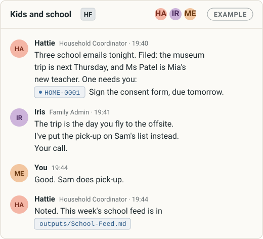
</p>

> [!NOTE]
> That exchange is an example, not one of the screenshots below. An Agent can only spot a
> clash like this if your travel is on record: you told it, a work Team holds it, or you
> switched on a calendar connector for that Agent.

## 2. A Team in a Room

Huddle is an app that runs on your own computer. You get a team of AI Agents, each with one
job, and you talk to them in Rooms, like a group chat. They don't just answer: they pick up
work, hand it to each other and bring you the result.

One rule makes a Room easy. Alone with you, an Agent answers everything you say. In a bigger
Room, an Agent answers when you mention it, like `@hattie`, and `@all` wakes everyone. You're
in every Room, so you see all the work, even the bits nobody asked you about.

<picture>
  <source media="(prefers-color-scheme: dark)" srcset="screens/team-room--cobalt-soft-dark.png">
  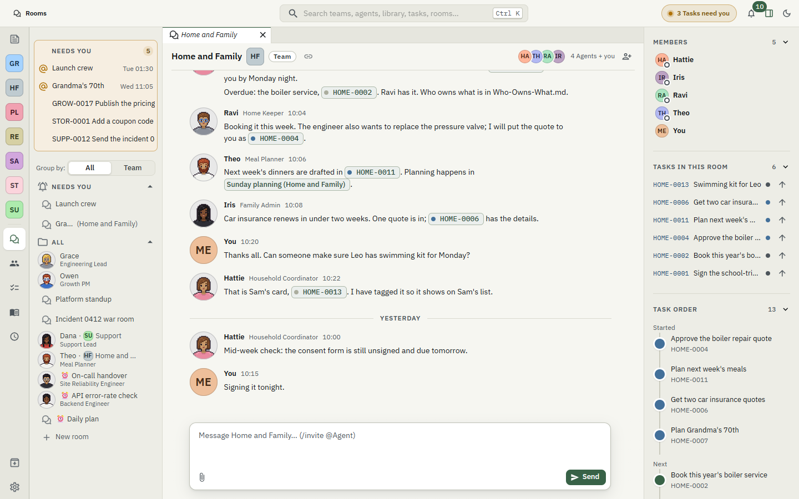
</picture>

The blue chips, like `HOME-0004`, are Tasks. Agents can also answer each other; after a set
number of replies without you, the Room pauses and asks whether to go on.

## 3. Tasks

Chat is where you talk. Tasks are where things actually get done, and where you can check that
they were. Every Task has one owner, a status and a due date, and its Timeline remembers what
happened. Assigning a Task to an Agent wakes that Agent up to work on it.

<picture>
  <source media="(prefers-color-scheme: dark)" srcset="screens/board--cobalt-soft-dark.png">
  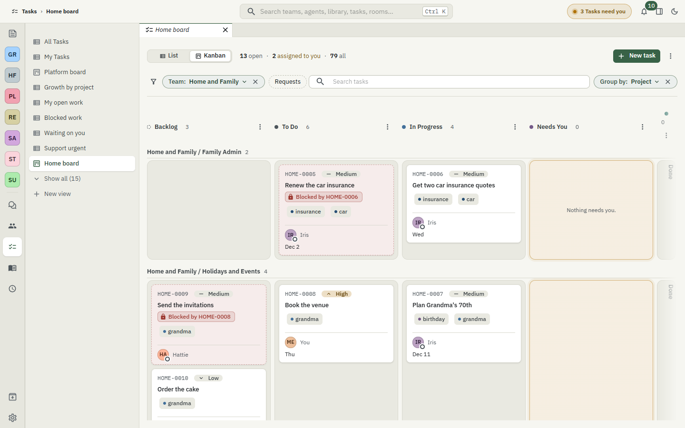
</picture>

You don't have to make Tasks yourself: say "remind me to…" or "can someone…" and the right
Agent files it. Each Task is one Markdown file in the Team's `_tasks/` folder, so you can edit
it by hand and Huddle picks the change up.

<picture>
  <source media="(prefers-color-scheme: dark)" srcset="screens/task--cobalt-soft-dark.png">
  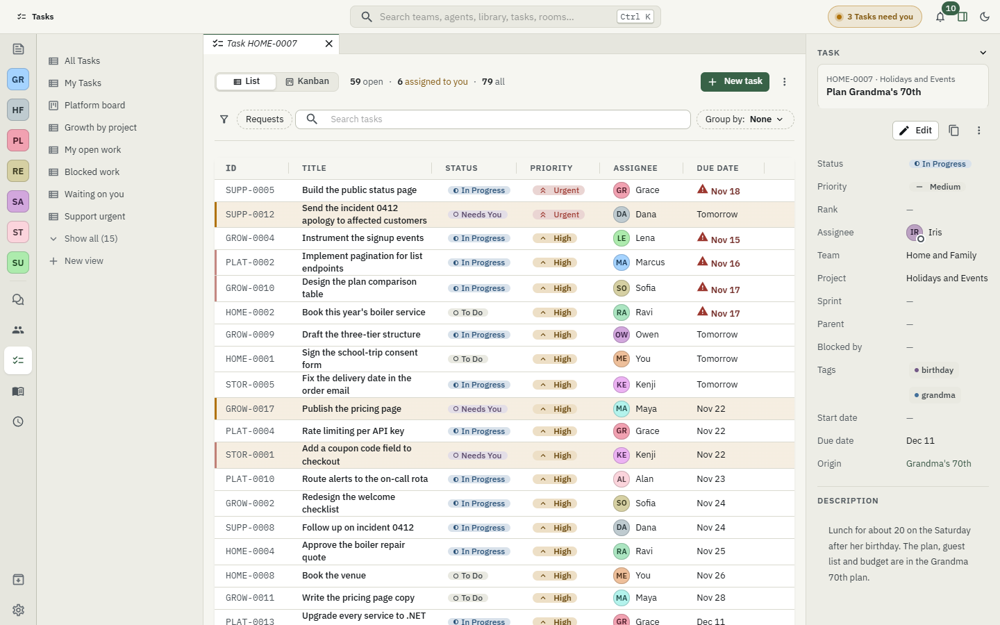
</picture>

## 4. The big stuff waits for you

Your team does a lot on its own, but some things are yours to decide. Everything waiting on you
gathers in **Needs you**: a question, a mention, a Room that paused to ask before going on.
Anything that leaves the house, like paying, sending, publishing or pushing code, waits for your
**Accept**. The team gets it ready, with its proof; you make the call.

<picture>
  <source media="(prefers-color-scheme: dark)" srcset="screens/needs-you--cobalt-soft-dark.png">
  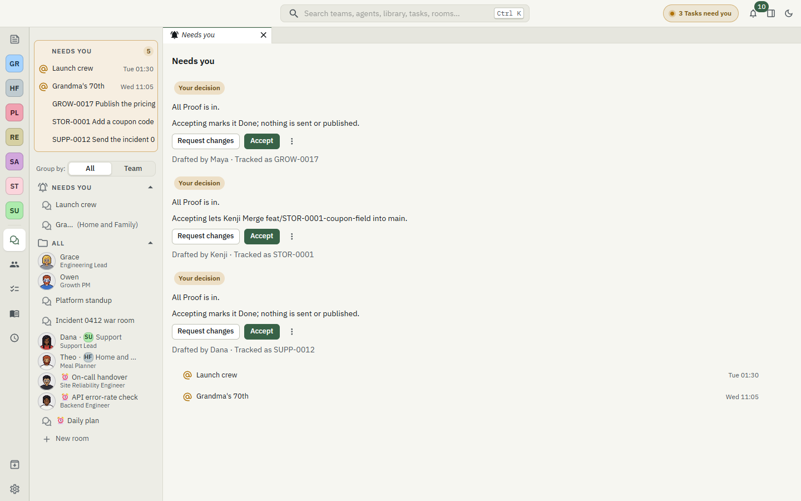
</picture>

A Task waiting for your Accept stays there until you decide. Nothing goes ahead because you were
busy.

## 5. Your second brain

Here's what makes Huddle different from a chat app: nothing important gets lost in a
conversation. Every Team keeps the same folders:

| Folder | Holds |
| --- | --- |
| `raw/` | Originals, as they arrived: the school letter, the PDF |
| `memory/` | Facts worth remembering, one topic per file |
| `outputs/` | Documents worth reading again |
| `_tasks/` | Tasks |

And `AGENTS.md` holds the rules, at three levels: all of Huddle, one Team, one Project. Agents
don't reread everything every time: they get an index of what exists and open what they need.

<picture>
  <source media="(prefers-color-scheme: dark)" srcset="screens/library--cobalt-soft-dark.png">
  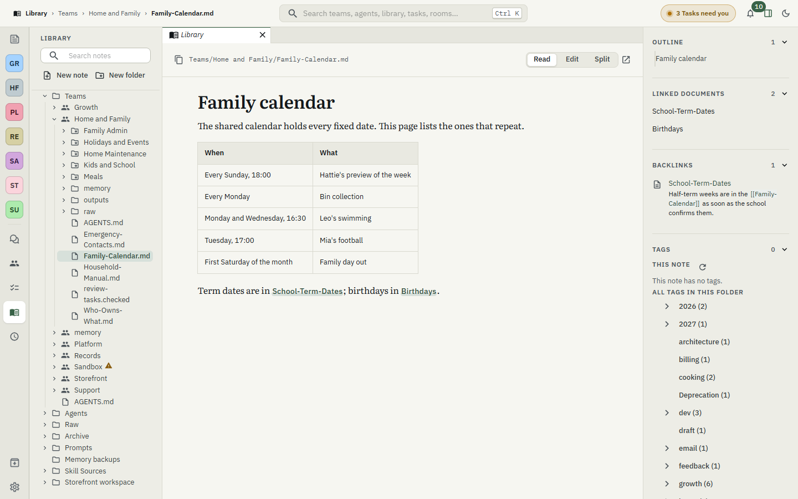
</picture>

Telling the Chief of Staff something files it in the right place:

| You say | It becomes |
| --- | --- |
| A fact about a Team | A note in that Team's Memory |
| Something dated, or an idea you haven't decided on | A Task |
| A rule | A proposed line in `AGENTS.md`, added once you agree |

They're plain Markdown in your data folder, and notes link to each other with `[[…]]`,
Obsidian-style. Once a week, Memory Tidy merges and shortens notes, copies each file first, and
lists every change in the Feed.

## 6. A development team

Now the same idea for code. The usual way to build with AI is one capable agent that does the
lot. Here's its log for one small feature:

```diff
  Read the issue: add a coupon field at checkout
  Wrote the coupon service and the form field
  Wrote tests for the coupon service
- Ran the tests: all pass
- Reviewed the change: looks good
- Merged into main
```

The agent that wrote the code also tested it, reviewed it and shipped it, and "all pass" is its
own word, with nothing anyone can check.

In Huddle you hire a whole team from the **Development Team** type: a manager, a tech lead,
developers, a reviewer, a security engineer, a QA engineer, a release engineer and a retro
agent. You pick the roles you want, and each is its own Agent, so the critic didn't write the
work.

<picture>
  <source media="(prefers-color-scheme: dark)" srcset="screens/build-team--cobalt-soft-dark.png">
  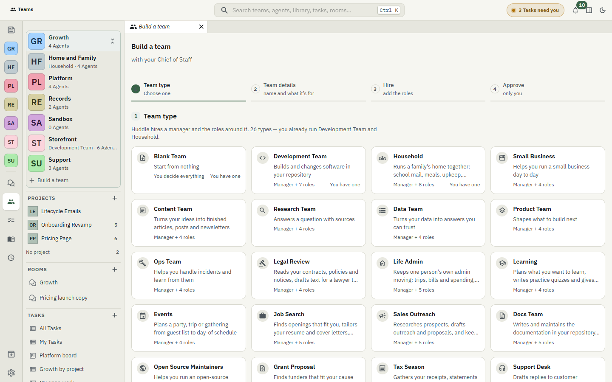
</picture>

<picture>
  <source media="(prefers-color-scheme: dark)" srcset="screens/dev-team--cobalt-soft-dark.png">
  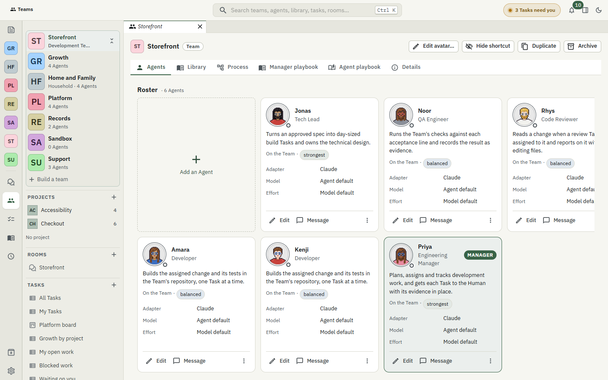
</picture>

The team works in your own repository. The manager splits your request into Tasks, a developer
works on a branch named after its Task, and the reviewer and QA report back in the Team's Room:

<picture>
  <source media="(prefers-color-scheme: dark)" srcset="screens/dev-room--cobalt-soft-dark.png">
  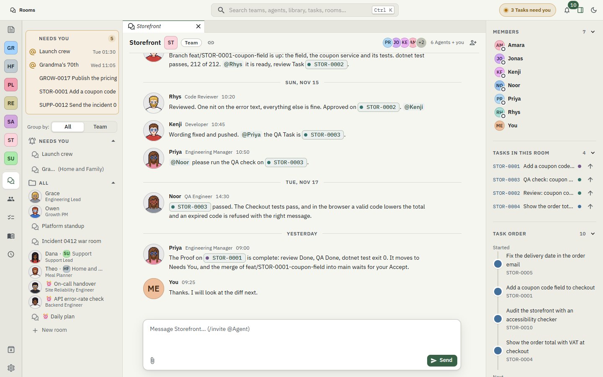
</picture>

Its process carries gates that Huddle checks, not just asks for:

- **QA evidence before Done:** a Task can't close until a verifier has recorded a test run.
- **Checks before merge:** a merge or push waits until the team's check command has passed.
- **Accept before merge:** merging into main waits for your Accept.

<picture>
  <source media="(prefers-color-scheme: dark)" srcset="screens/dev-task--cobalt-soft-dark.png">
  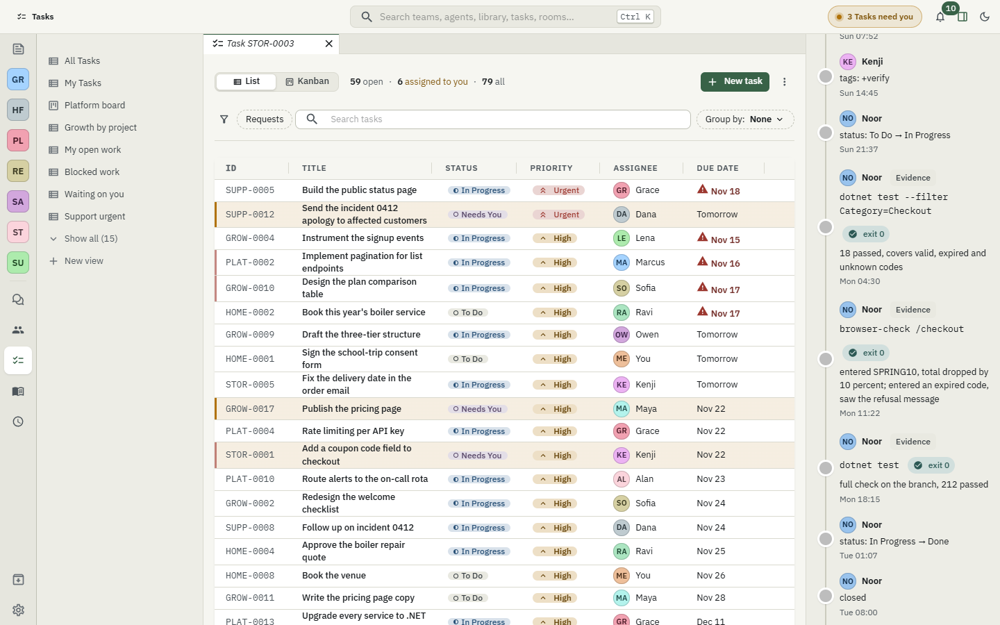
</picture>

You choose how they work: a lightweight flow, a spec you sign off before code is written,
sprints, or a maintenance mode where every fix starts with a failing test.

> [!WARNING]
> The gates catch an Agent's ordinary mistakes; they are not a security boundary. For a hard
> guarantee, protect your main branch on your git server too.

## 7. Catching up

Been away? The **Feed** is one list of everything your team did while you were gone: Tasks they
created, Rooms they started, documents they changed. The bell only rings for what needs you.

<picture>
  <source media="(prefers-color-scheme: dark)" srcset="screens/feed--cobalt-soft-dark.png">
  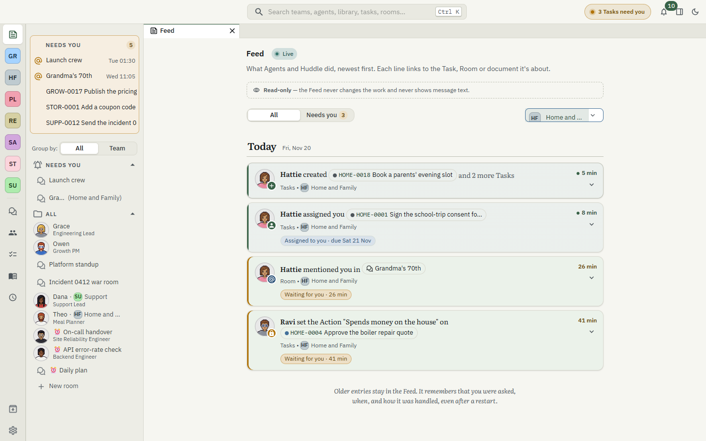
</picture>

Anything worth doing on a timetable, like a weekday morning review or a weekly notes check, can
be a scheduled Job. The Chief of Staff offers them, and sets each one up only if you say yes.

## 8. Staying in control

Three honest answers people usually want:

- **Cost.** Every Agent uses your Claude plan while it works, so small teams are the norm. A
  Room pauses and asks you before it runs on for long, and **Settings › Spending** shows what
  each Team and Agent has cost. Spending is reported, not capped.
- **Your data.** Everything is plain files on your own computer. The Agents run on your Claude
  account, which sees what they work on.
- **Permissions.** Each Agent has its own browser: reading is free, and every click or typed
  character asks you first. Account connectors such as email start off, are switched on per
  Agent, and each use asks first.

The **Needs You level** decides how much of a Team's work waits for you, and says plainly what
it cannot catch:

<picture>
  <source media="(prefers-color-scheme: dark)" srcset="screens/needs-you-level--cobalt-soft-dark.png">
  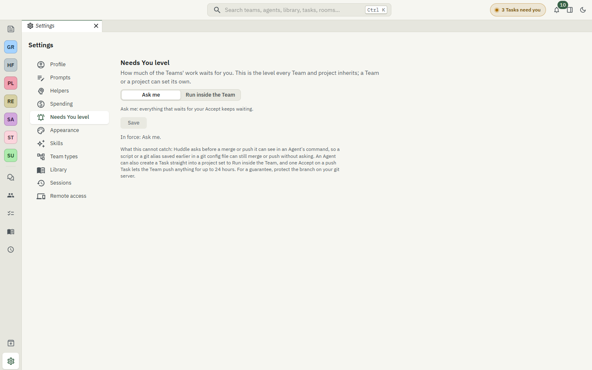
</picture>

## 9. Your first team

What's on your plate right now? Huddle ships a ready-made type for most of it. A few:

| On your plate | Start with |
| --- | --- |
| School mail, meals, the house, bills | **Household** |
| A codebase | **Development Team**, or **Docs Team**, **Ops Team**, **Open Source Maintainers** |
| Your own admin, a move, tax season | **Life Admin**, **Relocation**, **Tax Season** |
| A job hunt | **Job Search** |
| Looking after someone | **Caregiving** |
| A question that needs sources | **Research Team** |
| Running a small business | **Small Business**, **Sales Outreach**, **Support Desk** |

Nothing fits? The Chief of Staff builds a team from scratch around your goal. Either way it
drafts the team with you first: you can change names, faces and roles, and nobody is hired
until you press **Approve & hire**.

**Ready?** One command installs Huddle, with no admin rights. See
[Try it](../README.md#try-it) for Windows and Apple Silicon macOS. It opens in your browser with
the Chief of Staff, who builds that first team with you.

Questions the tour didn't answer? [The user guide](../docs/Huddle.UserGuide.md) covers
everything, or [ask your AI assistant](README.md) to give you the conversational version.
